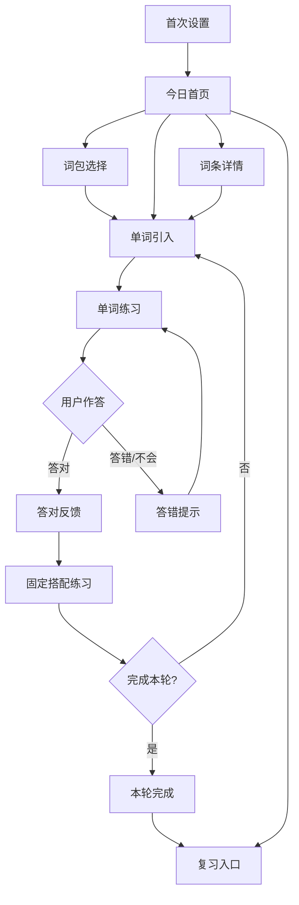

# SayAgain Android 首发原型设计 v0.1

> **状态：可评审低保真原型**  
> 日期：2026-10-13  
> 对应 PRD：`ARCHIVE-PRD-ANDROID-v0.1.md`

## 0. 这份文档解决什么问题

PRD 定义“做什么”，本文件定义“用户如何使用”和“页面如何组织”。它是低保真交互原型，不是最终视觉稿，也不是 Android 实现方案。

本版本覆盖一条可完整评审的首发闭环：

> 首次进入 → 选择每日目标 → 今日首页 → 开始学习 → 单词引入 → 单词回忆练习 → 答错提示/答对反馈 → 固定搭配练习 → 本轮完成 → 进入复习

## 1. 原型范围与工作假设

### 1.1 P0 页面

1. 欢迎/首次设置
2. 今日首页
3. 词包选择
4. 单词引入
5. 单词练习
6. 反馈状态
7. 固定搭配练习
8. 本轮完成
9. 复习入口
10. 词条详情
11. 设置

### 1.2 工作假设（尚未冻结）

- 首发用户：成人基础英语学习者；界面避免幼儿化。
- 解释语言：中文占位。
- 内容主题：日常生活。
- 数字人：一个动漫学习伙伴，暂名 **Milo**；名字、性别和美术风格待确认。
- 核心学习可离线完成。
- 首发先免费内测，不设计复杂付费流程。

### 1.3 不在本原型范围

- 语音评分、自由聊天、完整阅读/写作课程。
- 多角色商城、排行榜、社交关系。
- 复杂游戏化地图。
- 最终角色立绘和动画资产。

## 2. 信息架构

```text
启动
 ├─ 首次设置
 │   ├─ 学习目标
 │   ├─ 每日数量
 │   └─ 选择主题/开始
 └─ 已有用户
     └─ 今日首页
         ├─ 今日学习
         │   ├─ 单词学习
         │   ├─ 固定搭配
         │   └─ 本轮完成
         ├─ 复习
         │   ├─ 到期复习
         │   └─ 薄弱项（P1 占位）
         ├─ 词包
         └─ 我的
             ├─ 学习记录
             ├─ 设置
             └─ 关于
```

### 2.1 底部导航

首发使用 3 个一级入口，避免把学习功能拆得过细：

- **今天**：今日任务、继续学习、复习提醒。
- **词包**：浏览和选择主题词包。
- **我的**：学习记录、学习偏好、设置。

学习过程中隐藏底部导航，避免误触；系统返回键回到上一个安全节点。

## 3. 页面导航图



## 4. 端到端主流程

### Flow A：首次进入

**目标：** 在 60 秒内完成最小设置并开始第一轮学习。

```text
[欢迎]
  ↓ 点击“开始学习”
[学习目标] --跳过--> [每日目标默认 10 个]
  ↓
[选择主题：日常生活]
  ↓
[今日首页]
  ↓ 点击“开始今日学习”
[单词引入]
```

- 允许跳过非必要设置。
- 不要求注册、手机号或联网。
- 设置完成后本地保存；用户下次直接进入今日首页。

### Flow B：单词学习闭环

**目标：** 让用户完成“理解 → 支持下回忆 → 独立回忆 → 反馈”。

```text
[单词引入]
  ├─ 听发音
  ├─ 查看例句
  └─ 点击“我准备好了”
       ↓
[单词练习]
  ├─ 选择中文含义
  ├─ 查看提示
  ├─ 看答案
  └─ 提交
       ↓
[反馈]
  ├─ 答对：鼓励 + 进入下一题
  └─ 答错：解释 + 再试一次/稍后复习
```

### Flow C：退出恢复

- 在每一道题提交后保存进度，不等待本轮结束。
- 用户中途返回首页：显示“继续学习（已完成 3/10）”。
- 重新打开：恢复到最近一个未完成内容，不重复播放欢迎动画。
- 当前题尚未提交：恢复题目，但不恢复用户未提交的选项。

## 5. 低保真线框

> 线框只表达布局、层级和交互，不代表最终颜色和插画。

### 5.1 欢迎/首次设置

```text
┌─────────────────────────────┐
│                         跳过 │
│                             │
│        [数字人插画区]        │
│       Hi, I'm Milo!         │
│   每天几分钟，一起学会表达   │
│                             │
│       [ 开始学习 ]           │
│                             │
│  已有进度？ [恢复学习]       │
└─────────────────────────────┘
```

交互：
- “开始学习”进入目标设置。
- “跳过”使用默认设置：每日 10 个、日常生活、中文解释。
- 数字人只做一次轻量欢迎，不阻塞进入内容。

### 5.2 今日首页

```text
┌─────────────────────────────┐
│ 早上好，Alex          ⚙     │
│                             │
│  今日学习                     │
│ ┌─────────────────────────┐ │
│ │ [数字人小卡]             │ │
│ │ 今天一起掌握 10 个表达   │ │
│ │ 已完成 3/10              │ │
│ │ [继续学习]               │ │
│ └─────────────────────────┘ │
│                             │
│ 待复习  6        连续 2 天   │
│ [开始复习]                  │
│                             │
│ 今日词包：日常生活           │
│ [更换词包]                  │
│                             │
│ 今天     词包       我的     │
└─────────────────────────────┘
```

状态：
- 未开始：主按钮“开始今日学习”。
- 进行中：主按钮“继续学习”。
- 已完成：主按钮“再练一轮”，复习卡片仍保留。
- 空内容：说明“正在准备下一组内容”，提供重新加载。

### 5.3 词包选择

```text
┌─────────────────────────────┐
│ ← 选择词包                   │
│ [搜索词包]                  │
│                             │
│ 推荐                         │
│ ┌─────────────────────────┐ │
│ │ 日常生活                 │ │
│ │ 120 个词 · 入门          │ │
│ │ [开始]                   │ │
│ └─────────────────────────┘ │
│                             │
│ 我的词包                    │
│ 工作沟通   旅行基础（锁定）  │
└─────────────────────────────┘
```

首发只需一个可用词包；其他词包可以作为占位，不制造“内容很多但不可用”的错觉。

### 5.4 单词引入页

```text
┌─────────────────────────────┐
│ ← 今日学习              3/10 │
│                             │
│        [数字人指向图片]      │
│                             │
│          apple              │
│        /ˈæpəl/       🔊     │
│          苹果               │
│                             │
│  例句：I eat an apple.      │
│  我吃一个苹果。         🔊   │
│                             │
│  Milo：注意第一个音节。      │
│                             │
│       [我准备好了]           │
│       [稍后再学]             │
└─────────────────────────────┘
```

交互：
- 点击音频按钮播放；重复点击不叠加多个播放实例。
- 点击词义/例句可展开更详细内容。
- “稍后再学”将内容放入稍后复习队列，不视为掌握。

### 5.5 单词练习页：选择含义

```text
┌─────────────────────────────┐
│ 认识它的意思吗？        3/10 │
│                             │
│             apple           │
│              🔊             │
│                             │
│  ┌─────────────────────────┐ │
│  │ A. 苹果                 │ │
│  └─────────────────────────┘ │
│  ┌─────────────────────────┐ │
│  │ B. 橙子                 │ │
│  └─────────────────────────┘ │
│  ┌─────────────────────────┐ │
│  │ C. 香蕉                 │ │
│  └─────────────────────────┘ │
│                             │
│ [提示：看图片]     [我不会]  │
└─────────────────────────────┘
```

规则：
- 选择后立即显示选中态，但点击“提交”前不判定。
- “我不会”直接进入答错提示，不制造失败惩罚。
- 选项顺序应由内容配置确定并避免固定位置答案。

### 5.6 答对反馈

```text
┌─────────────────────────────┐
│              ✓              │
│       Great! 答对了         │
│                             │
│    [数字人点头/轻微庆祝]      │
│                             │
│  apple = 苹果                │
│  I eat an apple.            │
│                             │
│       [下一题]               │
└─────────────────────────────┘
```

反馈不得只显示“正确”；必须至少重复一次目标词、核心义和一个例句/搭配。

### 5.7 答错提示

```text
┌─────────────────────────────┐
│              !              │
│       还差一点，再看一眼     │
│                             │
│       [图片/数字人指向]       │
│       apple = 苹果           │
│       /ˈæpəl/          🔊    │
│                             │
│  记忆提示：想想午餐时吃的水果 │
│                             │
│ [再试一次]   [看答案并继续]   │
└─────────────────────────────┘
```

错误反馈不使用羞辱性文案；“看答案并继续”记录为低独立回忆，不阻塞流程。

### 5.8 固定搭配练习页

```text
┌─────────────────────────────┐
│ 固定搭配                1/3  │
│                             │
│  Please ___ the door.       │
│  请关上门。                 │
│                             │
│  ┌─────────────────────────┐ │
│  │ A. close                │ │
│  └─────────────────────────┘ │
│  ┌─────────────────────────┐ │
│  │ B. open                 │ │
│  └─────────────────────────┘ │
│  ┌─────────────────────────┐ │
│  │ C. make                 │ │
│  └─────────────────────────┘ │
│                             │
│ Milo：这个动词常和 door 一起用 │
│ [提交答案]                  │
└─────────────────────────────┘
```

固定搭配不是脱离词义的额外游戏；它必须复用刚学习的目标词，帮助用户从“知道词”迁移到“会用”。

### 5.9 本轮完成

```text
┌─────────────────────────────┐
│          本轮完成             │
│                             │
│       [数字人击掌/挥手]       │
│    今天完成了 10 个内容       │
│                             │
│  独立答对        7            │
│  需要复习        3            │
│                             │
│ [进入复习]   [回到首页]       │
│                             │
│ 明天回来，我们继续。          │
└─────────────────────────────┘
```

数字只作为反馈，不把“答题数量”包装成能力等级。

### 5.10 复习入口

```text
┌─────────────────────────────┐
│ 复习                         │
│                             │
│ 今天有 6 个内容需要复习      │
│ ┌─────────────────────────┐ │
│ │ 逾期 2 个               │ │
│ │ 需要巩固 4 个           │ │
│ │ [开始复习]              │ │
│ └─────────────────────────┘ │
│                             │
│ 稍后再学                     │
│ 3 个内容                    │
│ [查看列表]                  │
└─────────────────────────────┘
```

## 6. 页面状态规范

所有页面至少设计以下状态：

| 状态 | 规范 |
|---|---|
| Loading | 显示骨架或明确加载提示；数字人不做长时间循环动画 |
| Empty | 解释为什么为空，并给出唯一主行动 |
| Error | 说明问题、保留已保存进度、提供重试 |
| Offline | 核心本地内容可继续；需要网络的功能标注“联网后可用” |
| Disabled | 明确不可用原因，不只降低透明度 |
| Success | 通过颜色、图标、文案三者至少两种表达；不依赖颜色单独传达 |
| Wrong | 先给线索，再给答案；不清空已学记录 |
| Exit | 每次提交后自动保存，离开时不要求额外确认 |

## 7. 数字人出现规则

### 7.1 应该出现

- 首次进入：欢迎和说明学习目标。
- 新词引入：指向图片或情境中的目标对象。
- 发音播放：做“听”的提示动作，不模拟夸张口型除非资产可靠。
- 答错：给一个语义或情境提示。
- 答对：轻量点头、击掌或鼓励。
- 本轮完成：总结和引导复习。

### 7.2 不应该出现

- 每一次点击都弹出角色。
- 角色遮挡单词、选项或系统返回区域。
- 使用连续语音强迫用户等待动画结束。
- 以“角色失望”制造负面压力。

### 7.3 占位尺寸

- 手机竖屏时数字人占屏幕高度约 18%–26%。
- 内容页数字人位于上半区或顶部辅助区，题干和答案始终优先。
- 小屏设备隐藏大动作，改为头像/气泡提示。

## 8. 组件规格（低保真到实现的接口）

### 8.1 LearningProgress

**用途：** 显示当前学习位置和可恢复状态。

```text
props:
- current: Int
- total: Int
- label: String
- onBack: () -> Unit
```

状态：正常、保存中、保存失败。保存失败时不阻塞下一题，但显示可重试提示。

### 8.2 DigitalTutorCard

```text
props:
- mood: neutral | encouraging | hint | celebrating
- message: String?
- illustration: AssetRef?
- action: playAudio | showHint | none
```

要求：文字消息必须可被屏幕阅读器读取；动画不可承担唯一信息。

### 8.3 AnswerOption

```text
props:
- id: String
- text: String
- selected: Boolean
- result: none | correct | incorrect | revealed
- enabled: Boolean
- onSelect: () -> Unit
```

### 8.4 FeedbackPanel

```text
props:
- result: correct | incorrect | revealed
- target: LearningItem
- explanation: String
- nextLabel: String
- onNext: () -> Unit
```

### 8.5 AudioButton

必须包含播放中、暂停、失败、无音频四种状态；点击区域不小于 48dp。

## 9. 内容示例

### 单词

```text
id: daily.apple
spelling: apple
meaning: 苹果
pronunciation: /ˈæpəl/
example: I eat an apple.
example_zh: 我吃一个苹果。
image: apple_01
```

### 固定搭配

```text
id: daily.close_the_door
expression: close the door
meaning: 关门
example: Please close the door.
example_zh: 请关上门。
linked_word: close
question_type: sentence_completion
```

## 10. 验收用例

| 编号 | 场景 | 预期 |
|---|---|---|
| P-01 | 新用户点击开始学习 | 60 秒内进入第一道题 |
| P-02 | 用户跳过设置 | 使用默认目标并进入首页 |
| P-03 | 播放单词音频 | 音频可重复播放且不会叠音 |
| P-04 | 用户答对 | 显示词、义、反馈并可进入下一题 |
| P-05 | 用户答错 | 显示提示和答案选项，不丢失进度 |
| P-06 | 用户选择“我不会” | 记录低回忆结果并进入可恢复流程 |
| P-07 | 用户中途退出 | 回到首页显示继续学习位置 |
| P-08 | 设备离线 | 已下载内容仍可学习，网络功能明确标记 |
| P-09 | 完成单词后 | 至少出现一组与目标词关联的固定搭配 |
| P-10 | 开启 TalkBack | 题干、选项、反馈和进度有合理朗读顺序 |
| P-11 | 小屏设备 | 内容不被数字人和底部按钮遮挡 |
| P-12 | 内容包异常 | 显示可恢复错误，不进入死循环 |

## 11. 评审结论门槛

原型进入技术方案阶段前，必须确认：

- [ ] 首发用户和解释语言
- [ ] 每日学习量的默认值和可选范围
- [ ] 单词练习题型是否保留“选择含义”和“情境回忆”两类
- [ ] 固定搭配是否首发必做，还是作为可选加餐
- [ ] 数字人是一个角色还是多个角色
- [ ] 角色是否需要真人语音，还是首发仅使用词条音频
- [ ] 首页、学习页、复习页的信息架构
- [ ] 离线内容包是否为 P0

确认后才进入：`技术选型与技术方案-v0.1.md`。
