# OpenHands Software Agent SDK 源码深读与运行时校准（2026）

> 本文是对现有 SDK 架构文档的追加层，不替换原文。核对日期：2026-10-15。源码基线：`software-agent-sdk` 当前工作树 HEAD `152573531c59a357b67bd58854b36a793f29dca7`。重点核对 `openhands-sdk` 的 `LocalConversation`、`AgentBase`、事件日志、Workspace、MCP/Tool、Condenser 与 Agent Server 之间的边界。
>
> 标记：**[源码]** 可由符号直接核对；**[推论]** 来自多个模块的组合；**[建议]** 面向后端集成和生产部署。

## 目录

- [1. 代码地图与双循环](#1-代码地图与双循环)
- [2. SDK 运行时对象关系](#2-sdk-运行时对象关系)
- [3. LocalConversation 的真实执行边界](#3-localconversation-的真实执行边界)
- [4. EventLog 与事件溯源](#4-eventlog-与事件溯源)
- [5. View、Condenser 与上下文预算](#5-viewcondenser-与上下文预算)
- [6. Tool、MCP 与安全确认](#6-toolmcp-与安全确认)
- [7. Workspace 与外部副作用](#7-workspace-与外部副作用)
- [8. 多 Agent、ACP 与生命周期](#8-多-agentacp-与生命周期)
- [9. SDK 到 Agent Server 的时序](#9-sdk-到-agent-server-的时序)
- [10. 源码缺口与后端建议](#10-源码缺口与后端建议)
- [11. 源码索引](#11-源码索引)
- [12. 三层同步机制与真实故障边界](#12-三层同步机制与真实故障边界)
- [13. 静态可定位的订阅异常清理缺口](#13-静态可定位的订阅异常清理缺口)

## 1. 代码地图与双循环

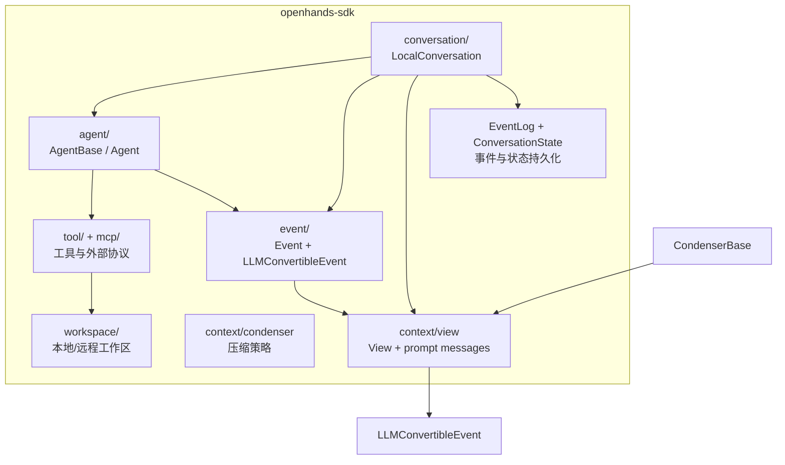

SDK 里有两个不能混淆的循环：

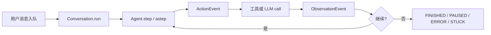

- **外层 Conversation loop**：由 `LocalConversation._run()` 控制迭代、预算、暂停、确认和终止状态。
- **内层 Agent step**：由 Agent 生成动作并执行工具；每个动作和观察都成为事件。
- **[推论]** View/Condenser 不执行 Agent，它们负责把事件日志投影成下一次 LLM 可见的上下文。

## 2. SDK 运行时对象关系

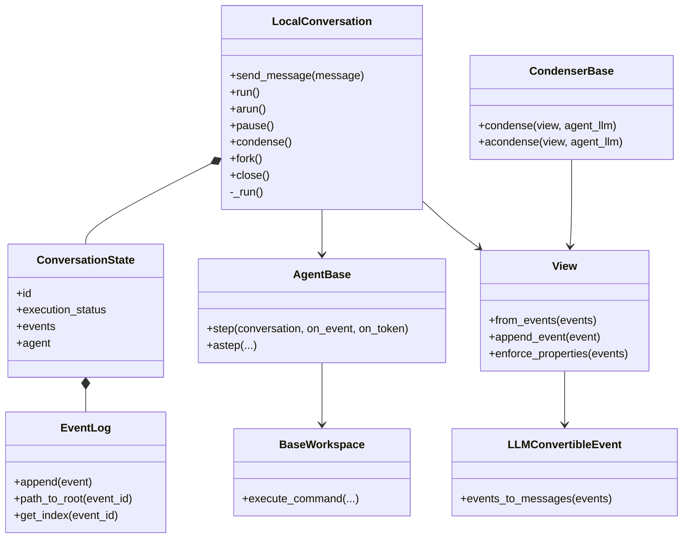

类图将部分内部持有关系投影为公共阅读视图；`ConversationState.events` 背后是私有 `_events`，Workspace 的文件/API 能力由具体实现补充。

**状态所有权表**：`ConversationState` 是当前运行状态；`EventLog` 是可追溯历史；`View` 是临时投影；`Workspace` 是外部副作用边界。保存事件并不等于保存工作区快照，fork conversation 也不天然复制远程服务或外部进程。

## 3. LocalConversation 的真实执行边界

`send_message()` 只接收 user 消息并写入状态；`run()` 初始化 agent、创建取消 token、把状态切到 RUNNING，然后循环调用 `agent.step()`。每次 step 都在状态锁内保护关键状态，事件通过 `_on_event` 写入日志/通知订阅者。

```python
# 源码语义压缩版，不是可直接复制的完整实现。
def run(self):
    self._ensure_agent_ready()
    self._cancel_token = CancellationToken()
    with self._state:
        self._state.execution_status = RUNNING
    while True:
        with self._state:
            if self._state.execution_status in {PAUSED, STUCK}:
                break
            self._step_holds_state_lock = True
            try:
                self.agent.step(self, on_event=self._on_event, on_token=self._on_token)
            finally:
                self._step_holds_state_lock = False
        if self._should_stop_or_budget_exceeded():
            break
```

关键语义：

1. `FINISHED` 不会在每一轮立即让 loop 退出，以便并发到达的用户消息在 FIFO lock 后把状态重置为 IDLE，避免被丢弃。
2. 达到 `max_iteration_per_run` 会生成 `ConversationErrorEvent`，但如果最后一步已经 FINISHED，则保留 FINISHED。
3. LLM 认证错误和一般异常会进入 ERROR，并尽量避免重复写入错误事件。
4. `pause()`、确认等待和取消不是同一种状态：确认暂停意味着等待用户决策，取消意味着当前运行应停止，错误意味着需要恢复/重试策略。

## 4. EventLog 与事件溯源

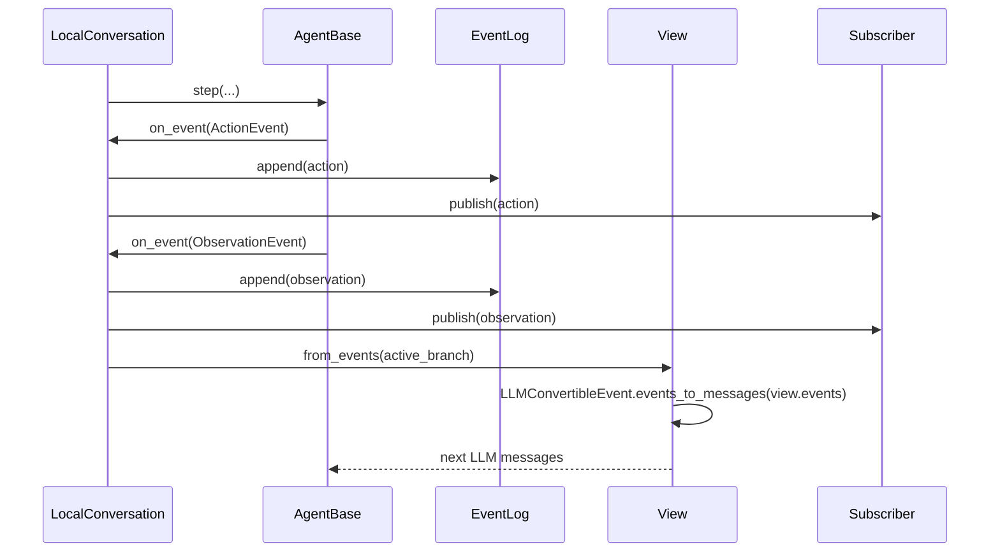

`EventLog` 通过事件 id、父关系、磁盘索引和长度 marker 支持追加、按路径读取和恢复。事件不是简单日志字符串：它们携带 action、observation、LLM response id、工具调用和状态变化，且要能转换为 provider 消息。

**[建议]** 后端应区分三个游标：已持久化事件序号、已推送给客户端的事件序号、LLM 已消费的 View 位置。WebSocket 重连不能只依赖“最后一个 token”，应按 event id/sequence 补发。

## 5. View、Condenser 与上下文预算

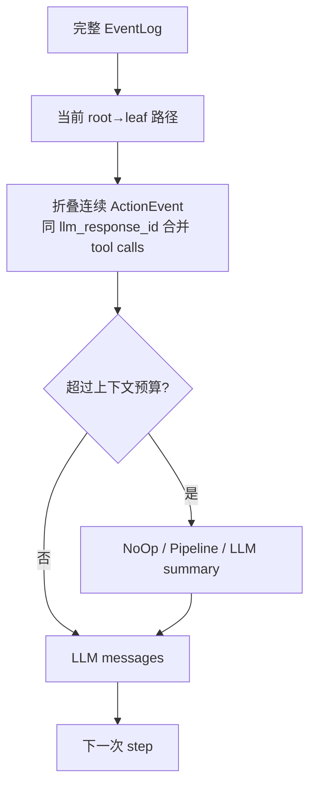

View 是从事件历史到 prompt 的投影，不是永久历史；Condenser 改变的是可见上下文，不应删除原始 EventLog。压缩结果需要与当前 root、模型、token 预算和策略版本绑定，否则恢复后同一事件链可能生成不同 prompt。

## 6. Tool、MCP 与安全确认

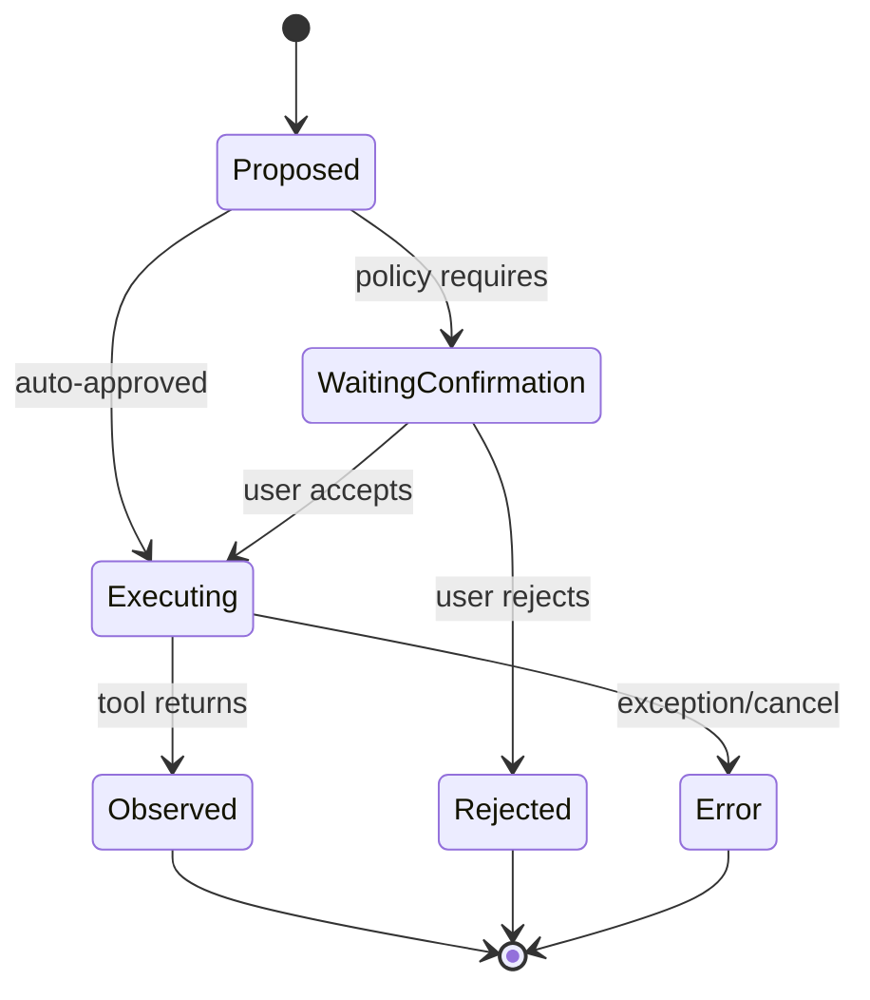

工具 schema、风险等级、确认策略和客户端工具是不同层：

- SDK `Tool` 描述可调用能力；
- MCP provider 将外部 server 能力转换成 SDK 工具；
- `ConfirmationPolicy` 决定是否停在 pending；
- Agent Server/Canvas 负责把 pending action 转成 UI/协议请求；
- workspace/sandbox 决定实际副作用发生在哪里。

**[推论]** 确认事件写入 EventLog 只记录事实，不提供授权本身。恢复时必须验证 conversation、pending action、调用者和确认策略仍匹配，不能仅凭历史中存在一个 action 就执行。

## 7. Workspace 与外部副作用

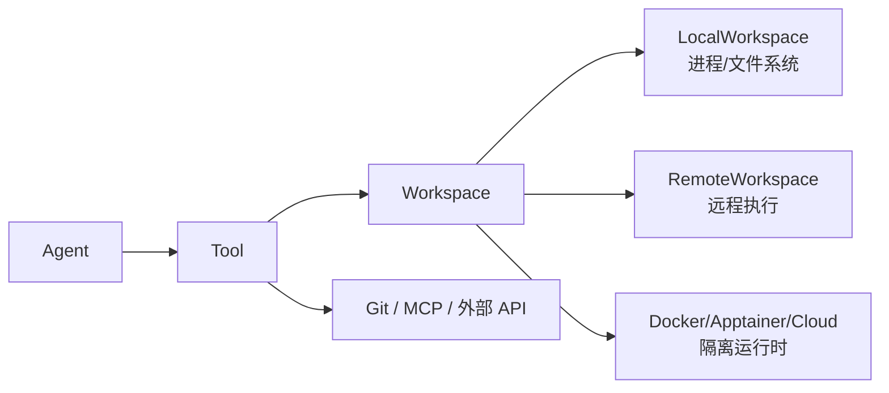

SDK 的 workspace 抽象隔离路径和执行入口，但“工作区状态”不自动随 EventLog 回滚。代码写入、git commit、安装包、网络调用都有各自一致性和补偿语义。**建议**将 workspace 标识、镜像/运行时版本、权限策略和 git worktree 记录到 conversation metadata，而不是只保存工作目录字符串。

## 8. 多 Agent、ACP 与生命周期

`TaskTool`/`AgentDefinition`、`SubAgentScope`/子 Agent registry 和 ACPAgent 形成不同的多 Agent 路径：同进程子 Agent、Agent Server 管理的子会话、外部 CLI/ACP 子进程不能用同一套“共享状态”解释。

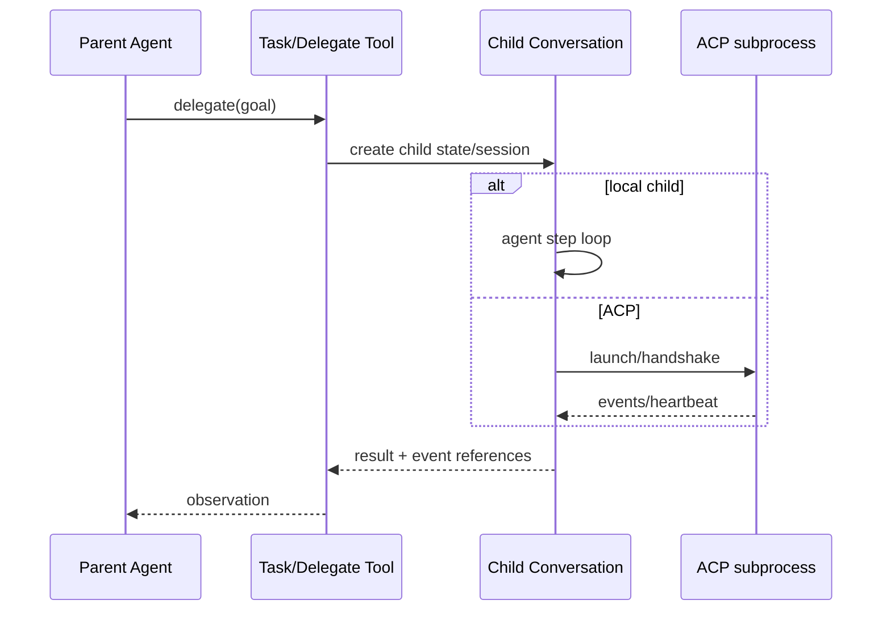

资源所有权必须明确：子会话、ACP 进程、MCP client、workspace、订阅者和线程池都需要在 `close`、异常和取消路径释放。删除子会话目录不等于终止 ACP 或远程任务。

## 9. SDK 到 Agent Server 的时序

```mermaid
sequenceDiagram
  participant UI as Canvas/CLI
  participant API as Agent Server API
  participant ES as EventService
  participant LC as LocalConversation
  participant EL as EventLog
  participant WS as WebSocket subscribers
  UI->>API: POST conversation/message
  API->>ES: send_message / start run
  ES->>ES: start claims lease; run reserves RunSlot
  ES->>LC: send_message + run/arun
  LC->>EL: append events
  LC-->>ES: on_event/on_token
  ES-->>WS: pub/sub event stream
  ES-->>API: status / event cursor
  UI->>API: reconnect with cursor
  API-->>UI: replay persisted events + live tail
```

Agent Server 的 `EventService` 增加了 SDK 没有的宿主职责：run slot、后台 task、lease renewal、持久化元数据、订阅、凭据绑定、状态查询和协议路由。`ConversationLease` 解决的是“谁可以写这个持久化会话”的宿主问题；SDK 的 `FIFOLock` 解决的是进程内状态访问顺序，二者不能互换。

## 10. 源码缺口与后端建议

### 10.1 已有能力，不应误报为缺失

- Conversation loop 已有暂停、预算、确认、异常状态和取消 token；
- EventLog 已有磁盘追加与索引；
- Condenser 已把上下文压缩与原始事件区分；
- Agent Server 已有 lease、run slot、WebSocket pub/sub 和持久化分层；
- SDK/Server 已区分本地 Conversation 与远程/ACP 路径。

### 10.2 文档缺口与后端待验证项

以下是需要补充契约或故障演练的项目，不表示相应实现完全不存在；建议项须经测试才能升级为已证实的源码缺陷。

| 项目 | 风险 | 建议 |
|---|---|---|
| WebSocket 恢复边界验证 | 已有 cursor/replay；乱序与坏事件仍需验证 | 核对 after_seq、gap 上限、慢订阅者断开 |
| lease 与外部副作用 | lease 丢失时工具仍在执行 | 工具幂等键、租约失效处理、补偿查询 |
| EventLog 与 metadata 双写 | 一边成功一边失败 | 明确恢复扫描和状态重建策略 |
| ACP 子进程回收 | orphan process/孤儿 workspace | owner registry + shutdown drain |
| snapshot/事件版本 | 升级后无法恢复 | schema version + migration + golden fixtures |
| confirmation 恢复 | 历史 action 被错误重放 | pending action identity + caller auth |
| workspace 隔离 | 跨会话读写或凭据泄漏 | 每会话目录、权限、容器身份和清理策略 |
| LLM/Tool telemetry | prompt/secret 泄露 | 统一 sanitizer，日志只落引用和摘要 |

## 11. 源码索引

| 主题 | 实际源码 |
|---|---|
| Agent 循环 | [`conversation/impl/local_conversation.py`](../../software-agent-sdk/openhands-sdk/openhands/sdk/conversation/impl/local_conversation.py) |
| Agent 抽象 | [`agent/base.py`](../../software-agent-sdk/openhands-sdk/openhands/sdk/agent/base.py)、[`agent/agent.py`](../../software-agent-sdk/openhands-sdk/openhands/sdk/agent/agent.py) |
| 事件转换 | [`event/`](../../software-agent-sdk/openhands-sdk/openhands/sdk/event/) |
| EventLog | [`conversation/event_store.py`](../../software-agent-sdk/openhands-sdk/openhands/sdk/conversation/event_store.py) |
| FIFO 锁 | [`conversation/fifo_lock.py`](../../software-agent-sdk/openhands-sdk/openhands/sdk/conversation/fifo_lock.py) |
| View/Condenser | [`context/view/`](../../software-agent-sdk/openhands-sdk/openhands/sdk/context/view/)、[`context/condenser/`](../../software-agent-sdk/openhands-sdk/openhands/sdk/context/condenser/) |
| Tool/MCP | [`tool/`](../../software-agent-sdk/openhands-sdk/openhands/sdk/tool/)、[`mcp/`](../../software-agent-sdk/openhands-sdk/openhands/sdk/mcp/) |
| Agent Server EventService | [`event_service.py`](../../software-agent-sdk/openhands-agent-server/openhands/agent_server/event_service.py) |
| Lease | [`conversation_lease.py`](../../software-agent-sdk/openhands-agent-server/openhands/agent_server/conversation_lease.py) |

## 12. 三层同步机制与真实故障边界

> 本节新增目录入口：[三层同步机制](#12-三层同步机制与真实故障边界)。代码证据包括 `fifo_lock.py`、`event_store.py`、`conversation_lease.py`、`event_service.py`、`session_socket.py`。

| 机制 | 所有权 | 保护范围 | 不提供的保证 |
|---|---|---|---|
| FIFOLock | 线程 owner、重入计数、等待队列 | 当前进程的 ConversationState | 分布式副作用幂等 |
| EventLog filesystem lock | 文件存储锁 | append、磁盘 marker/index 同步 | 所有 metadata 与 event 的跨文件事务 |
| ConversationLease | owner instance + generation + expires_at | 宿主 claim/renew/guarded_write | 任意远程存储均有线性一致锁 |
| RunSlot / permit | Server 内运行链 | 活跃 run 容量和关联运行的配额释放 | 全局集群调度与永久排队 |

`ConversationLease` 使用 `FileLock` 和 `owner_lease.json`；payload 用临时文件替换更新，带 host/pid 供同主机死进程检查。generation 能把旧 owner 的受保护写入挡住，但其正确性依赖底层文件锁/共享存储语义；不能直接称为分布式共识，更不能推断它会撤销已经发出的外部 HTTP 请求。

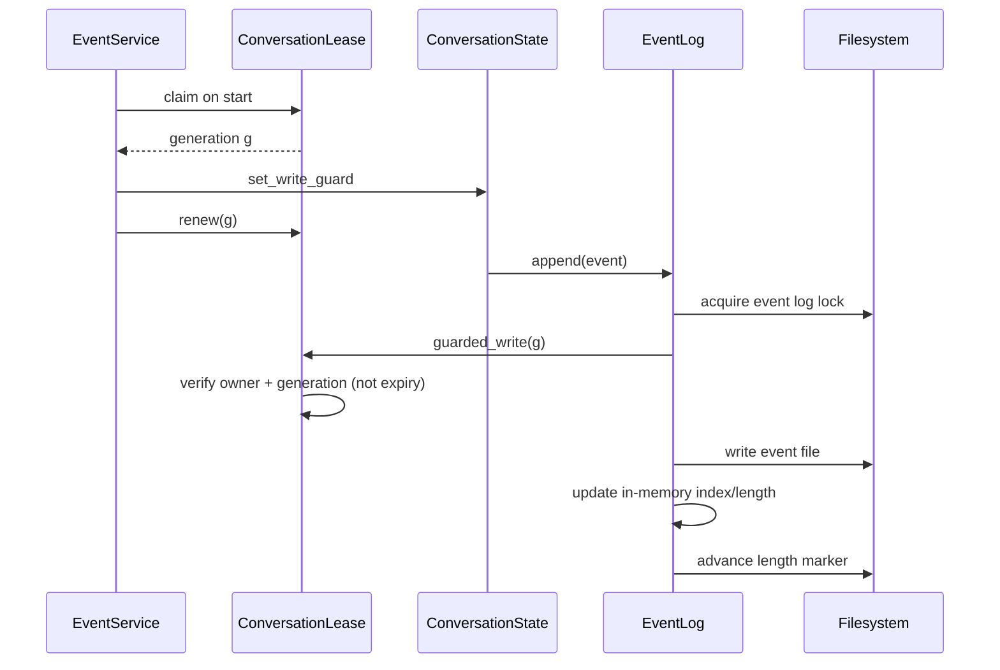

### 12.1 append 顺序不是一个数据库事务

`append()` 先在存储锁内检查 marker，必要时扫描磁盘同步索引；拒绝重复 event id 和不存在的显式 parent；在 write guard 内写 JSON；写入成功后更新内存索引和长度 marker，再返回 seq。这使“事件 id、分支关系、顺序索引”成为可核对的合同。

```python
# 摘取 event_store.py 的关键写入顺序；锁和前置校验在外层。
with write_guard:
    target_path = self._path(idx, event_id=evt_id)
    self._fs.write(target_path, payload)   # 磁盘事件先于内存提交
self._idx_to_id[idx] = evt_id
self._id_to_idx[evt_id] = idx
self._event_cache[idx] = event
self._length += 1
self._advance_length_marker(idx)         # marker 是快速扫描辅助，不是 workspace 快照
return idx
```

**故障演练建议**：分别在事件写成功后、marker 更新前、state 保存前注入异常；验证重启扫描不会重复分配 seq、丢分支 parent 或错误把外部工具副作用当成未发生。上述建议不是已复现 bug。

### 12.2 原生 async 与同步线程 fallback

`LocalConversation.arun()` 追踪当前 task，初始化也通过 worker 避免同步 LookupSecret 回调本服务器导致 event loop 自死锁；取消后进入 PAUSED、产生 InterruptEvent，并给未匹配 observation 的 action 补 synthetic AgentErrorEvent，维护 LLM tool-call 历史约束。

EventService 只有在 `arun`/`astep` 是实际原生覆盖实现时才走原生 async，否则交给 executor，并 `asyncio.shield(worker)`。**取消等待者不等于同步线程停止**：运行 permit 释放要绑定真实 worker 的结束，不能在 HTTP 请求 disconnect 时直接归还容量。

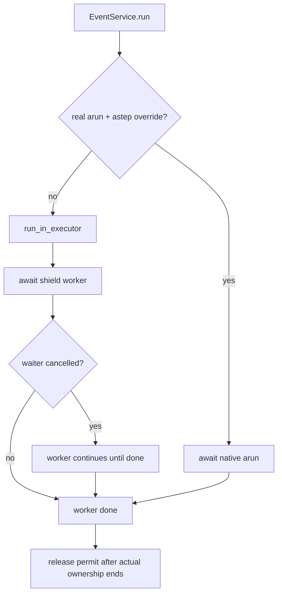

### 12.3 事件 transport 的背压

当前 session socket 已实现 durable `seq` 和 `after_seq`，不是尚未实现的建议。writer 为慢客户端提供有界队列，过慢时断开，由 durable replay 恢复；progress/delta 属于瞬态，不承诺全量恢复。先 subscribe、确定 through_seq、回放、再切 live 的机制避免订阅与读取之间遗漏新事件。

验收时应区分：事件已入 EventLog、已入 subscriber 队列、已送达浏览器、已被 UI 应用四个时刻。源码持久化保障不能自动推出用户输入“exactly once”或远程工具“exactly once”。

## 13. 静态可定位的订阅异常清理缺口

**证据**：`EventService.subscribe_to_events` 先调用 `_pub_sub.subscribe(subscriber)`，再创建初始 state snapshot、执行 subscriber。它只吞掉初次推送的 TimeoutError；其它异常向调用方传播，此时没有返回 subscriber id，也没有在本方法中 unsubscribe。`session_socket.py` 的异常分支关闭 writer/socket，并明确注释该 registration 仍占槽。

**推论**：若 snapshot 创建或初次 subscriber 回调抛出非 TimeoutError，订阅可能注册成功却不能被调用者回收。重复失败有占用 subscriber capacity 的风险。这是源码可定位的异常路径，不是本轮已做运行时复现的故障。

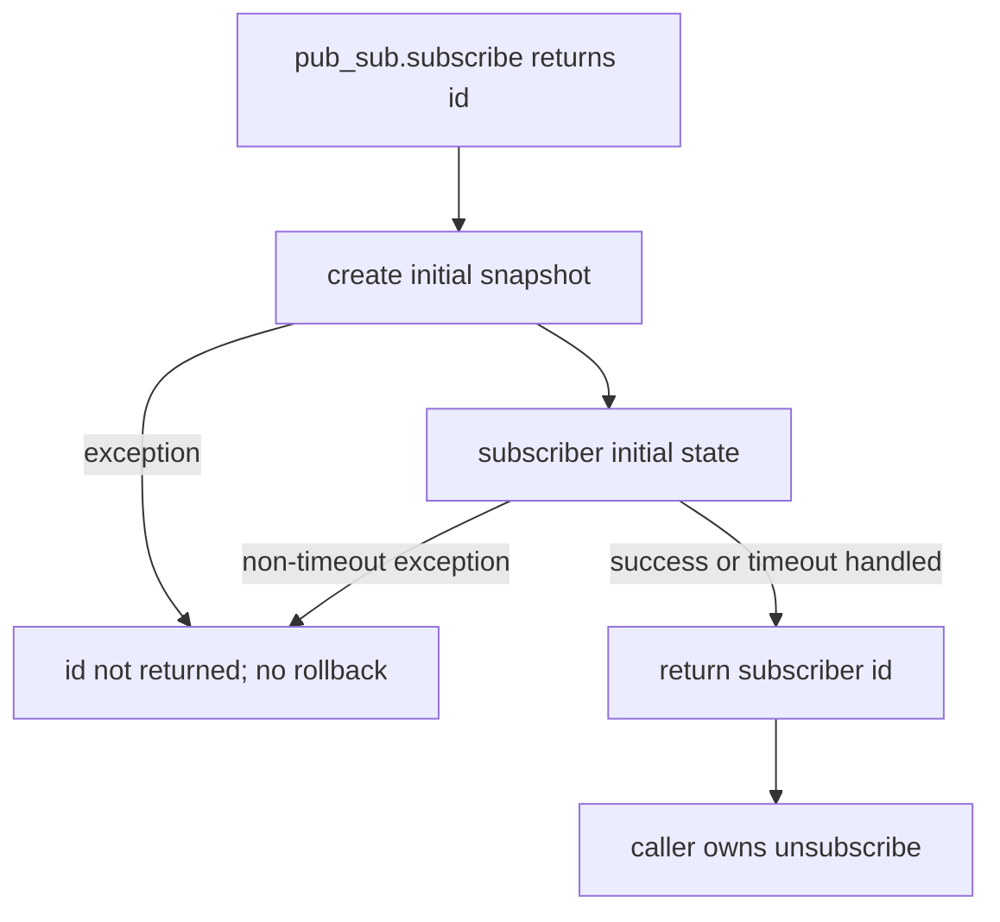

**建议修复契约**：注册后的初始化放入 try/except；非 TimeoutError 路径在方法内部回滚注册后再 raise。保留当前 TimeoutError 行为是否合理应单独决策，不应顺手改变。测试要注入 snapshot exception、subscriber exception、initial timeout，断言 pub/sub count 与返回/异常语义。本轮只补文档，不修改业务实现。
