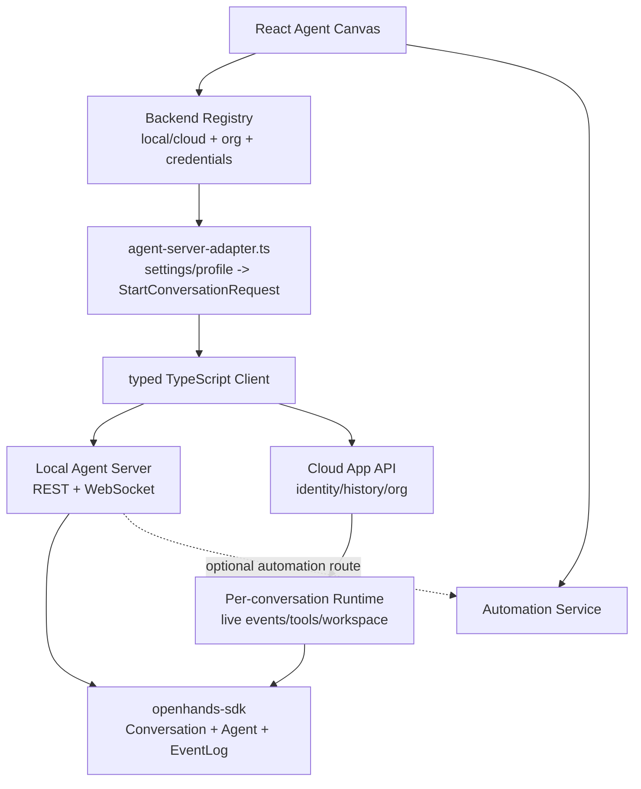
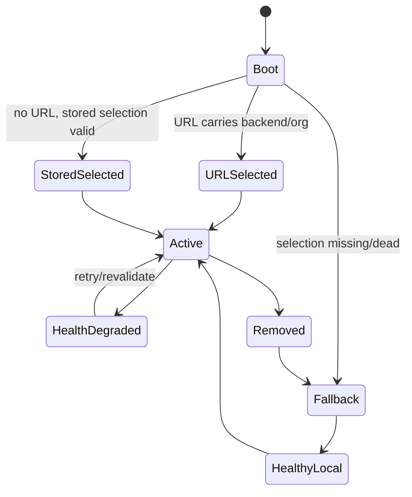
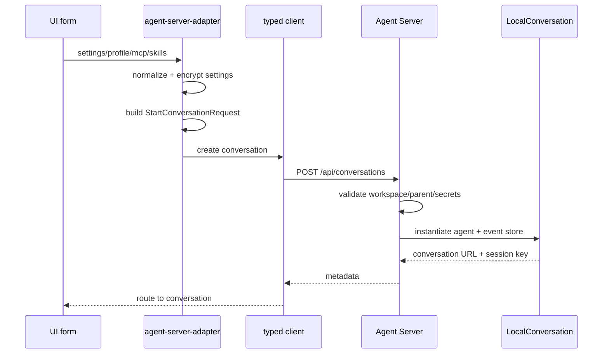
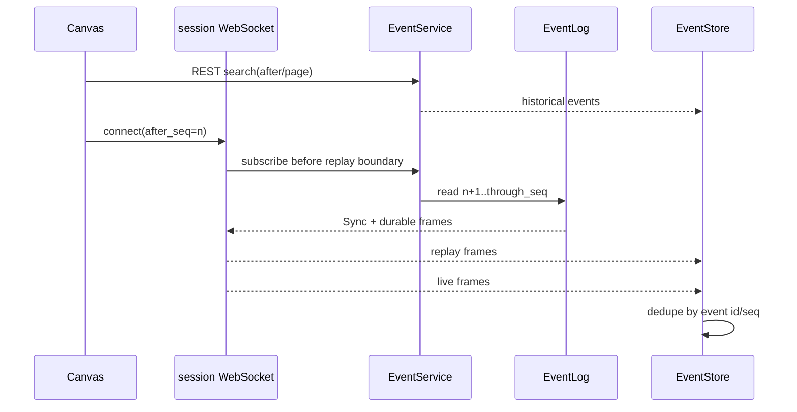
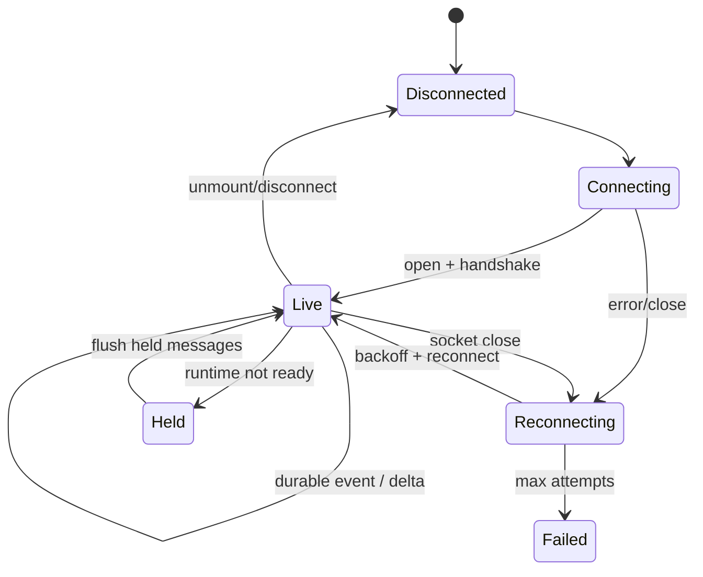
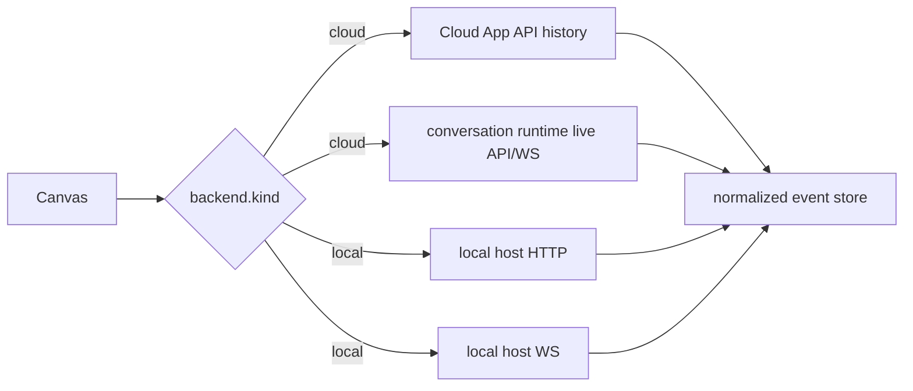
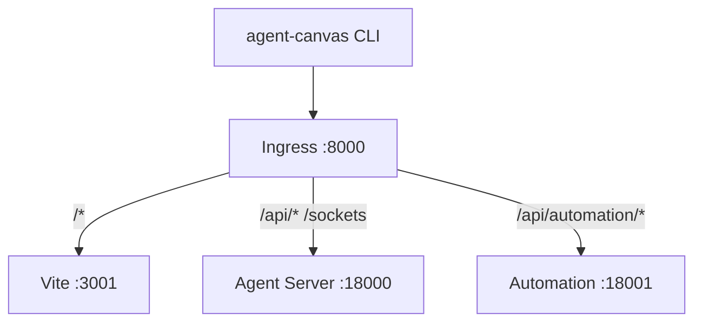

# OpenHands Agent Canvas 源码深读与架构校准（2026）

> 本文是对现有 OpenHands 文档的追加层，不替换历史架构叙述。核对日期：2026-10-15。源码基线：`OpenHands` HEAD `0071d9dfd8fb22ce204443b7e6f86ade0c1b6ba6`；Agent Server/SDK 基线：见 [`openhands-sdk/SOURCE_DEEP_DIVE_2026.md`](../openhands-sdk/SOURCE_DEEP_DIVE_2026.md)。当前仓库的产品前端是 React/TypeScript Agent Canvas，不应再把旧版 Python App Server 当作唯一当前实现。

## 目录与阅读路线

- [1. 当前边界与版本事实](#1-当前边界与版本事实)
- [2. 全局架构](#2-全局架构)
- [3. Backend Registry：多后端与身份边界](#3-backend-registry多后端与身份边界)
- [4. 会话创建与配置编译](#4-会话创建与配置编译)
- [5. WebSocket、REST 与事件游标](#5-websocketrest-与事件游标)
- [6. 前端事件状态机](#6-前端事件状态机)
- [7. 云端运行时与本地运行时](#7-云端运行时与本地运行时)
- [8. 启动、自动化与开发栈](#8-启动自动化与开发栈)
- [9. 可靠性、安全与数据一致性](#9-可靠性安全与数据一致性)
- [10. 当前真实缺口](#10-当前真实缺口)
- [11. 源码索引](#11-源码索引)

## 1. 当前边界与版本事实

当前 `package.json` 是 `@openhands/agent-canvas` `1.27.1`，使用 Node `>=24`，Typed Client `@openhands/typescript-client` `1.54.0`；`config/defaults.json` 同时声明 Agent Server `1.54.0`、最低兼容版本 `1.51.0`、Automation `1.19.3`。因此：

- **Canvas**：路由、后端选择、设置/Profile 编译、事件投影、终端/文件/扩展 UI。
- **Agent Server**：Conversation、EventLog、SDK Agent loop、REST/WebSocket、工作区和运行时。
- **Cloud/App API**：账户、组织、持久化会话历史和每会话 runtime 的编排；Canvas 对云端历史与 runtime 使用不同 host。
- **Automation**：独立服务，不应被误写成 Canvas 内部的 Agent loop。



## 2. 全局架构

系统不是“页面调用一个 API”这么简单，而是三条数据面：配置控制面、会话执行面、事件显示面。

```mermaid
flowchart LR
  subgraph Control[配置控制面]
    Settings[Settings]
    Profiles[Agent Profiles]
    Secrets[Secrets / LookupSecret]
    Compat[/server_info compatibility]
  end
  subgraph Execution[执行面]
    Start[Start conversation]
    Conv[ConversationService]
    Run[EventService / RunSlot]
    Agent[SDK Agent loop]
    WS[Session WebSocket]
  end
  subgraph Projection[显示面]
    Search[REST event search]
    Cursor[after_seq cursor]
    Store[Zustand event store]
    UI[Chat / terminal / planning UI]
  end
  Settings --> Start
  Profiles --> Start
  Secrets --> Start
  Compat --> Start
  Start --> Conv --> Run --> Agent
  Agent --> WS --> Cursor --> Store --> UI
  Agent --> Search --> Store
```

### 2.1 模块责任矩阵

| 模块 | 责任 | 不应承担 |
|---|---|---|
| `backend-registry` | 后端列表、激活项、组织、健康与连接 revision | 业务事件持久化 |
| `agent-server-adapter` | 把 UI 配置编译为服务端启动请求 | 重写 Agent Server endpoint |
| `conversation-service` | 创建、列表、上传、workspace 相关 API | 自己执行 Agent step |
| `event-service` | 历史搜索、计数、确认响应、失败重试 | 取代 WebSocket 实时流 |
| `conversation-websocket-context` | 建立主/规划 socket、发送、断线恢复、held message | 保存服务端真相 |
| `use-event-store` | 去重、排序、delta 聚合和 UI projection | 作为 durable event log |
| SDK/Agent Server | 执行、持久化、租约、工具副作用 | React UI 状态 |

## 3. Backend Registry：多后端与身份边界

`Backend` 不是简单的 URL：它含 `id/name/host/apiKey/kind/authMode/connectionRevision`，MARS 还记录 session/config 标识；`BackendSelection` 额外保存 `orgId`。激活后端的选择优先 URL，再读持久化选择；被删除或不可用时优先健康 local backend，而不是盲选数组第一项。



**关键推论**：所有 React Query/Zustand 缓存都必须以 `backendId`、`orgId` 和 `connectionRevision` 为隔离维度；否则切换 cloud/local 后会把一个后端的会话、组织或 API key 结果显示到另一个后端。当前源码已用持久化 registry 和 revision 表达此意图，新增业务缓存时应沿用，而不是创建全局 singleton cache。

## 4. 会话创建与配置编译

`agent-server-adapter.ts` 是产品配置到执行配置的编译器：它组合 profile、LLM 设置、MCP、skills、client tools、confirmation policy、最大迭代次数、父会话和 workspace。`parent_conversation_id` 还要通过服务端验证同一 workspace，不能在浏览器仅凭字符串接受跨工作区父子关系。



**代码解读（概念伪代码）**：

```ts
// 真实实现分散在 adapter、profiles、secrets 和 client options 中。
const request = {
  agent: resolveProfile(profile, settings),
  llm: encryptOrReference(settings.llm),
  tools: mergeMcpSkillsClientTools(profile),
  confirmation_policy: settings.confirmationPolicy,
  parent_conversation_id: sameWorkspaceParent(parentId),
  max_iterations: settings.maxIterations,
};
```

这里的 `LookupSecret` 引用与明文 secret 是两条不同路径；日志、事件和 URL 不能把二者混为一谈。配置变更后应增加 schema version 和迁移，而不是只在 UI 层补默认值。

## 5. WebSocket、REST 与事件游标

Canvas 同时使用 REST 和 WebSocket：REST 负责历史搜索、分页、计数和确认响应；WebSocket 负责 durable event、transient delta 和 progress。云端模式下，历史通常来自 Cloud App API，而 live runtime 来自会话 runtime host；这解释了为什么一个页面需要维护不同的 host、session API key 和 socket。



服务端 `session_socket.py` 的顺序保证是“先注册订阅，再确定 replay boundary，再回放，再切 live”；客户端 `createSeqCursor()` 不直接取最高 seq，而是维护“无缺口的最高序号”，并对不可读的 gap 设置上限，避免永久卡住。源码注释明确指出 durable frame 可能乱序到达，因此这是可靠性关键，而非 UI 小技巧。

```mermaid
flowchart TD
  Frame[durable seq]
  Frame --> Seen[observe(seq)]
  Seen --> Gap{连续无缺口?}
  Gap -->|yes| Advance[cursor += 1]
  Gap -->|no| Ahead[暂存 ahead set]
  Ahead --> Limit{ahead > MAX_AHEAD?}
  Limit -->|yes| Skip[跨过不可读缺口]
  Limit -->|no| Wait[等待后续 frame]
  Advance --> Dedup[低于 cursor 的 frame 去重]
  Skip --> Dedup
```

发送也有两条路径：socket open 时直接 `send({..., run:true})`；socket 尚未连接且 cloud runtime 尚未 ready 时进入 held message 队列；runtime 已有 URL 但 socket 未开时通过 typed client `sendEvent` 投递，返回 `queued` 只表示“不是当前 socket 直接发送”，不是服务端已完成执行。

## 6. 前端事件状态机

`use-event-store` 不只是数组：它维护原始事件、eventIds、UI events，并将 streaming delta 聚合为 UI 可显示的消息；事件 timestamp 乱序时会重新排序。`useHandleWSEvents` 负责将 typed agent error、认证错误和达到最大迭代的错误映射为 banner/toast/paused 状态，避免同一错误重复通知。



前端状态是投影，不是事实源：刷新后应从 REST/WS replay 恢复；React store 中的“已显示”不能作为后端已持久化的证明。

## 7. 云端运行时与本地运行时

| 维度 | local | cloud |
|---|---|---|
| 后端选择 | registry 中的本地 Agent Server | cloud app + org |
| live runtime | backend host | 每会话 runtime URL |
| auth | backend API key/session key | bearer + runtime `X-Session-API-Key` |
| event history | runtime/Agent Server | Cloud App API 分页 |
| message not ready | 通常连接失败 | held queue 或 runtime typed client |
| 兼容性 | `/server_info` 检查 | cloud/client 版本与 session 协议 |



这也是旧文档中“App Server + Agent Server 双服务器”需要校准的地方：在当前 Canvas 中，Cloud App API 与每会话 runtime 的双 host 是真实路径；旧版 App Server 章节应作为历史/部署背景保留，而不是当作所有安装方式的当前代码入口。

## 8. 启动、自动化与开发栈

`bin/agent-canvas.mjs` 和 `scripts/dev-safe.mjs`/`dev-with-automation.mjs` 负责可执行产品边界。开发栈默认通过 ingress 将 `:8000` 的不同路径路由到 Vite、Agent Server 和 Automation；`OH_AGENT_SERVER_LOCAL_PATH` 可将 SDK 仓库以 editable 方式接入，保证前后端源码调试看到同一份代码。



生产部署需把 bind host、API key、secret key、VScode base path、CORS、WebSocket upgrade 和 graceful shutdown 作为一组配置验证，不能只确认首页 HTTP 200。

## 9. 可靠性、安全与数据一致性

1. **事件一致性**：REST 历史、WS replay、transient delta 三者要有明确的 durable/transient 标记；delta 丢失可由 durable event 重建，不能反过来。
2. **运行一致性**：SDK EventLog 的写锁、Agent Server ConversationLease 的 generation fencing、EventService RunSlot 是三层不同锁；前端重连不应触发第二个 run。
3. **凭据隔离**：backend API key、conversation session key、cloud bearer、LookupSecret 引用分层传递；前端持久化 registry 需要明确 XSS/浏览器 profile 风险。
4. **副作用补偿**：文件写入、git、MCP、ACP 进程不随 EventLog 自动回滚；lease 失效时必须有 cancel/cleanup/reconcile 策略。
5. **兼容性**：Canvas 在 `server_info` 上检查最低版本；新增 endpoint 时必须同步 TS client、compatibility minimum、mock/e2e fixture 和迁移说明。
6. **可观测性**：日志记录 conversation/backend/seq/request correlation id，默认不记录 prompt、token、session key 和完整工具参数。

## 10. 当前真实缺口

| 缺口 | 影响 | 建议验收标准 |
|---|---|---|
| 事件协议 schema registry | 云/本地升级后 replay 不兼容 | 每种 frame 有版本、兼容策略、golden fixture |
| 多后端缓存审计 | 切换后串数据 | 所有 query/store key 含 backend/org/revision |
| held message 生命周期 | 页面关闭或 runtime 永不 ready 时消息悬挂 | 超时、取消、重试和用户可见状态 |
| lease 与副作用关联 | owner 被接管但旧工具仍写 workspace | generation fencing + tool cancellation/reconcile |
| cloud 双 host 故障模型 | history 成功但 runtime 不可用 | UI 区分历史可读、执行不可用、重连中 |
| 初次订阅异常清理 | 注册后异常不能返还 id，可能占用订阅容量 | subscribe 初始化失败时 rollback + 故障注入（详见 SDK 深读 §13） |
| graceful shutdown | socket、ACP、MCP、worker 泄漏 | 关闭演练后无 orphan process/task |
| 安全回归矩阵 | key、CORS、路径前缀配置组合脆弱 | local/public/cloud × auth × websocket 测试矩阵 |
| 端到端观测 | 无法判断“消息已送达还是仅入队” | message id、server ack、durable seq 可关联 |

## 11. 源码索引

- [`OpenHands/src/api/backend-registry/`](../../OpenHands/src/api/backend-registry/)
- [`OpenHands/src/api/agent-server-adapter.ts`](../../OpenHands/src/api/agent-server-adapter.ts)
- [`OpenHands/src/api/event-service/event-service.api.ts`](../../OpenHands/src/api/event-service/event-service.api.ts)
- [`OpenHands/src/contexts/conversation-websocket-context.tsx`](../../OpenHands/src/contexts/conversation-websocket-context.tsx)
- [`OpenHands/src/utils/session-seq-cursor.ts`](../../OpenHands/src/utils/session-seq-cursor.ts)
- [`OpenHands/src/stores/use-event-store.ts`](../../OpenHands/src/stores/use-event-store.ts)
- [`OpenHands/src/hooks/use-handle-ws-events.ts`](../../OpenHands/src/hooks/use-handle-ws-events.ts)
- [`OpenHands/scripts/dev-safe.mjs`](../../OpenHands/scripts/dev-safe.mjs)
- [`OpenHands/scripts/dev-with-automation.mjs`](../../OpenHands/scripts/dev-with-automation.mjs)
