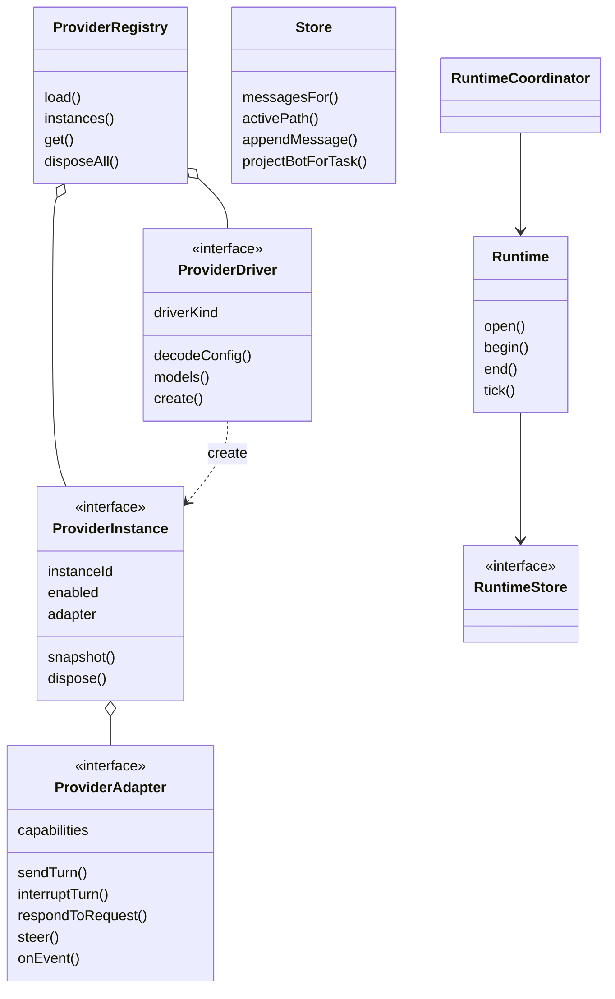
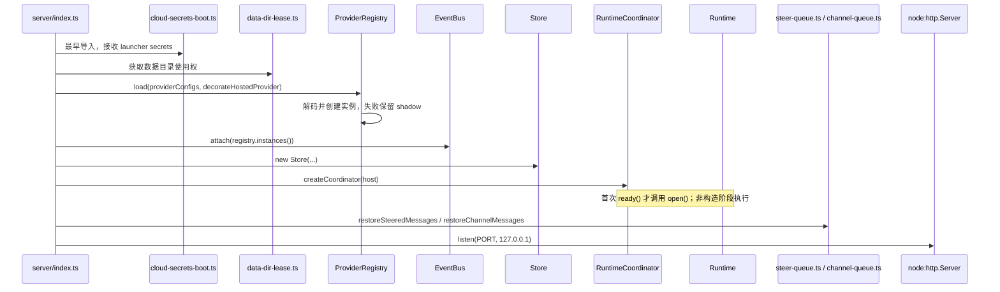
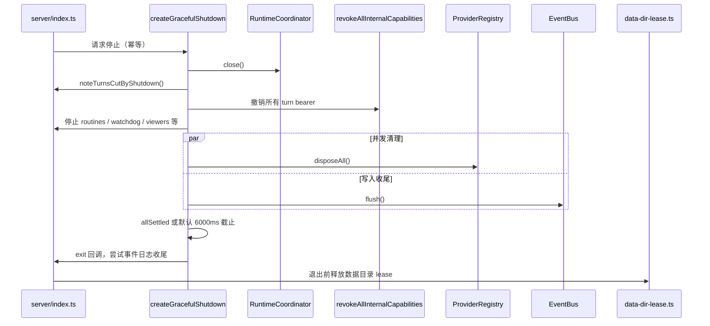

# 01 整体架构与生命周期

## 目录

- [1. 分层与职责](#layers)
- [2. 真实接口与实体关系](#entities)
- [3. 启动：从数据目录到可接收消息](#startup)
- [4. 停止：先撤销能力，再释放实例](#shutdown)
- [5. 为什么这样设计，代价是什么](#tradeoffs)
- [6. 源码入口](#source)

## 1. 分层与职责

| 层 | 真实目录 / 模块 | 核心责任 |
|---|---|---|
| 交互层 | `src/` | React 页面、消息/卡片展示、快照加载、实时事件归约 |
| 桌面宿主 | `electron/` | Electron 主进程、preload、服务子进程生命周期与系统能力 |
| 应用编排 | `server/index.ts`、`server/routes/` | 鉴权、路由、任务选择、turn admission、上下文、审批、SSE |
| 业务状态 | `server/store.ts`、`message-db.ts` | bot/task/thread 状态、消息树、命令回执、消息检索与 followup 持久化 |
| 引擎适配 | `contracts.ts`、`harness/registry.ts`、`drivers/` | 驱动创建、实例状态、执行请求、标准事件转换 |
| 协作调度 | `coordinator.ts`、`runtime-coordinator.ts`、`runtime/` | 委派树、等待、询问、结果回报、唤醒与恢复 |
| 执行能力 | MCP proxies、computer/browser/data 模块 | 将真实工具挂给引擎，处理工具访问与资源租约 |
| 横切能力 | memory / skills / routines / auth / usage 等 | 长期信息、自动化、身份、审计和成本 |
| 外围部署 | `companion/`、`cloudflare/`、`enterprise/`、`deploy/` | 伴随服务、云端服务与部署支持，不能与本机 turn runner 混为一谈 |

`server/index.ts` 在本基线约 1.8 万行，承担大量领域集成。虽然已有独立 routes 和 runtime，仍不能画成“一个很薄的 HTTP 层 + 完全独立服务”的理想结构。

## 2. 真实接口与实体关系

注意三种 ID：`instanceId` 路由到引擎配置；`threadId` 标识应用会话；`resumeCursor` 是驱动理解的原生继续信息。三者不能互相替代。

## 3. 启动：从数据目录到可接收消息

以下画出主干依赖顺序，不表示把所有顶层初始化都搬进了一个 `boot()` 函数。

关键细节：

- secrets 引导发生在会启动子进程的其他 import 之前，避免子进程继承缺失/错误的环境。
- Registry 并行创建引擎，但最终保持配置顺序；缺失 CLI 或坏配置成为可见的 unavailable/shadow，不应让所有引擎一起不可用。
- Store 的线程消息是**按需装载**，不是启动时把所有历史灌进模型。
- `RuntimeCoordinator` 构造时打开 `runtime.db`，但不立即恢复：首次 `ready()` 才 `Runtime.open()`，因为恢复会调用尚在初始化中的 host。图中以 Note 单独标记这条惰性初始化边界，不伪造它相对其他启动步骤的严格先后。
- Runtime 的恢复是任务状态恢复；steer/channel 的恢复是待发送队列恢复；原生引擎 session 的恢复又是第三条链路。
- 服务监听回环地址；可选 tunnel socket 与 session 鉴权属于额外访问路径，不能据此说服务“只会被本地人访问”。

## 4. 停止：先撤销能力，再释放实例

实际 cleanup 是一组并发 job；第一项在遇到任何 await 之前同步设置 shutdown 状态并撤销能力。这样子 MCP 进程或监听器即使暂时活着，也不应继续持有旧 turn 的授权。

`noteTurnsCutByShutdown()` 不会对 Runtime 已持有的根任务机械追加“重试”入口，否则恢复调度和人工重试可能把同一份工作跑两遍。退出带截止时间，因此不是“所有缓冲必然写盘”的保证。

## 5. 为什么这样设计，代价是什么

以下是从实现可推导的设计取舍，不冒充作者未公开的 ADR：

- **嵌入式服务 + SQLite**：本地部署简单，但需要单数据目录 lease，不能任意多个进程并写同一工作区。
- **统一宿主接口而非统一引擎内部**：可以接 CLI 和 API，但能力矩阵、错误映射、恢复策略必须逐驱动维护。
- **durable 状态 + 原生进程**：重启后仍知道工作归属，但无法恢复一个任意时刻的 JavaScript 堆栈和外部工具现场。
- **强编排中心**：跨领域校验容易在同处完成，但 `index.ts` 的耦合与阅读成本很高。

## 6. 源码入口

`server/index.ts`、`server/contracts.ts`、`server/harness/registry.ts`、`server/harness/bus.ts`、`server/graceful-shutdown.ts`、`server/data-dir-lease.ts`。带行号的跳转见 [08](08-source-map-and-verification.md)。
