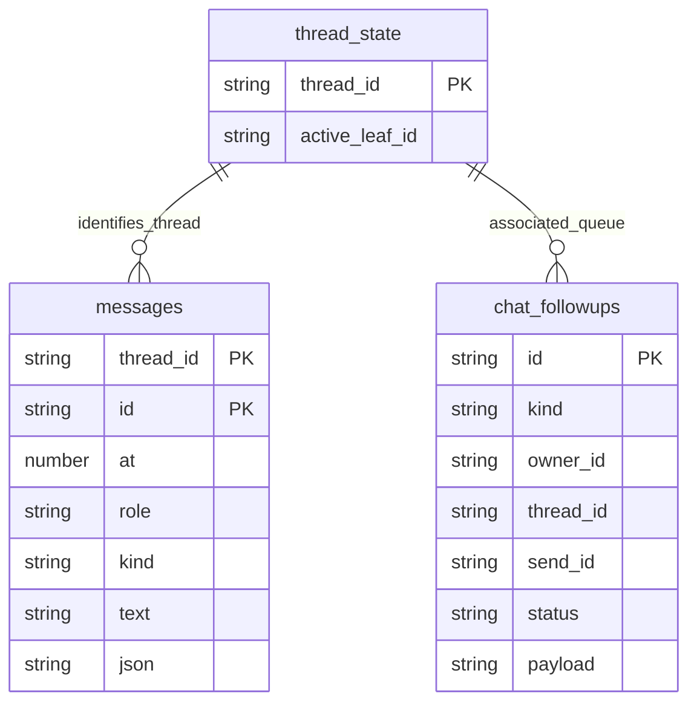
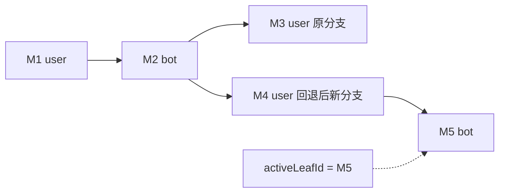
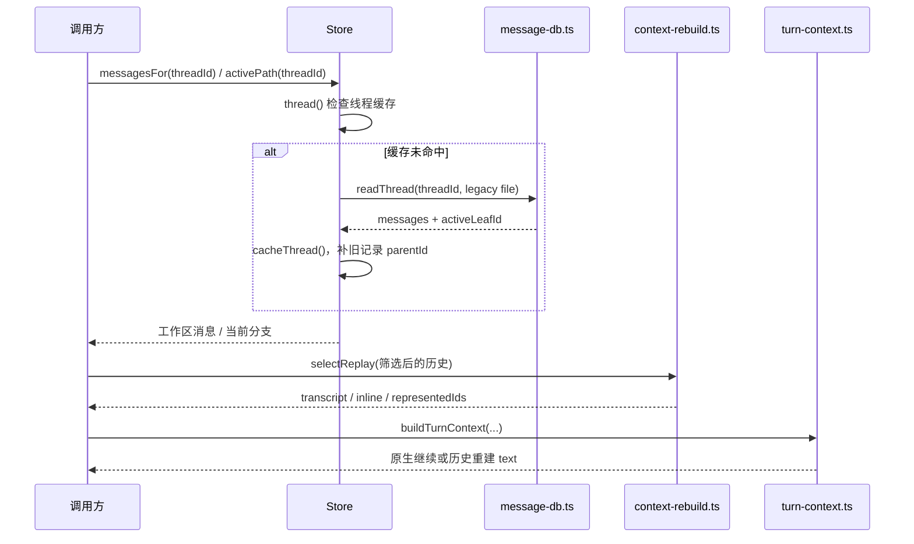
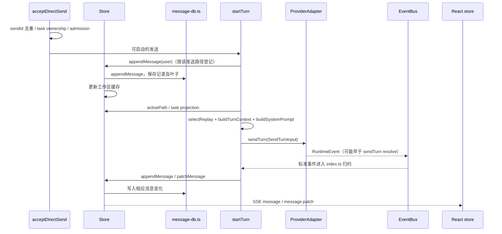
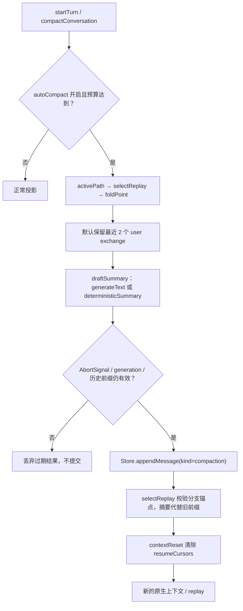
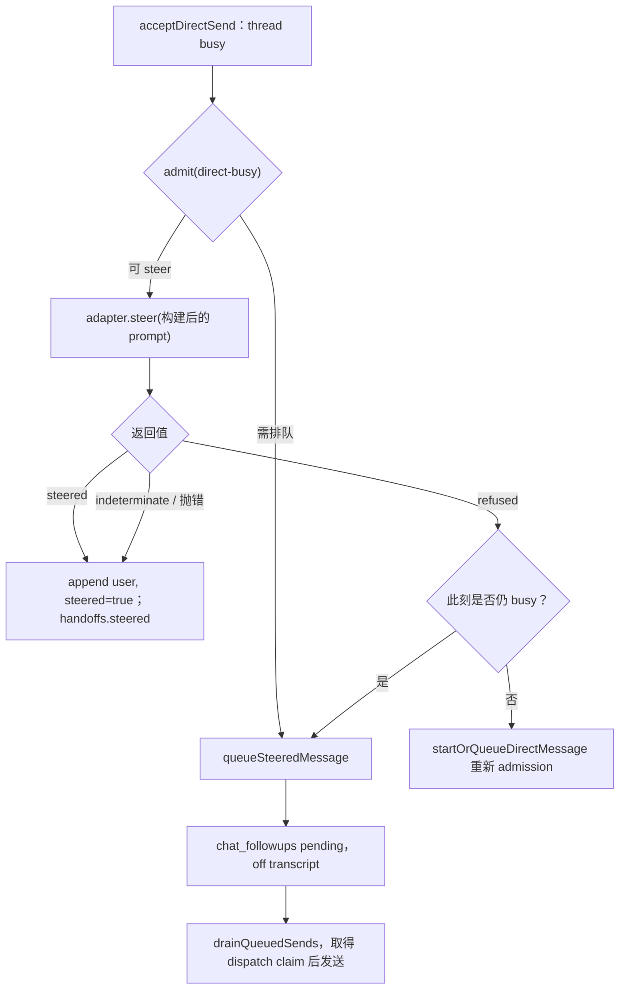

# 02 消息、上下文与会话

## 目录

- [1. 四种状态，不是一个 messages 数组](#models)
- [2. 启动后：SQLite 如何变成工作区消息](#load)
- [3. 普通发送：持久化、投影、引擎执行和回写](#send)
- [4. 请求模型时，context 到底放在哪里](#prompt)
- [5. 压缩：轻量裁剪、摘要与原生会话重建](#compact)
- [6. steer 与 followup：运行中追加不是同一条路径](#steer)
- [7. 回退、切换引擎与恢复失败](#resume)
- [8. 源码入口](#source)

<a id="models"></a>
## 1. 四种状态，不是一个 messages 数组

| 状态 | 真实结构 | 作用 |
|---|---|---|
| 聊天工作区 | `Store.threads` 中的 `messages` 与 `activeLeafId`；`Message = WireMessage` | 供 UI、分支选择、上下文构建使用，包含非模型消息 |
| 持久化记录 | `messages.db` 的 messages / thread_state / chat_followups 等 | 重启后的业务事实与队列 |
| 宿主发给驱动的输入 | `SendTurnInput` | 包含当前 text、system、transcript、resumeCursor、integrations 等 |
| 引擎原生状态 | 驱动的进程/session，以及 resumeCursor | 工具循环、中间推理和 provider 原生上下文 |

**Store 的 Message 不能直接当 OpenAI messages 发出去。** 卡片、活动、截图、compaction 等记录需要筛选和投影；即便最终是 user/assistant 历史，也要按驱动是原生 resume 还是 transcript replay 再决定如何传递。

### 工作区 Message 对象里具体有什么

`shared/wire.ts::WireMessage` 同时服务前后端，是可展示的业务记录，而不是单纯 `{role, content}`：

| 字段 | 为什么需要 |
|---|---|
| id / at / parentId | 标识、时间与分支父链；activeLeafId 在 thread state，不在每条消息上打 active 标记 |
| role | `user` 或 `bot`；投影时才变成 provider 的 user/assistant |
| kind | text、options、activity、screen、connector、secret、signin、digest、compaction、routine.run、goal.run、call、widget 等 |
| text / attachments | 用户原话或可读内容与附件；附件不是任意路径可公开读取的许可 |
| card | 问题/审批等结构化展示与 request 关联 |
| tool | 活动/工具描述、输入输出预览、执行结果、itemId 等；不等于 API 原始 tool message |
| compaction | summary 与 firstKeptId / foldedThroughId 等范围锚点 |
| steered / turnId / sendId | 运行中交付、执行轮次和幂等发送关联信息 |
| from / roomRequest / peerAsk 等 | 房间发言者、协作请求与来源，不可在 replay 时抹成主人的指令 |



上图是逻辑关联图，不表示源码给每条关系都建立了 SQL 外键。messages 的 `json` 保存完整业务对象，独立列用于检索/分页；消息 parentId 等字段在 JSON 内，不能从表面列清单误判“没有分支”。

消息关系也不是简单线性数组：`parentId` 形成树，`thread_state.active_leaf_id` 选中当前分支。`activePath()` 从叶子向父遍历再 reverse，得到本轮使用的路径；别的分支仍可保留。



<a id="load"></a>
## 2. 启动后：SQLite 如何变成工作区消息



`cacheThread()` 对没有 `parentId` 的旧记录按原先顺序补链；没有 stored leaf 时取最后一条。`messagesTail()` 支持分页；若旧记录缺少完整父链上下文，会回退到完整装载，而不是拿一个断尾片段猜消息树。

因此“重新打开会话”不等于“立即重新发送历史”；真正 dispatch 时才根据 activePath 和引擎状态决定投影。

<a id="send"></a>
## 3. 普通发送：持久化、投影、引擎执行和回写

主要链路：`acceptDirectSend → startOrQueueDirectMessage → startTurn`。前者处理 sendId 幂等与忙碌时 admission，后者完成执行前校验和请求构建。



这里的 user 登记节点是主干示意，忙时 steer、排队、内部协作会走不同分支，不能把它理解成每次 `startTurn` 都无条件插入新 user。

### 没有压缩时，需要等 turn 完了才 flush 吗？

不需要把它想成“整个 messages 数组结束时批量覆盖 session DB”。`Store.appendMessage()` 的关键顺序是：

```typescript
// 节选并省去外围分支：先持久化成功，再更新缓存并发事件。
const persist = () => { mdb.appendMessage(threadId, full); return full; };
const committed = command ? runCommand(command, persist) : persist();
if (committed.id !== full.id) return committed; // 幂等命令已有结果，不再追加
// 后续才 t.messages.push(full)、activeLeafId=full.id、emit(...)
```

`message-db.ts::appendMessage()` 在一个事务内 insert message 并 setActiveLeaf，使 DB 记录与当前叶子一起推进。

流式内容和卡片会经归约变成 append/patch；turn 结束再完成终态、handoff、资源和队列结算。另有 EventBus JSONL 事件日志自己的缓冲和 flush，**它与 SQLite 消息写入不是同一个 flush**。

<a id="prompt"></a>
## 4. 请求模型时，context 到底放在哪里

`buildSystemPrompt()` 返回 `{text, sections, stable, volatile}`。其中 memory、mentions、outstanding、recent、availability 是 volatile sections；角色等稳定信息保留在 stable 部分。

拆分原因：持续运行的 CLI 进程不能因为每轮“队友忙闲变化”就被迫更换稳定启动配置；API 请求也希望稳定前缀保持字节一致以利用缓存。

### 一个 API 驱动的具体例子

假设聊天记录是“帮我写方案 / 已给初稿”，本轮发“按昨天决定缩短到一页”，当前记忆指出用户偏好简洁：

```typescript
// 示意输入，不是项目硬编码的完整 prompt 模板。
const turn = {
  threadId: "t1",
  systemStable: "你是方案助手，遵守本轮提供的工具与权限边界。",
  systemVolatile: "当前记忆：用户偏好简洁。当前队友：Reviewer 空闲。",
  transcript: [
    { role: "user", text: "帮我写方案" },
    { role: "assistant", text: "已给初稿" },
  ],
  text: "按昨天决定缩短到一页",
};
```

`drivers/openai-chat.ts::messagesFor()` 的真实投影规则：

1. 使用 `promptHalves()` 取得稳定/易变部分。
2. 必要时把 volatile 变成 context note，放在**最新 user 内容前**。
3. 使用 `delivered` / `replayDelivered` 对齐以前真正交付过的内容，避免重建历史时丢失或重复上下文 note。
4. 形成 system + transcript + 最新 user 的 API 消息。

即大致为：

```text
system:    稳定角色与规则
user:      帮我写方案
assistant: 已给初稿
user:      [驱动生成的上下文 note，必要时包含易变信息]
           按昨天决定缩短到一页
```

**这不意味着 Store 中的原 user.text 被改写成上述拼接字符串。** 工作区记录用户原话；发送投影承载本轮 context。`recalled` 字段还明确指出 recall block 只影响这一轮，replay 可去掉它。

原生 CLI 驱动有自己的投递和增量注入策略，不能把上述 API 排列原样推广到全部 22 种驱动。也不要套用 Hermes 的 `<memory-context>` 或 `pre_llm_call` 标签来解释本项目。

<a id="compact"></a>
## 5. 压缩：轻量裁剪、摘要与原生会话重建

先区分三件事，它们**不是一个保证按序发生的统一算法**：

| 机制 | 源码 | 改变什么 |
|---|---|---|
| 工具结果预算 | `mcp-trim.ts`、`mcp-result-budget.ts` | 在相应 MCP 路径限制单个结果；默认预算 8000 字符，可按 custom server 配置 |
| replay 预算与截短 | `context-rebuild.ts` | 限制重建历史的条数/字节与工具摘要行；保留原聊天记录 |
| 会话 compaction | `compactConversation`、`compaction-summary.ts` | 新增摘要记录，后续 replay 用摘要代表旧前缀，并重建适用的引擎会话 |

`selectReplay()` 默认最多 40 条；可附加工具简述，工具行上限 20、每行最长 120 字符。它是重建预算，不等于原生引擎内部工具历史。`boundedContextText()` 按 UTF-8 边界截取首尾并提示原文仍在会话中。

### 自动摘要的判断与提交



预算以当前 context reading 为依据；没有可靠 token reading 时使用估算。`contextReading: "meter"` 的读数仅显示，不拿来触发宿主自动压缩。阈值、原生自动压缩上限和 regrowth floor 共同避免不可压缩固定 prompt 导致压缩风暴。

`draftSummary()` 默认 helper 超时 20 秒；失败可用确定性摘录。LLM 摘要不是唯一内容：成功时仍附带来源摘录。Stop 的 AbortSignal 被重新检查，不能让一个晚返回的摘要继续落盘。

### 压缩前后工作区与 DB 的准确变化

```text
原工作区：M1 → M2 → M3 → ... → Mn
追加后：  M1 → M2 → M3 → ... → Mn → C1(compaction)
C1: summary, firstKeptId, foldedThroughId, tokensBefore, by
发送投影：[历史摘要] + [保留尾部] + [当前输入]
```

- 原消息**没有因为 compaction 被物理删除**，也没有 Hermes 风格 `active=0, compacted=1` 更新流程。
- 新 C1 经正常 append 持久化，再进入工作区；`compaction.append` 命令回执防止同一操作重复提交。
- `selectReplay()` 校验 foldedThrough / firstKept / record 自身在当前分支上的顺序。陈旧或其他分支上的摘要不能悄悄遮住当前历史。
- `startTurn` 计算 `contextReset = selection.compacted > 0 && record.id !== task.appliedCompactionId`：先清除 resumeCursors 并要求重建，成功 dispatch 后才保存 appliedCompactionId。旧原生上下文因此不会被误当成已压缩的新上下文，失败发送也不会提前冒充“已应用”。
- 这条宿主检查位于 turn dispatch 准备阶段；不能据此宣称所有引擎每一个内部 tool round 都先执行同一套宿主压缩。

<a id="steer"></a>
## 6. steer 与 followup：运行中追加不是同一条路径

`admission.ts::admit()` 根据 busy、capacity、coordination、图片能力和电脑选择状态返回 start / queue / steer / refuse。



为什么 `indeterminate` 不重排？可能引擎已经收到输入，只是 ACK 丢失。再次排队会让同一条指令执行两次。这里优先防重复，而不是假装每次传输都有确定结果。

`steer-queue.ts` 的排队项不是一个裸字符串：包含 messageId、text、prompt、replyToId、sendId、dataContext、origin、sender、trigger、reason、queuedAt 等。公开 snapshot 只给 UI 的 pending chip，不能把内部 prompt/context 一起暴露。

**等待发送时保持 off transcript**，防止尚未执行的 followup 抢走 active leaf。队列持久化到 `chat_followups`；`restoreSteeredMessages()` 重启恢复 pending 项。Stop 与取消待发送项不是同一个动作，队列设计允许待发送内容在 Stop 后仍保留。

队列 drain 还要处理“引擎完成事件早于 `sendTurn()` Promise resolve”的竞态，不能刚看到 turn completed 就释放发送 claim，让下一条撞上尚在握手的前一条。

<a id="resume"></a>
## 7. 回退、切换引擎与恢复失败

`buildTurnContext()` 的核心分支：

- 没有 rewound / fresh / externallyUpdated：可以原生 resume，发送本轮增量。
- 必须重建且驱动不能原生重放：将筛选后的 transcript 拼进 text，附上为何重建的说明。
- transcript-replay API 驱动：历史通过 `SendTurnInput.transcript` 交给驱动投影，不必重复内联一份。
- 原生 cursor 在读 prompt 前被拒绝：驱动可按 `recoveryText` 重建；`strictResume` 契约禁止悄悄开空 session 丢掉历史。

### handedMessages 为什么不能省略

`Handoffs` 记录特定 instance/session 真正接收过哪些消息，而不仅是“DB 现在有多少条”。例如研究员的结果在负责人 native session 外被写入 thread：聊天记录已经更新，但负责人进程没读过这条结果。

`startTurn` 因此比较 contextOrder、resume cursor 和 task.handedMessages，计算 unseen 消息与 keep 标记；适合增量注入时构造 unseen block，不适合时触发重建。dispatch 前先登记 handoff 状态，成功后绑定 turnId，避免引擎同步吐完整轮次时漏记交付。

这又是一种**交付账本**，与 pending followup 队列、消息树、provider 原生历史各有不同职责。

“恢复”是以可验证的历史和 cursor 继续，不等于恢复模型内存、工具进程堆栈或一半完成的外部操作。

<a id="source"></a>
## 8. 源码入口

`store.ts`、`message-db.ts`、`context-rebuild.ts`、`turn-context.ts`、`context-budget.ts`、`compaction-summary.ts`、`system-prompt.ts`、`steer-queue.ts`、`admission.ts`、`drivers/openai-chat.ts`，以及 `index.ts` 的 `acceptDirectSend/startTurn/compactConversation`。
