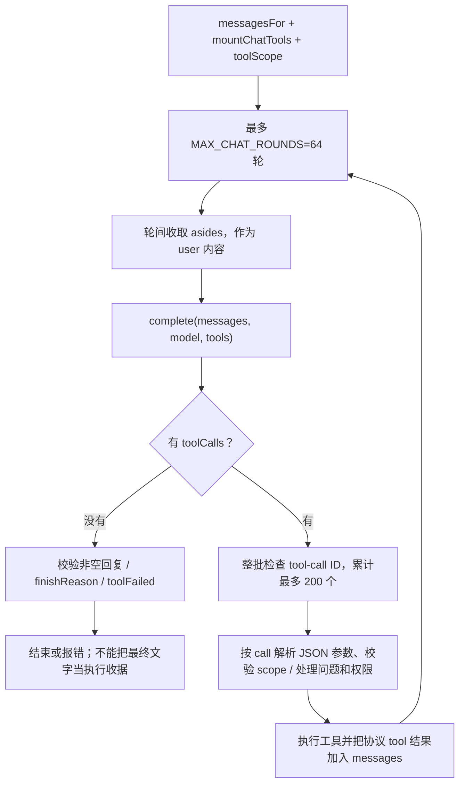
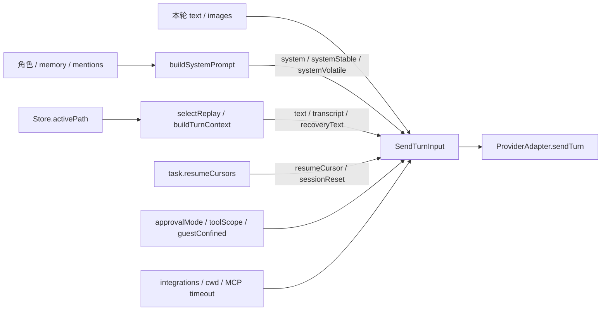
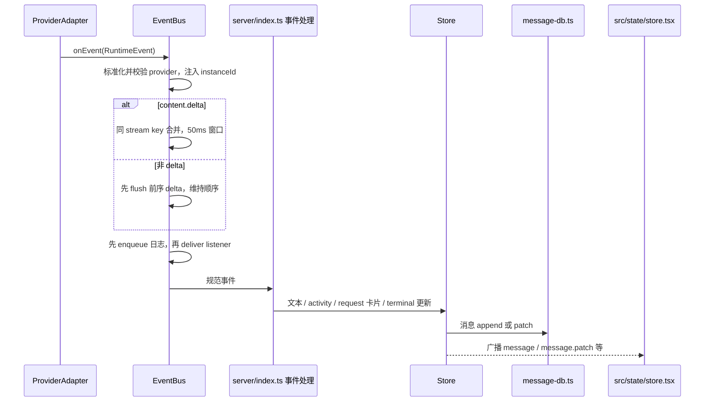
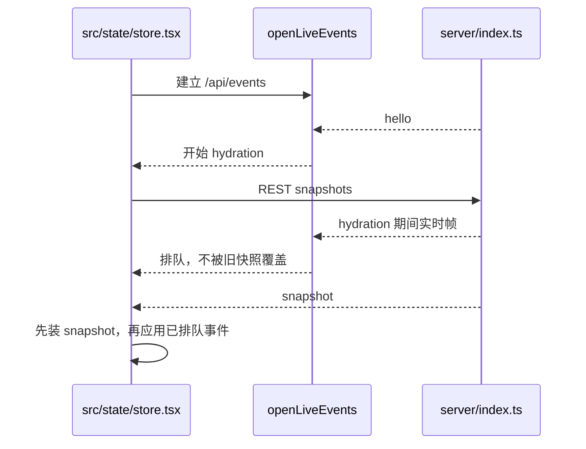

# 03 引擎驱动与事件链路

## 目录

- [1. Driver、Instance、Adapter 各解决什么问题](#contracts)
- [2. 不同引擎不能画成同一个推理循环](#execution)
- [3. 一次 sendTurn 的输入契约](#input)
- [4. 输出：从引擎事件到消息卡片](#events)
- [5. UI 如何避免快照覆盖新事件](#frontend)
- [6. 扩展引擎时必须守住的边界](#extension)
- [7. 源码入口](#source)

## 1. Driver、Instance、Adapter 各解决什么问题

**Driver 是工厂，Instance 是配置后的引擎，Adapter 是宿主调用它的接口。**

例如用户配置两个不同账号/endpoint 的兼容 API 引擎，它们可以属于同一种 driverKind，但有两个 instanceId。某个 bot 的模型选择使用 instanceId 路由，不是按“模型名字相同”随便找实例。

`ProviderRegistry.load()` 将配置解码为实例；解码或创建失败保留 `ShadowInstance`，使 UI 仍能展示不可用状态和修复入口。异步创建完后按配置次序排列，避免一次慢登录导致引擎列表随机重排。

`ProviderInstance` 除 adapter 外，还可能提供 `generateText`、`generateMemoryText`、`reviewPermission`。这些不是等价接口：后台记忆任务、轻量摘要和权限审查有不同约束，不能因为存在一个“文本生成函数”就把工具审批交给它。

## 2. 不同引擎不能画成同一个推理循环

本基线 `drivers/builtIn.ts` 注册 22 个 driver。较清晰的学习方式是按执行机制分类，而不是按品牌背名字：

| 路径 | 代表源码 | 宿主与引擎分工 |
|---|---|---|
| 原生 CLI | `drivers/claude.ts`、`drivers/codex.ts` | 引擎有原生会话/工具循环；宿主管理请求、MCP、审批、恢复和事件适配 |
| ACP Agent | `drivers/acp/core.ts` 及对应 driver | 通过 ACP 会话与事件协议接 Agent；能力和协议差异仍由具体驱动处理 |
| API chat runtime | `drivers/openai-chat.ts`、`drivers/openai-compat.ts` | 应用侧把 transcript、system、images 投影成 API 消息，处理工具相关执行逻辑 |
| Pi 集成 | `drivers/pi.ts` | 单独适配路径，不应根据 API driver 的请求形状推断其全部内部行为 |

这里对 native/API 主干做了源码核对；没有逐个运行 22 个引擎。能力字段比分类更有约束力：是否可 steer、可带图、支持哪类 MCP、能否严格 resume，都由 adapter capabilities 声明。

### API runtime 内部的推理与工具循环

以 `createOpenAIChatRuntime()` 为例，`sendTurn()` 先登记 active turn 和 AbortController，构建协议消息并发出 started 事件，再异步运行：

几个关键设计点：

- steer 的 `asides` 在模型轮次之间读取，**不插进一个工具 batch 的中间**。因此宿主“收到 steer”与引擎“下一轮消费 steer”是两个时刻。
- 同一 turn 重复 tool-call id 会拒绝，避免相同操作再次执行。
- 已处理工具调用或已经流出内容后，不能套用普通 transient retry 重新执行整个过程。
- 问题的回答处理在通用 permission gate 之前，防止 full 模式把“问人”错误地当普通工具自动放行。
- 任何工具失败/被拒绝，最终一段漂亮的文字也不自动等于工具执行成功。

这部分 `messages` 是 **API driver 本轮的协议工作区**；与 `Store` 的 WireMessage 缓存不是同一个对象，更不是一个数组直接共享给所有引擎。

## 3. 一次 sendTurn 的输入契约

几个容易忽略的约束：

- `approvalMode` 每轮重申，防止复用的 native session 继续沿用过期的宽松模式。
- `toolScope` 是主人当前选择的工具范围，与审批级别是两个维度。
- `guestConfined` 只能交给声明支持 confined guest 的引擎；不是一句“请别访问别处”的 prompt。
- images 是本轮输入，不应无差别放进历史文本 replay。
- `sessionReset` 比 resumeCursor 优先，明确要求丢掉旧 native context / retained process。
- `recoveryText` 是恢复 cursor 被拒绝时的备份输入，不等于每一轮重复发两次 prompt。

## 4. 输出：从引擎事件到消息卡片

`shared/runtime-events.ts` 定义跨引擎事件。`EventBus` 汇流，`index.ts` 归约为 Store 记录和 UI 广播。不同引擎的原始 wire frame 不应直接成为前端唯一状态模型。

Bus 为什么先 enqueue 日志再通知 listener？监听器可能同步触发新事件；如果先回调再入队，日志顺序会被重入反转。

### 三条不同的数据通道

1. **RuntimeEvent 日志**：规范化后的执行观察，异步写 JSONL。
2. **Store + SQLite 消息**：可浏览的业务聊天记录，不是原始事件逐条照抄。
3. **SSE 帧**：实时投影，带 sequence，并按访问范围裁剪。

Bus 日志队列有上限（256 events / 1 MiB，写入批次 64 行）；丢弃或写失败会出现 logWarning。**SSE 已展示成功不等于事件日志必然已 durable。** 它也不是拿来自动证明外部工具副作用 exactly-once 的事务日志。

## 5. UI 如何避免快照覆盖新事件

前端核心在 `src/state/store.tsx`，连接由 `src/lib/live-events.ts` 管理。关键策略不是“先拿快照，再随便接一个 EventSource”，而是收到 stream hello 后加载 REST snapshot，期间先缓存事件，随后把缓存帧叠到快照上。

服务端 `broadcast()` 为帧编号并维护 replay buffer；大 screen payload 不保留，但保留序列槽用于检测 gap。不同成员通过 `memberFrame()` 限制可见数据，admin-only 帧不回退泄露给普通成员。

这解释了为什么前端 store 里有大量“旧快照不能覆盖较新消息/线程切换”的分支：实时一致性是协议的一部分，不是 React 渲染细节。

## 6. 扩展引擎时必须守住的边界

不是只实现 `sendTurn()` 就算完成：

- 声明准确 capabilities；UI 与 admission 会据此决定是否允许 steer、图片、guest 等。
- 原始事件转换必须保留 thread/turn/item/request 关联。
- `respondToRequest()` 返回真实 outcome，不把“按钮已点”当“引擎已允许”。
- steer 无法确认时返回 indeterminate，不谎称 refused 诱发重复发送。
- 严格恢复不能静默变成空历史新会话。
- stop/dispose 清理进程和连接；启动失败与执行中失败要区分。
- 核对稳定/易变 prompt 与 session key 的关系，避免每轮不必要重建进程。

## 7. 源码入口

`contracts.ts`、`drivers/builtIn.ts`、`harness/registry.ts`、`harness/bus.ts`、`shared/runtime-events.ts`、`drivers/openai-chat.ts::messagesFor`、`src/state/store.tsx`、`src/lib/live-events.ts`。
