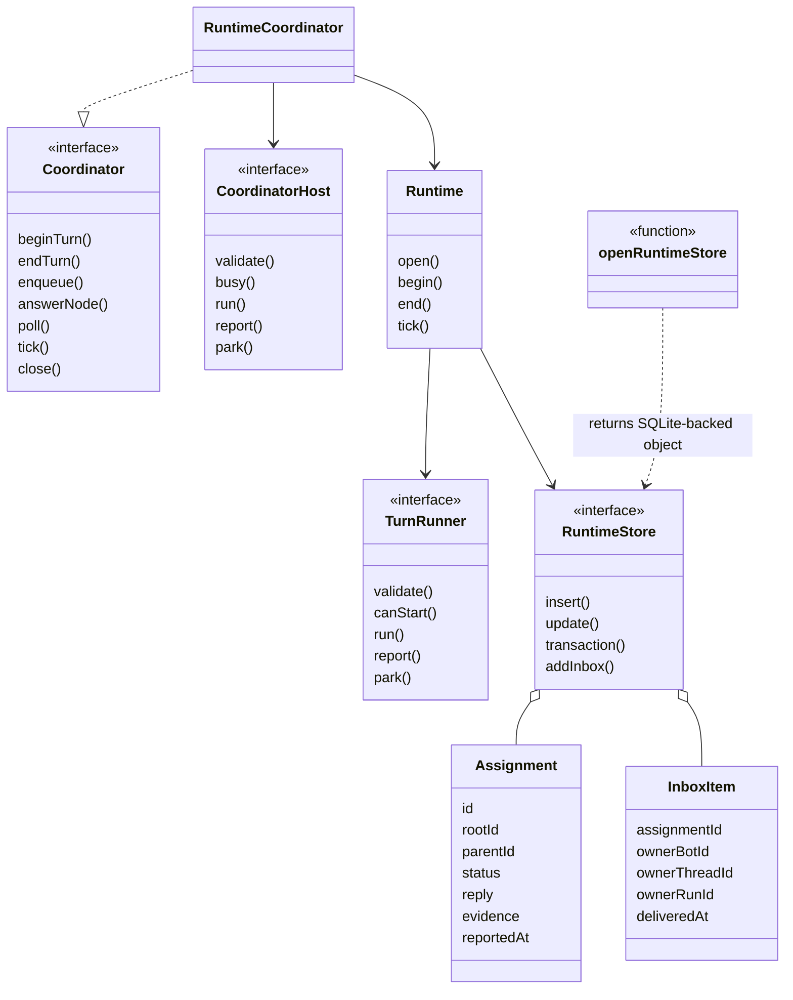
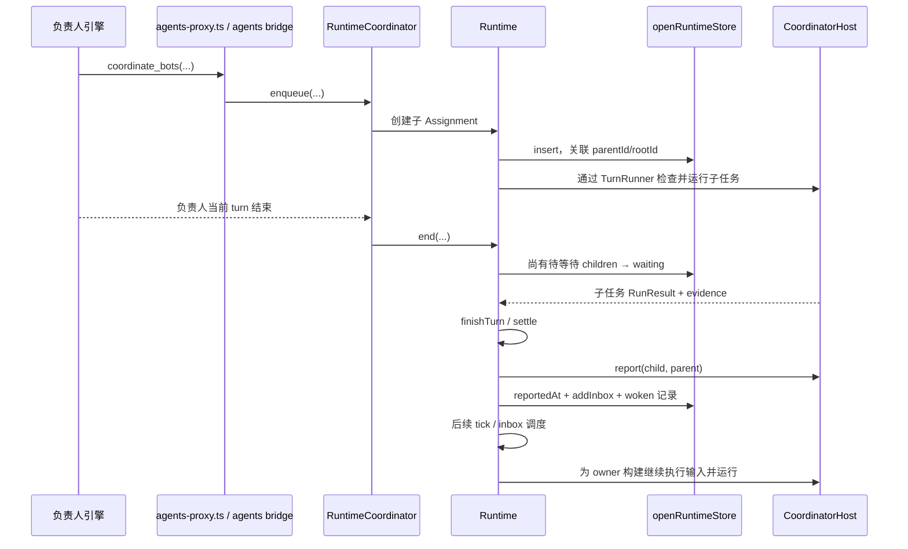
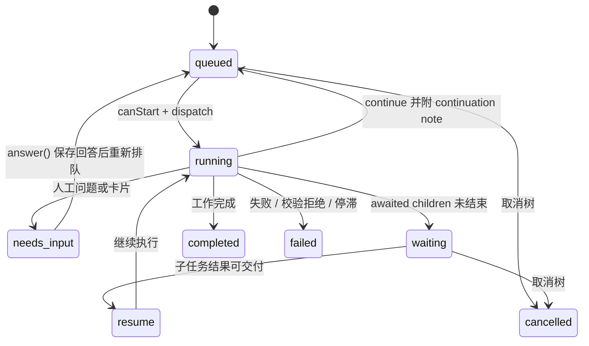

# 04 多 Agent 与持久化调度

## 目录

- [1. 协作为什么不能只用 Promise.all](#why)
- [2. 真实模块关系与 Assignment 数据模型](#model)
- [3. 父任务派工、子任务完成、父任务再运行](#handoff)
- [4. 状态机、询问与防空转](#state)
- [5. 重启恢复：哪些重跑，哪些不能重跑](#recovery)
- [6. 房间发言路由、channel 队列和并发边界](#rooms)
- [7. 源码入口](#source)

## 1. 协作为什么不能只用 Promise.all

“负责人派给研究员，再等研究员回答”看似只是一个异步调用，但用户可能关闭应用；负责人可能同时派了多项；研究员可能要问人；还可能已经向外发送邮件、不能随便重试。

项目因此把**工作单与其进度持久化**。负责人的 turn 可以结束，工作单仍留在 waiting；子任务完成写回结果，通过 inbox 提醒后续执行。继续的是同一业务工作，不是原来那段 JavaScript 调用栈。

## 2. 真实模块关系与 Assignment 数据模型

`runtime-coordinator.ts` 把应用层 host/旧 Handoff view 适配到 `Runtime` 和 `TurnRunner`。`coordinator.ts` 是契约层，不要当成另一套完全独立的 durable 引擎。

Assignment 关键字段：

- 身份与层级：id、rootId、parentId、depth。
- 目标：requester、assignee/destination、brief、doneWhen。
- 交互：mode = work / consult / notify；reply = resume / poll / none。
- 执行：status、executions、restarts、restart、continuation。
- 人工输入：question、answer、cards。
- 证据与结果：result、evidence、outcome、reportedAt。
- 风险控制：budgets、guard、approved、level、levelSource。

`openRuntimeStore()` 返回实现 RuntimeStore 接口的对象；其 SQLite 表 assignments、assignment_events、inbox 共同记录状态、事件及待交付唤醒。存储在 `runtime.db`，不是 messages.db 消息表的别名。源码没有一个名叫 SqliteRuntimeStore 的实体类，不能为画类图凭空添加它。

## 3. 父任务派工、子任务完成、父任务再运行

图中的“继续”取决于 reply 模式和归属，并不意味着每个 notify 都自动叫醒父 bot。`reply:none` 不创建 wake；poll 模式允许外部调用方主动取结果。

`report()` 只有在宿主报告成功后才记 reportedAt；报告异常放入 reportDue，后续再尝试。然后 `wake()` 以 ownerBot/thread/run 建 inbox lane，并累计 wake budget。父任务的 waiting → resume 由 `tick()` 核对 awaited children 全部 terminal 且已 reported 后推进；inbox 不是拿来跳过这项检查的快捷开关。**单一 inbox lane** 避免同一结果同时通过几条独立恢复路径重复送给主人。

## 4. 状态机、询问与防空转

这是主干状态视图，不穷举所有异常转换。实际 `finishTurn()` 会在 turn 结束时再次 validate，防止已经撤销的协作访问在返回结果时被继续保留。

- `needs_input` 持久化 question/cards，调用 runner.park，不能忙等模型反复追问。
- `continue` 重新 queued，同时记录 guard 和 continuation count；`loopStop()` 检测没有进展的循环。
- evidence 来自 harness 观察到的命令、文件、工具、outward 信息；不是模型声称“已完成”就变成证据。
- 通用 `Runtime` 默认 limits 包括 depth=4、requests=24、executions=48、wakes=48；**应用 `RuntimeCoordinator` 将 requests/executions 覆盖为 64/96，turnStallMs 覆盖为 24 小时，把逐 turn stall 留给 host watchdog**。另可通过 runtimeLimits 覆盖。不能拿通用默认值当当前应用最终配置。

这些预算的作用是限制递归协作和无进展唤醒，不是对外部交易提供原子提交保证。

## 5. 重启恢复：哪些重跑，哪些不能重跑

`Runtime.open()` 幂等，并在正常 tick 前按较深子任务优先检查未终态记录：

| 重启看到的现场 | 恢复策略 | 原因 |
|---|---|---|
| needs_input | 恢复 park/询问，不盲跑 | 原来就缺人的决定 |
| running，已派出子任务 | 转 waiting，标记 cut / teammates 等恢复说明 | 不重复派工，先等已有工作 |
| running，有向外副作用证据 | failed / interrupted | 邮件、发布等可能已发生，不能自动重放 |
| 已经 rerun 一次，又被截断 | failed / cuttwice | 防止重启无限重跑 |
| 可以安全恢复的其他未终态 | queued 或 resume，并登记恢复次数 | 用持久化输入再执行，而非还原栈 |
| terminal 但尚未 reported | 放入 reportDue | 补做结果交付，不重新执行工作 |

因此，“durable”准确含义是**记得工作是什么、归谁、到哪一步、接下来可做什么**。它不是任意工具 exactly-once，也不是应用退出后仍然保持同一个活跃进程。

## 6. 房间发言路由、channel 队列和并发边界

房间需要同时解决“谁回答”和“何时轮到他”，不能拿多 Agent 委派树替代全部房间逻辑：

| 模块 | 解决的问题 |
|---|---|
| `decider/room-routing.ts` | 有限候选中的发言路由，不是执行 Agent 本身 |
| `decider/index.ts` | 有界决策调用、配置、backend、失败结果与日志 |
| `channel-queue.ts` | channel/房间待发送内容、恢复、held head 和结算 |
| `room-queue.ts` | 可见的排队顺序与说明，避免把串行任务说成并行 |
| `room-member-lock.ts` | 房间成员运行占用相关约束 |
| `admission.ts` | 群聊/忙时/队首/容量等条件下决定 start、queue、steer、refuse |
| `runtime/` | 已创建协作 Assignment 的生命周期 |

room routing 的决策调用有 1500ms 超时及最低概率门槛 0.6；候选含 `__everyone__`。决策服务禁用、超时或低可信的情况是显式失败/无决策结果，调用方仍需执行其路由规则，不能把任意模型文字直接当调度命令。

channel 队列有 `holdChannelQueue()`、`settleHeldChannelQueueHead()`、`restoreHeldChannelQueue()`，目的是在取队首、实际交付和失败恢复之间保留清晰所有权。已确认交付的 steer 不能重启后又被当 pending 播一遍。

本节核对队列与路由模块的职责和关键接口，未穷举所有群组目标、外部聊天接入与语音会议分支；继续阅读应从 `routes/channels.ts`、`routes/groups.ts` 和 index.ts 的对应调用点进入。

## 7. 源码入口

`coordinator.ts`、`runtime-coordinator.ts`、`runtime/types.ts`、`runtime/runtime.ts`、`runtime/store.ts`、`runtime/tree.ts`、`drivers/agents-proxy.ts`、`channel-queue.ts`、`room-queue.ts`、`decider/`。
