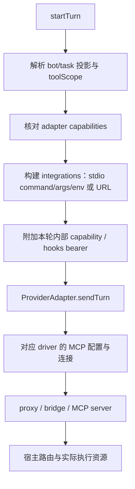
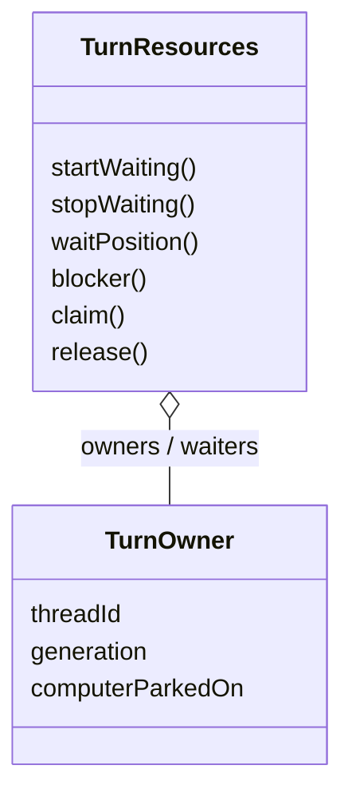

# 05 工具与执行资源

## 目录

- [1. 工具不是只有一套](#types)
- [2. 从本轮工具选择到 MCP 挂载](#mount)
- [3. 工具发现、结果预算与上下文成本](#results)
- [4. 电脑、浏览器和手机的资源所有权](#ownership)
- [5. 访问能力、Prompt 与沙箱的区别](#boundary)
- [6. 源码入口](#source)

## 1. 工具不是只有一套

`SendTurnInput.integrations` 是理解执行能力的直接入口：

| 字段 / 类别 | 作用 | 注意事项 |
|---|---|---|
| agents | 队友发现、协作和相关宿主能力 | 宿主管 turn、权限和递归，不由 peer 任意开进程 |
| composio | 外部集成连接，通过宿主拥有的 stdio bridge | 连接请求可成为可信聊天卡片 |
| localComputer | 所选电脑 MCP 连接 | 只有主机桌面才标记 host scope，不可把规则套到所有远程电脑 |
| phone | Android 手机相关工具 | 不是浏览器截图的同义词 |
| browser | 内建浏览器代理 | 按 bot 的 tab / persistent partition 组织 |
| data | Data MCP 代理 | 面向 bot 自有数据库的 DuckDB 工具 |
| custom | 用户配置的 MCP server | 需要实际协议/范围/审批支持，不默认全部预允许 |
| hooks | turn-scoped URL 和 token | 观察与注入上下文，不拥有业务状态裁决权 |
| dweb | 对应 daemon HTTP 能力 | 独立集成入口 |

引擎也可能有自己的 shell、文件、web 等原生工具。是否能执行某个动作，要同时看原生引擎配置、宿主挂载的 MCP 与本轮权限，不能只查 prompt 有没有工具名。

## 2. 从本轮工具选择到 MCP 挂载

proxy/bridge 是协议边界：引擎与工具之间常有独立子进程或 HTTP 通道，不是在同一个函数里 `callTool()` 就结束。配置 env 可能包含本轮能力凭据，因此日志与公开 UI 不能把整份 integrations 原样输出。

`mcp-registry.ts` 管服务器配置解析，`mcp-gate.ts`、`mcp-bridge.ts`、`mcp-remote-proxy.ts` 等处理不同接入路径。本轮文档说明公共挂载与预算边界，不把全部 OAuth、远程握手、schema 兼容分支简化为一个虚构 MCPManager 类。

## 3. 工具发现、结果预算与上下文成本

工具太多会同时增加 schema 成本和模型选错的概率。系统提示中可出现 `find_tool/use_tool` 的分级发现说明；只有 agents bridge 实际挂载时才应 advertise 相应能力。**在 prompt 里宣布工具存在不等于已经挂载工具。**

工具结果预算是另一条链路：

- `mcp-trim.ts` 默认结果预算 8000 字符。
- `mcp-result-budget.ts::attachCustomMcp()` 将 `customResultBudgets` 与 specs 分开放进 integrations；不要给原生引擎不认识的 server spec 硬塞字段。
- custom 服务器的预算可配置；契约中 0 表示不裁剪。
- 对结构化内容有结构裁剪相关处理，而不是所有 JSON 随便截断成坏 JSON。
- 这是相应 MCP 路径的单结果预算，不是保证所有 provider 原生工具都被同一代码裁剪。

它与 [02 的会话 compaction](02-messages-context-and-sessions.md#compact) 配合控制成本，但一个控制“刚返回的工具负载”，另一个控制“重建时保留哪些历史”，两者不应混叫成一次消息数据库清理。

## 4. 电脑、浏览器和手机的资源所有权

`TurnResources` 对 app-managed 资源实施**整轮占用**。原因很直白：A 看完截图，B 抢先点击换页，A 再按刚才截图点击，操作现场已经错位。

- owner 由 threadId + generation 识别，不只是 botId；同线程的新轮次不能被旧异步回调误释放。
- 当前 owner 可重验自己的 claim，不会因为等待队列存在而丢掉已占用资源。
- 资源空闲时有 waiters 则由队首获取，不能让新来者无限插队。
- lazy claim 等待失败后不应永远占据等待队首。
- 等待位置与 EWMA 等待耗时可用于给用户解释排队，而非静默卡住。

相关模块包括 `computer-selection.ts`、`computer-control.ts`、`shared-computers.ts`、`local-vm-lease.ts` 等；它们处理不同设备/共享场景，不能把所有远端 VM 生命周期都归给 `TurnResources` 这个小类。

## 5. 访问能力、Prompt 与沙箱的区别

| 机制 | 能解决 | 不能据此证明 |
|---|---|---|
| Prompt | 告诉模型角色、上下文、哪些能力可用 | 恶意模型不能越权 |
| toolScope / adapter capability | 本轮选择范围、引擎是否支持约束 | 该引擎所有原生 shell 已被 OS 隔离 |
| 内部 turn capability | 把宿主内部路由权限绑定到轮次 | 任意用户脚本都具备相同权限 |
| TurnResources | 整轮设备占用与竞争 | shell sandbox、文件系统隔离 |
| provider 原生 sandbox / guest confinement | 对应 provider 路径的执行约束 | 所有引擎、所有远端资源具备一致能力 |

这也是为什么关机先 revoke capability、再慢慢清理进程：网络/子进程寿命与业务授权寿命不能绑死在一起。

## 6. 源码入口

`contracts.ts::SendTurnInput`、`turn-resources.ts`、`mcp-registry.ts`、`mcp-trim.ts`、`mcp-result-budget.ts`、`harness-mcp-proxy.ts`、`drivers/agents-proxy.ts`、`computer-selection.ts`、`shared-computers.ts`。
