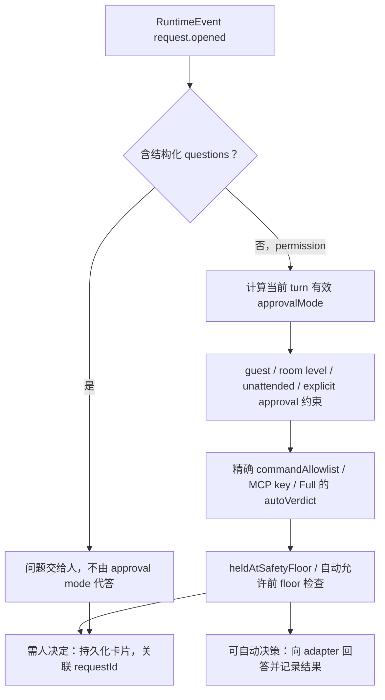
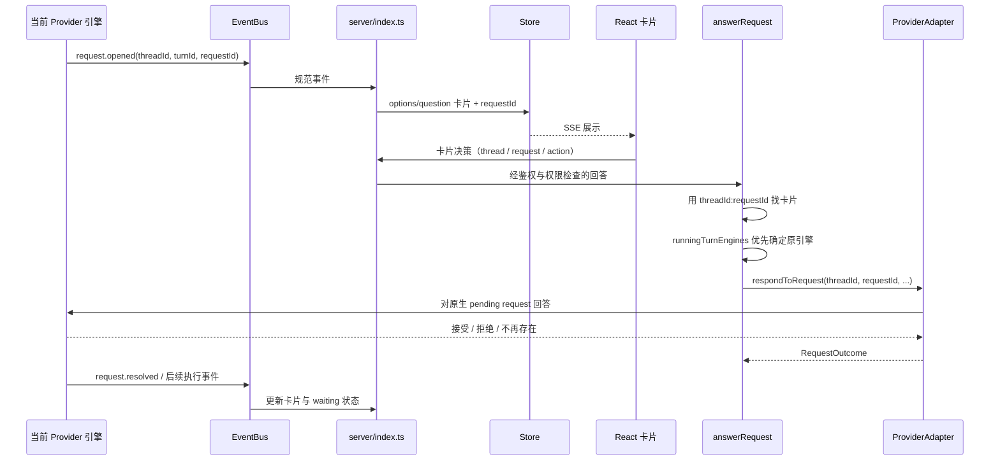

# 06 权限、审批与安全边界

## 目录

- [1. 权限不是一个 autoApprove 布尔值](#layers)
- [2. 从 request.opened 到自动决策或卡片](#decision)
- [3. 人点击允许以后，原 tool call 如何继续](#answer)
- [4. 一个完整审批示例与现场丢失](#example)
- [5. HTTP 身份、内部能力与共享部署风险](#auth)
- [6. safety floor 的准确保护范围](#floor)
- [7. 源码入口](#source)

## 1. 权限不是一个 autoApprove 布尔值

至少应分开看：HTTP 调用者身份、bot/task 的审批模式、toolScope、provider 原生执行约束、当前 turn capability，以及设备访问控制。

`shared/approval-mode.ts` 定义 `ask / edits / auto / full / custom`：

| 模式 | 含义与边界 |
|---|---|
| ask | 交给引擎对应的人工审批模式；不等于所有引擎有相同 sandbox |
| edits | 仅有实现映射的引擎提供自动接受编辑模式 |
| auto | 依赖对应引擎/驱动的自动审查语义，不等于所有工具无条件允许 |
| full | 对应引擎最宽松模式，或由宿主回答剩余 permission 请求 |
| custom | 本基线仅 Codex 支持，对应 provider 语义不能跨引擎照搬 |

**个人工作区代码默认是 full，不是 ask。** 共享公司部署可在启动时将默认设为 ask。未知的已存模式降到 ask；未完成的两阶段 `approvalGrant` 在确认前也只按 ask 执行。

切换引擎还要核对目标是否支持该模式；custom 规则跨引擎不能沿用。审批模式与工具范围独立：允许一个引擎自动判断，不意味着主人没有选中的工具也应挂载。

## 2. 从 request.opened 到自动决策或卡片

这不是“每个命令都先给宿主 LLM 审一遍”。多数 provider 已先按原生 permission mode 运行；宿主处理实际收到的 request，并在有明确规则时回答。

源码还限制：

- questions 即便走 permission 通道，仍按问题处理，不能 full 模式自动伪造人的回答。
- guest-driven turn 不能使用主人保存的 command grants 自动回答。
- 持久 MCP grant 绑定 provider 实例和服务器配置；换引擎或改 server 配置后不能误沿用旧许可。
- 不用被截短的 display summary 生成危险命令校验结果，也不从导入聊天记录恢复一份可信 live grant。

## 3. 人点击允许以后，原 tool call 如何继续

关联键必须包含 threadId：provider 的 request/item id 只在所属 thread 内唯一。`askMessageByRequest` / `toolMessageByItem` 因此不能只用 requestId 做全局 map。

`answerRequest()` 优先取 `runningTurnEngines.get(threadId)`，因为用户可能已经修改 bot 当前模型选择，而原来的请求仍属于旧引擎正在跑的 turn。

真实回执为：

- `allowed-once`：引擎接受了这次授权。
- `rejected`：拒绝。
- `answered`：问题已回答。
- `unavailable`：没有可用的回答者，fail closed。

`always` 只有卡片本身允许会话记忆、行为为 allow 时才透传。原生 session grant 由 provider 保管；另有明确的 bot-wide command allowlist，且只有原请求得到 `allowed-once` 后才尝试保存，不能按钮一按就先发永久通行证。

## 4. 一个完整审批示例与现场丢失

假设当前模式为 ask，一个原生工具操作触发了 provider 的 permission 请求：

1. 引擎暂停该工具调用，产生 requestId=`r7`，属于 thread=`t1` 的 turn。
2. 宿主保存卡片，UI 展示工具、参数说明和可选动作；`askMessageByRequest["t1:r7"]` 关联卡片记录。
3. 人点击“允许一次”，服务端核对调用者与当前卡片操作资格。
4. `answerRequest("t1", instanceId, "r7", "allow")` 找到**原 turn 的引擎实例**。
5. adapter 将许可送回原 pending request，引擎继续原工具，再继续自己的推理循环。
6. 事件更新审批卡片和输出；不需要把“我同意”作为普通 user 消息新开一次 turn。

**这条链路通常不是 restore。** 执行现场还在原生进程的等待点，requestId 指向那个等待者。`permission-proxy.ts` 的 Claude 路径更具体：CLI 的 permission prompt tool 经 Unix socket 询问 broker，broker 通过对应 id 把回答送回正在等待的 Promise；连接断开时全部等待项按 deny 收尾。

如果进程已经退出/应用重启，DB 留下卡片并不意味着原 pending Promise 也活着。adapter 找不到请求应返回 unavailable，不能假装批准旧工具并重新执行。协作任务的 `needs_input` 可以经 durable 状态机恢复，但它与 provider 内部暂停的 tool permission 是不同层次的恢复问题。

## 5. HTTP 身份、内部能力与共享部署风险

`request-auth.ts` 区分：

- 回环信任：同时核对 Host / Origin 等条件。
- 配对 session：bearer、cookie、stream ticket；采用 session scope 和同源/CSRF 约束。
- owner 与 service 模式：共享服务中 bot shell 也可能是回环调用者，不能自动视作机器主人。

内部工具另用 turn-scoped capability，绑定 generation / provider turn，并在停止、作废和退出时撤销。这里的授权寿命短于子进程寿命，避免旧异步操作借用新 turn 的权限。

**代码本身明确记载一个开放风险**：service-trust 下部分 session-less loopback 路由为 Slack worker 开放，而 bot 的 shell 也能成为回环调用者，可能触达同一白名单中的 guarded message/task 等操作。源码注释提出由 relay token 收紧的方向，但本文不把“计划修复”写成“已经隔离”。这不是一次完整漏洞审计，却是理解共享部署信任模型不可省略的边界。

## 6. safety floor 的准确保护范围

名字叫 safety floor，不代表所有危险命令都被底层 OS 拦住。实际代码：

- 默认关闭；config `safetyFloor.enabled` 或 `OMB_SAFETY_FLOOR=1` 开启。
- Windows server 路径当前不实施该检查，会提示。
- 规则包含 delete-root、delete-home、delete-system-directory、format-disk、overwrite-disk、fork-bomb。
- 只在宿主准备**无人查看地自动允许命令**的路径加一道检查。
- 明确命中 never-list 时自动 deny，并记录 decision；无法完整解析时不认作 clear，转人工/不自动授权。
- 人自己在卡片上做的决定不由这道自动审批 floor 覆盖。
- 如果 native 引擎在 bypass/yolo/approvals-off 模式根本不询问宿主，这个 gate 无法拦截它。

因此它是自动许可的附加条件，不是跨所有引擎、所有模式都不可绕过的安全沙箱。

## 7. 源码入口

`shared/approval-mode.ts`、`request-auth.ts`、`permission-proxy.ts`、`auto-approve.ts`、`safety-floor.ts`、`safety-floor-gate.ts`、`index.ts::answerRequest` 和 `request.opened/request.resolved` 归约。
