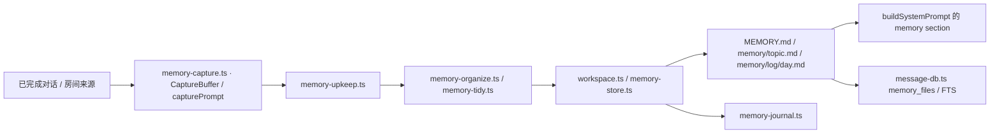
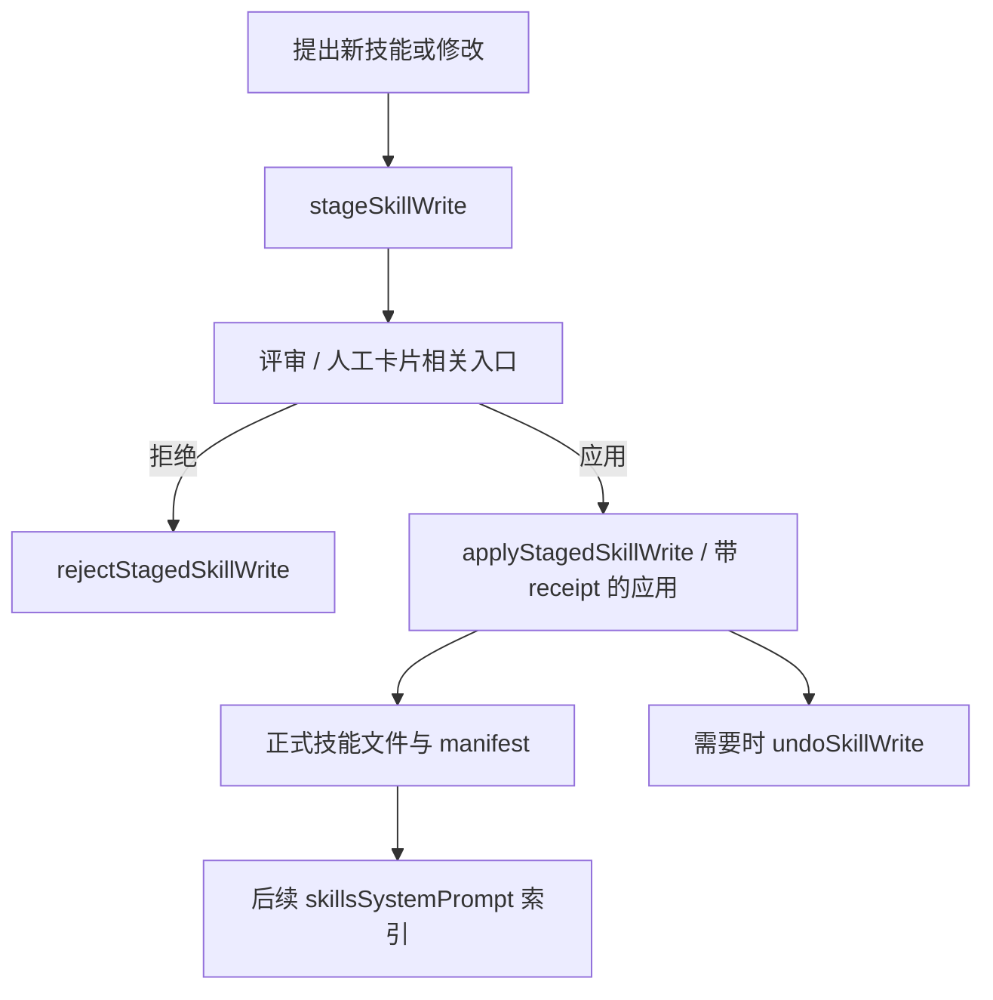

# 07 记忆、技能与自动化

## 目录

- [1. 三类“长期信息”不要混用](#concepts)
- [2. Memory：文件事实、主题与后台整理](#memory)
- [3. Skills：索引、正文、候选修改与应用](#skills)
- [4. Routines：计划、运行记录和连续执行](#routines)
- [5. 与主执行链的连接及一个例子](#example)
- [6. 源码入口](#source)

## 1. 三类“长期信息”不要混用

| 信息 | 解决什么问题 | 不是 |
|---|---|---|
| Conversation compaction | 当前会话过长，保留目标/纠正/进展 | 永久事实数据库 |
| Memory | 用户偏好、长期决定、主题事实 | 每轮全部原始 tool output |
| Skills | 可复用的方法、操作流程、参考资料 | 一段随意贴到用户消息中的历史摘要 |

Routine 则是第四个维度：它解决什么时候、对谁发起哪份工作，而不是另一种存储记忆的方法。

## 2. Memory：文件事实、主题与后台整理

这是模块关系图，不意味着所有文件写入都固定经过一条完全相同的函数链；API 手工编辑、后台 capture 和整理各有入口。

### 文件形态与安全边界

`parseMemoryPath()` 明确只接受三个形态：

- `MEMORY.md`：核心 notebook / 索引。
- `memory/<topic>.md`：主题文档。
- `memory/log/<day>.md`：日期日志。

这是 allowlist，不是“清洗任意路径后读取”。`MemoryStoreError` 包含 path、conflict、too-large、forbidden 等类型；冲突可携带 currentHash/current，避免并发编辑悄悄覆盖。

### 捕获哪些内容

`capturePrompt()` 要求只保留可归因、持久的信息，避免把 bot 的建议/猜测当用户事实。房间消息还区分 Person、其他人、其他 bot：别人说“用户喜欢 X”不能自动变成 aboutUser。

候选可以进入 core 或主题；主题有 aliases，便于按用户的不同说法找到同一主题。对用户自身的长期事实有 aboutUser 标记，但仍受来源判断约束。

### 后台维护不是一次摘要函数

`memory-upkeep.ts` 结合 capture、organize、tidy 和矛盾处理，并有工作量边界（例如 CAPTURE_MAX_TURNS=6、MODEL_TIMEOUT_MS=60000、MAX_PENDING_THREADS=50）。它还在捕获时重新检查可见性，避免排队前可见、现在已撤权的对话仍被记住。

`generateMemoryText` 在 ProviderInstance 契约中专为背景步骤预留；调用方选择可用引擎之后才做维护。记忆整理、会话标题、会话 compaction 不应被理解成完全相同的模型任务。

## 3. Skills：索引、正文、候选修改与应用

技能模块不仅是扫描一个目录：

| 模块 / 函数 | 责任 |
|---|---|
| `skill-library.ts` / `skill-storage.ts` | 技能库与存储入口 |
| `skills.ts::resolveBotSkills` | 合并 bot 已安装与被分配的 library skills |
| `skillsSystemPrompt` | 生成有预算的启用技能索引，指向 SKILL.md |
| `enabledSkillFile` | 只解析当前启用且可用的技能正文路径 |
| `expandSkillCommandTurnText` | 技能命令入口的 turn 文本展开 |
| `stageSkillWrite` | 准备创建/更新候选，不直接把提案当正式技能 |
| `applyStagedSkillWrite` / `applySkillWriteWithReceipt` | 审阅后应用与回执 |
| `rejectStagedSkillWrite` / `undoSkillWrite` | 拒绝和撤销路径 |
| `skill-review.ts` / `skill-share.ts` | 评审、分享等相邻功能 |

**常规索引不是把所有 SKILL.md 正文全塞进 system prompt。** `skillsSystemPrompt()` 对条目数量和 UTF-8 字节预算做限制，条目包含说明及应读取的文件；省略技能会被告知/记录，不谎称所有技能已经注入。

分享、包导入、组织技能另有来源与完整性处理，不能简化为无校验地覆盖同名目录。

## 4. Routines：计划、运行记录和连续执行

`RoutineManager` 区分“计划配置 Routine”和“某次运行 RoutineRun”。计划配置包含目标、prompt、schedule、runOn、enabled、持续时间/超时、attachments、continuity、overlap 等。

- schedule：once、daily、cron、interval；interval 可带工作日/时间窗口/结束时间。
- trigger：schedule、manual、webhook、startup。
- target：bot 或 room-goal。
- runOn：maus 与 cloud；契约注释明确 cloud 是在 bot Boat VM 中运行 agent，maus 使用 bot 自身 provider 并按需借用电脑工具。
- overlap：skip / queue，明确同计划重叠如何处理。
- continuity：携带前次运行相关上下文；本基线校验拒绝 room-goal continuity，不能画成所有 target 都支持。

运行状态包括 queued、running、waiting、completed、failed、cancelled、missed。waiting 不必然是引擎坏了，也可能需要人工/执行资源。

启动顺序也重要：`index.ts` 在 endpoint 已监听且相关 registry 初始化后才 `routines.start()`；队列恢复、turn admission 和资源选取仍走宿主规则，而不是定时器直接绕过权限调用 CLI。

## 5. 与主执行链的连接及一个例子

例子：用户希望每天检查项目风险，且报告简短。

1. “报告简短”若是长期偏好，可进入 Memory；本轮临时“这一次写一页”不必永久保存。
2. “如何检查风险”的可复用方法适合 Skill；索引指出需要读取哪个 SKILL.md。
3. “每天 9 点检查”属于 Routine 的 schedule/prompt，产生独立运行记录。
4. 运行时宿主从 bot/task 配置构建 system、memory、技能索引和工具范围，再发给引擎。
5. 需要队友核查时进入 Assignment；需要人决定时进入问题卡片，而不是让定时任务猜测批准。
6. 会话历史太长由 compaction/replay 处理，不应该为了“腾 token”删除长期偏好或把所有历史都写进 MEMORY.md。

## 6. 源码入口

`memory-store.ts`、`memory-capture.ts`、`memory-upkeep.ts`、`memory-organize.ts`、`memory-tidy.ts`、`memory-journal.ts`、`workspace.ts`、`skills.ts`、`skill-library.ts`、`routines.ts`、`routine-execution.ts`。
