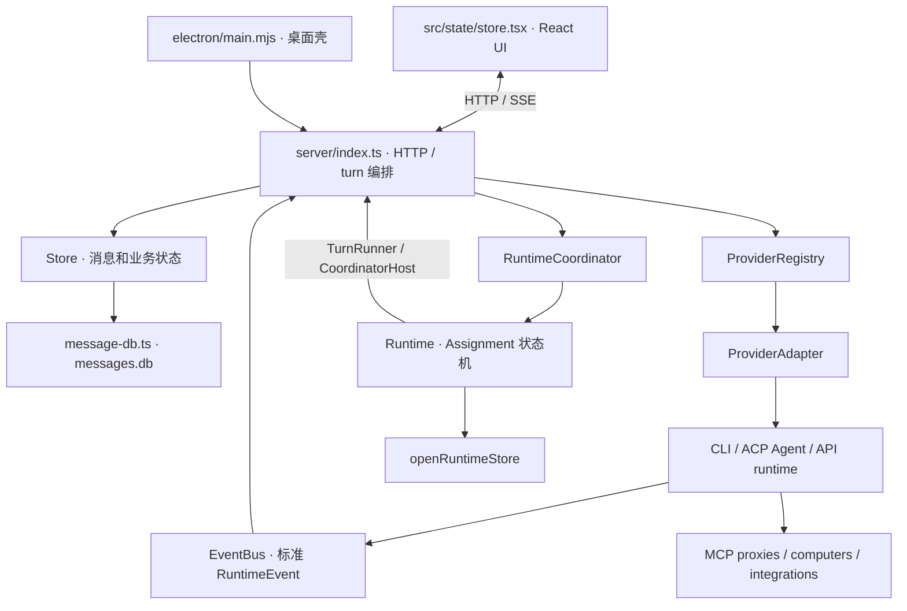

# OpenMausBot 源码设计原理

> 阅读基线：本地 `OpenMausBot`，版本 `0.1.111`，提交 `c2cf30127c9fb6fb506be533f361214f764c01da`；整理日期：2026-10-16。本文解释这一份代码，不代表上游最新发行版。

## 目录

- [1. 先理解它是什么](#overview)
- [2. 按问题找文档](#reading)
- [3. 一张图理解全局](#map)
- [4. 阅读时必须分开的概念](#concepts)
- [5. 覆盖范围与证据](#scope)

## 1. 先理解它是什么

**OpenMausBot 是以聊天为交互面的、多执行引擎的 Agent 应用宿主。** 用户看到的是 bot、房间、任务、工具卡片和电脑；服务端管理的是线程、执行轮次、引擎实例、权限、资源所有权和可恢复的协作任务。

它不是把所有模型接到同一段手写 `while (tool_calls)` 上：Claude/Codex 等原生引擎有自己的会话和工具循环；API 驱动则由应用侧运行时组装请求。项目统一的是**宿主契约和可观察事件**，不是强行抹掉各引擎差异。

最值得学习的设计：

1. 用 Driver / Instance / Adapter 三层，把“引擎类型”“已配置账号实例”“本轮执行接口”分开。
2. 用消息树保留可回退的聊天记录，用 replay 投影决定模型实际看到什么。
3. 用 Assignment + Inbox 持久化协作，把“重启后继续工作”从进程内 Promise 中解放出来。
4. 将 steer 的不确定交付、审批的真实回执、电脑资源的 generation 所有权作为正确性问题，而非 UI 小细节。
5. 同时保留边界：`server/index.ts` 仍是大型装配与编排中心；local-first 不等于不用云，也不等于自动具备强隔离。

## 2. 按问题找文档

| 想弄清楚什么 | 文档 |
|---|---|
| 整体分层、实体关系、启动和退出、目录职责 | [01 整体架构与生命周期](01-architecture-and-lifecycle.md) |
| DB 怎么变成工作区消息？消息是否直接发模型？压缩、回退、恢复、steer 怎么处理？ | [02 消息、上下文与会话](02-messages-context-and-sessions.md) |
| 多引擎如何接入？请求怎么发？流式输出如何到 UI？ | [03 引擎驱动与事件链路](03-engines-and-events.md) |
| 多 Agent 如何委派、等待、唤醒？房间谁发言？重启能恢复什么？ | [04 多 Agent 与持久化调度](04-coordination-and-rooms.md) |
| 工具如何挂载？MCP、电脑、浏览器、数据工具的边界在哪里？ | [05 工具与执行资源](05-tools-and-resources.md) |
| 什么情况下询问人？点击允许如何对应原 tool call？安全默认值是什么？ | [06 权限、审批与安全边界](06-permissions-and-security.md) |
| 记忆与聊天摘要有何不同？技能怎样安装与审批？定时任务如何接入？ | [07 记忆、技能与自动化](07-memory-skills-and-routines.md) |
| 去哪里继续读源码？有哪些外围模块？怎样验证、有哪些设计取舍？ | [08 源码导航、验证与设计取舍](08-source-map-and-verification.md) |

建议初读顺序：01 → 02 → 03 → 04；涉及实际运行前先读 06。每篇都有独立可见目录。

## 3. 一张图理解全局

图中 `Runtime` 不是模型推理循环，`EventBus` 也不是任务调度器。它们分别管理协作状态和执行事件。

## 4. 阅读时必须分开的概念

| 概念 | 在代码中的含义 | 不等于 |
|---|---|---|
| Bot | 角色、模型选择、技能、工具与任务的拥有者 | 一个永远不退出的模型进程 |
| Thread / Task | 会话标识与工作任务投影 | provider 原生 session id |
| Message | `WireMessage`：用户可见记录，含卡片、活动、压缩记录等 | API 的 `messages[]` |
| Turn | 一次交给 adapter 的执行轮次 | 必然只有一次模型 HTTP 请求 |
| ProviderDriver | 一类引擎的工厂和配置解码器 | 一个账号 |
| ProviderInstance | 某个具体配置生成的引擎实例 | 一个聊天线程 |
| Assignment | 可持久化、可嵌套的协作工作单 | 单条聊天消息 |
| Approval request | 当前执行中的具体询问，有 requestId | 往聊天框再发一个“同意” |
| Memory | 跨轮次的长期事实与主题笔记 | compaction 的历史摘要 |

## 5. 覆盖范围与证据

本轮深入追踪宿主启动、直接消息发送、上下文重建、压缩、steer/followup、驱动契约、事件回写、协作恢复、审批回传；对记忆、技能、自动化和执行资源给出已核对的模块设计。Electron、Companion、Cloudflare、企业部署等外围系统列出职责与阅读入口，**不宣称逐个协议和部署分支均已验证**。

- 每章末尾提供源码入口；[源码索引](08-source-map-and-verification.md)集中给出行号。
- `source-evidence.json` 固定源码提交、引用位置和文件摘要，可检测漂移。
- `verify_docs.py` 检查目录锚点、链接、围栏和证据匹配；不启动应用，不读 live 数据。
- 图是源码关系的解释性视图，不是新增类；注明“示意”的代码不冒充可直接复制的完整实现。
