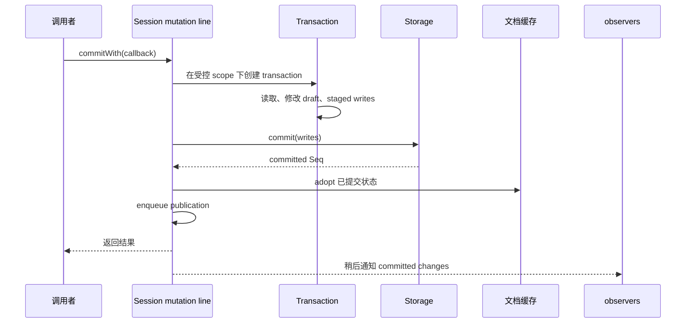
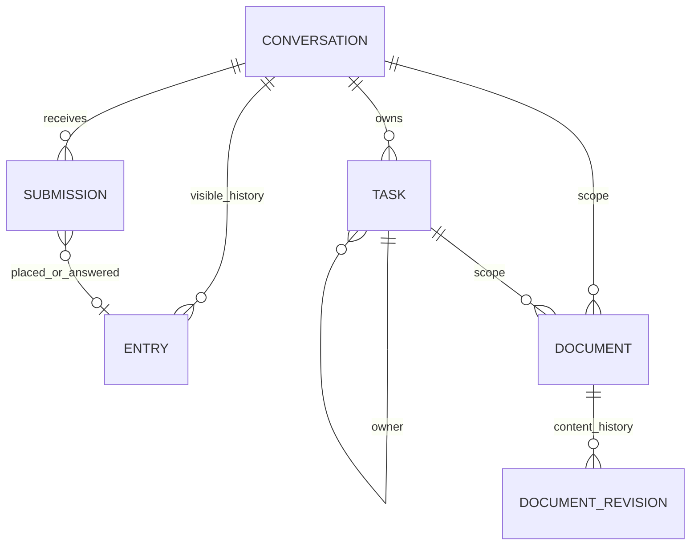
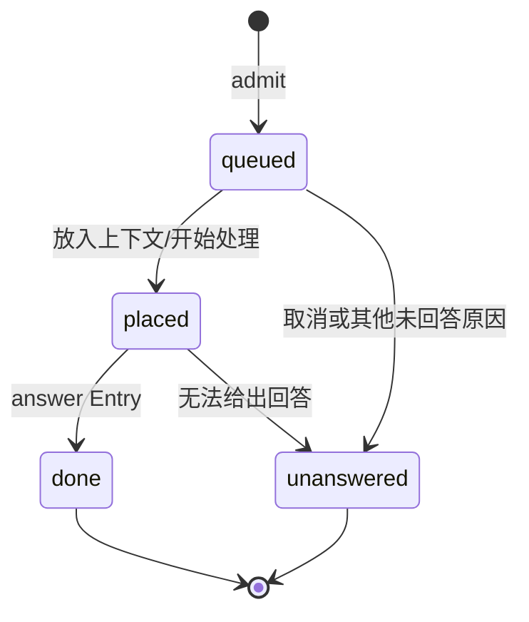
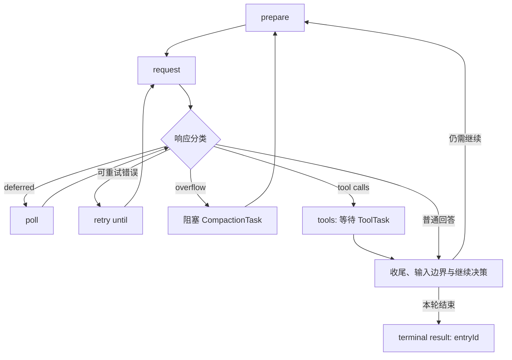
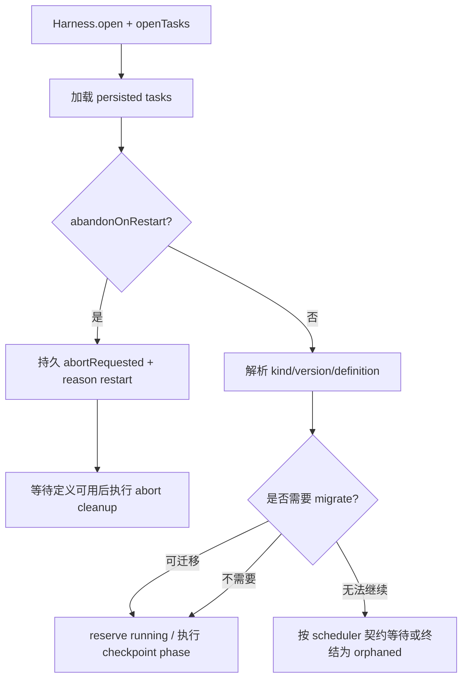
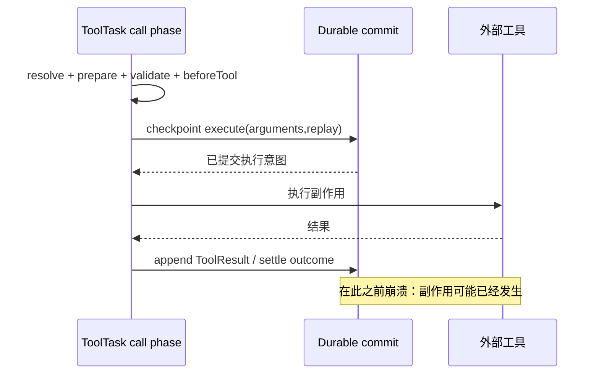
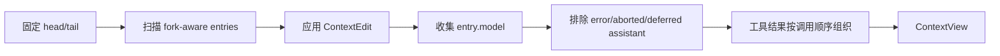

# Pi 后端深潜：提交、任务恢复、工具副作用与存储

> 本文补充旧架构文档缺少的后端语义。基线：本地 Pi `1729ff447841e7666159a6f8bf70fbd6bac05642`，workspace `1.2.0`。
> 先读 [全景补充](./PI_SOURCE_DEEP_DIVE_2026.md)，再对照 [源码清单](./SOURCE_MAP.md)。

## 目录

- [1. 先区分两种持久化](#1-先区分两种持久化)
- [2. 一次提交到底做了什么](#2-一次提交到底做了什么)
- [3. 后端的五类事实](#3-后端的五类事实)
- [4. 从用户请求到可恢复任务](#4-从用户请求到可恢复任务)
- [5. 重启恢复不是从头再跑](#5-重启恢复不是从头再跑)
- [6. 工具副作用：不能许诺恰好一次](#6-工具副作用不能许诺恰好一次)
- [7. 文档分叉与会话上下文](#7-文档分叉与会话上下文)
- [8. 内存、JSONL、SQLite 后端](#8-内存jsonlsqlite-后端)
- [9. 失败、取消、重试与观察](#9-失败取消重试与观察)
- [10. 调试和设计取舍](#10-调试和设计取舍)

## 1. 先区分两种持久化

**问题**：磁盘上有 JSONL，是否意味着运行到一半的工具可以恢复？

**例子**：Agent 执行 `bash`，文件已经写了，但最终结果还未写入会话；此时 Pi 退出。如果只有聊天历史，你只知道模型发过一条调用请求，不能判断 shell 副作用发生了多少。

**解决**：区分“保存对话”与“保存执行协议”。

| 维度 | coding-agent SessionManager | durable Session + Harness |
|---|---|---|
| 保存什么 | header、message、compaction、metadata、分支 entry | conversations、entries、submissions、tasks、documents |
| 恢复入口 | 重读会话、恢复 leaf/context/model 等 | 重建任务索引，从 checkpoint/phase 恢复 |
| 当前执行 | Agent core loop + AbortController | invocation + durable TaskState |
| 文件格式 | 单个 session JSONL 的 `type`/`parentId` | `main.jsonl` marker + sidecar 的 commit 协议 |
| 应用边界 | 本地 coding 产品 | 可供服务/worker/宿主使用的基础库 |

源码：[SessionManager](../../pi/packages/coding-agent/src/core/session-manager.ts)、[SessionImpl](../../pi/packages/durable/src/session/session.ts)、[ToolTask](../../pi/packages/durable/src/harness/tool.ts)。

> 旧文档里若把“leaf 行”“lane/registers”“agent/harness/session”写成当前通用格式，不应照抄。当前 CLI 与 Durable 的 JSONL 是不同协议。

## 2. 一次提交到底做了什么

### 2.1 Session 的 mutation line

“mutation line”用人话说，就是：**同一个 Session 的状态更改，排成一条队；一条提交没结束，下一条不能插进来修改它依赖的状态。**



不是“先把缓存改了，再试着写磁盘”。Storage 成功与内存 adopt 必须衔接；出现无法 adopt 的情况会失败关闭，避免缓存和后端分裂。

源码：[session.ts](../../pi/packages/durable/src/session/session.ts)、[transaction.ts](../../pi/packages/durable/src/session/transaction.ts)、[observation.ts](../../pi/packages/durable/src/session/observation.ts)。

### 2.2 一个必须提醒的死锁点

`TaskRuntime.commit()` 的回调里只能通过 `tx` 读状态。不要在里面调用 `runtime.snapshot()`、`getTask()`、`watchDoc()` 或 Session 外部读方法。

```ts
// 示意：读操作也排在 mutation line 上。
await runtime.commit(async (tx) => {
  // 正确：通过当前事务读取，不重新排队。
  const doc = await tx.doc(MyDoc, runtime.conversationId);
  doc.count += 1;

  // 错误思路：调用 snapshot() 又排到当前提交后面。
  // 当前 callback 等 snapshot，snapshot 等 callback 释放 line -> 死锁。
  return undefined; // 不替换 task state，只提交文档变化
}, context);
```

依据：[TaskRuntime 的 commit 契约](../../pi/packages/durable/src/types.ts)。此处 `MyDoc` 为示意 token，不是源码里的内置类型。

## 3. 后端的五类事实



这是逻辑关系图，不声称 SQLite 全部使用了对应 foreign key。

- **Conversation**：会话身份、父分叉位置、ownership。
- **Entry**：已提交历史事实；`model` 决定它贡献哪些模型消息；可带 `head` 改变上下文起点。
- **Submission**：外部输入的收据；包含 queued/placed/done/unanswered 状态。
- **Task**：输入、定义版本、checkpoint、owner、取消标记、outcome。
- **Document**：当前状态或可回溯状态，例如配置、队列、进度、usage。

内置文档不是“另一份聊天记录”：

| 文档 | 职责 | history / fork |
|---|---|---|
| `AgentDoc` | conversation 的模型、扩展、instructions 等配置 | rewindable / asOf |
| `InboxDoc` | 等待进入当前或下一轮的输入 | latest / initial |
| `LiveDoc` | 正在执行的 run/tool/compaction 展示状态 | latest / initial |
| `ProviderDoc` | conversation 关联的 Provider session 状态 | latest / initial |
| `UsageDoc` | 本会话模型和工具 usage 汇总 | latest / initial |
| `NestedCallDoc` | 工具内部调用的 durable receipt | task scope |

源码：[agent.ts](../../pi/packages/durable/src/harness/agent.ts)、[inbox.ts](../../pi/packages/durable/src/harness/inbox.ts)、[live.ts](../../pi/packages/durable/src/harness/live.ts)、[usage.ts](../../pi/packages/durable/src/harness/usage.ts)、[tool.ts](../../pi/packages/durable/src/harness/tool.ts)。

## 4. 从用户请求到可恢复任务

### 4.1 Submission：先接纳，再执行

`Conversation.submit()` 不是同步拿到模型回复。它先持久接纳请求，返回 `Submission` handle，宿主可以 `status()`、`wait()`、`abort()`。



当 conversation 忙时，`whenBusy` 可指定 `steer`、`followUp`、`reject`；还有 `type: write` 的被动 entry 提交。`requestId` 是 admission 的请求标识，具体去重/一致性行为以 `admitSubmission` 实现为准，不能扩大成外部副作用恰好一次。

`abort()` 返回 `aborted`、`already_placed` 或 `settled`，所以“取消请求”不一定代表已执行的操作撤回了。

源码：[submissions.ts](../../pi/packages/durable/src/harness/submissions.ts)、[harness/types.ts](../../pi/packages/durable/src/harness/types.ts)。

### 4.2 GenerationTask 是 phase machine



此图表达 phase/决策关系，省略 storage commit 的细节，不表示每条箭头都是源码里的单一函数调用。

`request` checkpoint 保存 model ref、thinkingLevel、streamOptions、cutoff。恢复时请求选项不会因为宿主配置已经变动就被悄悄换掉；下一 phase 才按规则刷新 registry/agent。

`poll` 保存 Provider 返回的 `DeferredHandle` 与 `pollAt`。不是所有 Provider 都支持 deferred；普通响应仍直接分类。

源码：[generation.ts](../../pi/packages/durable/src/harness/generation.ts)。

### 4.3 CompactionTask 独立于生成

它有 `select -> summarize -> retry` phases。select 固定 tail 和 firstKept，然后对旧前缀生成摘要，添加 `pi.compaction` entry。

- 由 GenerationTask 拥有的压缩阻塞生成，直接追加 summary entry。
- conversation 拥有的压缩通过 write submission 放入摘要。
- token policy 与 beforeCompact hook 决定是否压缩、是否使用自定义摘要。

源码：[compaction.ts](../../pi/packages/durable/src/harness/compaction.ts)。摘要取代模型上下文里的旧前缀，不等于删除历史。

## 5. 重启恢复不是从头再跑

Scheduler 持有 live/runnable/invocation 等索引；打开 Harness 时从 storage 恢复任务记录。进程内 invocation 已消失，持久 checkpoint 仍在。



需要分清三个“版本”：

1. workspace package 的 `1.2.0`；
2. task definition `version`，决定 input/checkpoint 的 migration；
3. SQLite migration version / JSONL format version，决定物理存储协议。

不要看到“版本迁移”就把三者写成同一个机制。

源码：[scheduler.ts](../../pi/packages/durable/src/harness/scheduler.ts)、[TaskDefinition](../../pi/packages/durable/src/types.ts)、[registry.ts](../../pi/packages/durable/src/harness/registry.ts)。

## 6. 工具副作用：不能许诺恰好一次

### 6.1 为什么“任务可恢复”不等于“工具可重跑”

例如 `send_email()`：邮件发送成功之后，机器退出，tool result 尚未提交。再执行一次会重复发邮件，不重跑又不能确定是否发送成功。

Pi Durable 的解决不是假装外部系统能回滚，而是保存 **执行意图与 replay policy**。



### 6.2 源码节选：先提交，再执行

下面保留源码的核心语句，省略进度 slot 更新，增加中文注释：

```ts
// packages/durable/src/harness/tool.ts：call phase 内部
await runtime.commit(async (tx) => {
  // 此前已完成最终参数校验并复制为严格 JSON。
  const intent = {
    phase: "execute",
    arguments: final,
    replay: tool.replay ?? "unsafe", // 默认不允许未知副作用静默重跑
  } as const;
  return { status: "running", checkpoint: intent };
}, context);
await run(runtime, task.input, call, tool, final, context);
```

恢复进入 `execute` phase 后，只有 **保存的 policy 和当前 tool policy 都为 `safe`** 才重跑。否则返回 interrupted 结果，并说明“may have partially run”。

`safe` 也不是 OS 证明：它是工具作者声明的 replay 契约。幂等键、外部查询收据等仍要由工具/宿主实现。

### 6.3 NestedCallDoc：工具调用工具

durable 的工具可调用其他工具。用稳定 key 找到 task-scoped `NestedCallDoc`：

- 首次创建 nested task 与 receipt document；
- 子任务完成，在 terminal commit 写结果；
- 父工具恢复后找到同一 key 的结果，不盲目再创建一次；
- 文档随 caller 生命周期退休。

CLI 的 `ctx.executeTool()` 也存在，但走 `runToolCall` 和 nested-tool tracking，不因此获得 Durable 的存储协议。

源码：[durable/tool.ts](../../pi/packages/durable/src/harness/tool.ts)、[coding-agent/nested-tool-calls.ts](../../pi/packages/coding-agent/src/core/nested-tool-calls.ts)、[agent/agent-loop.ts](../../pi/packages/agent/src/agent-loop.ts)。

## 7. 文档分叉与会话上下文

### 7.1 fork 不等于把所有当前状态复制一遍

| 策略 | 复制什么 | 例子 |
|---|---|---|
| `asOf` | 分叉 entry 所在 commit 时的 document | AgentDoc：历史配置 |
| `current` | 父 conversation 当前值 | 宿主自定义、希望继承最新值的文档 |
| `initial` | 不复制父值，按定义初始化 | LiveDoc/InboxDoc/UsageDoc |

`prepareForkDocumentCopies()` 校验 entry 从父会话可见，然后按 `asOf` 与 `current` 两次扫描，拒绝同一地址复制多个 source document。

源码：[forks.ts](../../pi/packages/durable/src/session/forks.ts)、[documents.ts](../../pi/packages/durable/src/documents.ts)。

### 7.2 构建模型上下文

先在 mutation line 上固定 `head/tail`，再扫描不可变 entry 范围，得到 ContextView。当前实现还有增量复用：head 不变时只扫描 tail 之后的新 entries。



历史结束在 tool call 中间时，context 层会处理缺失结果，不把不完整 tool pairing 直接交给 Provider。CLI 的 projection 是另一份实现，不应引用 Durable 的函数解释 CLI。

源码：[context.ts](../../pi/packages/durable/src/harness/context.ts)。

## 8. 内存、JSONL、SQLite 后端

### 8.1 内存实现也承担契约校验

MemoryStorage 不是只存几个 Map。JSONL 使用它先 `prepareCommit`，持久 append 成功后 `prepared.apply()`；因此内存结构也参与 writes 校验、sequence 和已提交状态管理。

源码：[memory.ts](../../pi/packages/durable/src/storage/memory.ts)。

### 8.2 JSONL：多文件的逻辑提交

```text
1. memory.prepareCommit(writes)
2. encodeCommit(seq, writes)
3. append task/document sidecars
4. fsync=true 时 flush 受影响 sidecars
5. append main.jsonl 的 commit marker
6. prepared.apply()、adopt sidecar state
7. 尝试 reclamation
```

两类文件内容不同：

```json
{"format":1,"type":"commit","seq":7,"writes":["此处是 MainOperation[]，不是此示例字符串"]}
```

此 JSON 只展示 marker 外形；真正 writes 结构见 `MainOperation`，不要拿它当可导入 fixture。

**重要限制**：默认 fsync=false；即使 true，正常 commit 代码也仅显式 flush sidecars，再 append 主 marker。不要把“函数成功返回”扩大成所有存储设备/断电条件下的物理持久保证。

源码：[JsonlStorage.commit](../../pi/packages/durable/src/storage/jsonl/storage.ts)。

### 8.3 SQLite：把业务写和 sequence 放进同一 DB transaction

```ts
// 核心逻辑节选：省略校验和 nextId 计算
const seq = await this.db.transaction(async (transaction) => {
  const metadata = await transaction.get(
    "SELECT next_id, next_seq FROM durable_metadata WHERE singleton = 1",
  );
  // 全局 ID 与 document actions 在事务内校验。
  for (const write of writes) await this.applyTableWrite(transaction, write, committedSeq);
  await this.applyDocumentActions(transaction, documentActions, committedSeq);
  await transaction.run(
    "UPDATE durable_metadata SET next_id = ?, next_seq = ? WHERE singleton = 1",
    nextId, committedSeq + 1,
  );
  return committedSeq;
});
```

这是解读节选，`nextId/committedSeq` 等局部变量定义省略，不是独立可执行片段。

适配面包括：

- Node：`NodeSqliteDatabase`/`openNodeSqliteStorage`；
- Cloudflare Durable Objects：`DurableObjectSqliteDatabase`/`openDurableObjectSqliteStorage`；
- 通用 facade：`SqliteDatabase`/`SqliteExecutor`，业务 Storage 不硬编码某个 runtime。

迁移表保存 schema versions；每个 migration 有顺序与事务要求。数据库事务提供原子提交，但不能自动把外部 shell/network 副作用纳入 SQLite transaction。

源码：[storage.ts](../../pi/packages/durable/src/storage/sqlite/storage.ts)、[database.ts](../../pi/packages/durable/src/storage/sqlite/database.ts)、[node.ts](../../pi/packages/durable/src/storage/sqlite/node.ts)、[cloudflare.ts](../../pi/packages/durable/src/storage/sqlite/cloudflare.ts)、[migrations.ts](../../pi/packages/durable/src/storage/sqlite/migrations.ts)。

## 9. 失败、取消、重试与观察

| 情况 | 应理解为 | 不应理解为 |
|---|---|---|
| Provider retry | 按模型/请求策略重新请求 | 所有工具副作用一起 retry |
| Task abort mark | 持久取消意图，交给 fresh abort invocation | 直接回滚已执行文件/网络操作 |
| `completing` | outcome 已决定，等待 owned work 收尾 | 仍在做模型推理 |
| Storage error | Session 失败关闭；重新打开恢复已提交状态 | Session 自动无限重试 |
| Remote connection lost | 当前执行结果可能 unknown | 远程 mutation 一定没有发生 |
| committed watch | 已提交 snapshot/change 可观察 | 所有实时 token 都是 entry 历史 |

Progress/live 状态服务 UI，final entries 服务历史；usage 在 response/summary 结果提交时汇总，不要求另行扫描每条聊天消息。background ownership 与普通 idle/abort cascade 的处理不同，不能笼统说“取消 conversation 会取消所有后台任务”。

源码：[scheduler.ts](../../pi/packages/durable/src/harness/scheduler.ts)、[events.ts](../../pi/packages/durable/src/harness/events.ts)、[view.ts](../../pi/packages/durable/src/harness/view.ts)、[env/connection.ts](../../pi/packages/env/src/connection.ts)。

## 10. 调试和设计取舍

### 检查顺序

1. Submission 是 queued、placed 还是已经 settled？
2. Task checkpoint 在 prepare/request/poll/tools/execute 中哪一 phase？
3. 是否被 owner cancellation、join 或 definition/version 阻塞？
4. Storage 中最后 committed Seq 是多少？主 marker 是否存在？
5. 当前上下文 head/tail 和 request cutoff 是否一致？
6. 工具 replay policy 是 safe 还是 unsafe？旧 intent 与当前定义是否同时 safe？
7. progress slot 是旧 attempt 残留还是当前 invocation 发布？

### 可恢复性付出的成本

- 更多 JSON schema 和版本契约，而不是保存 JS closure；
- 每次阶段推进要提交，不能只修改进程内变量；
- 取消和 ownership 需要任务树与收尾状态；
- 外部副作用不可能被本地事务神奇地回滚；
- Registry、模型与配置要有快照边界，否则恢复时改变请求含义。

**总结**：真正的持久后端，不是“聊天记录写磁盘”。Pi Durable 保存输入的接纳、阶段的执行意图、状态的提交顺序和结果收据；仍然明确承认外部副作用的未知窗口。这正是理解其复杂度和能力边界的关键。
