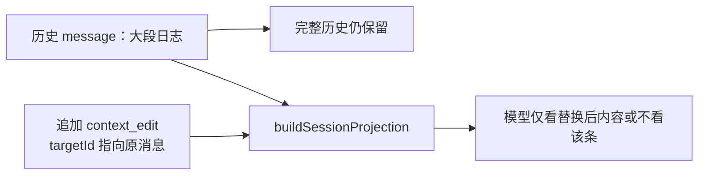

# Pi 会话 JSONL 与 Entry 树导读

> **版本核验：2026-10-17 / Pi v1.3.0**。本目录当前源码结论固定到官方 tag `71023aec1546d6d677a65669c5665c0927ce0dd0`。旧文中的 `agent/src/harness/`、Lane/registers、`LeafEntry` 和 Prime/第三方生态不能视为 v1.3.0 的 core 实现；具体差异见 [版本核验与纠错](./VERSION_ALIGNMENT.md)。历史示例保留并就地标记，旧行号不作为当前定位依据。

> **2026-10-15 源码校正**：原正文保留；请同时阅读本文末尾新增的当前源码补充和 [全景入口](./PI_SOURCE_DEEP_DIVE_2026.md)。涉及旧 Harness 路径、消息类型、第三方插件版本的描述不能直接视为当前实现。

> **定位**：图解第 8 幕的 **专用入口**——用树形示意理解 `entries`、压缩与投影。  
> **完整示例与字段说明**：见 [ARCHITECTURE.md Part II §3](./ARCHITECTURE.md#3-完整-jsonl-会话文件示例)（**不重复删除**，本文提炼 + 扩展阅读路径）。

---

## 1. 三层读者模型

| 读者 | 先看 | 再看 |
|------|------|------|
| 产品 / 架构 | 本文 §2 树图 | DESIGN_THINKING_SERIES 第 8 幕 |
| 集成方 | §3 JSONL 行类型 | ARCHITECTURE §3 完整 jsonl |
| 改存储的开发者 | `coding-agent/core/session-manager.ts` 或 `durable/src/storage/` | 两套格式分开理解，见 §10 |

---

## 2. Entry 树（一张图）

Session 在磁盘上是一棵 **只追加** 的树；`parentId` 指向上一个 entry。

```text
null
 └── 00000001  user: "读 src/index.ts"
      └── 00000002  assistant + toolCall(read)
           └── 00000003  toolResult
                └── 00000004  assistant 回复
                     └── 00000005  thinking_level_change  ← 投影 0 条 LLM 消息
                          └── 00000006  user: "改端口"
                               └── …
                                    └── 00000010  compaction  ← 摘要节点
                                         └── 00000011  user: "加 health check"
                                              └── 00000012  assistant  ← leafId 指向这里；不是额外一行
```

**leafId**：SessionManager 当前活动分支的游标，不是 `type: "leaf"` entry。切换分支不必立刻产生新节点；后续追加消息才沿选定节点延伸。

---

## 3. JSONL 行类型速查

| `type` | 作用 | 进 LLM 投影？ |
|--------|------|----------------|
| `session` | 文件头：version、cwd、id | 否 |
| `message` | user / assistant / toolResult | 是（按规则） |
| `compaction` | 上下文压缩摘要 | 变为 `CompactionSummaryMessage` |
| `branch_summary` | 分支摘要 | 按策略 |
| `thinking_level_change` | 推理档位 | 否 |
| `usage` | 独立用量记录 | 否 |
| `context_edit` | 上下文内容编辑 | 通过投影应用，而非新增普通消息 |
| `custom` | 扩展状态 | 否 |
| `custom_message` | 扩展注入的消息 | 是（经 convertToLlm） |

当前 CLI schema 类型定义：`packages/coding-agent/src/core/session-manager.ts`（`SessionEntry`、`SessionMessageEntry`、`CompactionEntry`）；header 不属于 SessionEntry。完整枚举见 §10.1。旧 `EntryProjector` 不适用于此处。

---

## 4. 压缩后模型看见什么

压缩 entry `00000010` 之后，**`firstKeptEntryId` 之前** 的消息被摘要替代：

```text
LLM messages[] =
  [ CompactionSummaryMessage,   ← 来自 00000010
    user: "再加 health check",    ← 00000011
    assistant: "好的…" ]         ← 00000012
```

详见 [ARCHITECTURE §3.1 树图与投影结果](./ARCHITECTURE.md#31-关键结构解读)。

---

## 5. 三种持久化（旧实验 Harness 对照，非 v1.3.0）

> 以下 entries/registers/usage 三分法是历史资料。v1.3.0 Durable 的五类记录是 conversation、entry、task、submission、document；CLI 是独立的 session v3 JSONL。

| 图解名 | Pi 机制 | 写入 API |
|--------|---------|----------|
| **entries** | JSONL `type:*` 行 / DB 行 | `insertEntry` |
| **registers** | namespace 下 value / list | `commit.ts` value/list writes |
| **usage ledger** | usage 行 | `insertUsage` |

一次 **commit** 可批量包含 entry + usage + value（`PreparedCommit.writes`）。

---

## 6. Lane 与并行（旧实验 Harness，非 v1.3.0）

> 当前不能引用 `LaneConfiguration` 或 `harness/runtime/lane.ts`；Durable 的并发/恢复入口是 TaskScheduler 与 task ownership，见 [后端深潜](./BACKEND_RUNTIME.md)。

| Lane 示例 | 用途 |
|-----------|------|
| `main` | 主对话轨 |
| `slack-thread` | 外部队列轨（若配置） |
| `subagent` | 子 agent 轨 |

配置：`LaneConfiguration`（model、thinkingLevel、activeToolNames）。  
运行时：`harness/runtime/lane.ts` 序列化 mutation line。

---

## 7. 版本迁移

| 版本 | 要点 |
|------|------|
| v1 | 无 id/parentId；`firstKeptEntryIndex` |
| v2 | 树结构 + `firstKeptEntryId` |
| v3 | `hookMessage` → `custom` |

→ [ARCHITECTURE §3.2](./ARCHITECTURE.md#32-版本迁移说明)

---

## 8. 源码速查

| 要查 | 路径 |
|------|------|
| CLI Entry 类型/JSONL | `packages/coding-agent/src/core/session-manager.ts` |
| Durable JSONL | `packages/durable/src/storage/jsonl/storage.ts` |
| Durable 批量提交 | `packages/durable/src/session/session.ts` + `transaction.ts` |
| Session 编排 | `coding-agent` SessionManager |
| 投影为 LLM | `messages.ts` / Part II §2 |

---

## 9. 相关导读

- [DESIGN_THINKING_SERIES.md §8](./DESIGN_THINKING_SERIES.md#第-8-幕harness-让-agent-变成可恢复的持久化运行时)
- [ARCHITECTURE.md Part II §3](./ARCHITECTURE.md#3-完整-jsonl-会话文件示例)（**完整 jsonl 原文**）


---

## 10. 当前源码校正：两种 JSONL，不是一份 schema（2026-10-15）

本节追加校正，前文保留作历史导读。当前 CLI 的 schema 来自 [`core/session-manager.ts`](https://github.com/earendil-works/pi/blob/v1.3.0/packages/coding-agent/src/core/session-manager.ts)，不是已经不存在的 `agent/src/harness/session/types.ts`。

### 10.1 CLI session v3 的实际类型

当前 `SessionEntry` 联合包含 `message`、`thinking_level_change`、`model_change`、`usage`、`compaction`、`branch_summary`、`custom`、`custom_message`、`context_edit`、`label`、`session_info`。`SessionHeader` 是单独的 `type: session` 文件头。

**没有 `type: leaf` 联合成员**。`leafId` 是 SessionManager 的当前分支指针；前文树图的“leaf”可理解为指针示意，不能当作当前 JSONL 行类型。

| 类型 | 当前模型可见性 |
|---|---|
| `custom` | 保存扩展状态，不贡献模型消息 |
| `custom_message` | 通过投影贡献自定义消息，再转换为模型可接受的消息 |
| `context_edit` | append-only 替换/移除 earlier entry 的上下文贡献，不改历史原文 |
| `usage` | 费用/缓存等统计元数据，不等于 toolResult |
| `message` 中的 `system` | 支持 prompt sections 与 tool declarations 的位置更新 |

例如同一段历史可以保持原 entry 不变，只追加 context edit：



### 10.2 Durable JSONL 保存的是提交协议

Durable 的 `storage/jsonl/storage.ts` 保存 `main.jsonl` commit markers 及 task/document sidecars。它使用 conversation/entry/task/submission/document 五类记录，不是 CLI 的 `SessionEntry` JSONL。

前文的 `registers`、`LaneConfiguration` 和旧 `harness/runtime/lane.ts` 不应作为当前路径：当前 backend 请读 [BACKEND_RUNTIME.md](./BACKEND_RUNTIME.md)，其中解释 mutation line、Document scope/fork、UsageDoc 和任务恢复。

### 10.3 文件写入时机与 durability 限制

CLI `_persist()` 在已有 conversation 且未 flushed 时以 `wx` 创建文件、写入所有已缓存 entries；以后 append 新 entry。普通 append 不在这里显式执行 fsync，不能把“写 JSONL”理解为数据库级事务或任意掉电条件下持久保证。

源码：[`SessionManager._persist`](https://github.com/earendil-works/pi/blob/v1.3.0/packages/coding-agent/src/core/session-manager.ts)、[`JsonlStorage.commit`](https://github.com/earendil-works/pi/blob/v1.3.0/packages/durable/src/storage/jsonl/storage.ts)。


### 10.4 v1.3.0 当前字段的最小 JSONL 示例

下面给出一段**结构示例**，替代把旧 `leaf` 样本照抄成当前文件：provider/model 与 usage 数值均为占位，不代表真实模型调用，也不是完整生产导出。它展示 header、parentId、arguments、toolName、stopReason 和当前 usage 字段。逐行 JSON 与父节点引用已检查，但没有执行 Pi 导入或 Provider 请求。

```jsonl
{"type":"session","version":3,"id":"a1b2c3d4-e5f6-4890-abcd-ef1234567890","timestamp":"2026-10-17T00:00:00.000Z","cwd":"/example/project"}
{"type":"message","id":"00000001","parentId":null,"timestamp":"2026-10-17T00:00:00.000Z","message":{"role":"user","content":"读取 README.md","timestamp":1792195200000}}
{"type":"message","id":"00000002","parentId":"00000001","timestamp":"2026-10-17T00:00:00.000Z","message":{"role":"assistant","api":"openai-completions","provider":"example","model":"example-model","usage":{"input":0,"output":0,"cacheRead":0,"cacheWrite":0,"totalTokens":0,"cost":{"input":0,"output":0,"cacheRead":0,"cacheWrite":0,"total":0}},"timestamp":1792195200000,"content":[{"type":"toolCall","id":"call_1","name":"read","arguments":{"path":"README.md"}}],"stopReason":"toolUse"}}
{"type":"message","id":"00000003","parentId":"00000002","timestamp":"2026-10-17T00:00:00.000Z","message":{"role":"toolResult","toolCallId":"call_1","toolName":"read","content":[{"type":"text","text":"# Example"}],"isError":false,"timestamp":1792195200000}}
{"type":"message","id":"00000004","parentId":"00000003","timestamp":"2026-10-17T00:00:00.000Z","message":{"role":"assistant","api":"openai-completions","provider":"example","model":"example-model","usage":{"input":0,"output":0,"cacheRead":0,"cacheWrite":0,"totalTokens":0,"cost":{"input":0,"output":0,"cacheRead":0,"cacheWrite":0,"total":0}},"timestamp":1792195200000,"content":[{"type":"text","text":"README 的标题是 Example。"}],"stopReason":"stop"}}
```

这里 `leafId` 指向 `00000004`；磁盘不另写 `type: "leaf"`。真实请求还可能有模型/推理设置、system messages、usage、context edits、压缩等条目；完整联合类型仍以固定版本的 [session-manager.ts](https://github.com/earendil-works/pi/blob/v1.3.0/packages/coding-agent/src/core/session-manager.ts) 和 [ai/types.ts](https://github.com/earendil-works/pi/blob/v1.3.0/packages/ai/src/types.ts) 为准。
