# Pi 1.3.0 源码级全景补充：从请求到持久化、恢复与扩展

> **用途**：这是对现有 `ARCHITECTURE.md`、`EXTENSIONS.md`、`JSONL_TREE_GUIDE.md` 等文档的补充，不替换、不删除旧内容。
>
> **源码基线**：官方 `v1.3.0`，tag commit `71023aec1546d6d677a65669c5665c0927ce0dd0`，workspace package version `1.3.0`；2026-10-17 重新核验。上一轮本地 1.2.0 不是最新发布版，本次已独立取得发布源码比对；[版本差异与证据](./VERSION_ALIGNMENT.md)。文中源码链接固定到发布 tag，不代表本地 `../pi` 已更新。
>
> **阅读方法**：先看本文的“全景”和“边界澄清”，再按需要进入 agent loop、coding-agent、durable、ai、chord、codemode、env、mcp、tui 专题。文中路径均相对于 Pi 源码根目录 `packages/`。

## 目录

1. [先建立正确的总体模型](#1-先建立正确的总体模型)
2. [源码包地图](#2-源码包地图)
3. [两条执行路径：coding-agent 与 durable](#3-两条执行路径coding-agent-与-durable)
4. [核心 Agent Loop：最小状态机](#4-核心-agent-loop最小状态机)
5. [coding-agent：面向 CLI 的会话运行时](#5-coding-agent面向-cli-的会话运行时)
6. [pi-ai：模型、认证和 Provider 边界](#6-pi-ai模型认证和-provider-边界)
7. [pi-durable：可恢复任务运行时与后端](#7-pi-durable可恢复任务运行时与后端)
8. [Chord：跨进程对象、状态和 RPC 基础设施](#8-chord跨进程对象状态和-rpc-基础设施)
9. [工具、MCP、Code Mode 与远程环境](#9-工具mcpcode-mode-与远程环境)
10. [扩展、项目信任与安全边界](#10-扩展项目信任与安全边界)
11. [TUI、输出模式和可观测性](#11-tui输出模式和可观测性)
12. [一次请求的完整源码追踪](#12-一次请求的完整源码追踪)
13. [现有文档缺口与补充结果](#13-现有文档缺口与补充结果)
14. [源码阅读索引](#14-源码阅读索引)
15. [总结](#15-总结)
16. [v1.3.0 版本对齐后的补充阅读](#16-v130-版本对齐后的补充阅读)

---

## 1. 先建立正确的总体模型

Pi 不是“一个带工具的聊天循环”，而是三个层次叠加：

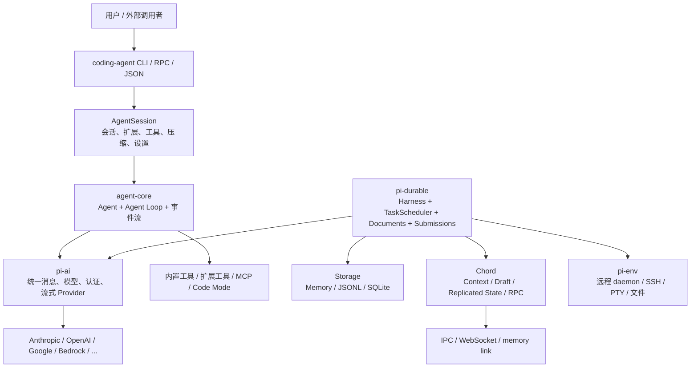

### 1.1 三个容易混淆的“运行时”

| 名称 | 解决的问题 | 是否天然可恢复 | 典型入口 |
|---|---|---:|---|
| `@earendil-works/pi-agent-core` | 一次 Agent 推理和工具循环 | 否；由宿主决定如何保存 | `packages/agent/src/agent-loop.ts` |
| `@earendil-works/pi-coding-agent` | 本地 CLI 的会话、文件工具、扩展、TUI | 会话可恢复；正在执行的 JS/进程不是 durable task | `packages/coding-agent/src/core/agent-session.ts` |
| `@earendil-works/pi-durable` | 长任务、任务树、检查点、重启后恢复 | 是；状态按提交保存 | `packages/durable/src/harness/generation.ts`、`scheduler.ts` |

**关键结论**：`Agent Loop` 是算法；`AgentSession` 是本地产品编排；`Harness` 是另一套持久执行内核。三者属于不同抽象层，不能用同一个“Session”概念代替。当前 `durable/package.json` 不依赖 agent-core：它使用 `pi-ai`，由 `GenerationTask` 驱动请求，不调用 agent-core 的 `runLoop`。

### 1.2 Pi 的核心不变量

1. **模型边界才做格式转换**：运行时内部尽量使用 `AgentMessage`；只有调用 Provider 时才通过 `convertToLlm` 等逻辑得到模型消息。
2. **会话树是事实源，LLM context 是投影视图**：分支、压缩、重放不会直接修改历史事实，而是重新计算当前分支可见消息。
3. **工具结果是消息，也是控制流**：工具调用结束后，`toolResult` 回到上下文，触发下一次模型请求。
4. **流式事件和持久化分离**：事件先服务 UI/宿主；coding-agent 再把消息和元数据写入 session JSONL。
5. **durable 的可恢复性来自提交点，不来自“保存 JS 堆栈”**：每个任务 phase 用 JSON checkpoint 表示，恢复时从 phase 重新执行。
6. **信任和权限不是 Agent Loop 自带能力**：Pi 默认使用启动它的用户权限；项目资源加载前由 coding-agent 做项目信任判断，真正的 OS 隔离需要容器或扩展。

---

## 2. 源码包地图

当前 workspace 共有 11 个核心包：

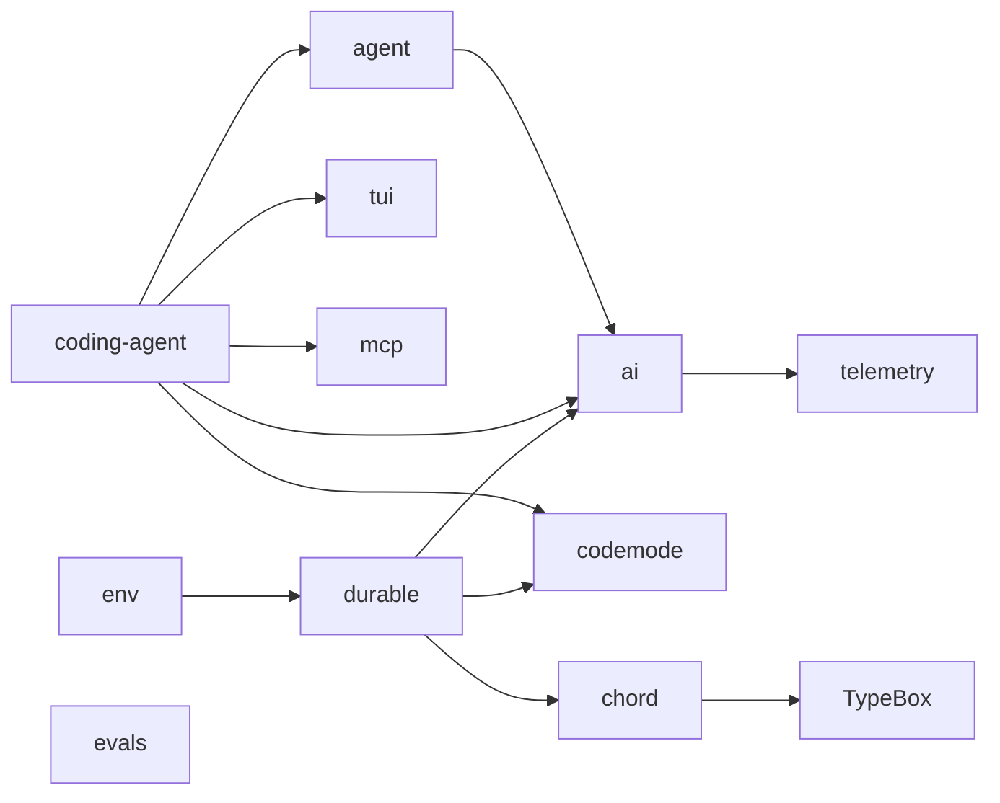

| 包 | 一句话职责 | 主要源码入口 |
|---|---|---|
| `ai` | Provider 无关的消息、模型、认证、OAuth、重试、流式 API | `src/types.ts`, `src/models.ts`, `src/api/`, `src/providers/`, `src/auth/` |
| `agent` | 有状态 Agent 与无状态双层循环 | `src/agent.ts`, `src/agent-loop.ts`, `src/types.ts` |
| `coding-agent` | CLI、会话、工具、扩展、TUI/RPC/JSON 模式 | `src/main.ts`, `src/core/`, `src/extensions/`, `src/modes/` |
| `tui` | 终端组件、差分渲染、编辑器、Markdown、图片和键盘 | `src/tui.ts`, `src/components/`, `src/terminal-image.ts` |
| `mcp` | MCP JSON-RPC 客户端、stdio、streamable HTTP、OAuth | `src/client.ts`, `src/transports/`, `src/oauth/` |
| `codemode` | QuickJS-WASM 沙箱；脚本只能调用注入工具 | `src/runtime/`, `src/source.ts`, `src/declarations.ts` |
| `durable` | Harness、任务调度、会话、文档、提交、压缩、工具 | `src/harness/`, `src/session/`, `src/storage/` |
| `chord` | 跨进程对象、合同、远程引用、复制状态、delta、热重载 | `src/host.ts`, `src/contract.ts`, `src/state.ts`, `src/link.ts` |
| `env` | SSH 启动的远程 daemon、帧协议、文件、PTY、watch | `src/connection.ts`, `src/remote-env.ts`, `daemon/src/` |
| `telemetry` | Vendor-neutral span/event/schema contracts | `src/index.ts` |
| `evals` | 文档/代码能力评测、Docker 隔离和结果比较 | `src/cli.ts`, `src/docker.ts`, `src/report.ts` |

### 2.1 版本校正：旧文档需要这样读

现有文档中出现的 `agent/harness`、旧的 Harness 桥接命名，应视为历史设计或旧版本描述。当前源码中的实际边界是：

- `packages/agent`：`Agent`、`agentLoop`、`runAgentLoop`；没有当前可直接引用的 `agent/harness/` 目录。
- `packages/coding-agent`：`AgentSession` 将 Agent core 接到 SessionManager、ExtensionRunner、工具和 UI。
- `packages/durable`：独立的 `Harness` 和 `TaskScheduler`，其内置 `GenerationTask` 自己驱动模型请求、重试、压缩和工具任务。

这不是删掉旧材料，而是为旧材料增加“源码版本边界”。

---

## 3. 两条执行路径：coding-agent 与 durable

### 3.1 coding-agent 路径：交互优先

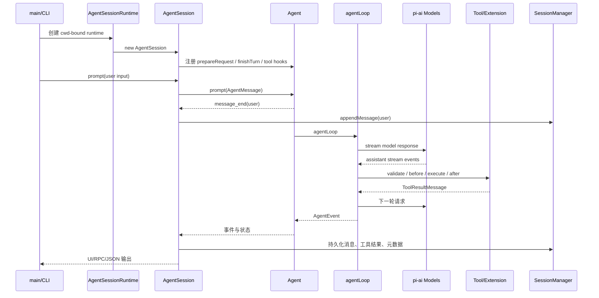

特点：

- 当前进程负责循环；中断时由 `AbortSignal` 取消。
- Session JSONL 用于恢复“对话历史”和分支，而不是恢复任意进程中的调用栈。
- `prepareRequest`、`prepareNextTurn`、`finishTurn` 是控制循环的重要切入点。

### 3.2 durable 路径：提交优先

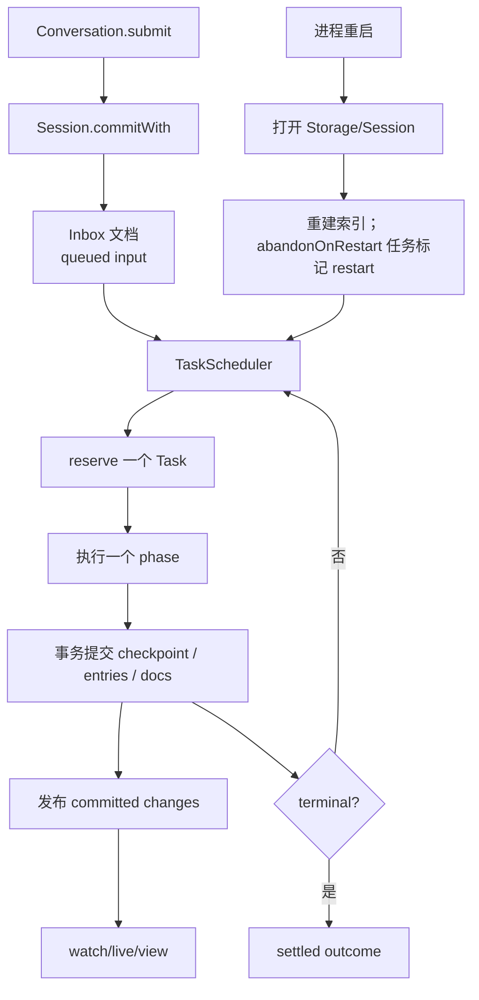

**为什么需要两套路径？** 本地聊天追求低延迟、直接控制 UI；耐久任务追求“任何 phase 都能重新进入”，需要事务、任务状态和 storage contract。把两者混成一个大循环，会同时损失交互体验和恢复语义。

---

## 4. 核心 Agent Loop：最小状态机

源码：`packages/agent/src/agent-loop.ts`。

### 4.1 外层 follow-up，内层 tool/steering

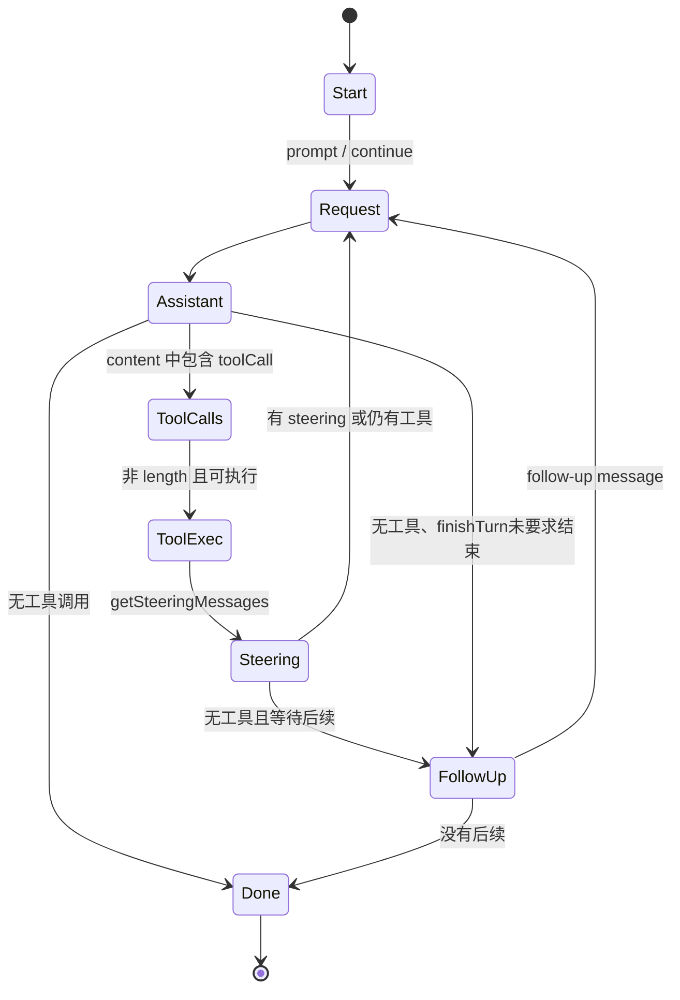

源码里的关键行为：

```ts
// 伪代码，保留真实控制意图：
// 以下是解释控制流的伪代码，不是可以直接粘贴运行的 SDK 示例。
while (true) { // 外层：一批工具/steering 全部处理后才取 follow-up
  let hasMoreToolCalls = true; // 每次外层进入，至少做一次模型请求
  while (hasMoreToolCalls || pending.length > 0) {
    // 首轮之外还会 prepareNextTurn；有必要时先压缩，再重建上下文。
    await applyPreparedAndQueuedMessages();
    const request = await prepareRequest?.(snapshot);
    const assistant = await streamAssistantResponse(request);
    if (["error", "aborted"].includes(assistant.stopReason)) return;
    // length 截断的 tool calls 生成失败结果，不执行其残缺参数。
    const batch = await executeOrFailToolCalls(assistant);
    hasMoreToolCalls = batch.hasCalls && !batch.terminate;
    const decision = await finishTurn?.(turn);
    if (decision?.action === "end") return;
    explicitContinuation = decision?.action === "continue";
    pending = (await getSteeringMessages?.()) ?? [];
    if (hasMoreToolCalls || pending.length > 0) explicitContinuation = false;
  }
  const followUp = (await getFollowUpMessages?.()) ?? [];
  if (followUp.length > 0) { pending = followUp; explicitContinuation = false; continue; }
  if (explicitContinuation) { explicitContinuation = false; continue; }
  break;
}
```

### 4.2 工具调用的四道边界

1. **准备**：找到工具、解析/校验 JSON 参数。
2. **前置 hook**：agent-core 的 `beforeToolCall` 返回 `block/reason/terminate`，可以阻止执行；**不能**据此声称它有任意替换结果或改写参数的返回契约。参数准备来自工具 `prepareArguments`；durable 的 `beforeTool` 才另有 `arguments` 改写契约。
3. **执行**：接收增量 `onUpdate`；同步或异步均转成统一结果。
4. **后置 hook**：`afterToolCall` 可以补充/改写结果，但不会把异常抛出到循环外，而是转成 error tool result。

`stopReason === "length"` 时不会冒险执行可能截断的工具参数：所有 tool calls 会被标记为失败结果，再让模型恢复。这是一个很容易在旧文档中遗漏的安全不变量。

### 4.3 并行不是默认绝对规则

- `config.toolExecution === "sequential"` 时顺序执行。
- 即使全局为并行，只要某个工具声明 `executionMode: "sequential"`，整批会进入顺序路径。
- 顺序工具适合有写冲突、依赖前一步结果或需要强顺序的操作；并行工具适合互不影响的读取。

---

## 5. coding-agent：面向 CLI 的会话运行时

### 5.1 AgentSession 的职责不是“再实现一个 Agent”

`AgentSession` 负责把通用 Agent 嵌入产品：

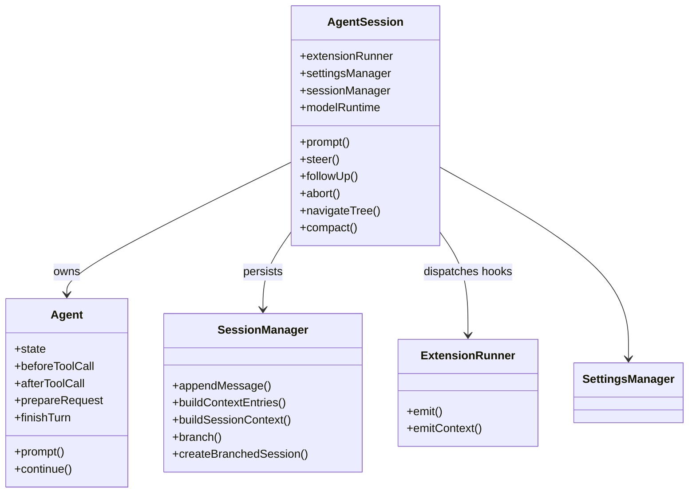

### 5.2 会话持久化的两种视图

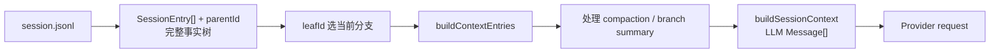

要强调：`SessionManager` 不是简单的 append-only chat log。它同时处理：

- parent/child entry 树和 leaf 导航；
- compaction、branch summary、reset；
- model/thinking/tool change 等系统元数据；
- 从事实树投影出 Provider 可接受的 `Message[]`。

### 5.3 CLI 外壳的模式

`coding-agent` 不只一种输出：

| 模式 | 入口 | 目的 |
|---|---|---|
| interactive | `src/main.ts` + TUI | 人机交互、steering、审批、可视化工具结果 |
| print | `src/modes/print-mode.ts` | 非交互文本输出 |
| json | `src/modes/json-event.ts` | 机器消费事件流 |
| rpc | `src/rpc-entry.ts` | 外部宿主控制会话 |

---

## 6. pi-ai：模型、认证和 Provider 边界

### 6.1 结构

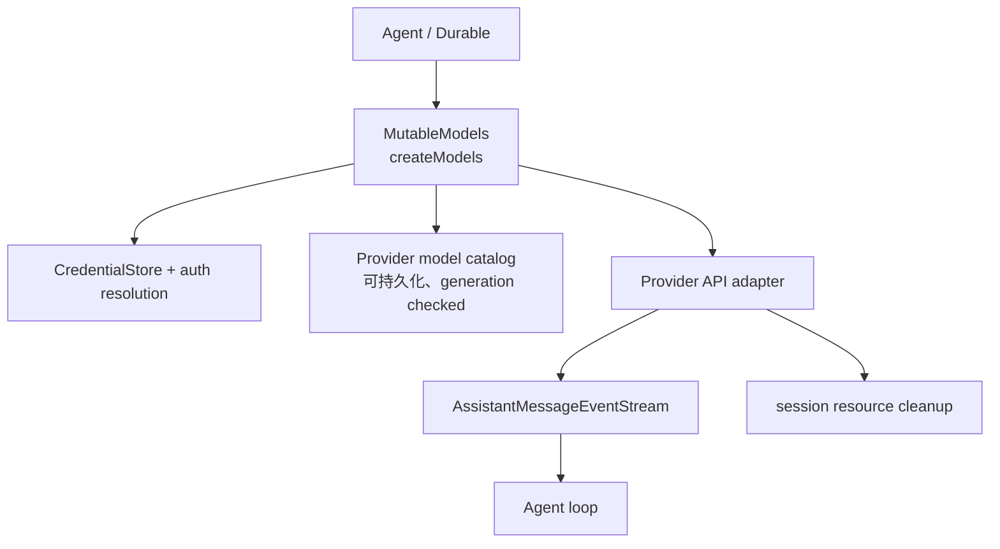

`pi-ai` 的重要边界：

- `types.ts` 定义 `Message`、`Context`、`Model`、usage、tool call、stream event。
- `models.ts` 负责模型注册、刷新 catalog、选择 Provider、执行统一 stream。
- `api/` 是具体协议适配；`providers/` 是 Provider 工厂和模型清单。
- `auth/` 把 API key、OAuth、刷新、交互式登录与模型调用分离。
- `session-resources.ts` 让 WebSocket、其他已注册的 Provider 资源可以按 session 清理；实际清理对象取决于 adapter 的注册，不假设所有 OAuth refresh 都是 session 资源。

### 6.2 Provider 不是简单的 fetch wrapper

一次请求通常包含：

```text
选择模型
  -> 解析有效 credential（必要时刷新 OAuth）
  -> 合并 provider/model/request options
  -> normalize Context / tool schema
  -> provider adapter stream
  -> 将不同 provider 事件归一化为 AssistantMessageEvent
  -> retry / overflow / abort / usage
```

这解释了为什么 Provider 相关文档要同时看 `models.ts`、`auth/`、`api/`、`providers/` 和 `utils/retry.ts`，只读一个 Anthropic adapter 会漏掉真实控制面。

---

## 7. pi-durable：可恢复任务运行时与后端

### 7.1 Durable 的核心对象

下图是职责关系图，不是可复制的完整 TypeScript 接口。`Harness` 的公共类型继承 `Session`；`Harness.open()` 是导出工厂对象的方法，实际 `HarnessImpl` 继承 `SessionImpl`。Scheduler 图中的 phase/recover 表示职责，不保证是公开方法名。

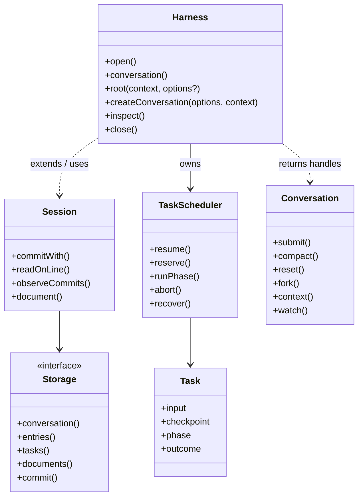

### 7.2 TaskState 是恢复语义的中心

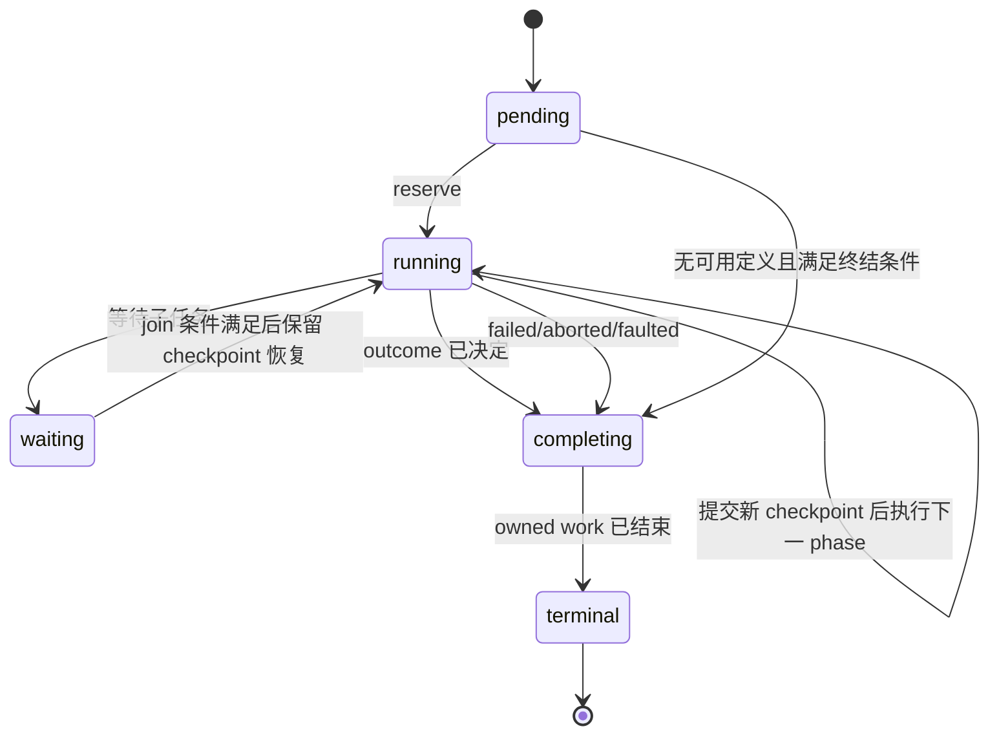

`TaskState` 的五种状态不是 UI 状态，而是 storage 中的 durable contract：

- `pending`：有完整 checkpoint，等待调度；
- `running`：被一个进程内 invocation 占用；
- `waiting`：等待依赖任务完成；
- `completing`：已有 outcome，但拥有的普通子任务尚未清空；
- `terminal`：结果收据，不再执行代码。

### 7.3 GenerationTask：把一次模型请求拆成可恢复 phase

`packages/durable/src/harness/generation.ts` 把生成过程拆成：

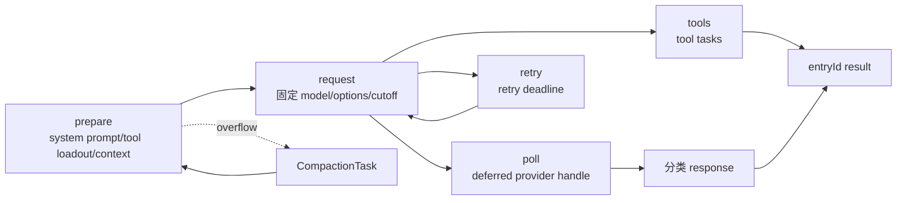

这比普通 `while(await stream())` 更复杂，但换来了：进程重启后能知道是在 prepare、retry、poll 还是 tools 阶段；也能把模型响应、工具子任务和压缩作为独立的事务事实保存。

### 7.4 Storage 后端

当前 durable 提供三类后端思路：

| 后端 | 特点 | 适用场景 |
|---|---|---|
| memory | 进程内、最快、测试友好 | 单元测试、短生命周期 |
| JSONL | `main.jsonl` commit marker + sidecar，顺序追加、可检查 | 本地文件、调试、简单部署 |
| SQLite | 数据库事务、迁移、索引、可选表/索引 prefix；DO adapter 共享队列 | 长期服务、结构化查询 |

JSONL 的提交形态：

```text
sidecar records (task/document payloads)
        ↓ 可选 flush：fsync=true
main.jsonl: { format, type: "commit", seq, writes[] }
```

先 append 受影响的 sidecar，再 append main commit marker，随后才 `prepared.apply()` 更新内存视图。`fsync: true` 会在写 marker 前 flush sidecar；默认是 false。**当前正常 commit 路径没有在 marker append 后显式 flush main 文件，因此不能把它描述成掉电后必定保存已返回提交的保证。** 损坏或 poison 后端不能静默继续写。

### 7.5 Session 的失败模型

`SessionImpl` 维护一条 mutation line：提交回调、storage settlement、publication enqueue 都在这条线上执行。Storage 第一个非取消错误会让 Session 进入 failed/closed；后续调用收到 `SessionFailed`。这不是自动 retry 机制，重试属于 Storage 或上层策略。

---

## 8. Chord：跨进程对象、状态和 RPC 基础设施

Chord 的一句人话解释：**调用者拿到的是跨进程仍然有效的 reference，不是把整个对象复制过来。**

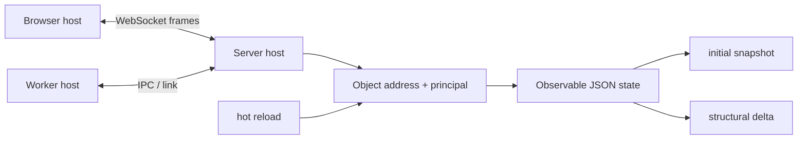

关键概念：

- **Contract**：用 TypeBox 描述输入、方法、状态、host family 和权限变体。
- **Principal**：owner/guest 拿到不同 facet；安全检查在 host 端执行。
- **Replicated state**：远端先收到 snapshot，之后收到 delta。
- **Transaction/draft**：结构化 JSON 修改经 revision validator 检查后发布。
- **Link**：内存、Node IPC、WebSocket 都可以承载 JSON frame。
- **Hot reload**：工作中的调用继续使用旧代码，安全点切换新代码，状态通过迁移保留。

直接看 imports，Durable 使用 Chord 的 `Context`、JSON/Draft 和 replicated-state/delta 设施。**Durable 自己实现 Session、Storage 和调度器，不能把这些类归属到 Chord**。Chord 另外提供 host/reference/RPC；是否将 Harness 包成远程对象是宿主集成选择，而不是 `Harness.open()` 默认启动一个 server。

---

## 9. 工具、MCP、Code Mode 与远程环境

### 9.1 内置工具

coding-agent 的工具位于 `core/tools/`：`read`、`write`、`edit`、`edit-diff`、`bash`、`grep`、`find`、`ls`、`powershell` 等。它们通过统一 tool definition 进入 Agent loop，输出经过 truncation、rendering 和 output guard。

### 9.2 MCP：配置、连接、暴露是三件事

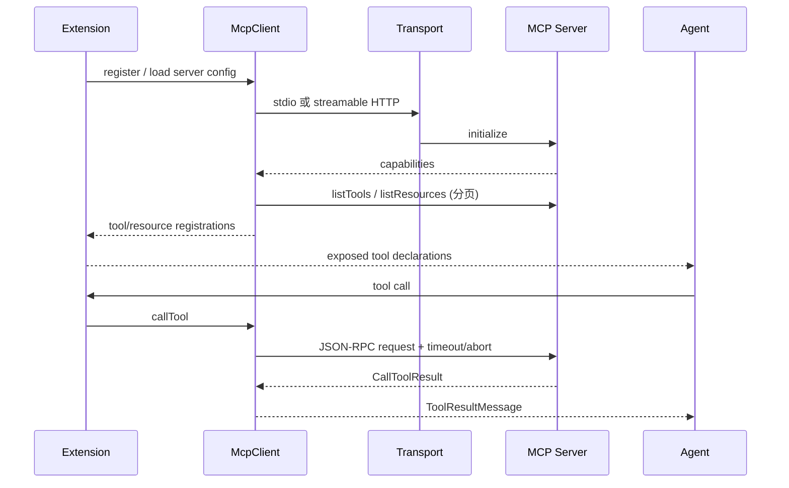

MCP client 自己处理 JSON-RPC 校验、分页、超时、abort、进度、OAuth 和连接关闭；coding-agent 的 MCP extension 再负责把它接入工具、资源命令和 UI。不要把 `packages/mcp` 描述成“内置工具集合”。

### 9.3 Code Mode：模型编写的是脚本，不是直接拿宿主权限

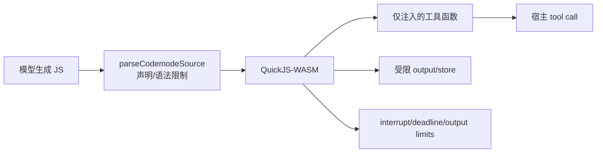

Node/Bun 默认每次执行使用独立 worker + QuickJS VM；失控脚本可终止 worker，避免污染下一次运行。没有 worker 的环境使用 interrupt budget。Code Mode 是能力收敛和批量工具调用优化，不等于 OS sandbox。

### 9.4 pi-env：远程执行不是把本地 shell 变远程字符串

`pi-env` 在 SSH 下启动 daemon，双方使用带长度、类型、request id、session id 的 framed protocol；支持 exec 输出事件、cancel、PTY、文件和 watch。`Connection` 会 lazy start，断线后创建新 daemon session；在旧 session 打开的 handle 不会被错误地发送到新 session。对写操作，断线时结果可能是 unknown，不能自动声称失败或成功。

---

## 10. 扩展、项目信任与安全边界

### 10.1 ExtensionRunner 的位置

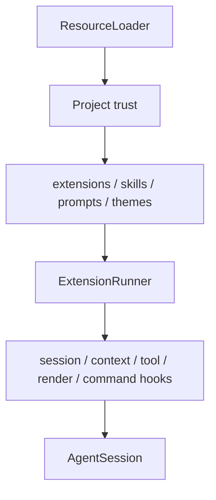

当前 built-in extensions 包括：`llama.cpp`、`codemode`、`tool-search`、`mcp`；后面三者是 replaceable，第三方 extension 可以接管同一能力点。

### 10.2 项目信任的真实范围

当项目目录包含 `settings.json`、`mcp.json`、`extensions`、`skills`、`prompts`、`themes`、`SYSTEM.md` 等资源时，coding-agent 会检查 trust。信任允许加载项目资源、安装项目包和执行 project extensions；不信任则不能把这些资源当成可信配置。

但 Pi 本身默认没有完整的文件/进程/网络权限系统。真正需要边界时使用 Gondolin、Docker、OpenShell 或其他 OS/VM 隔离。文档中要明确区分：

- **应用层 policy**：project trust、tool allow/exclude、extension hooks；
- **执行层 sandbox**：Code Mode QuickJS 限制脚本能力；
- **OS 层隔离**：容器、微 VM、权限用户、网络策略。

---

## 11. TUI、输出模式和可观测性

`tui` 不只是“打印文字”：它有 layout tree、viewport、差分渲染、终端能力探测、Kitty/iTerm2 图片、编辑器、Markdown、autocomplete、overlay 和原生剪贴板适配。

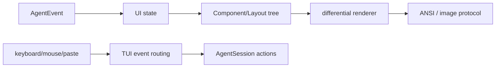

`telemetry` 是 vendor-neutral contract：业务代码通过 span/event/schema 记录，默认可以使用 noop context；它不强制绑定某一家观测平台。`evals` 则通过 Docker 创建隔离运行、收集 observations、比较有/无文档两组结果，属于质量验证面，不是生产 Agent loop。

---

## 12. 一次请求的完整源码追踪

下面是一条“用户要求修改文件”的可读追踪：

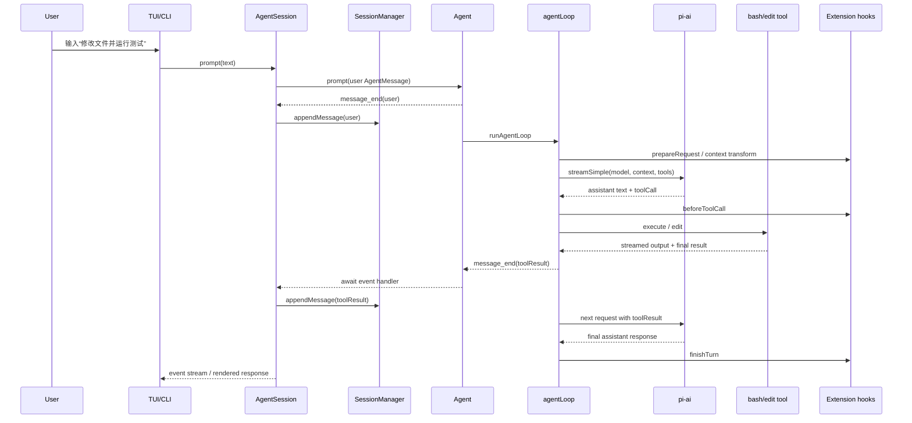

### 12.1 代码阅读时最值得跟的 8 个断点

1. `packages/agent/src/agent-loop.ts:runLoop`：循环控制。
2. `packages/agent/src/agent-loop.ts:executeToolCalls`：工具并行/串行分支。
3. `packages/coding-agent/src/core/agent-session.ts`：产品 hook 如何套到 Agent。
4. `packages/coding-agent/src/core/session-manager.ts:buildSessionContext`：树到 LLM context。
5. `packages/coding-agent/src/core/compaction/compaction.ts`：overflow/threshold 到摘要 entry。
6. `packages/ai/src/models.ts:createModels`：模型注册与统一 stream。
7. `packages/durable/src/harness/generation.ts:GenerationTask`：可恢复模型任务 phase。
8. `packages/durable/src/harness/scheduler.ts`：reserve、abort、restart recovery 和 outcome。

---

## 13. 现有文档缺口与补充结果

| 缺口 | 影响 | 本文补充 |
|---|---|---|
| 11 个 workspace 包未形成一张源码地图 | 读者只看到 coding-agent/agent，忽略 durable、chord、env | 第 2 节包地图与依赖图 |
| Agent Loop、AgentSession、Durable Harness 混在同一层 | 无法判断哪个对象负责循环、持久化、恢复 | 第 3 节明确两条路径 |
| Durable 后端和恢复机制不足 | 不能理解 JSONL/SQLite、checkpoint、restart 标记 | 第 7 节状态机、Storage、Session failure |
| `pi-ai` 只讲“调用模型”，未讲 auth/catalog/resource cleanup | Provider 适配边界不清晰 | 第 6 节 |
| Chord 几乎缺少对象/权限/复制状态模型 | 无法理解 durable 为什么依赖它 | 第 8 节 |
| MCP 与 Code Mode 容易被统称为“工具” | 忽略协议、沙箱和 extension 层 | 第 9 节 |
| 安全容易被误读为内置 sandbox | 产生危险的安全假设 | 第 10 节 |
| TUI、RPC、JSON、print、evals 没进入总图 | 不知道 Pi 如何嵌入外部系统 | 第 5、11 节 |
| 代码阅读缺少“从用户输入到结果”的追踪 | 读源码时跳文件 | 第 12、14 节 |

---

## 14. 源码阅读索引

### 14.1 从上到下读一轮

```text
packages/agent/src/types.ts
  -> packages/agent/src/agent-loop.ts
  -> packages/agent/src/agent.ts
  -> packages/ai/src/types.ts
  -> packages/ai/src/models.ts
  -> packages/coding-agent/src/core/sdk.ts
  -> packages/coding-agent/src/core/agent-session.ts
  -> packages/coding-agent/src/core/session-manager.ts
  -> packages/coding-agent/src/core/extensions/runner.ts
```

### 14.2 读 Durable

```text
packages/durable/src/types.ts
  -> packages/durable/src/session/session.ts
  -> packages/durable/src/session/transaction.ts
  -> packages/durable/src/storage/jsonl/storage.ts
  -> packages/durable/src/storage/sqlite/storage.ts
  -> packages/durable/src/harness/scheduler.ts
  -> packages/durable/src/harness/generation.ts
  -> packages/durable/src/harness/tool.ts
  -> packages/durable/src/harness/compaction.ts
```

### 14.3 读扩展和边界

```text
packages/coding-agent/src/core/trust-manager.ts
packages/coding-agent/src/core/mcp-servers.ts
packages/coding-agent/src/extensions/mcp/
packages/coding-agent/src/extensions/codemode/
packages/codemode/src/runtime/
packages/env/src/connection.ts
packages/env/daemon/src/frame.rs
packages/chord/src/contract.ts
packages/chord/src/host.ts
packages/chord/src/state.ts
```

### 14.4 测试作为设计说明

优先阅读这些测试：

- `agent/test/agent-loop.test.ts`：steering、工具循环、abort；
- `coding-agent/test/agent-session-auto-compaction-queue.test.ts`：压缩和排队；
- `durable/test/harness-generation.test.ts`、`session-checkpoints-migrations.test.ts`：phase/recovery；
- `durable/test/jsonl-storage.test.ts`、`sqlite-migrations.test.ts`：后端契约；
- `chord/test/replicated-state.test.ts`、`reload.test.ts`：复制状态和热重载；
- `codemode/test/worker-lifetime.test.ts`、`portable.test.ts`：沙箱终止和运行时差异；
- `env/test/remote.test.ts`、`conformance.test.ts`：远程协议与一致性；
- `mcp/test/client.test.ts`、`streamable-http.test.ts`：协议和 transport。

---

## 15. 总结

本次补充没有删除现有 Pi 文档，而是增加了四个原来最缺的维度：

1. **全局边界**：把 `agent`、`coding-agent`、`durable`、`ai`、`chord`、`env`、`mcp`、`codemode`、`tui` 放回同一张包和运行时地图。
2. **后端深度**：补上 Durable 的 TaskState、phase checkpoint、Session mutation line、JSONL commit marker、SQLite 后端和重启恢复语义。
3. **源码可追踪性**：用真实文件入口、流程图、状态图、类图和一次完整请求时序，把“概念”连到函数。
4. **边界与风险**：明确两条执行路径、Provider/auth 边界、MCP/Code Mode 区别，以及 Pi 默认不是 OS sandbox。

如果后续要继续深入，建议按这三条专题扩展：

- **持久化专题**：逐函数解释 `TaskScheduler` 的 reservation、join、abort cascade 和 recovery；
- **会话专题**：逐条解释 JSONL entry schema、branch/fork、compaction projection 和 resume；
- **扩展专题**：按事件顺序画出 extension loader、project trust、MCP/Code Mode/tool-search 的完整生命周期。


## 16. v1.3.0 版本对齐后的补充阅读

本次不是只改标题：已对 `packages/*/src` 做旧快照与发布版字节比较，再核对变化文件。主要差异见 [VERSION_ALIGNMENT.md §4](./VERSION_ALIGNMENT.md#4-发布版必须补上的设计变化)：

- pi-ai 最终工具参数使用 `parseToolCallArguments`；仍损坏时写 `argumentsError` 并拒绝执行，流式预览不是可执行参数。
- 跨模型投影丢弃旧 thinking blocks，不把它们转换为普通答案文本。
- kimi-coding 改用 OpenAI Chat Completions；Anthropic/Bedrock 错误工具图片拆出后仍保留给模型。
- SQLite namespace 和同一 DO storage 的队列协调；工具 output 工具下沉至 Chord。
- Chord foreign ctx 和 InteractiveMode overlay 身份边界修复。

Agent、coding-agent core 支撑服务及 MCP/Code Mode 等不少文件与上轮相同；“实现未变”不等于旧文正确，旧 Harness/Lane/leaf 示例仍须按标记区分。main 未发布改动单列，不混入本篇发布版结论。


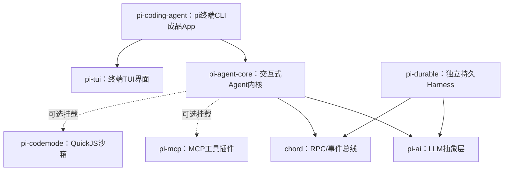

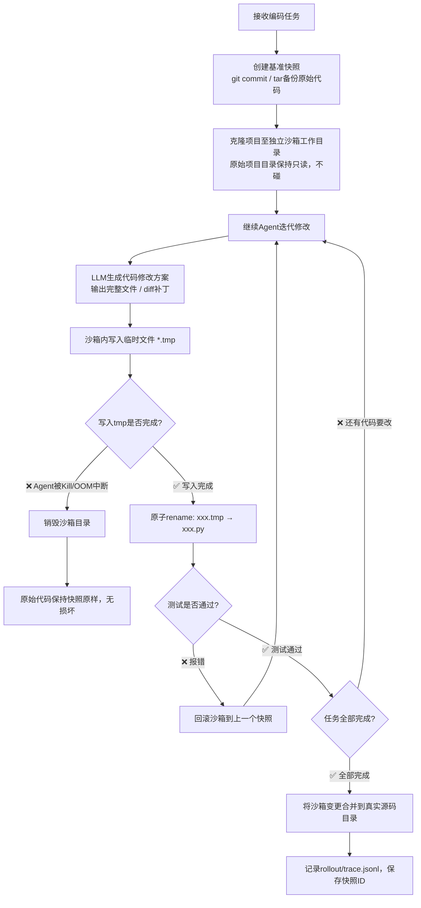
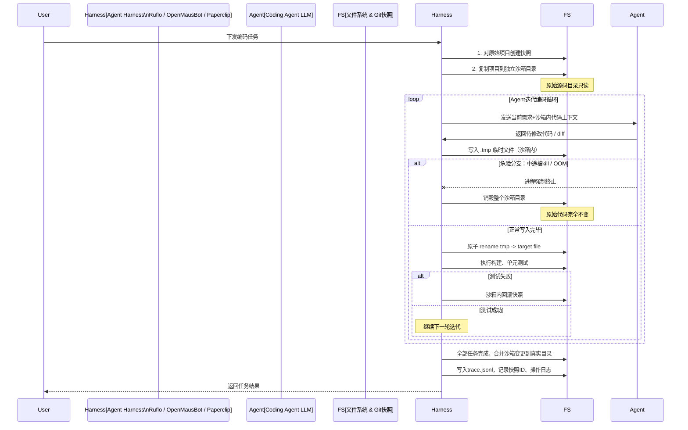
```mermaid
flowchart LR
subgraph BadAgent [简易Agent（无保护）]
U1[原始代码] --> U2[直接打开原文件write]
U2 -- 中途kill --> U3[文件截断损坏，旧代码丢失]
end

subgraph SafeAgent [Harness沙箱模式]
S1[原始代码（只读基准）] --> S2[复制到沙箱]
S2 --> S3[写入tmp临时文件]
S3 --> S4[原子rename]
S4 -- 测试通过 --> S5[合并回原始目录]
S3 -- 中途kill --> S6[丢弃沙箱，原始不动]
end
```