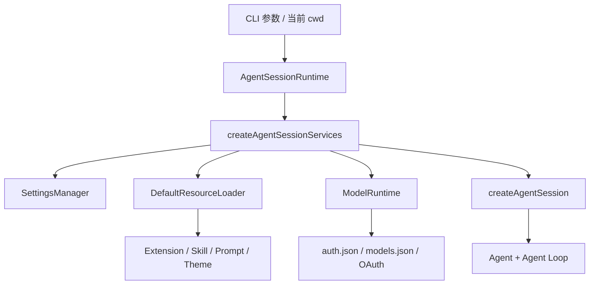
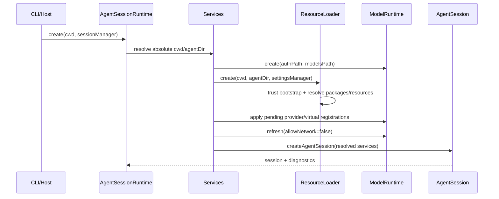
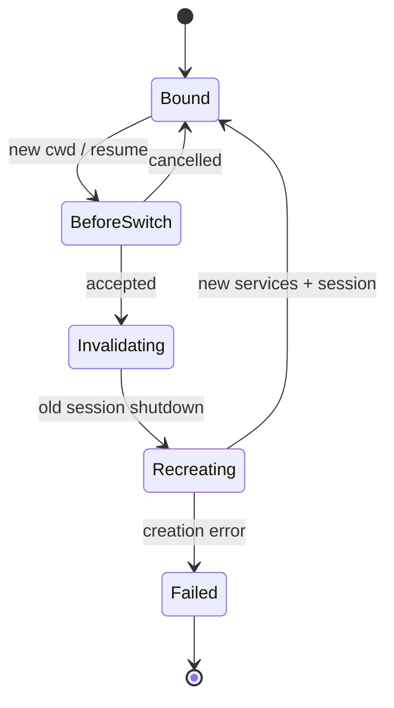
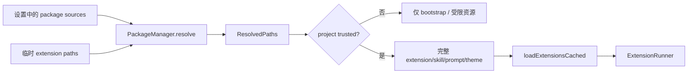
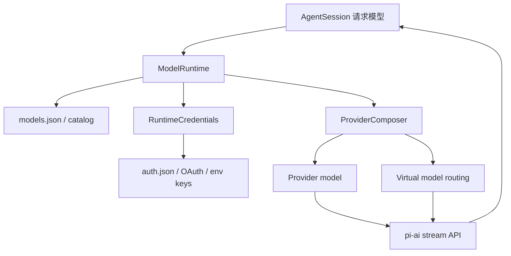

# Pi 运行时支撑层：配置、资源、模型与会话重绑定

> 本文补上最容易被 Agent Loop 遮住的一层：用户输入进入循环以前，Pi 如何决定“在哪个目录运行、加载什么、用哪个模型、是否可信，以及失败后由谁处理”。源码基线：官方 `v1.3.0` / commit `71023aec1546d6d677a65669c5665c0927ce0dd0`（2026-10-17 核验；本文主要 core 文件与上轮快照字节一致）。

> 发布版相对旧快照的 UI overlay、模型投影与 Provider 变化见 [VERSION_ALIGNMENT.md](./VERSION_ALIGNMENT.md)。本篇不把“core 文件相同”扩大成“整个运行时没有变化”。

## 目录

1. [为什么需要支撑层](#1-为什么需要支撑层)
2. [cwd-bound Runtime](#2-cwd-bound-runtime)
3. [设置分层与持久化](#3-设置分层与持久化)
4. [资源加载与项目包](#4-资源加载与项目包)
5. [模型运行时与认证](#5-模型运行时与认证)
6. [诊断、输出护栏与替换会话](#6-诊断输出护栏与替换会话)
7. [源码阅读路径](#7-源码阅读路径)

## 1. 为什么需要支撑层

`AgentSession` 并不是 `new Agent()` 后立刻开始请求。它依赖一组随工作目录、信任状态和用户配置变化的服务：



这层解决的是“运行条件”，而不是“模型如何循环”：

- `SettingsManager` 决定有效配置；
- `ResourceLoader` 决定扩展、技能、提示词和主题；
- `ModelRuntime` 决定模型目录、凭据和 Provider；
- `AgentSessionRuntime` 负责这些服务与会话的生命周期一致。

## 2. cwd-bound Runtime

源码：`packages/coding-agent/src/core/agent-session-services.ts`、`agent-session-runtime.ts`。

### 2.1 一次创建的实际顺序



源码注释明确要求：CLI 传入的资源路径先转绝对路径，否则切换 cwd 后，同一个相对路径会被重新解释。

### 2.2 切换 cwd 为什么不是改一个字段

工作目录影响项目设置、项目资源、技能、扩展解析和工具行为。因此 `AgentSessionRuntime` 的切换流程是：

1. 发出 `session_before_switch`，允许扩展取消；
2. `await session.abort()`，先收敛并持久化旧 turn，再发送 `session_shutdown`；
3. 调用旧 session 的 `dispose()`，使其扩展上下文失效；这里不是逐个服务都有显式 `close()`；
4. 创建新服务并重新解析资源、模型和工具；
5. 通过回调把新 `AgentSession` 交给 UI/宿主；
6. 返回诊断，而不是在底层直接打印或退出。



这里的关键不是“可热切换”本身，而是避免旧扩展继续持有旧 cwd、旧信任状态或旧资源引用。

## 3. 设置分层与持久化

源码：`packages/coding-agent/src/core/settings-manager.ts`。

### 3.1 有效设置不是单个 JSON

可以把设置理解为以下投影：

```text
有效设置 = migrate(global settings + trusted project settings + runtime overrides)
```

- 全局设置位于 agent 目录；
- 项目设置只在项目被信任时进入有效配置；
- 设置读取会做迁移，例如把旧 retry 字段迁移到 provider retry；
- `getSettings()` 返回拷贝，调用者不会直接改内部状态；
- 项目未信任时，项目设置会被清空出有效合并结果。

### 3.2 写入为何排队

设置写入按 scope 进入 `writeQueue`。项目 scope 写入前再次检查信任；写入使用锁和“只合并本次修改字段”的策略，避免一个旧快照覆盖另一个并发修改。写失败进入 diagnostics/error 记录，不由底层替宿主决定 UI 行为。

## 4. 资源加载与项目包

源码：`packages/coding-agent/src/core/resource-loader.ts`、`package-manager.ts`。

资源类别包括 extension、skill、prompt、theme，以及项目上下文文件。`PackageManager` 可以解析 npm/git/local 来源，并处理 install/update/remove；这使“加载插件”和“安装插件”成为两个不同阶段。



`reload()` 不是简单重新 import：它会重新读设置、解析包路径、执行信任前置加载、加载扩展、技能、提示词和主题，并保留需要跨 reload 的运行时状态。内置扩展（如 MCP、Code Mode、tool-search）也会经过资源加载与替换边界。

## 5. 模型运行时与认证

源码：`packages/coding-agent/src/core/model-runtime.ts`、`provider-composer.ts`、`runtime-credentials.ts`、`virtual-models.ts`。

`ModelRuntime` 实现的是模型运行时服务，不只是 `fetch(url)`：



需要特别区分：

- `pi-ai` 定义 Provider 无关的 `Model`、消息和流式 API；
- `coding-agent` 的 `ModelRuntime` 负责当前应用的模型来源、凭据同步、远程/存储目录与组合；
- 虚拟模型可以把逻辑模型 ID 路由到实际模型，不能把配置文件中的 ID 直接当成 Provider endpoint；
- 凭据写入成功但本地同步失败时，源码使用专门错误类型表达“远端已提交、本地状态不确定”的边界。

## 6. 诊断、输出护栏与替换会话

运行时创建返回 `diagnostics`，由 CLI、RPC 或其他宿主决定是否展示、转成错误或继续运行。这一服务创建入口不自行打印或退出，方便不同宿主复用；这不代表整个仓库所有 I/O 代码都不调用 `process.exit`（例如原始 stdout 写入失败的护栏）。

输出护栏（`output-guard.ts`）在接管 stdout 后把普通 stdout 写入重定向到 stderr，保留原始 stdout 写入通道用于协议输出；原始写入排队处理背压，并对暂时性缓冲错误重试。它用于避免日志污染 JSON/RPC 输出，它不是权限沙箱。项目 trust 也不是 OS 隔离：Agent 仍以启动进程用户权限运行，需要容器或其他系统隔离才有更强边界。

### 请求失败时的责任分配

```text
Provider/API 错误 -> pi-ai / ModelRuntime 分类与重试边界
Agent 错误        -> agent-loop 结束当前 turn 并发出事件
Session 写入错误  -> SessionManager/宿主处理持久化失败
Runtime 创建错误  -> AgentSessionRuntime 返回/抛出，由调用者决定 UI
```

这些层不能互相越权：例如运行时不能把 Provider 重试当成 Agent Loop 继续，也不能把诊断自动当成用户可见文本。

## 7. 源码阅读路径

1. `agent-session-services.ts`：先看服务输入输出和 cwd 约束；
2. `agent-session-runtime.ts`：再看 session switch、shutdown、resume/import/fork 的生命周期；
3. `settings-manager.ts`：看 merge、migration、trust 和排队持久化；
4. `resource-loader.ts` + `package-manager.ts`：看资源解析与包安装边界；
5. `model-runtime.ts` + `provider-composer.ts`：看模型组合、认证和虚拟路由；
6. 回到 `agent-session.ts`：看这些服务如何被投影到 Agent Loop。

相关专题：

- [PI_SOURCE_DEEP_DIVE_2026.md](./PI_SOURCE_DEEP_DIVE_2026.md)
- [BACKEND_RUNTIME.md](./BACKEND_RUNTIME.md)
- [SKILLS_LIFECYCLE.md](./SKILLS_LIFECYCLE.md)
- [EXTENSIONS.md](./EXTENSIONS.md)

### 可点击的源码入口

- [agent-session-services.ts](https://github.com/earendil-works/pi/blob/v1.3.0/packages/coding-agent/src/core/agent-session-services.ts)
- [agent-session-runtime.ts](https://github.com/earendil-works/pi/blob/v1.3.0/packages/coding-agent/src/core/agent-session-runtime.ts)
- [settings-manager.ts](https://github.com/earendil-works/pi/blob/v1.3.0/packages/coding-agent/src/core/settings-manager.ts)
- [resource-loader.ts](https://github.com/earendil-works/pi/blob/v1.3.0/packages/coding-agent/src/core/resource-loader.ts)
- [package-manager.ts](https://github.com/earendil-works/pi/blob/v1.3.0/packages/coding-agent/src/core/package-manager.ts)
- [model-runtime.ts](https://github.com/earendil-works/pi/blob/v1.3.0/packages/coding-agent/src/core/model-runtime.ts)
- [provider-composer.ts](https://github.com/earendil-works/pi/blob/v1.3.0/packages/coding-agent/src/core/provider-composer.ts)
- [runtime-credentials.ts](https://github.com/earendil-works/pi/blob/v1.3.0/packages/coding-agent/src/core/runtime-credentials.ts)
- [virtual-models.ts](https://github.com/earendil-works/pi/blob/v1.3.0/packages/coding-agent/src/core/virtual-models.ts)
- [output-guard.ts](https://github.com/earendil-works/pi/blob/v1.3.0/packages/coding-agent/src/core/output-guard.ts)
