# Pi Agent v1.3 + Pi Durable 设计文档

> **源码基线**：Pi 官方 `v1.3.0`，tag commit `71023aec1546d6d677a65669c5665c0927ce0dd0`。
>
> **核验日期**：2026-10-19（Asia/Shanghai）。
>
> **本文目标**：参考 `ARCHITECTURE.md` v1.2 的细节密度，重新整理 v1.3 的 `pi-agent` 与 `pi-durable`。本文不是把旧文档改名，而是按 v1.3 当前源码重新建立一套连贯的设计叙事：先讲是什么，再讲怎么工作，最后解释为什么这样设计。
>
> **源码链接**均固定到 `v1.3.0`，避免把后续 `main` 的未发布变化混入发布版结论。

---

## 目录

### Part I：先建立整体模型

1. [Pi v1.3 到底是什么](#1-pi-v13-到底是什么)
2. [源码包地图](#2-源码包地图)
3. [两个运行时，而不是一个“大 Agent”](#3-两个运行时而不是一个大-agent)
4. [核心设计不变量](#4-核心设计不变量)

### Part II：pi-agent 核心

5. [Agent、Agent Loop 与 StreamFn](#5-agentagent-loop-与-streamfn)
6. [一轮请求的完整生命周期](#6-一轮请求的完整生命周期)
7. [工具调用管线](#7-工具调用管线)
8. [steering 与 follow-up：为什么有两层循环](#8-steering-与-follow-up为什么有两层循环)
9. [事件流与状态管理](#9-事件流与状态管理)
10. [coding-agent：产品编排层](#10-coding-agent产品编排层)
11. [会话树、投影与上下文](#11-会话树投影与上下文)
12. [压缩与上下文编辑](#12-压缩与上下文编辑)
13. [pi-ai：Provider 无关的模型边界](#13-pi-aiprovider-无关的模型边界)

### Part III：pi-durable 持久执行内核

14. [Durable 是什么](#14-durable-是什么)
15. [Durable 的对象模型](#15-durable-的对象模型)
16. [Session 与 mutation line](#16-session-与-mutation-line)
17. [Storage：memory、JSONL 与 SQLite](#17-storagememoryjsonl-与-sqlite)
18. [Conversation、Submission 与 Inbox](#18-conversationsubmission-与-inbox)
19. [TaskScheduler：任务为什么能恢复](#19-taskscheduler任务为什么能恢复)
20. [Task 状态机与 ownership](#20-task-状态机与-ownership)
21. [GenerationTask：持久化模型请求](#21-generationtask持久化模型请求)
22. [ToolTask：工具副作用与嵌套调用](#22-tooltask工具副作用与嵌套调用)
23. [CompactionTask：持久化压缩](#23-compactiontask持久化压缩)
24. [文档、Entry 与 Context View](#24-文档entry-与-context-view)
25. [Durable 恢复、取消与失败](#25-durable-恢复取消与失败)
26. [Durable 扩展、Code Mode、ExecutionEnv 与权限](#26-durable-扩展code-modeexecutionenv-与权限)

### Part IV：支撑设施与设计思考

27. [Chord：跨进程对象与状态同步](#27-chord跨进程对象与状态同步)
28. [v1.3 新变化：和 v1.2 的关键差异](#28-v13-新变化和-v12-的关键差异)
29. [是什么、为什么、背后的设计思考](#29-是什么为什么背后的设计思考)
30. [端到端示例：从用户输入到恢复完成](#30-端到端示例从用户输入到恢复完成)
31. [源码阅读路线与文件索引](#31-源码阅读路线与文件索引)
32. [总结](#32-总结)

---

# Part I：先建立整体模型

## 1. Pi v1.3 到底是什么

### 1.1 一句话定义

Pi v1.3 不是一个单独的聊天机器人类，而是由三层组成的 Agent 基础设施：

```text
pi-ai       —— 把不同模型 Provider 统一成流式消息协议
    ↑
pi-agent    —— 负责一次 Agent 运行：模型、工具、事件、队列
    ↑
pi-coding-agent —— 把 Agent 组装成 CLI/TUI/RPC 产品

pi-durable  —— 另一条独立的可恢复执行路径：
               Conversation + Session + TaskScheduler + Storage
               负责长任务、崩溃恢复、任务所有权和持久状态
```

最重要的边界是：

```text
CLI 路径：
AgentSession → Agent → agent-loop → pi-ai

Durable 路径：
Harness → Conversation / Submission → TaskScheduler
         → GenerationTask / ToolTask / CompactionTask → pi-ai
```

`pi-durable` 使用 `pi-ai`，但不把 `agent` 包的内存 Agent Loop 直接当作持久化内核。前者保存的是任务 phase、checkpoint、ownership 和提交事实；后者主要管理一次运行中的消息、队列与事件。

### 1.2 不能用一句“Pi 有一个 Agent Loop”概括

常见误解是：

```text
用户输入 → Agent Loop → LLM → 工具 → 结束
```

这只够解释最小调用，不够解释 Pi v1.3：

- CLI 需要会话树、分支、压缩、扩展和多种输出模式；
- Provider 需要把统一消息转换成 Anthropic、OpenAI、Google、Mistral 等不同协议；
- Durable 需要处理进程重启、任务恢复、工具副作用和存储失败；
- Chord 需要处理跨 host reference、state hydration 和 RPC；
- 用户输入可能在模型请求、工具执行或压缩期间排队；
- 一个工具还可以嵌套调用另一个工具。

因此本文始终区分三件事：

| 概念 | 它是什么 | 不是什么 |
|---|---|---|
| Agent Loop | 一次运行中的控制流算法 | 不是数据库、不是恢复协议 |
| AgentSession | CLI 产品编排 facade | 不是 Durable Session |
| Durable Harness | 可恢复任务运行时 | 不是 `agent-loop.ts` 的简单包装 |

### 1.3 v1.3 的设计主题

可以用四个词总结：

1. **边界化**：Agent、模型、工具、存储、宿主彼此通过类型契约连接；
2. **投影化**：持久事实和模型看到的 Context 是两种不同视图；
3. **可恢复化**：恢复从 checkpoint/phase 继续，不保存不可移植的 JS 调用栈；
4. **保守地承诺**：Provider retry 不等于工具 exactly-once，project trust 不等于 OS sandbox。

---

## 2. 源码包地图

v1.3.0 发布版有 11 个 workspace package：

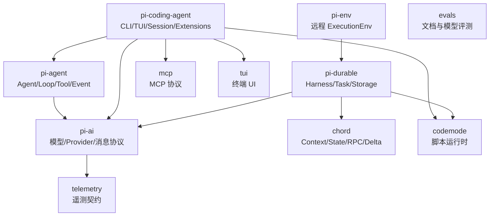

### 2.1 包职责表

| 包 | 主要问题 | v1.3 关键入口 |
|---|---|---|
| `agent` | 一次运行如何继续、结束、执行工具 | `agent.ts`、`agent-loop.ts`、`types.ts` |
| `ai` | 多 Provider 如何统一 | `types.ts`、`models.ts`、`api/`、`providers/` |
| `coding-agent` | 如何成为 CLI 产品 | `agent-session.ts`、`session-manager.ts`、`extensions/` |
| `durable` | 如何把 Agent 变成长任务运行时 | `harness/harness.ts`、`scheduler.ts`、`generation.ts` |
| `chord` | 如何跨进程持有对象和复制状态 | `host.ts`、`remote.ts`、`state.ts`、`wire.ts` |
| `env` | 如何连接本地/远程执行环境 | `connection.ts`、`remote-env.ts` |
| `codemode` | 如何执行受限脚本 | `runtime/` |
| `mcp` | 如何接入 MCP server | `client.ts` |
| `tui` | 如何把流式事件渲染到终端 | `tui.ts`、`layout.ts` |
| `telemetry` | 如何定义 vendor-neutral telemetry | `types.ts`、`index.ts` |
| `evals` | 如何做文档、Provider、扩展评测 | `evals/` |

### 2.2 依赖方向为什么重要

依赖方向不是项目目录的偶然排列，而是架构约束：

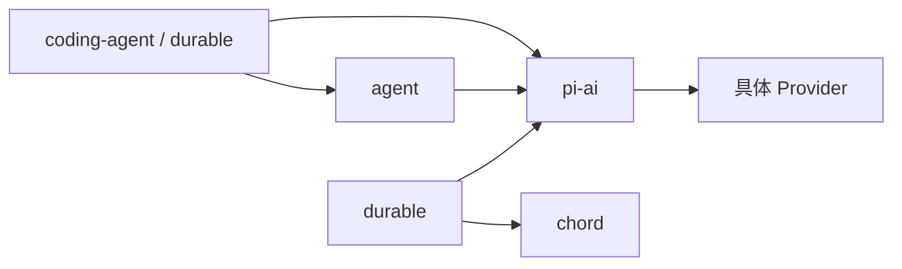

- `agent` 不应该知道 TUI、SessionManager 或 SQLite；
- `pi-ai` 不应该知道用户如何操作工具；
- `durable` 可以使用 `chord`，但存储协议仍由 durable 自己定义；
- Provider 适配器是模型边界内部的实现，不应泄漏给 Agent Loop。

---

## 3. 两个运行时，而不是一个“大 Agent”

### 3.1 CLI 运行时

CLI 的核心对象关系：

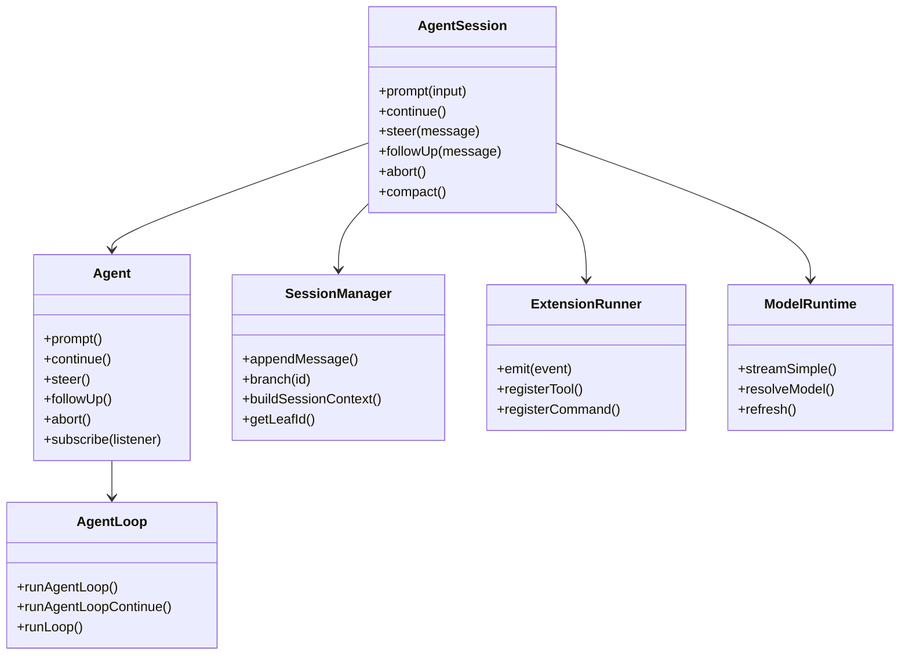

CLI 的事实源主要是 SessionManager 的 session JSONL；Agent 的内存 state 是当前执行快照。一次 turn 结束后，coding-agent 才把事件中的消息和元数据落入会话。

### 3.2 Durable 运行时

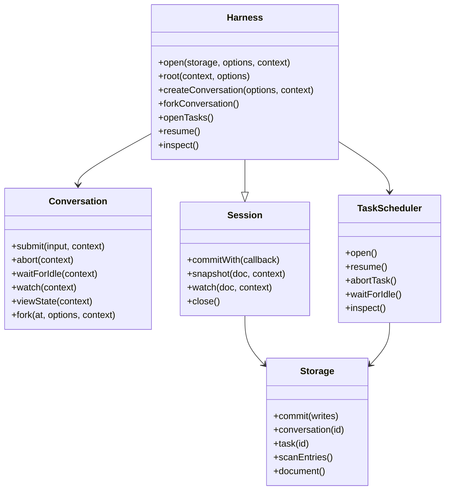

Durable 的关键差别：`Conversation.submit()` 不等于“立刻调用模型”。它先创建或排队 Submission；调度器在合适的边界创建 `GenerationTask`，task 再以 phase 形式驱动模型请求和工具任务。

### 3.3 为什么不把两者强行合并

如果把 CLI Agent 与 Durable Harness 合成一个对象，就会产生三个问题：

1. UI 生命周期和持久任务生命周期被耦合；
2. 内存 queue 被误认为可恢复状态；
3. 工具的外部副作用被误认为可以被数据库事务回滚。

分成两条路径，代价是存在两套上下文/持久化实现；收益是每条路径都可以对自己的承诺负责。

---

## 4. 核心设计不变量

### 4.1 运行时不变量

```text
事实（Facts）
  = 已提交的 Session / Storage 记录

状态（State）
  = 当前内存中的调度索引、Agent 快照、UI 状态

视图（View）
  = 从事实投影出的 LLM Context、ConversationView、TUI 输出
```

三者不能混为一谈：

- 修改 View 不等于修改 Facts；
- 重启会丢失大部分 State，但可以从 Facts 重建；
- LLM 看到的是 View，不是磁盘上的所有记录。

### 4.2 五条关键不变量

1. **所有任务状态转换都在 Session mutation line 上提交**；
2. **模型请求必须有可描述的 phase/checkpoint**；
3. **外部副作用不在 Storage transaction 内**；
4. **工具恢复只能在 policy 允许时重跑**；
5. **事件通知是观察面，不是事实源**。

---

# Part II：pi-agent 核心

## 5. Agent、Agent Loop 与 StreamFn

### 5.1 Agent 是什么

`Agent` 是有状态的运行时 facade。它持有：

- `AgentState`：systemPrompt、model、thinkingLevel、tools、messages；
- `steeringQueue`：本轮还没结束时注入的消息；
- `followUpQueue`：本轮结束后启动下一轮的消息；
- listener 集合：向 TUI、RPC、测试广播 `AgentEvent`；
- AbortController：终止当前运行。

它不负责：

- 写 session JSONL；
- 选择具体 Provider HTTP 协议；
- 回滚 shell 或网络副作用。

### 5.2 Agent Loop 是什么

`agent-loop.ts` 是无状态算法。它接收一个 `AgentContext` 快照和 `AgentLoopConfig`，在内部做：

```text
prepareNextTurn
  → 注入 steering messages
  → prepareRequest
  → streamAssistantResponse
  → 解析 assistant message
  → executeToolCalls
  → turn_end
  → getSteeringMessages
  → 必要时继续 inner loop
  → getFollowUpMessages
  → 必要时重新开始 outer loop
```

### 5.3 当前 v1.3 工具准备伪代码

```ts
// agent-loop.ts 的语义化伪代码，省略事件细节。
const prepared = prepareToolCallArguments(tool, toolCall);
const args = validateToolArguments(tool, prepared);

const decision = await config.beforeToolCall?.(
  { assistantMessage, toolCall, args, context },
  signal,
);

if (decision?.block) {
  return createErrorToolResult(
    decision.reason ?? "Tool execution was blocked",
    decision.terminate === true,
  );
}

const result = await tool.execute(toolCall.id, args, signal, onUpdate);
const override = await config.afterToolCall?.(
  { assistantMessage, toolCall, args, result, isError: result.isError === true, context },
  signal,
);
return mergeToolResult(result, override);
```

这里有三个容易混淆的接口：

| 机制 | 所在层 | 能力 |
|---|---|---|
| `prepareArguments` | `AgentTool` | 在 schema 校验前把原始值整理成参数 |
| `agent-core beforeToolCall` | `agent-loop` | `block/reason/terminate`，不通过返回值任意改参数 |
| coding-agent `tool_call` event | 扩展层 | 可原地改 `event.input`，但修改后不自动重新 schema 校验 |

### 5.4 工具并行策略

Agent Loop 支持 sequential/parallel 两种工具执行模式。parallel 并不意味着“没有顺序语义”：

- 同一 assistant 消息中的多个 tool call 可以并发；
- 工具声明为 sequential 时需要串行；
- 每个工具仍有自己的 start/update/end 事件；
- 所有结果回到 Context 后，才决定是否发下一次模型请求。

### 5.5 为什么 Loop 不持久化 JS 栈

JS 调用栈包含 AbortSignal、闭包、网络连接和宿主对象，不能可靠地跨进程恢复。Pi 的做法是把可恢复点写成数据：

```text
phase = "await_model"
checkpoint = { requestId, provider, model, contextCutoff }
```

这为 Durable 重新执行提供了基础；CLI 则可以保持轻量，不需要为每个 turn 引入任务数据库。

---

## 6. 一轮请求的完整生命周期

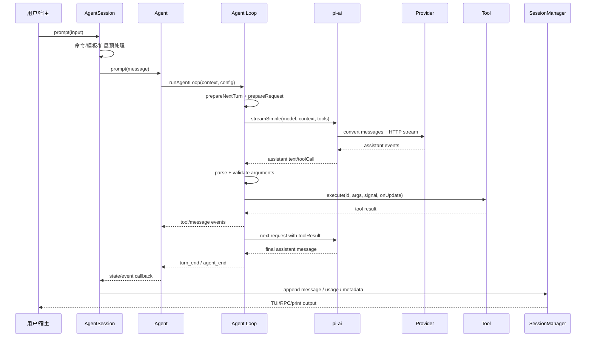

### 6.1 请求前的 `prepareRequest`

`prepareRequest` 是请求真正送到 Provider 前的最后一个 Agent 层调整点，可以改变：

- Context；
- model；
- thinking level。

它与 `transformContext` 的关系是：前者可以重新选择请求快照，后者通常在转换边界做上下文变换。两者都不应被理解为“修改原始会话历史”。

### 6.2 Provider 返回的最终参数

v1.3 在 pi-ai 中区分：

```text
流式 partial JSON —— 只用于实时展示
最终 arguments 文本 —— 重新完整解析
schema validation —— 通过后才允许执行
```

如果最终 JSON 仍然非法，`ToolCall.argumentsError` 保存错误和原始文本，validation 失败并反馈给模型，避免执行“解析出来的半个参数”。

---

## 7. 工具调用管线

### 7.1 事实顺序

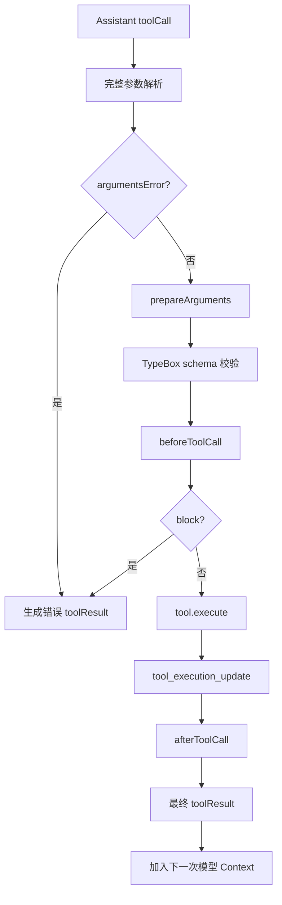

### 7.2 before/after 的边界

`BeforeToolCallResult` 是一个控制结果，不是任意结果替换器：

```ts
interface BeforeToolCallResult {
  block?: boolean;
  reason?: string;
  terminate?: boolean;
}
```

`AfterToolCallResult` 可以字段级覆盖 `content/details/structuredContent/isError/usage/terminate`。它不是 deep merge；如果替换 content 却没有同步 structuredContent，旧 structuredContent 会被移除，防止两种输出互相矛盾。

### 7.3 参数错误为什么必须回给模型

如果工具参数损坏，直接抛出宿主异常会让 Agent 看不到问题；Pi 把它编码成 tool result error，让模型能修正自己的调用：

```text
模型：read({"path":"src/\usepackage"})
解析：发现非法 \u escape
Pi：toolResult(isError=true, argumentsError=原始文本+错误)
模型：重新发起合法 read 调用
```

这是“模型可自愈”的错误边界，而不是简单的 TypeScript 异常。

### 7.4 stopReason=length

如果模型在工具调用 JSON 尚未完整输出时因为 token 上限结束，Pi 不执行不完整调用，而是为未完成的工具调用生成失败结果，让模型知道请求被截断。

---

## 8. steering 与 follow-up：为什么有两层循环

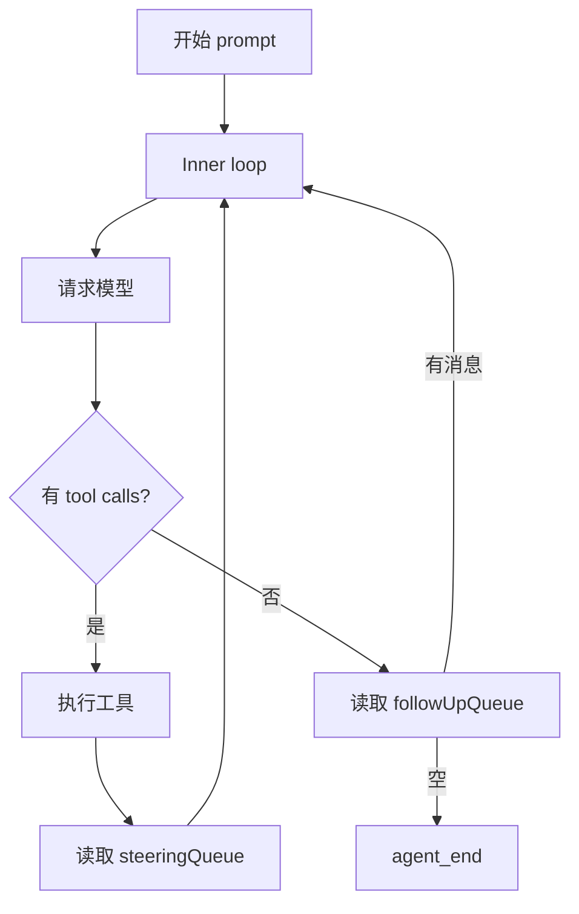

| 队列 | 注入时机 | 适合解决的问题 |
|---|---|---|
| `steeringQueue` | 当前 turn 的工具轮之间 | 用户说“别改生产环境”，立即改变下一轮方向 |
| `followUpQueue` | 当前 Agent 即将结束后 | 用户说“再跑一次测试”，开启新的 inner loop |

如果只有一个 queue，就无法表达“当前工作还没结束时插入约束”和“当前工作结束后追加新工作”这两个不同语义。

---

## 9. 事件流与状态管理

### 9.1 典型事件序列

```text
agent_start
  → turn_start
  → message_start / message_update* / message_end
  → tool_execution_start / tool_execution_update* / tool_execution_end
  → turn_end
  → ...
  → agent_end
```

事件是观察面：TUI 需要流式文字和工具进度，RPC 需要 JSONL 事件，测试需要断言顺序；事件本身不是 durable commit。

### 9.2 Agent state 与 session facts

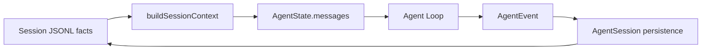

这个图不是“事件自动落盘”的意思。coding-agent 通过 `AgentSession._handleAgentEvent()` 在特定消息边界写入 SessionManager；不同事件的可见时机和持久化时机不同。

---

## 10. coding-agent：产品编排层

`coding-agent` 负责把核心 Agent 变成可用产品：

```text
CLI 参数
  → AgentSessionRuntime（cwd、settings、resources、model）
  → AgentSession（扩展、工具、压缩、持久化）
  → Agent
  → interactive / print / RPC / JSON event mode
```

### 10.1 AgentSession 负责什么

- 将用户输入分类为命令、模板、skill 或普通 prompt；
- 根据当前 session leaf 构建 Context；
- 构建 system prompt 与工具列表；
- 安装 extension hooks；
- 处理 compaction、branch、model change；
- 把 AgentEvent 投影成 session entry 和宿主事件。

### 10.2 运行时支撑服务

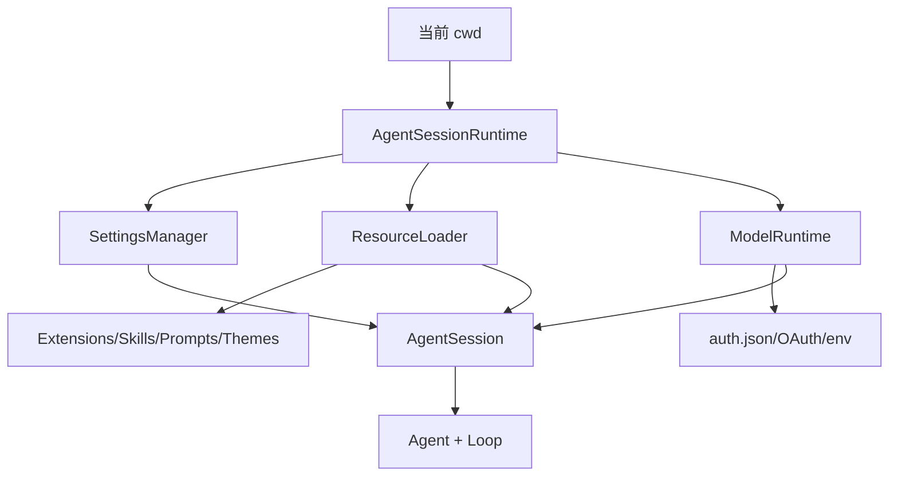

project trust 控制项目资源来源是否进入有效配置；它不是 OS sandbox。Agent 仍以宿主进程权限执行工具。

### 10.3 扩展的三层作用

1. **注册**：工具、命令、快捷键、flag；
2. **观察**：session start、agent start、tool result、agent end；
3. **改变策略**：请求前改 Context、工具前 block、工具后修改结果。

扩展和 Durable extension 不应混写：CLI 扩展是 `coding-agent` 的事件模型，Durable extension 是 task/hook 注册模型。

---

## 11. 会话树、投影与上下文

### 11.1 CLI SessionManager 的事实模型

当前 CLI session v3 的核心 entry 类型包括：

```text
session header
message
thinking_level_change
model_change
usage
compaction
branch_summary
custom
custom_message
context_edit
label
session_info
```

`leafId` 是 SessionManager 内存中的当前游标，不是 `type: "leaf"` 的 JSONL entry。

### 11.2 从事实到 LLM Context

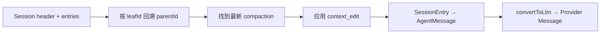

### 11.3 为什么需要 projection

磁盘需要保存：

- 用户真实输入；
- 模型回复；
- 工具结果；
- usage 和模型变化；
- 分支与压缩元数据；
- 扩展自定义消息。

模型不需要看到所有这些字段。投影层把“审计事实”转换成“当前模型可理解的上下文”。因此：

```text
Session entry 不是 LLM message
AgentMessage 也不是 Provider Message
```

### 11.4 当前 v1.3 JSONL 最小示例

```jsonl
{"type":"session","version":3,"id":"s1","timestamp":"2026-10-19T00:00:00.000Z","cwd":"/work"}
{"type":"message","id":"00000001","parentId":null,"timestamp":"2026-10-19T00:00:01.000Z","message":{"role":"user","content":"读取 README.md","timestamp":1792368000000}}
{"type":"message","id":"00000002","parentId":"00000001","timestamp":"2026-10-19T00:00:02.000Z","message":{"role":"assistant","content":[{"type":"toolCall","id":"call_1","name":"read","arguments":{"path":"README.md"}}],"stopReason":"toolUse","provider":"example","model":"example-model","usage":{"input":10,"output":5,"cacheRead":0,"cacheWrite":0,"totalTokens":15,"cost":{"input":0,"output":0,"cacheRead":0,"cacheWrite":0,"total":0}},"timestamp":1792368001000}}
{"type":"message","id":"00000003","parentId":"00000002","timestamp":"2026-10-19T00:00:03.000Z","message":{"role":"toolResult","toolCallId":"call_1","toolName":"read","content":[{"type":"text","text":"# Example"}],"isError":false,"timestamp":1792368002000}}
```

这是结构示意，不是完整生产文件。当前没有额外的 `type: "leaf"` 行。

---

## 12. 压缩与上下文编辑

### 12.1 压缩是什么

压缩不是删除历史，而是追加一条新的事实记录：

```text
旧 entries 保留
    ↓
生成 summary + firstKeptEntryId
    ↓
追加 compaction entry
    ↓
下次 buildContextEntries 从 summary + kept path 构造上下文
```

### 12.2 context_edit 是什么

`context_edit` 允许以 append-only 方式改变某些历史 entry 对当前模型的贡献，例如：

- 隐藏过大的工具输出；
- 替换上下文中的某段内容；
- 保留磁盘原始事实但减少模型上下文负担。

这和直接修改旧 JSONL 行不同：审计历史仍然存在，投影规则发生变化。

### 12.3 为什么压缩需要独立层

压缩同时涉及：模型请求、token 预算、历史投影、扩展通知、持久化和失败恢复。把它塞进 Agent Loop 会让核心循环承担产品策略；coding-agent 把它放在 AgentSession，Durable 则有独立 `CompactionTask`。

---

## 13. pi-ai：Provider 无关的模型边界

### 13.1 pi-ai 提供什么

- `Model`、`AgentMessage`、`ToolCall`、`ToolResultMessage`；
- `streamSimple()` 和 Provider API 类型；
- Provider catalog、API key/OAuth；
- message transformation；
- retry、overflow、usage 和 diagnostic。

### 13.2 Provider 适配为什么需要单独一层

不同 Provider 对以下问题的约束不同：

- tool call 参数是增量 JSON 还是完整 JSON；
- thinking block 是否需要 signature；
- system message 是否允许出现在对话中间；
- error tool result 是否允许图片；
- thinking effort 如何在同一个对话内变化。

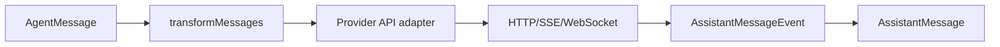

### 13.3 v1.3 重要 Provider 变化

- `kimi-coding` 使用 OpenAI Chat Completions，base URL 为 `https://api.kimi.com/coding/v1`；
- 不同模型切换时，旧模型 thinking 不转成新模型的普通文本；
- Anthropic/Bedrock 的 error tool result 图片会拆分后重新放入请求；
- malformed tool arguments 会进入 `argumentsError`，不再静默执行前缀参数。

---

# Part III：pi-durable 持久执行内核

> 本 Part 只讨论 v1.3.0 的 `packages/durable`。它不是按源码文件罗列概念，而是围绕**一条主线**组织：`Conversation.submit → admission commit → Scheduler → GenerationTask → ToolTask / CompactionTask → Entry → Submission settled`。先把主线读懂，再进入各模块。
>
> **推荐阅读顺序（避免被局部细节淹没）：**
>
> 1. **先读 §14.5、§14.5.1、§14.6**：Harness 和 Session 是不是同一个对象、谁拥有 Scheduler、一次真实请求怎样从打开走到完成；
> 2. **再读 §15、§18、§19、§20**：对象关系、Submission/Inbox admission、Scheduler 的唤醒与 task 状态机；
> 3. **最后读 §21.6、§22、§23、§24、§25**：模型轮、工具副作用、压缩、Entry/Context、重启恢复；
> 4. **§21.5 和 §30** 都是“按 checkpoint / Storage 逐步展开”的参考示例；它们用于核对细节，不应替代 §14.6 的主叙事。
>
> 下面每节都应回到同一个问题：**这一步由谁发起、提交了什么 durable 事实、Scheduler 下一次为什么会（或不会）继续执行。**

## 14. Durable 是什么

### 14.1 人话解释

`pi-agent` 解决的是“当前进程里如何把模型、工具和消息循环起来”；`pi-durable` 解决的是“这次运行如果很长、进程可能崩溃、工具会产生副作用，怎样把运行变成可观察、可恢复、可继续的持久任务”。

它不是把 JavaScript 调用栈序列化到磁盘，也不是一个自动保证外部副作用 exactly-once 的数据库。它把一次 Agent 运行拆成一组**可持久化的事实、任务状态和检查点**：进程退出后，新进程根据这些数据重新装配任务并从某个 phase 继续。

```text
宿主应用
  │  submit / configure / abort / watch
  ▼
Harness
  ├── Conversation       对外的交互边界
  ├── Submission         一次输入的 admission 与结果
  ├── Session            唯一 mutation line
  ├── Storage            持久事实
  ├── TaskScheduler      可恢复任务调度
  ├── GenerationTask     模型推进
  ├── ToolTask           工具与副作用
  ├── CompactionTask     上下文压缩
  └── ContextView        从事实投影成模型上下文
```

### 14.2 它解决什么问题

| 问题 | Durable 的回答 |
|---|---|
| 进程在模型流式响应中退出 | 保存 task phase/checkpoint，重启后重新调度 |
| 用户输入到达时 Agent 正在运行 | `Submission` 进入 inbox，按 queue/steer/follow-up 规则 admission |
| 多个工具任务互相嵌套 | ownership tree 记录父子关系，取消和 idle 可以级联 |
| 历史很大，模型上下文很小 | `Entry` 是事实，`ContextView` 是当前模型视图 |
| 工具输出很大 | bounded output、progress 和持久化 result 分离 |
| 多个调用方同时写会话 | Session 的 mutation line 串行化提交 |
| 需要观察进度 | commit publication、watch、task graph 与 output 观察接口 |

### 14.3 它不承诺什么

1. **不保存可恢复的 JS 调用栈**：只保存数据化的 phase 和 checkpoint。
2. **不自动提供完整审批产品**：v1.3.0 core 没有独立的 human approval 状态机。
3. **不自动提供 OS sandbox**：`ExecutionEnv` 是能力接口，不等于隔离边界。
4. **不保证所有外部副作用 exactly-once**：Storage commit 与 shell、网络、文件系统写入不在同一事务里。
5. **不把所有历史都直接发给模型**：模型看到的是 `ContextView` 投影。

### 14.4 输入、输出与外部引用

#### 输入

```text
Storage                         JSONL / SQLite / Memory
HarnessOptions                  models、registry、settings、env
Context                         abortSignal、principal、Chord 调用上下文
ConversationCreateOptions       agent 初始配置、cwd、初始化回调
SubmissionDraft                 input / steer / follow-up / display-only
AgentChange                     model、system、tools、thinking 等配置变化
Registry                        task、tool、extension、hook、prompt 定义
ExecutionEnv                    文件、shell、远程执行能力
```

#### 输出

```text
Conversation / ConversationView  可交互会话与投影状态
Submission / SettledSubmission  输入的接受、排队、完成结果
EntryRecord / Document snapshot  对话事实和可查询文档
TaskRecord / TaskGraph           任务状态、依赖、ownership
AssistantEntry / ToolResult      模型和工具产生的事实
CommitPublication / watch        已提交事实的观察流
UsageState / diagnostics         token、费用、重试、错误和进度
BoundedOutput                    有上限的工具/远程输出
```

#### 外部引用与边界

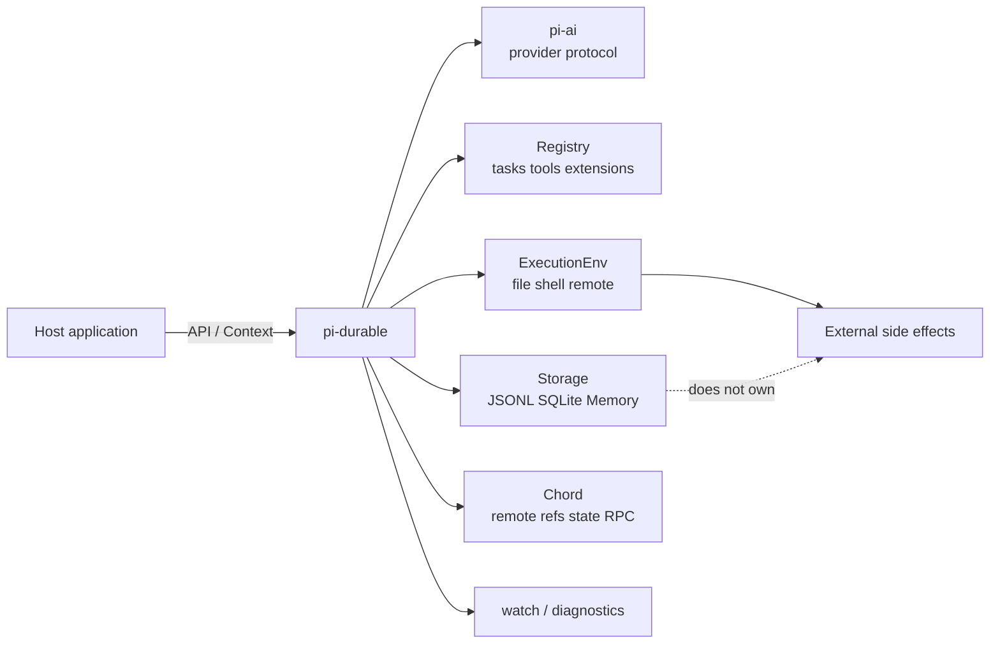

- `pi-ai` 负责模型协议和流，不负责 durable commit。
- `Storage` 只保存持久事实和 task/document 数据，不替外部副作用做事务协调。
- `ExecutionEnv` 承载执行能力；宿主负责决定是否允许、是否需要审批。
- `Chord` 负责跨 host 的 contract、reference、RPC、state 和 bounded output，不是 Durable 的数据库。
- `Registry` 负责“如何构造/执行任务”的定义；已提交数据负责“这次任务已经走到哪里”。

### 14.5 先校正对象关系：`Harness` 在代码上就是扩展后的 `SessionImpl`

前图若把 `Harness`、`Session` 画成两个并列的运行时对象，会产生一个严重误解：仿佛 Harness 打开后又持有、调用另一个 Session。**v1.3.0 的实际实现不是这样。**

`HarnessImpl` 直接 `extends SessionImpl`。创建 Harness 时，构造函数先以 `super(rawStorage, ...)` 初始化 Session 内核，然后在**同一个对象**上创建私有的 `TaskScheduler`、`Submissions`、`ConversationViews` 等服务；Scheduler 的 `session` 参数就是 `this`（即这个 Harness 对象本身）。因此：

```text
代码身份（is-a）
HarnessImpl ──extends──> SessionImpl ──implements──> Session

运行时对象（has-a）
一个 HarnessImpl 对象
  ├── 继承得到的 Session 能力：commitWith / readOnLine / observeCommits / close / Storage guard
  ├── #tasks: TaskScheduler（Harness 私有字段）
  ├── #submissions: Submissions（Harness 私有字段）
  ├── #host: ConversationHost（把上述服务借给 Conversation handle）
  ├── #taskGraph / ConversationViews
  └── Storage（由继承的 Session 内核保护和访问）
```

所以两句话必须同时成立：

- **实现/对象身份上：Harness 就是一个增强版 Session。**源码中没有另建一个独立 `SessionImpl` 实例再塞进 Harness。
- **职责/讲解上：Session 仍值得单独命名。**它指的是 Harness 继承来的“唯一 mutation line、事务、commit publication、failure guard”这组底座能力；Harness 则在其上再加 Agent runtime 的组装、Conversation API、Submission 和调度服务。

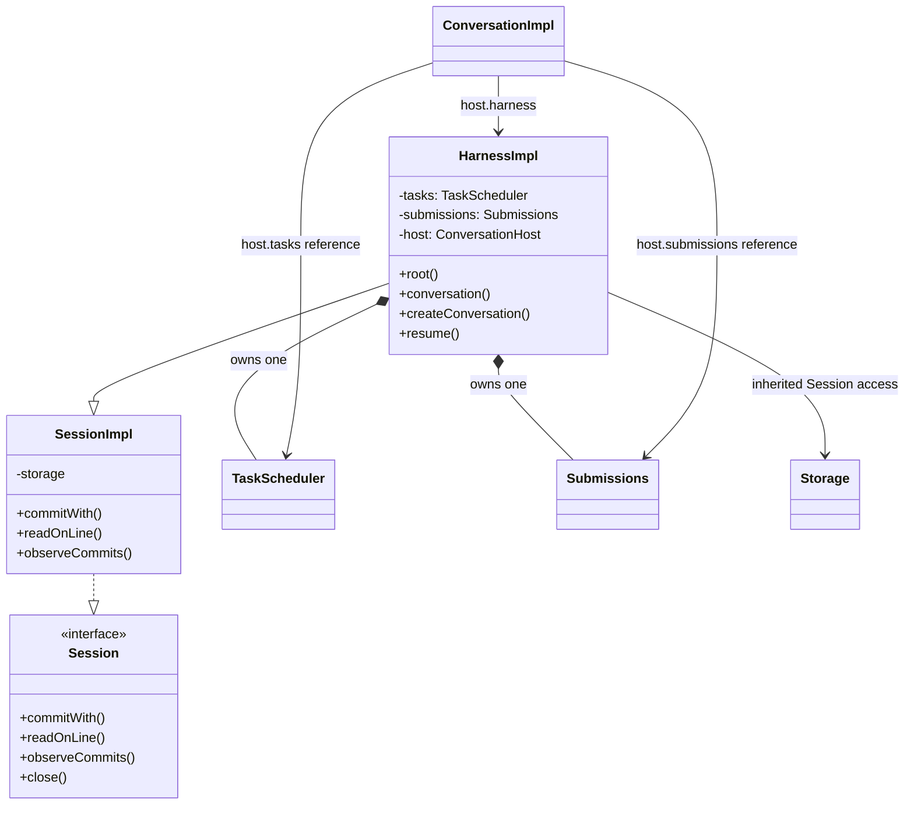

> 图中的 `ConversationImpl → TaskScheduler` 是**借用引用**，不是 ownership。`ConversationImpl` 通过 `ConversationHost` 调用全局 scheduler，例如 `compact()`、`abort()`、`waitForIdle()`；它不会创建、更换或独占一个 Scheduler。

#### 14.5.1 谁是发起核心，Scheduler 又归谁

用户的直觉是对的，但需要分成两个层级：

| 问题 | 正确答案 |
|---|---|
| 谁是宿主打开 Durable 的入口？ | `Harness.open(storage, options, ctx)`。它创建唯一的 Harness runtime，并恢复 scheduler 索引。 |
| 谁是“一次面向用户请求”的发起入口？ | `Conversation.submit(draft, ctx)`。它把输入交给 `Submissions` admission；空闲时会在同一 commit 中写 User Entry、创建 `Submission` 和 `GenerationTask`。 |
| Scheduler 被谁拥有？ | **Harness**。`HarnessImpl` 构造时 `new TaskScheduler({ session: this, ... })`，保存在私有字段 `#tasks`。一个 Harness 有一个 Scheduler。 |
| Scheduler 是不是 Conversation 的成员？ | **不是。**Conversation 只是携带 `conversationId` 的 handle；它通过 Harness 注入的 `ConversationHost.tasks` 使用共享 Scheduler。 |
| Scheduler 如何知道该推进哪个 Conversation？ | 每个 `TaskRecord` 自带 `conversationId` 和 ownership；每一次创建/等待/恢复均由 Scheduler 在同一个 Harness 范围内按 task graph 处理。 |

因此比较准确的因果链不是“Harness 调 Conversation，Conversation 自己调一个 Scheduler”，而是：

```text
Host
  └─ opens one HarnessImpl (= SessionImpl + durable services)
       ├─ owns one shared TaskScheduler
       └─ returns many Conversation handles
            └─ Conversation.submit(c1, draft)
                 └─ Submissions commits facts through the inherited Session line
                      └─ creates g1 tagged with conversationId=c1
                           └─ the shared TaskScheduler observes the commit and runs g1
```

一个 Harness 可以有根 Conversation、独立 Conversation、fork Conversation，且都共用该 Harness 的同一个 Scheduler / Session mutation line / Storage 后端；它们不会各自启动 scheduler。Conversation 是**请求和会话语义的核心**，Harness 是**运行时、服务所有权和跨会话恢复的核心**。

### 14.6 从打开到完成的主生命周期（源码级完整版）

下面用一个完整但仍可读的正常路径说明。例子是：宿主打开已有 Storage；创建/取得 root conversation；提交用户输入 `s1`；模型产生一个工具调用；工具完成；生成后继模型轮并给出最终答案。`s2` 为运行中抵达的 steer，用来显示 Inbox boundary。压缩、provider retry、取消和重启是分支，不应伪装成每次请求的必经步骤，后面紧接着单独列出。

#### 14.6.1 打开阶段：没有独立的 Session participant

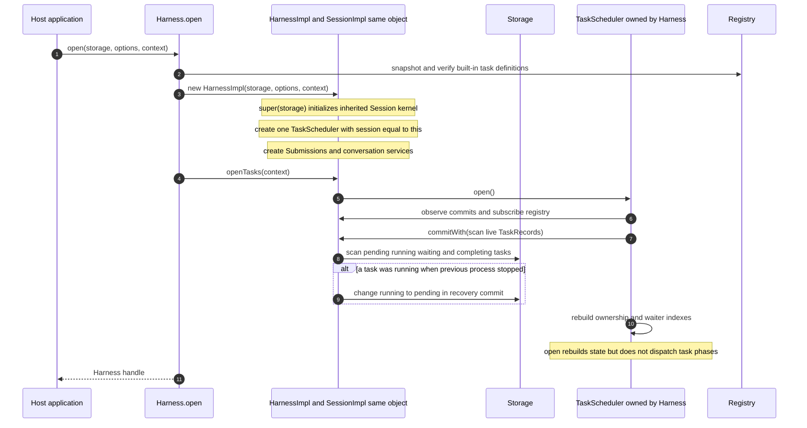

`TaskScheduler.open()` 的恢复动作是在 Harness 继承的 `SessionImpl.commitWith()` 上执行的；这就是图中不再单列“Session 对象”的原因。之后首次 `submit()`、`waitForIdle()`、`compact()` 或 `abort()` 调用 `tasks.resume()`，才启用调度。

#### 14.6.2 一次带工具、steer 与后继 generation 的完整请求时序

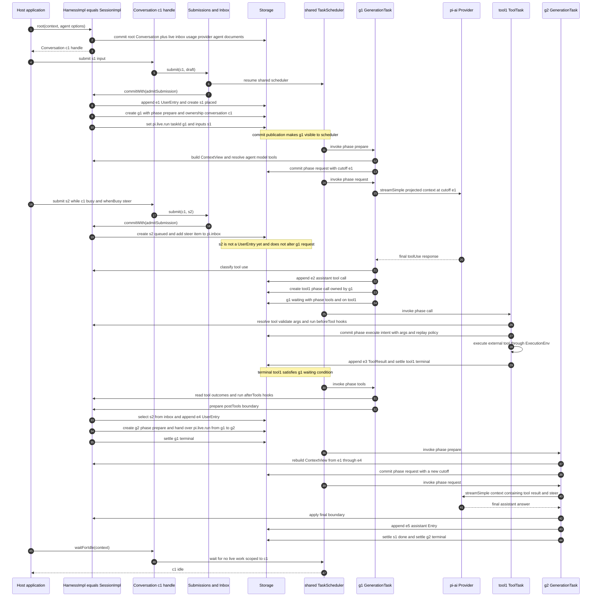

这张图故意把几个常被省略、却决定解释正确性的提交点展开：

1. **`Conversation.submit()` 是用户请求的直接入口**，但它不是直接 new `GenerationTask`；它委托 `Submissions.submit()`，后者通过 Harness 继承的 Session mutation line 执行 `admitSubmission()`。
2. `s1`、`e1`、`g1`、`pi.live.run` 在一次 admission commit 中落库，提交发布后共享 Scheduler 才看见 `g1`。
3. 忙时的 `s2` 只先成为 `Submission(status=queued)` 和 `pi.inbox` item；在 `g1.tools` 的 `postTools` boundary 被选中后，才成为 `e4`。这就是它不会污染已经以 `cutoff=e1` 发出的 provider request 的原因。
4. `tool1` 是 `g1` 的 owned child；`g2` 不是 `tool1` 的 child，而是 `g1.tools` 结束时为同一 live run 创建的 successor GenerationTask。
5. `waitForIdle()` 看的是共享 Scheduler 中**属于 `c1` 的 live work 是否归零**，不是创建一个临时 scheduler。

#### 14.6.3 上图未走到、但必须纳入全流程理解的分支

| 分支 | durable 事实如何变化 | Scheduler 接下来做什么 | 与正常工具路径的差别 |
|---|---|---|---|
| `g1.prepare` 发现 blocking compaction | 创建 `compact1`；`g1` 变为 `waiting + phase=prepare + on=[compact1]` | 先运行/恢复 `compact1`；终态后重调**同一个 `g1.prepare`** | 没有 successor generation。 |
| provider 可重试错误 | `g1` commit 为 `phase=retry, until=...` | sleep 后把 checkpoint 改回 `prepare`，attempt 加一 | provider 请求可能重发，工具尚未创建。 |
| provider deferred | `g1` commit 为 `phase=poll`，保存 handle 与 pollAt | 到点 fetchDeferred，再 classify | 不等于 tool polling。 |
| 进程在 tool intent 后崩溃 | `tool1.phase=execute` 已持久化，但尚无 ToolResult Entry | 重启后仅当持久 checkpoint 与当前工具都标记 safe replay 才重跑；否则写 interrupted result | 不能保证外部副作用 exactly-once。 |
| follow-up 在 final boundary 前到达 | Submission 留在 Inbox；final boundary 选择它 | 本次 g terminal 后 `startRun()` 创建后继 generation | 与 idle 后的新 submit 相比，区别只是 admission 时机。 |
| `Conversation.abort()` | Scheduler 为 c1 相关 live tasks 写 abort intent，并级联 owned work | 运行 task abort handler 或等待已在执行的工作结束 | Conversation 不直接杀线程，也不绕开 task ownership。 |

> **读图口诀：**Harness 是“同一个对象上的 Session 内核 + durable 服务”；Conversation 是“某个 conversationId 的对外发起/观察句柄”；Scheduler 是“由 Harness 唯一拥有、跨 Conversation 共享、按 TaskRecord 的 conversationId 分域推进”的执行器。

### 14.7 抽象设计：为什么是“数据化执行”

Durable 采用四个抽象层次：

```text
事实 Fact       已提交且可重建的 Entry、Document、Task outcome
状态 State      当前 task phase、retry、abortRequested、indexes
视图 View       ConversationView、ContextView、TaskGraph
执行 Handler    读取 checkpoint，执行有限工作，返回下一状态
```

handler 不应依赖“上一次调用还留在内存里的局部变量”。如果某个变量决定恢复后的分支，它必须进入 checkpoint；如果只是缓存，可在重启时重建。

### 14.8 如何阅读 Durable Agent Loop：只保留一条主线

Durable 没有一个单独名为 `agent-loop.ts` 的持久化循环。它把“模型 → 工具 → 模型”的过程切成可恢复 Task，并把每一次可见进度写成 commit。为了避免文档中出现多张互相重叠的 loop 图，本文规定：

```text
主叙事图：§14.6.2
  用来回答一次 submit 怎样启动、steer 怎样排队、tool 怎样唤醒 g1、g2 怎样接力。

调度细节图：§19.0
  用来回答 Scheduler 为什么被唤醒、如何 reserve、何时调用 phase handler。

Task 生命周期图：§21.6
  用来回答 g1 / tool1 / g2 / compact1 / g3 各自何时创建、等待、terminal、恢复。

Storage/checkpoint 参考例：§21.5、§30
  用来逐提交核对 Entry、TaskRecord、checkpoint 如何变化。
```

读者不需要把这些图当作四条不同流程：它们是**同一条 durable 主线的四个观察角度**。CLI 的 `agent-loop` 在进程内维持调用栈；Durable 则只依赖已提交的 Task phase、checkpoint、Entry 和 Submission 事实继续推进。

### 14.9 权限与 HITL 的真实边界

v1.3.0 的 core 有能力边界和取消边界，但没有内建的完整人工审批状态机。已有机制包括：

- `ToolRegistration.callers`：工具可由 `model` 或 `tools` 调用；
- `executionMode`：工具并行或串行；
- `replay`：安全重放或不安全重放策略；
- `ExecutionEnv`：执行能力的抽象；
- `Context.abortSignal` 与 `Conversation.abort()`；
- `permission_denied` 等执行错误；
- project trust 与 OS sandbox 的分离。

因此 HITL 应是宿主集成模式，而不是把“需要审批”误写成 core 已存在的 phase：

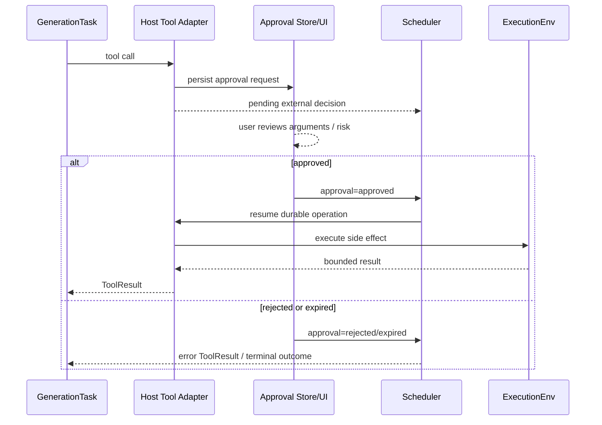

上图中的 `awaiting_approval` 是建议的宿主扩展状态，不是 v1.3.0 源码中已经命名的内建 phase。审批结果必须持久化，不能只等待一个内存 Promise。

### 14.10 把 Harness 放回中心：它到底是什么

前面的“四平面”是**内部拆分视角**，不是说 Durable 没有中心对象。对宿主而言，`Harness` 仍然是整个 Durable runtime 的根对象；但要使用 §14.5 的精确定义：**HarnessImpl 继承 SessionImpl，而不是组合一个独立 Session 对象。**它在同一个对象上拥有 Scheduler、Submissions、Conversation views 和 Registry 相关服务，并提供跨 Conversation 的查询与恢复入口。

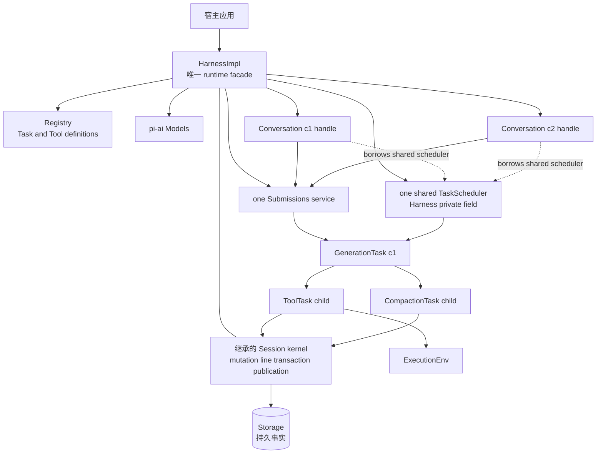

因此不要把 `Harness` 理解为“又一个 Agent Loop”，也不要把 `Session` 理解成图中被 Harness 另行持有的第二个对象。更准确的关系是：

- `HarnessImpl` 是**运行时根与门面，同时也是 SessionImpl 的子类**；
- `Session` 是这同一对象提供的**所有持久写入串行提交内核**；
- `Conversation` 是**一个会话的操作句柄和用户请求入口**；
- `TaskScheduler` 是 Harness **唯一拥有并在各 Conversation 间共享**的可恢复工作推进器；
- `Storage` 是已提交事实来源；
- `GenerationTask` 才是某个 Conversation 当前这次 Agent run 的执行任务。

真实入口是：

```ts
const harness = await Harness.open(storage, options, context);
const conversation = await harness.root(context, { agent: initialAgent });
const submission = await conversation.submit(draft, context);
await submission.wait(context);
```

`Harness.open()` 负责初始化其继承的 Session 内核、加载索引、恢复 non-terminal task；`root()` 或 `conversation()` 返回句柄；`submit()` 进入 Submission admission；随后 Scheduler 才推进 task。宿主通常不直接创建 `GenerationTask`，而是通过 `Conversation.submit()` 间接触发它。

### 14.11 从“概念分层”回到一次请求

下面这张图是整个 Durable 最重要的阅读地图。后文每个模块都应能在这条链上找到位置：

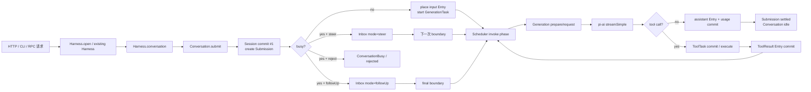

## 15. Durable 的对象模型

### 15.1 先不要把它们当成“四层业务实体”

`Conversation`、`Submission`、`Session`、`SessionImpl` 名字相近，但它们不是从外到内的一组“业务对象层级”。其中有**业务句柄**、**一次请求句柄**、**公共接口契约**和**接口实现类**四种不同维度：

```text
Conversation / Submission
  = 宿主用来操作一个会话、一次提交的业务 API handle。

Session
  = “如何原子提交、读 Document、观察 commit、关闭”的公共 TypeScript 接口。

SessionImpl
  = 实现 Session 接口的运行时内核类；持有 mutation line、缓存、Storage guard。

Harness / HarnessImpl
  = 在 SessionImpl 之上加上 Conversation、Scheduler、Registry、Submission 服务的 runtime 根。
```

所以不要读成：

```text
Conversation → Submission → Session → SessionImpl
```

这不是调用链，也不是持久化父子关系。更准确的是：

```text
Host 调用 Conversation.submit()
  → Submissions 服务创建/返回 Submission handle
  → Submissions 通过 SessionImpl 提交事实
  → Storage 保存 SubmissionRecord、EntryRecord、TaskRecord、Document
```

### 15.2 四类对象：API、实现、服务、持久事实

| 名称 | 源码性质 | 是否落盘 | 主要职责 | 生命周期 |
|---|---|---:|---|---|
| `Conversation` | public interface / handle | 否；其对应 conversation 数据会落盘 | 一个会话的 API：`submit`、`context`、`abort`、`waitForIdle` | 由 `Harness.root()` / `conversation()` 取得；可重新取得 |
| `ConversationImpl` | `Conversation` 的内部实现类 | 否 | 将 Conversation API 转发给 Harness、Submissions、Scheduler、Storage | 进程内；重开 Harness 后重建 |
| `Submission` | public interface / handle | 否；对应 `SubmissionRecord` 会落盘 | 查询、等待或撤销某一次已 admission 的提交 | 可由 `Harness.submission(id)` 重新取得 |
| `SubmissionHandle` | `Submission` 的内部实现类 | 否 | 委托 `Submissions` 服务完成 `status/wait/abort` | 进程内；可重新创建 |
| `Session` | public interface contract | 否 | `commit`、document read/watch、close、commit observation | 一个 Harness 的公共提交能力 |
| `SessionImpl` | `Session` 的实现类 | 否；它管理的记录会落盘 | mutation line、Transaction overlay、cache adoption、Storage failure guard | 一个打开的 Harness 生命周期 |
| `Submissions` | Harness 内部服务 | 否 | admission、waiter、queued submission abort、Inbox 处理 | 一个打开的 Harness 生命周期 |
| `TaskScheduler` | Harness 内部服务 | 否；TaskRecord 会落盘 | 扫描、恢复、reserve、运行、等待和取消 Task | 一个打开的 Harness 生命周期 |
| `EntryRecord` / `SubmissionRecord` / `TaskRecord` / Documents | durable records | **是** | 用户消息、模型消息、请求状态、checkpoint、Inbox、Live 状态 | 跨进程；由 Storage 恢复 |

> **最容易混淆的点**：`ConversationImpl`、`SubmissionHandle`、`SessionImpl`、`TaskScheduler` 都是本进程对象；崩溃后它们都会消失。真正跨进程留下的是 Storage 中的 record/document。新的 Harness 会重新创建这些实现对象，再把持久记录装配为可继续运行的系统。

### 15.3 正确的类图：类型继承、运行时组合和服务委托

这张图刻意把“接口继承”和“运行时对象依赖”分开。实线三角表示 TypeScript 类型/类关系；普通箭头表示运行时委托或组合；圆柱表示持久化数据而不是普通对象实例。

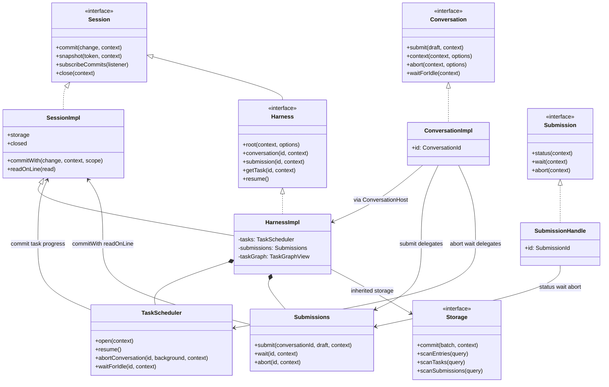

请特别注意 `Harness` 的两条关系：

```text
Harness extends Session              公共 API 继承关系
HarnessImpl extends SessionImpl      实现类继承关系
```

这不是“Harness 持有另一个独立 Session 对象”。在 v1.3.0 中，`HarnessImpl` **本身就是**一个 `SessionImpl` 的子类；所以 Harness 公开了 Session 的 commit/read/watch/close 能力，并额外添加 conversation、scheduler 和 task 管理能力。

### 15.4 从一次 `submit` 看四者如何协作：补上共享 `TaskScheduler`

这张图在“对象关系”之外补上**调度发生在何时**。重点不是让 `Conversation` 直接调用 Scheduler，而是看清：`Conversation.submit()` 委托 `Submissions` 做 admission；admission 的 commit 创建可运行 task；**Harness 唯一拥有的共享 Scheduler 观察该 commit 后才开始推进 task**。

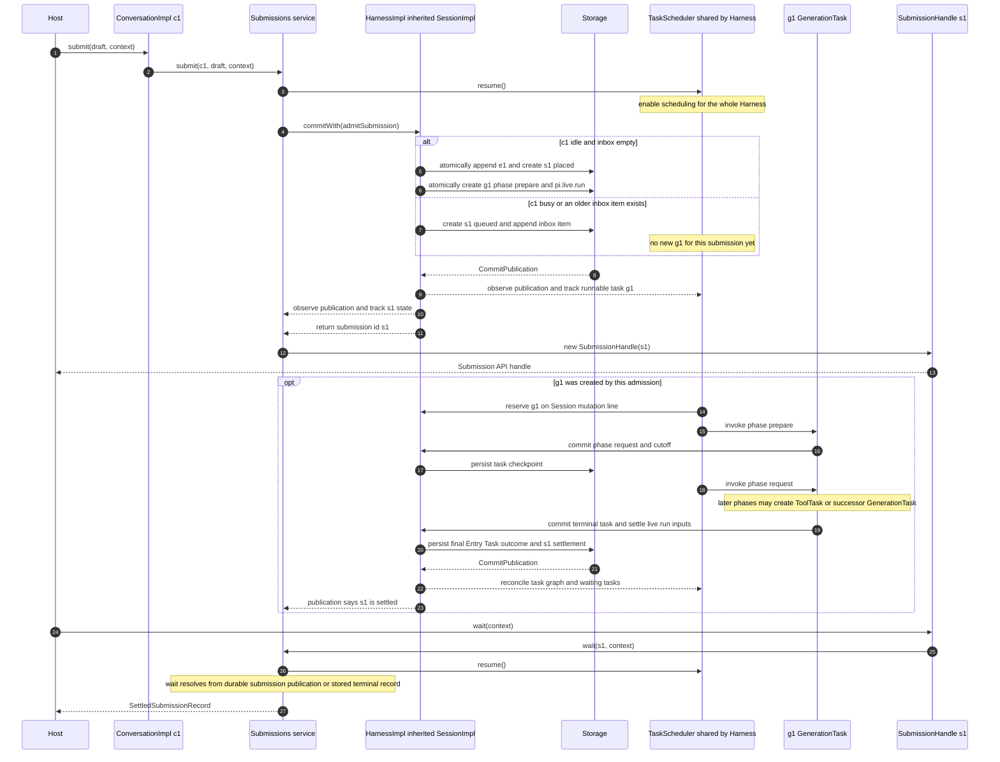

这里的关键因果关系是：

```text
Conversation.submit
  → Submissions.submit
  → Scheduler.resume（允许整个 Harness 开始推进）
  → Session commit admission facts
  → Scheduler observes CommitPublication
  → Scheduler reserves and invokes the created Task phase
  → Task commits its next checkpoint / terminal outcome
  → Submission observer resolves SubmissionHandle.wait
```

`TaskScheduler` 的三个边界尤其容易被误写：

1. **它不属于 Conversation。**`ConversationImpl` 经由 `ConversationHost.tasks` 借用 Harness 的共享 scheduler；多个 Conversation 共用它。
2. **它不负责 admission。**`Submissions.admitSubmission()` 决定当前 input 是立即 `placed + startRun`，还是 `queued + Inbox`；Scheduler 只在 commit 后看到已经存在的 TaskRecord。
3. **它不直接返回 `SubmissionHandle.wait()` 的结果。**`SubmissionHandle` 委托 `Submissions.wait()`；后者读取 durable `SubmissionRecord`，并从 Session 的 commit publication 中观察 `done` / `unanswered` settlement。

这段时序对应三个不同层次的值：

```text
Host 手上的 SubmissionHandle
  = 可调用的进程内 API 对象。

Storage 里的 SubmissionRecord s1
  = 可恢复的持久状态；queued / placed / done / unanswered 等。

Storage 里的 EntryRecord / TaskRecord
  = 该 Submission 被放置为哪条消息、由哪些 Task 继续执行的事实。
```

### 15.5 持久化实体图：Conversation scope 下真正保存什么

```mermaid
flowchart TB
    CR[Conversation record c1\nscope and ownership] --> SD[Conversation documents]
    CR --> ER[Entry records\nuser assistant tool summary]
    CR --> SR[Submission records\nqueued placed done]
    CR --> TR[Conversation owned Task records]

    SD --> IN[pi.inbox\nqueued steer followUp]
    SD --> LIVE[pi.live\ncurrent run partial progress]
    SD --> AG[pi.agent\nmodel tools cwd configuration]

    SR -->|placed entry| ER
    TR -->|produces| ER
    TR -->|waits on or owns| TR2[Child Task records]
    TR -->|checkpoint references| ER
```

这一张图回答的是“Storage 里实际保存什么”；上一张类图回答的是“进程中有哪些接口、实现和服务”。二者不要混为同一张图。

### 15.6 主要实体的职责

| 实体 | 回答的问题 | 关键数据 |
|---|---|---|
| `Harness` | 整个运行时怎样打开、恢复、查询 | Session、Scheduler、Registry、全局 API |
| `Conversation` | 一个会话怎样接受输入和生成上下文 | agent state、head、inbox、documents |
| `Submission` | 某次输入被怎样接纳和完成 | admission、状态、result/error |
| `Entry` | 发生过什么 | user、assistant、tool、compaction、edit 等事实 |
| `Task` | 下一步可恢复工作是什么 | type、phase、checkpoint、owner、retry |
| `Document` | 如何以定义的语义读取/观察数据 | snapshot、as-of、retention |
| `ContextView` | 模型这一轮看到什么 | system、messages、tools |

### 15.7 三条关系线：身份、归属、上下文

```mermaid
flowchart LR
    C[Conversation] -->|scope| E[Entry]
    C -->|admits| S[Submission]
    C -->|owns root work| T[Task]
    T -->|ownership| T2[Child Task]
    T -->|produces| E2[Tool / Assistant Entry]
    E -->|parent / head / fork cutoff| E3[History]
    E -->|context edit| CE[ContextEdit]
    C -->|projects| CV[ContextView]
```

- 身份线：ID、parent、head、fork cutoff，回答“是谁、来自哪里”；
- 归属线：conversation owner task、task owner task，回答“取消、等待、故障影响谁”；
- 上下文线：entry、compaction、edit、system baseline，回答“模型看到什么”。

### 15.8 typed ID 与版本化

ID 类型不是装饰：`ConversationId`、`SubmissionId`、`TaskId`、`EntryId`、`DocumentId` 防止把不同作用域的字符串混用。Task definition 和 registry 还需要稳定的 type/version，原因是重启时新进程必须知道旧 checkpoint 应由哪个 handler 解释；代码升级时要么兼容读取，要么显式 migration。

## 16. Session 与 mutation line

### 16.1 Session 是提交内核

`SessionImpl` 负责把多个业务对象的修改串成一条 mutation line：

```text
read committed snapshot
  → create transaction overlay
  → callback 读取/修改 overlay
  → Storage.commit
  → adopt cache
  → publish CommitPublication
```

Session 不是“某一个 Conversation 的对象缓存”，而是 Harness 范围内持久写入的协调点。Conversation、Scheduler、Document 都应通过它提交事实。

### 16.2 一次 commit 的详细流程

```mermaid
sequenceDiagram
    participant Caller
    participant S as Session mutation line
    participant TX as Transaction overlay
    participant DB as Storage
    participant C as Cache/index
    participant W as Watchers

    Caller->>S: commitWith(change, ctx)
    S->>TX: open overlay over committed state
    TX-->>S: read-your-writes
    Caller->>TX: apply facts / task changes
    TX->>DB: atomic commit
    alt storage_failure
      DB-->>S: error
      S-->>Caller: reject and apply failure policy
    else storage_success
      DB-->>S: committed sequence
      S->>C: adopt committed cache/index
      S->>W: publish CommitPublication
      S-->>Caller: commit result
    end
```

### 16.3 为什么不能给每个对象一把锁

如果 Conversation、Task、Document 各自独立提交，就会出现：Entry 已落盘但 task phase 没更新、watch 先看到一半结果、恢复扫描到不一致组合。mutation line 让“事实和状态的联动修改”有一个可解释的顺序；它是串行提交，不等价于所有 handler 都串行执行。

### 16.4 Session 对外 API 与失败语义

| 类别 | 典型能力 | 设计含义 |
|---|---|---|
| 写 | `commit`（实现内部为 `commitWith`） | 所有事实进入唯一提交线 |
| 读 | snapshot、as-of、scan | 读已提交状态，不读半成品 |
| 观察 | commit publication、document watch | 观察提交，不把临时流当事实 |
| 生命周期 | close、closed、failure | Storage 失败不能被静默吞掉 |

Storage error 与 Task handler error 要分开：前者可能使 Session 进入 failed，后者通常只影响当前 Task。观察者失败也不应倒写已经提交的事实。

## 17. Storage：Memory、JSONL 与 SQLite

### 17.1 Storage 的最小契约

Storage 需要支持的不是“保存一个 JSON 大对象”，而是围绕 Session/Document/Task 的读取与提交：

```text
open / close
read committed snapshot
commit mutation batch
scan entries / tasks / documents
read as-of sequence
retain / compact storage records
```

具体接口以 `packages/durable/src/storage` 和 `src/types.ts` 为准；后端替换不应改变上层 Task handler 的语义。

### 17.2 三类后端

| 后端 | 适合 | 代价 |
|---|---|---|
| `MemoryStorage` | 单元测试、短生命周期、快速原型 | 进程退出即丢失 |
| JSONL | 可读、易调试、append-friendly | 并发/索引/随机查询能力弱，需要重建 |
| SQLite | 事务、索引、as-of 与较大任务图 | schema、迁移和锁管理更复杂 |

不要把 `MemoryStorage` 翻译成“Agent memory”。它是存储后端；Agent 的 transcript 和模型 memory 另有含义，见第 24 节。

### 17.3 commit 与外部副作用的边界

```text
Storage transaction: 事实、phase、checkpoint、result metadata
外部执行: shell、网络、文件、远程 RPC、第三方 API

两者之间没有自动的分布式事务。
```

安全做法是把副作用设计为幂等、带 operation id、可检查结果，或在工具级别实现 outbox/补偿；不能因为 task phase 已提交就声称 shell 只执行了一次。

### 17.4 一次存储提交的数据流

```mermaid
flowchart LR
    M[Mutation] --> TX[Transaction overlay]
    TX --> B[Mutation batch]
    B --> DB[(Storage backend)]
    DB --> SEQ[Committed sequence]
    SEQ --> IDX[Indexes/cache adoption]
    IDX --> PUB[CommitPublication]
    PUB --> DOC[Document observers]
    PUB --> TASK[Task graph observers]
```

## 18. Conversation、Submission 与 Inbox

### 18.1 Conversation 是用户边界

Conversation 将 agent state、历史、inbox、任务和 document 绑定在一个可操作边界上。它不是单纯的一段字符串 transcript，因为它还负责配置、fork、abort、compact、context 和 idle 语义。

### 18.2 Submission 为什么独立

用户提交的是“请求被 Durable 接纳”的对象，而不是立即成为一条模型消息。Submission 可以：

- 在 busy 时排队；
- 被按模式合并或拒绝；
- 触发一个或多个 Task；
- 在任务完成、取消或失败时 settle；
- 作为 display-only 输入只影响 UI，不进入模型上下文。

```mermaid
stateDiagram-v2
    [*] --> submitted
    submitted --> admitted: admission accepted
    submitted --> rejected: invalid / closed
    admitted --> queued: busy or policy
    admitted --> running: scheduler starts
    queued --> running: next boundary
    running --> settled: final result
    running --> aborted: abort
    running --> faulted: terminal error
```

### 18.3 Inbox admission 流程

```mermaid
flowchart TD
    U[submit draft] --> V{valid?}
    V -- no --> R[rejected Submission]
    V -- yes --> B{conversation busy?}
    B -- no --> A[admit + append input Entry]
    B -- yes --> M{queue mode}
    M -- steer --> ST[steering inbox; next tool boundary]
    M -- follow-up --> FU[follow-up inbox; after current turn]
    M -- all --> Q[ordered queue]
    A --> T[create / resume GenerationTask]
    ST --> T
    FU --> T
    Q --> T
```

`Submission`、`User Entry`、`GenerationTask` 三者因此不能合并：一个表示 admission，一个表示事实，一个表示执行。

## 19. TaskScheduler：任务为什么能恢复


### 19.0 Scheduler 是什么：Harness 内存中的“Task 调度器”

`TaskScheduler` 是 `HarnessImpl` 创建并私有持有的**内存服务对象**。它不是 Entry、Document、TaskRecord，也不属于某一个 Conversation。一个 Harness 有一个共享 Scheduler；每个 TaskRecord 自带 `conversationId`、ownership、status 与 checkpoint，Scheduler 据此把工作限定在正确的 Conversation scope。

最容易误解的问题是：**“Task 已经写进 Storage 之后，Scheduler 到底是谁叫醒的？”**

答案不是某个 `Conversation` 直接 `scheduler.run(g1)`，而是下面这条 commit-driven 链：

```text
1. Harness.open()
   └─ scheduler.open()
      ├─ 注册 session.observeCommits(publication => scheduler.observe(publication))
      ├─ 注册 registry.subscribe(() => scheduler.kick())
      ├─ 扫描 non-terminal TaskRecord，running → pending
      └─ 重建内存 ownership / waiter / runnable 索引
         注意：open 只恢复索引，尚未启动 phase dispatch。

2. Conversation.submit()
   └─ Submissions.submit()
      ├─ scheduler.resume()：enabled=true，调用 kick()
      └─ Session.commitWith(admitSubmission)
         └─ 同一 commit 中可能创建 g1 TaskRecord。

3. Session 发布 CommitPublication
   └─ scheduler.observe(publication)
      ├─ 把新增/变化的 TaskRecord 写进内存索引
      ├─ 处理 terminal child 对 waiting parent、ownership、idle 的影响
      └─ 若有 task change，调用 kick()。

4. scheduler.kick()
   └─ queueMicrotask(drain)，前提是 enabled 且未 closing / draining。

5. drain()
   └─ reserve() 在 Session mutation line 上原子保留 runnable Task
      └─ start() → run()
         └─ 读取 checkpoint.phase，调用 TaskDefinition.phases[phase]()。
```

```mermaid
sequenceDiagram
    autonumber
    participant C as Conversation submit
    participant Sub as Submissions
    participant H as Harness inherited Session
    participant DB as Storage
    participant Sch as TaskScheduler
    participant G as g1 GenerationTask

    C->>Sub: submit(c1, input)
    Sub->>Sch: resume()
    Note over Sch: enabled becomes true then kick queues a microtask
    Sub->>H: commitWith(admitSubmission)
    H->>DB: append Entry create Submission create g1
    DB-->>H: CommitPublication
    H-->>Sch: observe(publication)
    Sch->>Sch: track g1 in runnable indexes
    Sch->>Sch: kick then drain
    Sch->>H: reserve g1 atomically on mutation line
    Sch->>G: phases.prepare(checkpoint)
    G->>H: commit next checkpoint or waiting terminal state
    H->>DB: persist durable progress
    DB-->>H: CommitPublication
    H-->>Sch: observe updated task state
```

Scheduler 还会在下列时机再次尝试推进，但它们不改变“所有推进都以持久 task state 为依据”的原则：

| 触发来源 | 为什么会 `kick` / 继续推进 | 典型例子 |
|---|---|---|
| `resume()` | 宿主要求当前 Harness 开始产生进度 | `submit()`、`Submission.wait()`、`Conversation.compact()`、`abort()`、`waitForIdle()`、显式 `Harness.resume()`。 |
| Task/Conversation commit publication | 新 task、checkpoint/status 改变、child terminal、abort mark 都可能使某项工作可运行 | `tool1` terminal 后，`g1` 的 `tools` phase 可继续。 |
| Registry 变化 | 原先缺失或不兼容的 TaskDefinition 可能变得可解析 | 动态注册/更新 task definition。 |
| 正在运行的 phase 自己完成等待 | `retry`/`poll` 的 `runtime.sleep()` 是该 invocation 内的等待；醒来后 handler 自己 commit 下一状态 | `GenerationTask.retry` 到达 `until`。 |
| invocation 结束 | Scheduler 清理 invocation，再次 `kick` 检查其余 runnable work | 一个 ToolTask terminal 后让父任务获得运行机会。 |

Scheduler 的职责可以压缩为五件事：

| Scheduler 做什么 | 具体含义 | 不做什么 |
|---|---|---|
| 打开与恢复 | 扫描 non-terminal TaskRecord；把崩溃遗留的 `running` 调回可恢复的 `pending` | 不恢复 JS 调用栈，也不在 `open()` 立刻 dispatch |
| 观察并索引 | 消费 Session CommitPublication，重建 owner / waiter / runnable 等内存派生状态 | 不把索引当 durable 事实 |
| reserve 后执行 | 先在 mutation line 上保留 Task，再按 `checkpoint.phase` 调 handler | 不实现具体 Provider 或工具业务 |
| 等待与唤醒 | child terminal、状态提交、registry 更新、显式 resume 后重试推进 | 不替 Admission 决定 steer/follow-up 的 placement |
| 取消与收尾 | 沿 ownership 传播 abort，等待 owned child，完成 terminal outcome | 不回滚已经发生的外部副作用 |

因此必须一直区分：

```text
TaskRecord = 被调度的、持久化的工作单；
TaskScheduler = 读取这些工作单、维护可重建索引、调用 phase handler 的内存服务；
Conversation = 提交请求和限定 scope 的句柄，不是 Scheduler owner。
```

进程重启后 Scheduler 对象会重新创建，但它能从 Storage 重新读取 TaskRecord、重建索引、继续调度；这正是 Durable 不能只依赖内存队列的原因。

### 19.1 TaskDefinition 与 TaskRecord

```text
TaskDefinition<I, S, R, H>
  = type/version + input schema + initial state + phase handler + hooks

TaskRecord
  = id + definition type/version + input + state/checkpoint
    + status + owner + retry + timestamps + outcome
```

定义是代码，记录是持久数据。恢复时 scheduler 用 record 的 type/version 找 definition，再把 checkpoint 交给 handler。

### 19.2 `open`、`resume` 与 `kick`：不要把三者混成“启动调度”

| 动作 | 谁调用 | 做什么 | 会不会立刻运行 phase |
|---|---|---|---|
| `scheduler.open()` | `Harness.open()` | 注册 commit/registry listener；扫描 live task；把 crash 遗留的 `running` 改为 `pending`；重建索引 | **不会**。Scheduler 此时仍未 enabled。 |
| `scheduler.resume()` | `Submissions.submit/wait`、Conversation 的 `compact/abort/waitForIdle`、或 `Harness.resume()` | 设置 `enabled=true`，调用 `kick()` | 如果已经有 runnable task，则会在 microtask drain 中尝试 reserve。 |
| `scheduler.kick()` | `resume()`、commit observer、registry observer、invocation finally | 若未 draining/closing，则排一个 microtask 执行 `drain()` | 不直接执行业务；只合并多次变化后统一抢占 runnable task。 |
| `drain()` | `kick()` 的 microtask | 循环 reserve 可以运行的 task，并开始 invocation | **是**，通过 `start() → run()` 进入 phase handler。 |

恢复后的一个重要细节是：`open()` 将遗留 `running` 改为 `pending`，因为旧进程的调用栈已不存在；但是它不假定可以立刻继续跑。只有宿主或正常 API 路径调用 `resume()` 后，新的 Scheduler 才真正尝试 dispatch。

### 19.3 一次 phase dispatch 的精确流程：handler 不返回下一状态，而是 commit 它

此前如果把流程画成“handler 返回 outcome，Scheduler 再提交”，容易误解 v1.3.0 的实现。内建 Task handler（如 `GenerationTask.prepare`、`ToolTask.call`）在运行中通过 `runtime.commit(...)` 自己提交 durable progress；Scheduler 在相邻的调度步骤中检查这次 phase 是否真的推进。

```mermaid
sequenceDiagram
    participant Sch as TaskScheduler
    participant SI as Harness inherited Session
    participant DB as Storage
    participant H as phase handler

    Sch->>SI: reserve runnable task on mutation line
    SI->>DB: set task status running
    Sch->>SI: step and decide current checkpoint
    SI-->>Sch: checkpoint phase is prepare request tools or call execute
    Sch->>H: invoke phases[checkpoint.phase](task runtime context)
    H->>SI: runtime.commit(next checkpoint waiting or terminal)
    SI->>DB: atomically persist durable progress and related facts
    DB-->>SI: CommitPublication
    SI-->>Sch: observe changed TaskRecord
    Sch->>SI: next step checks previous checkpoint
    alt checkpoint changed or task is waiting terminal
        Sch->>Sch: continue later or release invocation
    else handler returned without durable progress
        Sch->>SI: fault task because phase made no durable progress
    end
```

这条规则解释了为什么 checkpoint 不是普通日志：

```text
handler 的内存局部变量改变     不算推进；崩溃后会丢。
runtime.commit(...) 写入 checkpoint / waiting / terminal
                              才算推进；重启后 Scheduler 才看得见。
```

它也解释了 child task 完成后的父 task 唤醒：`tool1` terminal 的 commit 先被 observer 写入 Scheduler 的索引与 waiter 关系；随后 `kick → drain → reserve` 才会让 `g1` 的 `phase=tools` 获得下一次执行机会。

### 19.4 Scheduler 索引与 ownership

Scheduler 通常需要按 task id、status、owner、ready/running 等索引快速定位。索引是可重建的派生状态，TaskRecord 才是事实。ownership tree 则把取消、等待、子任务完成和孤儿处理串起来：父任务结束时，未完成的 owned child 不能悄悄脱离。

### 19.5 Registry 版本与 migration

如果新版本改变 phase schema，不能依赖“旧进程局部变量”。可选策略是：向后兼容读取、在打开时迁移、或将旧 definition 保留到所有旧 task terminal。文档中的“可恢复”默认前提是 task definition 对 checkpoint 的解释稳定。

## 20. Task 状态机与 ownership

### 20.1 状态机

```mermaid
stateDiagram-v2
    [*] --> pending
    pending --> running: scheduler invoke
    running --> pending: checkpoint / retry
    running --> completed: result committed
    running --> faulted: unrecoverable error
    running --> aborted: abort requested
    running --> orphaned: owner unavailable
    pending --> aborted: cascade abort
    faulted --> [*]
    completed --> [*]
    aborted --> [*]
    orphaned --> [*]
```

实际内部字段以源码类型为准；图表达的是恢复语义，不把每个内部标记误写成稳定 API。

### 20.2 ownership tree

```mermaid
flowchart TD
    C[Conversation root work] --> G[GenerationTask]
    G --> T1[ToolTask: read]
    G --> T2[ToolTask: bash]
    T2 --> N[Nested ToolTask]
    G --> CP[CompactionTask]
    C --> F[Follow-up generation]
```

ownership 不是 parent entry：entry 表达历史关系，ownership 表达执行控制关系。取消父任务可级联子任务；fork 历史也不会自动复制正在运行的 task。

### 20.3 任务的取消与等待

`waitForIdle()` 需要综合 conversation root work、owned tasks、inbox 和 pending compaction，而不是只检查某一个 `running` 布尔值。`abort()` 写入取消意图并唤醒 scheduler；它不是回滚已提交事实。

## 21. GenerationTask：持久化模型请求

### 21.0 先分清 Loop、Task、Phase 与 Checkpoint

这一节最容易被术语误导。`pi-durable` **仍然有 Agent Loop**；不同之处在于，它不把 Loop 保存在一个进程内的 `while` 调用栈里，而是把 Loop 拆成持久化 Task，并用 Task 的 checkpoint 串起每个 phase。

```text
Agent Loop（整体行为）
  └── 多个 Task（可调度、可恢复的工作单）
        └── 多个 Phase（某张工作单的步骤）
              └── Checkpoint（下一步恢复 phase 所需的数据）
```

| 概念 | 它回答的问题 | Generation 示例 | 它不是什么 |
|---|---|---|---|
| Agent Loop | “用户输入如何经历模型、工具、再模型直到完成？” | `input → generation → tool → generation → final` | 不是一个必须常驻的 `while(true)` |
| Task | “这份可恢复工作是谁、归谁、完成了吗？” | `t1 = pi.generation`、`t2 = pi.tool` | 不是某个具体步骤名称 |
| Phase | “这份 Task 此刻进行到哪一步？” | `prepare`、`request`、`tools` | 不是独立的 Task |
| Checkpoint | “进程重启后，这个 phase 要带什么数据继续？” | `phase=request, model, cutoff, attempt` | 不是 JS 调用栈快照 |
| Storage | “哪些事实已经可靠地提交？” | task state、Entry、Submission、Inbox | 不知道外部副作用是否已发生 |
| Scheduler | “现在应该运行哪个 Task 的哪个 phase？” | `phases.get(checkpoint.phase)(...)` | 不承担模型协议或工具实现 |

因此下面这句话是最准确的：

> **Durable 的 Agent Loop 由 Task 驱动；Task 由 Phase 推进；Phase 的恢复输入由 Checkpoint 持久化；Harness 把它们与 Session、Storage、Scheduler 组装为一个 runtime。**

```mermaid
flowchart LR
    IN[Submission / Inbox] --> LOOP[Durable Agent Loop]
    LOOP --> G[GenerationTask t1]
    G --> P1[phase=request]
    P1 --> T[ToolTask t2]
    T --> P2[phase=tools]
    P2 --> G2[successor GenerationTask t3]
    G2 --> OUT[final Entry / Submission settled]
    CP[(checkpoint)] -. tells scheduler what resumes .-> P1
    ST[(Storage)] -. persists task, checkpoint, entries .-> CP
    H[Harness] --> LOOP
```

### 21.1 责任与输入输出

```text
输入：ContextView、ModelRef、retry policy、prompt/system/tools、checkpoint
输出：assistant Entry、usage、tool calls、next phase 或 terminal result
依赖：pi-ai streamSimple、Registry、Session、Context abortSignal
```

### 21.2 Generation phase

```mermaid
flowchart TD
    P[pending] --> B[build ContextView]
    B --> R[request provider stream]
    R --> EV[consume stream events]
    EV --> F{final response}
    F -- tool calls --> TC[commit assistant tool-call entry]
    TC --> X[spawn ToolTasks]
    X --> RES[commit tool result entries]
    RES --> B
    F -- final text --> OUT[commit assistant entry + usage]
    R -->|transient provider error| RETRY[provider retry policy]
    RETRY --> R
    R -->|terminal| ERR[faulted outcome]
```

模型流事件不是事实本身：中途 token 可能重复、截断或进程丢失。只有按 Durable 边界提交的 assistant/tool/usage 记录才进入可恢复事实。

### 21.3 Provider retry 与 task retry

- Provider retry：同一次模型请求层面的退避、限流、网络错误处理。
- Task retry：handler phase 失败后，scheduler 是否重新执行该 phase。

两者不能混写，否则会把一次 provider 重试误算成两次业务任务，也会让工具副作用被错误重放。

### 21.4 Checkpoint 如何驱动 phase：不是一个 `Checkpointer` 对象

v1.3.0 `pi-durable` 里没有一个名为 `Checkpointer` 的独立类。这里的 **checkpoint** 是每个非终态 `TaskRecord.state` 中持久化的一段 JSON 数据；其中必须带有 `phase` 字段。Scheduler 用它选择下次要调用的 phase handler：

```ts
// 语义化简化；真实实现位于 harness/scheduler.ts。
const checkpoint = taskRecord.state.checkpoint;
await taskDefinition.phases[checkpoint.phase](taskRecord, runtime, context);
```

因此关系必须严格区分：

```text
TaskRecord                    一张持久化工作单，例如 t1 = pi.generation
TaskRecord.state.status       pending / running / waiting / terminal 等调度状态
TaskRecord.state.checkpoint   可 JSON 化的恢复数据
checkpoint.phase              当前要执行的 phase 名称，例如 prepare / request / tools
phase handler                 代码中的函数，根据 checkpoint 继续推进
```

```mermaid
flowchart TD
    R[TaskRecord in Storage\ntype=pi.generation] --> S{state.status}
    S -- pending / running --> CP[checkpoint JSON]
    CP --> PH[phase=request]
    PH --> LOOKUP[Registry resolves GenerationTask]
    LOOKUP --> CALL[Scheduler invokes phases.request]
    CALL --> WORK[read data / call provider / wait child]
    WORK --> COMMIT[runtime.commit]
    COMMIT --> NEXT{next state}
    NEXT -->|running + phase=tools| CP2[new checkpoint]
    NEXT -->|waiting + on child tasks| WAIT[Scheduler waits]
    NEXT -->|terminal + outcome| END[Task settled]
    CP2 --> CP
```

**checkpoint 的使用规则**：phase handler 不能仅修改内存变量后返回。它必须经由 `runtime.commit(...)` 写出新的 checkpoint、waiting 条件或 terminal outcome。Scheduler 在 handler 返回后会检查 checkpoint 是否真的改变；如果没有产生 durable progress，会把 task 视为故障，避免一个 phase 在内存中空转。

#### 21.4.1 `GenerationTask` 的真实 checkpoint 形状

`packages/durable/src/harness/generation.ts` 定义的 `GenerationCheckpoint` 是一个 phase discriminated union，核心形状如下：

```ts
// 为可读性省略部分字段；字段和 phase 以 v1.3.0 为准。
type GenerationCheckpoint =
  | { phase: "prepare"; attempt: number; compacted?: TaskId; overflow?: string }
  | {
      phase: "request";
      attempt: number;
      model: ModelRef;
      thinkingLevel: ModelThinkingLevel;
      streamOptions: ConversationStreamOptions;
      cutoff: EntryId;
    }
  | { phase: "retry"; attempt: number; until: number }
  | { phase: "poll"; attempt: number; handle: DeferredHandle; pollAt: number }
  | {
      phase: "tools";
      assistant: EntryId;
      tools: TaskId[];
      pending: string[];
    };
```

这些字段不是为了“记录日志”，而是恢复所必需的最小输入：

| phase | checkpoint 必须保存什么 | 为什么恢复时需要它 |
|---|---|---|
| `prepare` | attempt、关联的 compaction | 知道第几次准备，以及是否先等待压缩 |
| `request` | model、thinking、streamOptions、cutoff | 重启后能重建同一请求边界，而不是随意读取最新状态 |
| `retry` | until、attempt | 恢复后仍按原退避时间，而不是立即重试 |
| `poll` | provider deferred handle、pollAt | 能继续轮询同一个异步 Provider 结果 |
| `tools` | assistant entry、已创建 tool task IDs、未启动调用 | 能等待已有工具，不重复创建整轮工具 |

`cutoff` 尤其重要：它标记本次 Provider 请求最多使用到哪个 Entry。恢复时 `ContextView` 可以按这个历史边界重建，避免在请求中途混入之后刚到达的 steer/follow-up 输入。

#### 21.4.2 一次 phase 推进的精确动作

以 `prepare → request` 为例：

```text
1. Scheduler 从 Storage/缓存读取 t1：
   state = { status: pending, checkpoint: { phase: prepare, attempt: 1 } }

2. Scheduler 先把 t1 reserve 成 running；
   这表示本进程开始执行它，但还没有声称 Provider 已成功返回。

3. Scheduler 调用 GenerationTask.phases.prepare(t1, runtime, context)。

4. prepare 构造 ContextView、解析 model/tools/system；
   然后在 runtime.commit 中把同一 Task 更新为：
   { status: running, checkpoint: { phase: request, model, cutoff, ... } }

5. commit 成功后，新的 checkpoint 已进入 Storage。

6. Scheduler 的下一步看到 phase=request，调用 phases.request。
```

如果进程在第 4 步之前崩溃，Storage 里仍是 `phase=prepare`，重启后重新 prepare；如果在第 5 步之后崩溃，Storage 里已经是 `phase=request`，重启后从 request 开始。**提交点决定恢复点。**

### 21.5 完整 checkpoint 恢复例子：一次 read 工具调用

下面从用户请求“读取 README 并说明如何启动”开始，只聚焦 checkpoint 如何变化。ID 为示意值，phase 和恢复机制对应 v1.3.0。

```mermaid
sequenceDiagram
    participant H as Harness/Scheduler
    participant DB as Storage
    participant G as GenerationTask t1
    participant AI as pi-ai Provider
    participant T as ToolTask t2
    participant ENV as ExecutionEnv

    H->>DB: load t1 phase=prepare
    H->>G: phases.prepare(checkpoint)
    G->>DB: commit phase=request, cutoff=e1
    H->>G: phases.request(checkpoint)
    G->>AI: streamSimple(messages through e1)
    AI-->>G: assistant tool call read README
    G->>DB: commit e2 + t2 + t1 phase=tools waiting[t2]
    H->>T: phases.call(t2)
    T->>DB: commit execute intent (arguments + replay)
    T->>ENV: read README.md
    ENV-->>T: content
    T->>DB: commit e3 + t2 terminal
    H->>G: resume t1 phase=tools
    G->>DB: commit successor generation t3 phase=prepare
    H->>G: t3 prepare/request with e1,e2,e3
    AI-->>G: final answer
    G->>DB: commit e4 + settle submission
```

对应的持久记录演进如下：

```text
A. 用户输入刚被接纳
   t1 = {
     kind: "pi.generation",
     state: { status: "pending", checkpoint: { phase: "prepare", attempt: 1 } }
   }

B. prepare 已提交，尚未发模型请求
   t1 = {
     state: {
       status: "running",
       checkpoint: {
         phase: "request",
         attempt: 1,
         model: { provider: "anthropic", modelId: "claude-opus" },
         thinkingLevel: "...",
         streamOptions: { ... },
         cutoff: "e1"
       }
     }
   }

C. 模型工具调用已成为事实
   entries += e2 (assistant: read README)
   t2 = {
     kind: "pi.tool",
     ownership: { taskId: "t1" },
     state: { status: "pending", checkpoint: { phase: "call" } }
   }
   t1 = {
     state: {
       status: "waiting",
       checkpoint: {
         phase: "tools",
         assistant: "e2",
         tools: ["t2"],
         pending: []
       },
       on: ["t2"],
       policy: "allSettled"
     }
   }

D. 工具完成
   entries += e3 (tool result)
   t2.state = { status: "terminal", outcome: completed }

E. tools phase 处理结果后
   t1 terminal/completed
   successor t3 = {
     kind: "pi.generation",
     state: { status: "pending", checkpoint: { phase: "prepare", attempt: 1 } }
   }
```

注意 D 到 E：`t1` 不需要重新执行 `request` 来“猜”之前有哪些工具。它的 checkpoint 已有 `assistant=e2`、`tools=[t2]`，Scheduler 先等待 t2，随后 `tools` phase 基于已提交的 task outcome 和 Entry 继续。工具结果 e3 进入 ContextView 后，后继 generation t3 再发起下一次模型请求。

#### 21.5.1 在不同崩溃点会发生什么

| 崩溃时刻 | Storage 中最后 checkpoint | 重启后执行什么 | 是否可能重复 |
|---|---|---|---|
| prepare 尚未提交 request checkpoint | `t1.phase=prepare` | 再次 build ContextView 和 prepare | 不会重复已提交事实；可能重复纯计算 |
| request checkpoint 已提交、模型尚未完成 | `t1.phase=request` | 重新构造 cutoff 对应请求并再次调用 Provider | Provider 请求可能重复 |
| tool-call entry/t2 已提交 | `t1.phase=tools`, `on=[t2]` | 等待或恢复 t2；不会重新创建整轮 ToolTask | 工具本身取决于 replay policy |
| Tool 外部动作完成、e3 未提交 | `t2` 仍 non-terminal | 按 ToolTask replay/幂等策略处理 | 可能重复外部副作用 |
| ToolResult e3 已提交 | `t2` terminal | t1/t3 使用 e3 构建后续 ContextView | 不应重复同一个已完成工具 |

所以 checkpoint 不是“万能恢复快照”；它解决的是**控制流恢复**。是否可安全重做外部副作用，仍由工具 replay policy、幂等键和外部系统能力决定。

### 21.6 `GenerationTask` 与 `ToolTask` 的联合生命周期

> **先给结论：**`GenerationTask` 是“一次模型轮次（model turn）的持久化控制器”；`ToolTask` 是该轮中**某一个实际工具调用**的持久化执行单元。模型要求调用工具时，当前 generation `g1` 先把 tool-call assistant 消息写成 Entry，再创建并等待一个或多个 tool child task。工具都结算后，`g1` 在 `tools` phase **结束自身**，并把同一个 live run 交给新的 generation `g2`；`g2` 才携带 tool result 进行下一次模型请求。
>
> 所以它不是“一个 `GenerationTask` 内部无限循环地调用工具”。对 v1.3.0 的 built-in harness 而言，**一次工具轮把 generation 切成前、后两个 Task**；而**同一个 Task 内**则可能在 `prepare → request → retry/poll` 之间推进，或因 compaction 等待后再次进入 `prepare`。

#### 21.6.1 先看附图中的 `g1 / tool1 / g2 / compact1 / g3`

以下是它们在一个 Conversation `c1` 内的正确关系。缩进表示 **Task ownership（谁拥有/取消谁）**；箭头表示 **等待或 handover（控制流）**。两者不能混为一谈。

```mermaid
flowchart TB
    C[Conversation c1]

    G1[g1: GenerationTask<br/>第 1 次模型请求]
    T1[tool1: ToolTask<br/>读取 README]
    G2[g2: GenerationTask<br/>工具结果后的模型请求]
    CMP[compact1: CompactionTask<br/>为 g2 压缩上下文]
    G3[g3: GenerationTask<br/>follow-up 触发的新请求]

    C --- G1
    C --- G2
    C --- G3
    G1 -. task ownership .-> T1
    G2 -. task ownership .-> CMP

    G1 -->|waiting on tool1| T1
    T1 -->|terminal wakes g1.tools| G1
    G1 -->|handover live run;<br/>g1 becomes terminal| G2
    G2 -->|waiting on compact1| CMP
    CMP -->|terminal wakes same g2.prepare| G2
    G2 -->|final boundary / startRun| G3

    classDef generation fill:#E7F0FF,stroke:#3B82F6,color:#111827;
    classDef child fill:#FFF4D6,stroke:#D97706,color:#111827;
    class G1,G2,G3 generation;
    class T1,CMP child;
```

| ID | 类型与拥有者 | 从哪里来 | 它结束后发生什么 |
|---|---|---|---|
| `g1` | `pi.generation`，Conversation-owned | 原始 submission `s1` 触发 `startRun` | 模型给出 tool call 后等待 `tool1`；工具轮完成时 terminal，并 handover 到 `g2`。 |
| `tool1` | `pi.tool`，`g1` 的 task child | `g1` 把 assistant tool-call Entry `e2` 提交后创建 | 写 `e3` tool-result（或错误结果）并 terminal；Scheduler 唤醒 `g1.tools`。 |
| `g2` | `pi.generation`，Conversation-owned | `g1.tools` 的 `finishToolRound()` 创建 | 带上 `e1 → e2 → e3` 再请求模型；最终回答后结束，或再产生下一轮工具。 |
| `compact1` | `pi.compaction`，`g2` 的 task child | `g2.prepare` 发现阈值压缩必须先完成 | terminal 后唤醒**同一个 `g2.prepare`**；不是新建 `g2b`。 |
| `g3` | `pi.generation`，Conversation-owned | `g2` 在 final boundary 接纳 follow-up 后的 `startRun`（或 onYield continuation handover） | 一次独立的后续模型请求。 |

这里最容易误读的是 `g2`：它不是 `tool1` 的 child，也不是 `g1` 的同一个 Task 重新回到 `prepare`。`tool1` 是工具副作用的 child；`g2` 是工具轮完成后创建的**后继 generation**。相反，`compact1` 完成后恢复的是**同一个 `g2`**，因为 compaction 只是为 `g2` 的下一次 provider request 腾出上下文空间。

#### 21.6.2 两条状态轴：不要把 `phase` 当成 `status`

每个 Task 都同时有两条状态轴：

```text
Scheduler status（调度事实）    pending / running / waiting / terminal
checkpoint.phase（业务恢复点）  Generation: prepare / request / retry / poll / tools
                               Tool:       call / execute
```

例如 `g1 = { status: waiting, checkpoint: { phase: "tools", ... }, on: ["tool1"] }` 的意思不是“tools 是一种等待状态”，而是：**Scheduler 暂不运行 g1；等 `tool1` terminal 后，再调用 `GenerationTask.phases.tools`。**

```mermaid
stateDiagram-v2
    direction LR
    [*] --> GPrepare : createGeneration<br>status=pending, phase=prepare
    GPrepare --> GRequest : commit<br>status=running, phase=request
    GRequest --> GRetry : retryable provider error<br>phase=retry
    GRetry --> GPrepare : delay elapsed<br>attempt + 1
    GRequest --> GPoll : deferred response<br>phase=poll
    GPoll --> GRequest : provider response classified
    GRequest --> GTools : tool-use response<br>status=waiting, phase=tools
    GTools --> GTools : sequential tool: create next child<br>continue waiting
    GTools --> GDone : all tools terminal<br>create successor g2; g1 terminal
    GRequest --> GDone : final assistant Entry<br>final boundary; terminal
    GPrepare --> GWaitCompact : create compaction child<br>status=waiting, phase=prepare
    GWaitCompact --> GPrepare : child terminal<br>same g resumes prepare
    GDone --> [*]
    state "GenerationTask g1 / g2" as GNote
```

上图的 `GWaitCompact → GPrepare` 是“**同一个 Task 同一 phase 的恢复**”；`GTools → GDone` 之后创建 `g2` 是“**另一个 Task 接管 run**”。这正是 durable 需要同时保存 `TaskId`、`status`、`checkpoint` 和 ownership 的原因。

#### 21.6.3 `GenerationTask` 自身的生命周期

`GenerationTask` 由 `initial()` 从 `{ phase: "prepare", attempt: 1 }` 开始，运行时只由 commit 把 checkpoint 推进。其职责不是直接保存对话全文，而是把“本轮模型请求应在何处继续”持久化下来。

```mermaid
flowchart TD
    A[createGeneration<br/>phase=prepare] --> B[prepare<br/>解析 agent/model/settings<br/>构建 ContextView 和 system entries]
    B --> C{需要 blocking<br/>compaction?}
    C -- 是 --> C1[创建 CompactionTask<br/>waiting; checkpoint 仍为 prepare]
    C1 --> C2[child terminal]
    C2 --> B
    C -- 否 --> D[commit request checkpoint<br/>model + thinking + streamOptions + cutoff]
    D --> E[request<br/>按 cutoff 重建 ContextView<br/>streamSimple]
    E --> F{分类模型最终结果}
    F -- deferred --> P[poll: sleep + fetchDeferred]
    P --> F
    F -- retryable error --> R[retry: sleep until]
    R --> B
    F -- toolUse --> T[写 assistant tool-call Entry<br/>创建 ToolTask child / waiting tools]
    T --> U[tools: child terminal 后读取 outcome<br/>afterTools + postTools boundary]
    U --> V[创建 successor GenerationTask<br/>handover live run from g1 to g2<br/>g1 terminal]
    F -- final text / length --> W[写 final assistant Entry<br/>final boundary]
    W --> X{follow-up / selected user input?}
    X -- 有 --> Y[startRun 或 continuation handover<br/>创建下一 generation]
    X -- 无 --> Z[endRun; current generation terminal]
```

**`cutoff` 的作用。**`prepare` 在一次原子提交中把 `phase=request` 与 `cutoff=eN` 写入 Storage。`request` 再用 `runtime.context(conversationId, { at: cutoff })` 重建模型上下文。因此本轮后来才抵达 Inbox 的 steer/follow-up 不会偷偷混入这次 provider request；它们只会在 `postTools` 或 `final` boundary 被选择、写成 User Entry，并进入正确的后继 generation。

#### 21.6.4 `ToolTask` 自身的生命周期：`call` 是正常路径，`execute` 是恢复路径

`ToolTask.initial()` 是 `{ phase: "call" }`。这很关键：**首次正常执行进入 `call`，不是 `execute`。**`call` 负责把“解析、校验、hook、写执行意图、真正调用、写结果”尽可能连成一条正常路径；`execute` 仅在“执行意图已提交、但结果还没有提交”时为崩溃恢复而存在。

```mermaid
stateDiagram-v2
    [*] --> Call: createToolTask\nstatus=pending, phase=call
    Call --> Settled: tool unavailable / invalid / blocked\ncommit ToolResult + terminal
    Call --> Intent: validate + beforeTool passed\ncommit status=running, phase=execute\narguments + replay
    Intent --> Run: same process immediately calls run()
    Run --> Settled: output/error → afterTool\ncommit ToolResult + terminal
    Intent --> Recovered: process crashes before terminal result
    Recovered --> Execute: scheduler resumes phase=execute
    Execute --> Replay: checkpoint.replay=safe\nand current tool.replay=safe
    Replay --> Settled: rerun, then commit result + terminal
    Execute --> Interrupted: otherwise do not rerun\ncommit interrupted ToolResult + failed terminal
    Settled --> [*]
    Interrupted --> [*]
```

`call` 的正常职责按顺序为：

1. 从 model-issued assistant Entry 中按 `assistant + callId` 找到 `ToolCall`（nested call 则从 input 读取）；
2. 在当前 agent 的 `tools` 或 `callable` 注册表中解析 tool；
3. `prepareArguments`、schema 校验、`beforeTool` hook；hook 可以修改参数或 block；
4. **先提交 intent**：`{ phase: "execute", arguments, replay: tool.replay ?? "unsafe" }`，同时将 live tool slot 标记为 running；
5. 同一进程立即 `run(...)` 执行外部动作、收集 progress/output/details/diagnostics，并调用 after hook；
6. 将 model-issued call 的 ToolResult 写成 `pi.tool-result` Entry（nested call 则写 caller 的 `NestedCallDoc`），再把 Task terminal。

第 4 步是唯一能在外部副作用前留下的 durable “我正要做什么”记录。它不是 exactly-once 协议：如果进程在工具已经请求外部系统、却还没提交最终结果时崩溃，Pi 只能依据 replay policy 决定能否重跑。

#### 21.6.5 从真实输入到 `g3`：一次完整的联合时序

假设用户发来 `s1: “读取 README，并告诉我如何启动。”`；模型先调用 `read_file`，运行中又收到 steer `s2: “重点说本地开发。”`；最终回答后用户又发 follow-up `s3: “给我最短命令。”`。`e*` 是 Entry，`s*` 是 Submission，二者不是一回事。

```mermaid
sequenceDiagram
    autonumber
    participant Client
    participant Conv as Conversation / SessionImpl
    participant DB as Storage
    participant Sch as TaskScheduler
    participant G1 as g1: GenerationTask
    participant Tool as tool1: ToolTask
    participant G2 as g2: GenerationTask
    participant Cmp as compact1: CompactionTask
    participant AI as Provider

    Client->>Conv: submit(s1, original request)
    Conv->>DB: append e1 UserEntry， create g1 prepare， set live run to g1
    DB-->>Sch: runnable g1
    Sch->>G1: prepare
    G1->>DB: commit g1 request with cutoff e1
    Sch->>G1: request
    G1->>AI: streamSimple(ContextView at e1)
    AI-->>G1: toolUse(read_file)
    G1->>DB: append e2 tool-call， create tool1 in call， g1 waits in tools

    Client->>Conv: submit s2 steer while busy
    Conv->>DB: queue s2 in Submission and inbox， not e4 yet

    DB-->>Sch: runnable tool1
    Sch->>Tool: call
    Tool->>DB: commit tool1 execute intent with args and replay
    Tool->>Tool: run read_file
    Tool->>DB: append e3 ToolResult， tool1 terminal
    DB-->>Sch: g1 wait condition satisfied
    Sch->>G1: tools
    G1->>DB: postTools selects s2， append e4， create g2， hand over live run， g1 terminal

    Sch->>G2: prepare
    G2->>DB: create compact1， g2 waits in prepare
    Sch->>Cmp: compact
    Cmp->>DB: append e5 compaction Entry， compact1 terminal
    DB-->>Sch: g2's wait condition satisfied
    Sch->>G2: prepare， same g2 resumes
    G2->>DB: commit g2 request with cutoff e5
    Sch->>G2: request
    G2->>AI: streamSimple with projected entries e1 through e5
    AI-->>G2: final answer
    G2->>DB: append e6 assistant Entry， settle s1， g2 terminal

    Client->>Conv: submit s3 follow-up
    Conv->>DB: append e7 UserEntry， startRun creates g3 prepare
    DB-->>Sch: runnable g3
```

**请特别留意时序图中的四个交接点：**

- `s2` 到达时不能直接写为 `e4`，因为当前请求正在消费 `cutoff=e1` 的上下文；先入 Inbox，`g1.tools` 在 post-tools boundary 决定接纳它后才成为 `e4`。
- `tool1` 结束不直接调用模型；它只让 Scheduler 唤醒 `g1.tools`。`g1` 完成本轮的 hooks/boundary/handover 后，`g2` 才开始。
- `compact1` 结束后没有 `g3`；它只是让**同一个 `g2`** 从 `prepare` 重新构建 context。
- 这里 `s3` 是 idle 后才发到的新 follow-up，故它走 `startRun → g3`。若 follow-up 在 `g2` 的 final boundary 前已在 Inbox，则 final boundary 会接纳它；此后同样会产生后继 generation，只是 admission 时机不同。

#### 21.6.6 每个 durable 提交点之后，Storage 到底有什么

下表只列最能解释恢复的字段；`Entry` 是对话事实，`checkpoint` 是控制流游标，`pi.live.*` 是运行展示/接力状态。

| 提交点 | `g1 / tool1 / g2` 的关键 TaskRecord | Entries / Inbox | 恢复时 Scheduler 做什么 |
|---|---|---|---|
| 接纳 `s1` | `g1: pending, phase=prepare` | `e1=user` | 执行 `g1.prepare`。 |
| g1 准备完 | `g1: running, phase=request, cutoff=e1` | `e1` | 执行 `g1.request`；若重启，provider request 可能重发。 |
| 模型给 tool call | `g1: waiting, phase=tools, assistant=e2, tools=[tool1]`；`tool1: pending, phase=call` | `e1,e2` | 执行/恢复 `tool1`；不是再次创建第二个 `tool1`。 |
| tool intent 已写 | `tool1: running, phase=execute, arguments={path:"README.md"}, replay=safe/unsafe` | `e1,e2` | 进入 `ToolTask.execute` 的恢复规则；安全性由 replay/幂等性决定。 |
| tool result 已写 | `tool1: terminal`；`g1` 仍等待 `tools` | `e1,e2,e3`；`s2` 仍在 Inbox | 唤醒 `g1.tools`，由它应用 post-tools boundary。 |
| post-tools handover | `g1: terminal`；`g2: pending, phase=prepare` | `e1,e2,e3,e4` | 运行 `g2.prepare`。任何时刻重启都不会回到 `g1.request`。 |
| g2 等待压缩 | `g2: waiting, phase=prepare, compacted=compact1`；`compact1: pending/...` | `e1..e4` | 先完成/恢复 `compact1`，再重调**同一 `g2.prepare`**。 |
| g2 最终回答 | `g2: terminal` | `e1..e6` | `s1` 已 settled；没有运行中的 g2。新的或已排队 follow-up 才创建后继 generation。 |

#### 21.6.7 崩溃恢复的最小判断表

| 最后 durable 事实 | 恢复后的行为 | 为什么 |
|---|---|---|
| `g1.phase=request, cutoff=e1` | 重新以 `e1` 作为固定视图请求 provider | 请求已经有恢复入口，但 provider 调用本身不是事务。 |
| `g1.waiting / phase=tools / on=[tool1]`，`tool1.phase=call` | 正常跑 `tool1.call` | 外部工具还没有 intent；可以从解析/校验重新开始。 |
| `tool1.phase=execute` 但无 e3 | 仅当**checkpoint 与当前注册 tool 都是 `replay:"safe"`**才重跑；否则写 `interrupted` 结果并失败 terminal | 不能把未知副作用伪装成未发生。 |
| `tool1` terminal 且 e3 已存在 | Scheduler 唤醒 `g1.tools` | task outcome 和 Entry 都是已提交事实。 |
| `g2.waiting / phase=prepare / on=[compact1]` | 先恢复 compaction，之后重新运行同一 `g2.prepare` | 压缩是 request 前置依赖，不是下一轮工具 loop。 |

**设计上的一句话总结：**GenerationTask 用 checkpoint 把“模型控制流”切成可恢复 phase；ToolTask 用 intent checkpoint 把“外部副作用是否可能已经发生”显式化；Entry 则保存模型、用户、工具真正说过什么。Scheduler 只根据这些已提交事实推进，从不靠进程内调用栈猜测进度。

## 22. ToolTask：工具副作用与嵌套调用

### 22.1 为什么工具是独立 Task

工具可能慢、失败、需要输出截断、需要子工具、需要取消，也可能产生不可逆副作用。把它当作 GenerationTask 的一个普通函数调用，崩溃后就无法判断是尚未执行、执行中退出，还是结果已经写出。

### 22.2 ToolTask 的真实输入输出

```text
输入：ToolCall、tool registration、caller、ExecutionEnv、Context、output limits
输出：ToolResult、details、diagnostics、progress、usage、error
持久边界：调用参数、phase、replay policy、结果摘要和 terminal outcome
```

### 22.3 精确执行边界

```mermaid
sequenceDiagram
    participant G as GenerationTask
    participant S as Scheduler
    participant T as ToolTask
    participant P as Registry/Hook
    participant E as ExecutionEnv
    participant DB as Session/Storage

    G->>S: create ToolTask(call)
    S->>DB: commit pending + ownership
    S->>P: before/tool control
    P-->>S: allow / modify / deny
    alt allowed
      S->>E: executeTool(call, context)
      E-->>T: output / details / error
      T->>T: bound output + collect progress
      T->>DB: commit ToolResult + terminal phase
      DB-->>G: resume generation
    else denied
      S->>DB: commit permission_denied result
      DB-->>G: model sees error result
    end
```

### 22.4 两重 replay policy

1. **Task replay**：phase 是否可以在崩溃后再次调用 handler。
2. **Tool replay**：这个外部动作是否安全重复。

安全读取通常可重放；发送邮件、下单、删除、写第三方系统等不应仅凭 task retry 就自动重放。要做到更强语义，需要 operation id、幂等键或外部事务协议。

### 22.5 output limit 与 progress

工具输出要分成“业务结果”和“实时观察”：业务结果进入 ToolResult，实时输出进入 bounded buffer/Progress。Chord 的 `OutputBuffer` 也采用有上限的窗口，防止单个工具把内存、日志或 RPC 通道撑爆。

## 23. CompactionTask：持久化压缩

### 23.1 压缩的输入输出契约

```text
输入：当前 head、Entry/Document 历史、保留策略、模型配置
输出：summary、firstKeptEntryId / cutoff、compaction Entry、usage
副作用：更新 ContextView 的投影起点，不删除原始审计事实
```

### 23.2 为什么压缩必须是 Task

压缩本身会调用模型，可能超时、失败、消耗 token，并且会改变后续 context projection。把它作为 task 才能记录 phase、重试、取消和恢复；把它作为普通 helper 会让“压缩完成但进程崩溃”的边界变得不明确。

```mermaid
flowchart LR
    H[large history] --> CT[CompactionTask]
    CT --> SUM[summary + cutoff]
    SUM --> CE[append compaction Entry]
    CE --> CV[ContextView projection]
    H -. original facts retained .-> DB[(Storage)]
```

### 23.3 CLI 与 Durable 的差异

CLI 的 compaction 主要围绕当前进程的 `AgentState.messages` 和 session entry；Durable compaction 必须把结果纳入可恢复 task 和 durable entry。两者都在做上下文缩短，但持久边界不同。

## 24. 文档、Entry 与 Context View


### 24.0 对话 message 存在哪里：Entry 是事实，Checkpoint 只引用它

**对话 message 没有塞进 GenerationTask checkpoint。** 用户消息、assistant 消息、tool result、system message、compaction summary 都作为 `EntryRecord` 持久化在 Storage 中；Task checkpoint 只保存“执行控制需要的少量引用和边界”，例如 `cutoff: EntryId`、`assistant: EntryId`、`tools: TaskId[]`。

```mermaid
flowchart LR
    U[用户输入] --> UE[pi.user Entry: UserMessage]
    A[模型返回] --> AE[pi.assistant Entry: AssistantMessage]
    T[工具结果] --> TE[pi.tool-result Entry: ToolResultMessage]
    SYS[系统提示或工具变更] --> SE[pi.system Entry: SystemMessage]
    UE --> ST[(Storage)]
    AE --> ST
    TE --> ST
    SE --> ST

    ST --> CV[ContextView: head cutoff edits projection]
    CV --> G[GenerationTask request]
    G --> CP[checkpoint: phase cutoff task IDs]
    CP -. references but does not copy messages .-> ST
```

v1.3.0 内建 Entry 类型的 message 位置如下：

| Entry kind | 持久化内容 | 谁写入 |
|---|---|---|
| `pi.user` | `model: [UserMessage]` | Submission admission / boundary placement |
| `pi.assistant` | `model: [AssistantMessage]` | GenerationTask |
| `pi.tool-result` | `model: [ToolResultMessage]`，结构化 diagnostics 在 `data` | ToolTask 或 GenerationTask |
| `pi.system` | `model: [SystemMessage]` | generation prepare 阶段 |
| `pi.compaction` | 压缩 summary 对应的 model message 和保留 head | CompactionTask |
| `pi.reset` | 新 context head；可带 handoff user message | Conversation reset / tool handoff |

三类数据必须分清：

```text
Entry / Document
  = 长期事实与对话 transcript；恢复和审计的来源。

Task checkpoint
  = 控制流游标；例如“本请求读到 e12”“正在等 t7”。
  ≠ transcript 的拷贝。

pi.live Document
  = 正在运行时的临时展示状态；例如流式 partial assistant 文本、当前 tool slot。
  它可持久化以便重启后显示/清理，但不是最终 assistant Entry。
```

还有一个容易混淆的例外：busy 时的 steer/follow-up 尚未成为 `pi.user Entry`。它先作为 `SubmissionRecord(status=queued)` 和 `pi.inbox` document item 持久化；直到相应 boundary 选中它，才 append 成真正的 User Entry。

#### 24.0.1 Checkpoint 与 message 的协作：为什么只保存 `cutoff`

假设 Storage 已有：

```text
e1 = 用户问题
e2 = assistant tool call
e3 = tool result
e4 = busy 时刚到达的 steer（仍在 Inbox，尚未成为 Entry）
```

当前 GenerationTask 的 checkpoint：

```ts
{
  phase: "request",
  cutoff: "e3",
  model: { provider: "anthropic", modelId: "claude-opus" },
  attempt: 1
}
```

恢复或重试时，GenerationTask 不从 checkpoint 中读取一整份 messages 数组；它让 `ContextView` 从 Storage 重建到 `cutoff=e3` 的历史。因此模型请求稳定地看到 `e1 → e2 → e3`，而不意外混入请求开始后才到达的 `e4`。`e4` 将在 post-tools/final boundary 通过 Inbox 机制被放置到下一次正确的模型上下文中。

这就是分离的价值：**Entry 保存“说过什么”；checkpoint 保存“这一次执行看到历史的哪一个边界、下一步该做什么”。**

### 24.1 三种 memory 必须分开

| 词 | 在 Pi 中的含义 | 是否等于 Agent 记忆 |
|---|---|---|
| `MemoryStorage` | 内存存储后端 | 否，进程退出即丢 |
| transcript / Entry / Document | 持久化或可查询的事实 | 是 Agent 的历史事实层 |
| `ContextView` | 本轮模型看到的 system/messages/tools | 是模型工作记忆视图，但不是全部历史 |

因此“memory”不是一个独立模块；它是 Storage、Entry、Document、ContextView 的组合语义。

### 24.2 Entry 是事实

Entry 可以表达 user input、assistant message、tool result、compaction、context edit、usage 等。它保留审计与恢复所需的元数据；不能因为模型不需要某字段就从事实层删除。

### 24.3 ContextView 是投影

```mermaid
flowchart LR
    E[Entries] --> PATH[parent/head/fork path]
    PATH --> COM[compaction cutoff]
    COM --> EDIT[context edits]
    EDIT --> SYS[system baseline]
    EDIT --> MSG[AgentMessage projection]
    TOOLS[active tool registry] --> MSG
    SYS --> VIEW[ContextView]
    MSG --> VIEW
    VIEW --> GEN[GenerationTask]
```

`ContextView` 还要完成 AgentMessage 到 provider message 的边界转换、工具定义装配、system prompt 和 model/provider 相关投影。不能把 JSONL entries 直接拼成 messages。

### 24.4 as-of、fork 与 rewindable

- `snapshotAsOf(seq)`：按提交序列读取历史点；
- fork：从某个历史 head 建立新的身份/上下文分支；
- context edit：保留原始事实，但改变当前模型投影；
- rewindable document：按 definition 声明哪些修改可随历史点回退。

这些都是投影/文档语义，不等价于数据库物理回滚。

## 25. Durable 恢复、取消与失败

### 25.1 重启恢复流程

```mermaid
sequenceDiagram
    participant Old as old process
    participant DB as Storage
    participant New as new process
    participant S as Scheduler
    participant R as Registry

    Old->>DB: commit checkpoint / facts
    Old--xNew: crash or restart
    New->>DB: open + read committed snapshot
    New->>R: resolve task definitions
    New->>S: rebuild indexes and ownership
    S->>S: running records become recoverable
    S->>S: invoke from checkpoint
    S->>DB: commit next phase / outcome
```

恢复的核心不是“继续原来的 call stack”，而是“重新执行一个有数据输入的 phase handler”。

### 25.2 取消不是回滚

```text
abort
  → mark abort requested
  → propagate through ownership
  → signal AbortSignal
  → stop accepting new work
  → settle task/submission
  ≠ undo shell/network/file effects
```

### 25.3 失败矩阵

| 故障 | 典型结果 | 恢复责任 |
|---|---|---|
| Provider transient error | retry 或当前 generation fault | provider/task policy |
| Tool error | ToolResult `isError`，模型可决定继续 | tool/agent policy |
| Tool side effect 后进程退出 | 可能重放或需要人工对账 | operation id / idempotency |
| Task handler error | task faulted/orphaned | scheduler/owner |
| Storage commit error | Session failure 或拒绝后续提交 | 宿主重开/修复存储 |
| Context abort | 当前调用停止、任务进入 aborted | ownership cascade |

### 25.4 恢复矩阵

| 中断点 | 可重建事实 | 可能重复的工作 |
|---|---|---|
| 请求尚未 commit | 无 assistant 事实 | 模型请求可能重新发起 |
| assistant tool-call 已 commit | call 参数可读 | 工具执行仍需按 replay policy 判断 |
| ToolResult 已 commit | 模型可继续 | 通常不再执行同一工具 |
| compaction summary 已 commit | context cutoff 可恢复 | 不需重新压缩 |
| 外部副作用已发生但 result 未 commit | Storage 不知道真实结果 | 必须对账/幂等，不可盲猜 exactly-once |

## 26. Durable 扩展、Code Mode、ExecutionEnv 与权限

### 26.1 扩展注册链

```mermaid
flowchart LR
    EXT[Extension] --> REG[Registry]
    REG --> SNAP[RegistrySnapshot]
    SNAP --> CFG[Conversation agent config]
    SNAP --> GEN[Generation hooks]
    SNAP --> TOOL[Tool registrations]
    SNAP --> COMP[Compaction hooks]
```

Durable extension 包括 `defineExtension`、`defineTool`、`hook`、`section`、`wrapSection`、`wrapTool` 等能力。它与 CLI `pi.on()` 同名但不应混写：CLI 扩展围绕 AgentEvent；Durable 扩展围绕 registry、task 和持久执行边界。

### 26.2 Code Mode

```text
model → code tool → QuickJS/worker runtime → host/tool bridge → output/progress/deadline
```

Code Mode 把多步编排压缩进脚本，减少模型往返；但脚本运行时、工具 bridge、超时和隔离仍由宿主/ExecutionEnv 决定。它不自动等于 sandbox，也不自动等于审批。

### 26.3 ExecutionEnv

`ExecutionEnv` 把 cwd、read/write/edit、bash、图像/文档和可选的远程能力抽象出来。它解决“在哪里执行、怎样报告结果”，不解决“谁有权执行”。后者需要调用方 principal、tool policy、project trust、OS sandbox 或宿主审批共同决定。

### 26.4 权限分层

```mermaid
flowchart TD
    P[principal / host context] --> T[tool registration callers]
    T --> POL[tool policy / hooks]
    POL --> E[ExecutionEnv capability]
    E --> OS[OS/container sandbox]
    POL -. optional host HITL .-> AP[approval store]
    AP --> E
```

不要把以下概念混成一个“permission”字段：

- **project trust**：是否加载项目资源；
- **tool caller**：谁可以调用工具；
- **ExecutionEnv**：能访问哪些能力；
- **OS sandbox**：进程实际被系统限制什么；
- **HITL approval**：某次具体副作用是否得到人批准。

### 26.5 宿主 HITL 集成建议

宿主可定义一个 durable approval task/document：工具调用先写入待审批记录，返回 pending；审批 UI 通过 Harness API 写入 approved/rejected；scheduler 重新调度同一个 operation id。状态必须落盘并可查询，拒绝和过期也要形成 terminal outcome。

---

# Part IV：支撑设施与设计思考

## 27. Chord：跨进程对象与状态同步

### 27.1 Chord 是什么

Chord 是 Pi 的跨 host 对象与调用基础设施。它把 typed contract、host placement、reference、link、context、replicated state、delta 和 bounded output 组合起来，使本地对象和远程对象拥有相似的调用模型。

```text
Contract     我能调用什么、输入输出类型是什么
Host         对象在哪个运行时/进程/机器
Ref          指向对象的稳定远程身份
Link         连接、租约、生命周期与调用通道
Context      本次调用的 deadline、signal、principal 等
State        可同步的快照/状态
Delta        状态变化的增量
Output       有边界的流式输出与进度
```

### 27.2 输入、输出与外部引用

| 输入 | 输出 |
|---|---|
| `Contract` / schema / placement | typed local/remote invocation |
| `Host` / connection / principal | `Ref`、link、route |
| `Context` / deadline / AbortSignal | result、error、remote diagnostics |
| initial replicated state | snapshot + delta updates |
| output limits | bounded output、dropped bytes/lines、progress |

Chord 依赖连接/传输、registry、序列化 wire、远程 host；它不负责 Durable 的 conversation transcript、task commit 或外部副作用事务。

### 27.3 内部架构

```mermaid
flowchart TB
    API[Contract / Ref API] --> ROUTE[Host placement + route]
    ROUTE --> CONN[Connection / wire]
    CONN --> CTX[Context validation]
    CTX --> INV[local or remote invoke]
    INV --> RES[typed result / error]
    STATE[ReplicatedState] --> SNAP[snapshot hydration]
    STATE --> DELTA[delta publisher]
    DELTA --> CONN
    OUT[OutputBuffer / Progress] --> CONN
    CONN --> REMOTE[Remote host]
    REMOTE --> OBJ[Object / facet implementation]
```

### 27.4 Contract、Host、Ref、Link 的关系

```mermaid
classDiagram
    class Contract {
      +name
      +version
      +input schema
      +members
      +placement
    }
    class Host {
      +serve()
      +connect()
      +load()
      +routes
    }
    class Ref {
      +objectId
      +contract
      +host identity
    }
    class Link {
      +accept()
      +close()
      +remote calls
    }
    class Context {
      +deadline
      +abortSignal
      +principal
      +chord context
    }
    class ReplicatedState {
      +snapshot
      +subscribe
      +source
    }
    Host o-- Link
    Host o-- Ref
    Ref --> Contract
    Link --> Context
    Ref --> Context
    Host --> ReplicatedState
```

Ref 不是对象复制：它是可路由的身份。拿到 Ref 后，调用仍然需要经过 host/connection/contract 校验；对象的状态可以通过 hydration 和 delta 投影到调用方，但那不改变引用语义。

### 27.5 Remote call 完整时序

```mermaid
sequenceDiagram
    participant C as Client host
    participant R as Ref
    participant L as Link/Connection
    participant H as Remote host
    participant O as Object

    C->>R: invoke(method, args, Context)
    R->>L: encode contract + object ref + context
    L->>H: route request
    H->>H: validate contract/version/principal/context
    H->>O: call implementation
    O-->>H: result / error / output
    H-->>L: wire response
    L-->>R: decode typed result
    R-->>C: resolve / throw / abort
```

### 27.6 Context：调用期对象，不是全局权限

Context 绑定本次调用的 deadline、取消信号、principal、request metadata 等。跨 host 传递时要检查来源和可序列化内容；不能把一个 host 的任意 Context 当作另一个 host 的本地对象，也不能把它当成永不过期的权限 token。

### 27.7 State hydration 与 delta replication

```mermaid
sequenceDiagram
    participant C as Client
    participant R as Remote Ref
    participant H as Host
    participant S as ReplicatedState

    C->>R: request state / attach
    R->>H: hydrate request
    H->>S: read snapshot
    S-->>H: version + snapshot
    H-->>C: initial state hydration
    S->>S: mutate
    S-->>C: delta(baseVersion, patch)
    C->>C: apply if base matches
    C-->>H: resync request if version gap
    H-->>C: new snapshot + version
```

snapshot 负责初始一致视图，delta 负责增量传播；版本号/基线用于发现丢包或乱序。delta 不是 Durable Session commit 的替代品：它解决跨 host 状态同步，Session 解决持久事实提交。

### 27.8 Output、progress 与截断

Chord 的 output utility 采用 `OutputLimits(maxBytes, maxLines, retain)` 和 bounded buffer。输出超限时保留 head 或 tail，并报告 dropped bytes/lines；progress 是观察信号，不应无限积累成历史。

这与 ToolTask 的 output policy 相互配合：远程工具可以通过 Chord 输出，Durable 决定哪些摘要、details 和 terminal result 进入持久事实。

### 27.9 Chord 与 Durable 的边界

```text
Chord: 远程对象、连接、Context、state hydration、delta、output
Durable: Conversation、Entry、Document、Task、Session、恢复、提交线

Durable 可以把 Chord 当作外部执行/服务依赖；Chord 不替 Durable 决定
一次对话是否已提交、一个任务是否 terminal、一次工具是否可重放。
```

## 28. v1.3 新变化：和 v1.2 的关键差异

每项变化都按“是什么—为什么—调用方影响—源码入口”理解：

### 28.1 Durable 从实验边界进入清晰的持久执行内核

- **是什么**：以 Harness、Conversation、Session、Scheduler、Task 为中心，和 CLI Agent Loop 分开。
- **为什么**：长任务恢复需要数据化 phase，不应把 CLI 的进程内状态当作数据库。
- **影响**：集成方要选择 CLI 路径或 Durable 路径，不能只改一个 `Agent` 开关。
- **入口**：`packages/durable/src/harness/*`、`session/*`、`storage/*`。

### 28.2 CLI `leafId` 语义更明确

- **是什么**：leaf 是 SessionManager 当前游标，不是额外的 `type: "leaf"` entry。
- **为什么**：分支和投影通过 parent/head/leaf 计算，避免写入冗余控制记录。
- **影响**：解析 v1.3 JSONL 时不要寻找不存在的 leaf 行。
- **入口**：`packages/coding-agent/src/session/SessionManager.ts`。

### 28.3 `argumentsError` 进入工具调用错误语义

- **是什么**：工具参数解析/校验失败可以作为结构化错误信息表达。
- **为什么**：模型可区分“参数错”和“执行环境错”，并决定是否修正重试。
- **影响**：扩展工具不要只返回含糊字符串错误。
- **入口**：`packages/agent/src` tool call 类型与 coding-agent tool dispatch。

### 28.4 thinking/model switch 成为显式状态

- **是什么**：thinking level、model change 等不只是 UI 临时变量，而是 session/config 事实或变更。
- **为什么**：恢复和分支后必须知道当时使用的模型策略。
- **影响**：构建 context 时要把 system/model/tool 配置视为投影输入。
- **入口**：`packages/coding-agent/src/session`、`packages/agent/src`。

### 28.5 SQLite prefix、Cloudflare Storage Queue 与 output 下沉

- **SQLite prefix**：避免多个逻辑数据库/会话共享物理库时发生 key 冲突。
- **Cloudflare storage queue**：把 Durable 的持久任务/队列适配到边缘运行时的异步存储能力。
- **output 下沉到 Chord**：远程输出、截断、progress 成为跨 host 基础设施，不由每个上层任务重复实现。
- **影响**：部署方要把“持久化、队列、远程输出”作为运行时能力配置，而不是假设本地 Node 文件可用。
- **入口**：`packages/durable/src/storage`、`packages/chord/src/output.ts`、相关 Cloudflare adapter。

### 28.6 release 与 main 的边界

本文只对 `v1.3.0` tag commit `71023aec1546d6d677a65669c5665c0927ce0dd0` 下结论。后续 `main` 的新增 API、实验目录或未发布行为不自动属于 v1.3.0。

## 29. 是什么、为什么、背后的设计思考

### 29.1 为什么 Agent Loop 和 Durable Task 分离

**是什么**：Agent Loop 是当前进程的控制流；Task 是持久化的执行单元。

**为什么**：控制流可以重启重建，持久事实不能靠调用栈保存。分离后，CLI 追求交互低延迟，Durable 追求恢复、审计和任务图，两者各自优化。

### 29.2 为什么 Conversation / Submission / Task / Entry 要分开

它们分别表示交互边界、输入 admission、执行工作和历史事实。合并会导致“用户已提交但尚未执行”“工具结果已写但任务未 settle”“取消只取消消息却没取消子任务”等语义无法表达。

### 29.3 为什么事实、状态、视图分离

事实用于审计和恢复，状态用于调度，视图用于模型/客户端。一个视图可以重建，事实不能被视图覆盖；这也是 compaction 可以缩短 context 但保留原始记录的原因。

### 29.4 为什么使用 JSON checkpoint 而不保存 JS 调用栈

调用栈包含闭包、文件句柄、网络连接、版本相关对象，无法稳定跨进程/跨版本恢复。JSON checkpoint 是可检查、可迁移、可测试的数据协议；代价是 handler 必须显式设计 phase。

### 29.5 为什么 Storage 和 Task handler 解耦

Storage 只提供提交和查询语义；handler 只描述业务推进。这样可以用 Memory 做测试、JSONL 做调试、SQLite 做生产，而不用把每个任务写三遍。

### 29.6 为什么工具 replay 只能是 policy

Durable 能知道“某 phase 是否提交”，但不能从本地数据库知道远程 API 是否已经扣款。replay policy 加幂等键/operation id 才能把不确定性变成可操作的对账流程。

### 29.7 为什么 memory、transcript、ContextView 分离

内存后端是存储介质；transcript 是事实历史；ContextView 是模型工作集。三者生命周期、大小和一致性目标不同，混成“memory”会让读者错误地认为模型看到了全部历史或 MemoryStorage 可持久化。

### 29.8 为什么权限与 HITL 不应伪装成 project trust

项目可信只决定是否加载项目资源；它不能表达“这一次删除文件是否要人批准”。能力、隔离、调用者身份和具体审批是不同层，分开才能安全审计和测试。

### 29.9 为什么 HITL 必须是可持久化状态

审批可能跨进程、跨用户、跨小时。内存 Promise 在进程重启后不存在，无法知道审批是否已发生。把 approval request/result 作为 Durable task/document 事实，scheduler 才能恢复和超时。

### 29.10 为什么 Chord 使用 reference + hydration

跨 host 复制对象会产生身份、所有权和一致性歧义；Ref 保留远程身份，hydration 提供本地可用状态，delta 提供增量更新。调用仍回到 owner host，避免多主写入。

### 29.11 为什么 state 使用 snapshot + delta

只传 delta 无法让新连接建立状态，只传完整 snapshot 又浪费带宽。snapshot 建立基线，delta 传播变化，version 检测缺口并触发 resync。

### 29.12 为什么 output 需要 bounded window

模型和远程工具可能输出无限日志；无界缓冲会拖垮内存和 RPC。保留 head/tail 加 dropped 计数，既保留诊断价值，又使资源上限可预测。

### 29.13 为什么 Durable 实体有三条关系线

同一条 Entry 的历史 parent、同一 Task 的 ownership parent、同一 Context 的 projection parent 不是同一关系。分别建模，才能正确实现 fork、abort、as-of 和模型上下文。

## 30. 端到端示例：从用户输入到恢复完成

### 30.1 普通执行

```text
submit(input)
  → user Entry commit
  → GenerationTask pending
  → ContextView projection
  → pi-ai request
  → assistant final Entry commit
  → Submission settled
  → ConversationView idle
```

### 30.2 带工具调用

```text
assistant tool-call Entry commit
  → ToolTask pending (owned by GenerationTask)
  → policy / hook / optional HITL
  → ExecutionEnv executes
  → bounded ToolResult commit
  → GenerationTask resumes
  → final assistant Entry commit
```

### 30.3 崩溃恢复

```text
ToolTask phase=running
  → process crash
  → new Harness.open(...)
  → scan non-terminal task
  → resolve definition/version
  → apply replay policy
  → continue, reconcile, or fault
```

### 30.4 Chord remote view

```text
Durable ToolTask
  → ExecutionEnv adapter
  → Chord Ref.invoke
  → remote host validates Context
  → remote output bounded + result
  → ToolResult fact commit
```

### 30.5 宿主 HITL 集成

```text
ToolTask
  → approval request document/task persisted
  → UI waits
  → approve/reject persisted
  → scheduler resumes same operation id
  → execute or terminal reject
```

### 30.6 完整真实请求示例：`submit → steer → tool → follow-up → storage`

本例使用一个 Conversation，设置：`steeringMode = "one-at-a-time"`、`followUpMode = "one-at-a-time"`。时间线中的 ID 是示意 ID，但状态变化对应 v1.3.0 的实现边界。

#### 30.6.1 初始打开

```ts
const storage = new SQLiteStorage({ filename: "pi.db" });
const harness = await Harness.open(storage, { models, registry, settings, env }, ctx);
const conversation = await harness.root(ctx, {
  agent: {
    model: { provider: "anthropic", modelId: "claude-opus" },
    cwd: "/work/project",
  },
});
```

此时 `Harness.open()` 做的不是“发起模型请求”，而是恢复运行时：构造一个以 `SessionImpl` 为基类的 `HarnessImpl`、连接 Storage、重建 Scheduler 索引，并把上次未结束的 task 重新纳入**待调度**集合。`open()` 本身不启用 phase dispatch；随后 `submit()`、`waitForIdle()`、`compact()` 或 `abort()` 会调用 `tasks.resume()`。新 Conversation 创建会先持久化 `pi.agent` 等内建 document；此时还没有本次用户输入。

```text
Storage 初始：
  conversation(c1): agent document 已存在
  entries(c1): []
  submissions: []
  tasks: []
  pi.inbox(c1): { items: [] }
  pi.live(c1): {}
```

#### 30.6.2 第一个请求：普通 input

宿主收到：

```json
{
  "type": "input",
  "content": "读取 README.md，并告诉我项目如何启动"
}
```

宿主调用：

```ts
const s1 = await conversation.submit({
  type: "input",
  content: "读取 README.md，并告诉我项目如何启动",
}, ctx);
```

`submit()` 在同一个 Session commit 中完成 admission。因为此时 `pi.live.run` 不存在、Inbox 为空，输入立即 placed：

```text
commit #1
  submissions[s1] = { type: input, status: placed, entry: e1 }
  entries += e1 (pi.user, user message)
  tasks += t1 (pi.generation, status: pending, phase: prepare)
  pi.live.run = { taskId: t1, inputs: [s1] }
  pi.inbox.items = []
```

关键点：

- `s1` 是“提交请求”的身份；
- `e1` 是模型历史中的用户事实；
- `t1` 是执行工作；
- 三者在同一个提交中建立关联，但不是同一个对象。

#### 30.6.3 Scheduler 推进 GenerationTask

```text
commit #2：t1 prepare
  读取 pi.agent、settings、ContextView
  规划 system entries、tools、model、cutoff=e1
  如果上下文超限，创建 t_compaction 并等待
  否则写入 t1 checkpoint = { phase: "request", cutoff: e1, ... }

commit #3：t1 request
  pi.live.generation = { attempt: 1 }
  调用 pi-ai streamSimple(model, messages)
  流式 partial 按节流间隔写入 pi.live.generation.message
```

此时 Storage 中的 `pi.live` 是**可观察的临时运行状态**，而不是最终 transcript：

```json
{
  "run": { "taskId": "t1", "inputs": ["s1"] },
  "generation": {
    "attempt": 1,
    "message": { "role": "assistant", "content": "我先读取..." }
  }
}
```

#### 30.6.4 模型返回工具调用

模型返回：

```json
{
  "role": "assistant",
  "content": [{ "type": "toolCall", "id": "call_read_1", "name": "read", "arguments": { "path": "README.md" } }],
  "stopReason": "toolUse"
}
```

Durable 先提交 assistant tool-call entry，再把工具工作数据化：

```text
commit #4
  entries += e2 (assistant tool call)
  tasks += t2 (pi.tool, owner=t1, phase=prepare)
  t1 checkpoint = { phase: "tools", assistant: e2, tools: [t2], pending: [] }
  pi.live.tools = [{ callId: call_read_1, taskId: t2, status: running/pending }]
```

然后 `ToolTask` 通过 `ExecutionEnv` 读取文件：

```text
commit #5
  t2 = running / executing
  ExecutionEnv.read("README.md")

commit #6
  entries += e3 (tool result)
  t2 = completed, result.entryId = e3
  pi.live.tools[t2] = done
```

外部文件读取发生在 Storage 事务之外；Storage 只记录调用、结果和 task 状态。若进程在 read 已完成但 commit #6 之前崩溃，恢复时不能凭数据库断言 read 一定没发生，必须依据 replay policy 或 operation id 处理。

#### 30.6.5 工具结果后 GenerationTask 继续

Scheduler 看到 t2 已完成，恢复 t1 的 `tools` phase，并提交下一阶段：

```text
commit #7
  t1 hand over 到新的 generation task t3
  或继续当前 generation 的下一次 prepare
  pi.live.run.taskId = t3
```

`t3` 的 ContextView 现在投影到 `e1 → e2 → e3`，模型看到用户问题、自己的 tool call 和工具结果，然后再次请求模型。

#### 30.6.6 在工具轮期间提交 steer

用户此时发来：

```json
{
  "type": "input",
  "content": "不要修改任何文件，只做分析",
  "whenBusy": "steer"
}
```

宿主调用：

```ts
const s2 = await conversation.submit({
  type: "input",
  content: "不要修改任何文件，只做分析",
  whenBusy: "steer",
}, ctx);
```

因为 `pi.live.run` 存在，`s2` 不会立即成为 Entry，而是在同一个 commit 中进入 Inbox document：

```text
commit #8
  submissions[s2] = { type: input, status: queued }
  pi.inbox.items += {
    id: s2,
    mode: "steer",
    content: "不要修改任何文件，只做分析"
  }
  entries: unchanged
  pi.live.run: unchanged
```

`steer` 的含义不是“立刻中断当前 HTTP 请求”，而是“在下一个 post-tools boundary 尽快注入”。当当前工具轮完成，`applyBoundary(..., "postTools")` 读取 Inbox：

```text
commit #9：postTools boundary
  从 Inbox 选择第一个 steer（one-at-a-time）
  append e4 (pi.user，steer 内容)
  submissions[s2] = { status: placed, entry: e4 }
  从 pi.inbox.items 移除 s2
  把 s2 放入当前 run.inputs
  generation 继续，ContextView 包含 e4
```

如果设置是 `steeringMode = "all"`，该 boundary 会一次放入所有 steer；默认/示例的 `one-at-a-time` 只放入第一个。

#### 30.6.7 在最终回答前提交 follow-up

再假设用户在当前 run 尚未最终 settle 时发送：

```json
{
  "type": "input",
  "content": "另外给我一个三步启动命令清单",
  "whenBusy": "followUp"
}
```

```text
commit #10
  submissions[s3] = { type: input, status: queued }
  pi.inbox.items += {
    id: s3,
    mode: "followUp",
    content: "另外给我一个三步启动命令清单"
  }
```

`followUp` 不在普通工具边界注入；它等当前 generation 得到最终 answer，进入 `applyBoundary(..., "final")` 时才被放入 Entry：

```text
commit #11：final boundary
  append e5 (assistant final answer for first run)
  append e6 (pi.user, follow-up content)
  submissions[s1] = { status: done, entry: e5 }
  submissions[s3] = { status: placed, entry: e6 }
  remove s3 from Inbox
  create t4 (pi.generation) with inputs [s3]
  pi.live.run = { taskId: t4, inputs: [s3] }
```

这就是为什么 follow-up 不能简单等同于“普通用户 Entry”：在它被选中的 boundary 之前，它只是一个已持久化的 queued Submission + Inbox item。

#### 30.6.8 第一个请求的最终 Storage 形态

为了避免只讲概念，下面是逻辑上的最终状态（字段有省略）：

```text
Conversation c1
├── Entries
│   ├── e1 pi.user       原始问题
│   ├── e2 pi.assistant  tool call: read README.md
│   ├── e3 pi.toolResult README 内容
│   ├── e4 pi.user       steer：只做分析
│   ├── e5 pi.assistant  第一轮最终回答
│   └── e6 pi.user       follow-up：启动命令清单
├── Submissions
│   ├── s1 done    -> e5
│   ├── s2 placed -> e4（随后随 t1/t3 的 run 结算）
│   └── s3 placed -> e6
├── Tasks
│   ├── t1 completed / generation owner conversation
│   ├── t2 completed / tool owner t1
│   └── t4 pending or running / generation owner conversation
├── pi.inbox
│   └── items: []
└── pi.live
    ├── run: t4（如果 follow-up 正在执行）
    └── generation/tools: 当前实时状态
```

实际源码中 `Submission` 的 settled 语义还要结合 run 的 inputs；示例重点是**谁在何时写入哪一类事实**，而不是伪造一个完整 Storage adapter 的序列化格式。

### 30.7 真实请求视角：HTTP/RPC 宿主如何观察

```mermaid
sequenceDiagram
    participant U as User
    participant API as HTTP/RPC handler
    participant H as Harness
    participant C as Conversation
    participant DB as Storage
    participant Q as Scheduler
    participant AI as Provider
    participant E as ExecutionEnv

    U->>API: POST /conversations/c1/submissions
    API->>H: conversation(c1)
    API->>C: submit(draft, Context)
    C->>DB: commit submission + inbox/entry
    C-->>API: { submissionId: s1 }
    API-->>U: 202 Accepted
    Q->>DB: read task/checkpoint
    Q->>AI: streamSimple
    AI-->>Q: tool call
    Q->>DB: commit assistant entry + ToolTask
    Q->>E: read/bash via ExecutionEnv
    E-->>Q: bounded result
    Q->>DB: commit ToolResult + task terminal
    Q->>AI: next generation request
    AI-->>Q: final assistant message
    Q->>DB: commit assistant entry + settle s1
    API->>H: submission(s1).wait(ctx)
    H->>DB: read settled submission / wait publication
    H-->>API: settled result
    API-->>U: 200 result + conversation view
```

推荐宿主接口采用“两段式”：提交接口快速返回 `submissionId`，查询/事件接口观察结果。这样 HTTP 请求断开不会杀掉 Durable task；`submission.wait()` 可以在另一个请求或 WebSocket/SSE 连接中继续观察。

### 30.8 真实恢复示例：在三个不同断点重启

#### 断点 A：模型请求前已 commit checkpoint

```text
Storage:
  t1.status = pending
  t1.state.phase = "request"
  t1.state.cutoff = e2
  pi.live.run.taskId = t1

进程崩溃
  → 新进程 Harness.open(storage, options, ctx)
  → openTasks() 扫描 non-terminal tasks
  → scheduler 将 surviving running/pending 重新放入 ready index
  → registry.resolve("pi.generation", version)
  → 从 phase=request 重新调用 pi-ai
```

这时模型请求可能重复一次；如果 provider 请求带有可复用 session/request metadata，宿主可以进一步做去重，但 Durable 本身不声称 provider exactly-once。

#### 断点 B：工具已经产生外部结果，但 ToolResult 尚未 commit

```text
Storage:
  t2.status = running
  t2.checkpoint = { phase: "execute", callId: "call_read_1", ... }
外部世界：README 已被读取

重启
  → t2 被恢复
  → ToolTask 根据 replay policy 决定重试、查询 operation id 或 fault
  → 成功后 commit e3 + t2.completed
  → GenerationTask 才继续
```

对于读取文件，重试通常安全；对于发送邮件/支付/删除等动作，必须使用幂等键、operation id 或人工对账。

#### 断点 C：follow-up 已入 Inbox，但尚未到 final boundary

```text
Storage:
  s3.status = queued
  pi.inbox.items = [{ id: s3, mode: "followUp", ... }]
  t1.status = running

重启
  → Inbox document 从 Storage 读取
  → t1 恢复并继续当前 generation
  → final boundary 再次读取 Inbox
  → place s3、append e6、创建后续 generation
```

这说明恢复的不只是 Task：**Inbox、Submission、LiveDoc、TaskRecord 和 Entry 必须共同恢复**，否则会出现“请求找不到”“用户输入丢失”或“任务完成但 Submission 永不 settle”。

### 30.9 全链路时序图：Submission、Scheduler、Task、Phase、SessionImpl、Entry 与压缩如何协作

本节用**一个完整但刻意小的真实场景**把所有核心实体串起来。目标不是展示每一行内部字段，而是让读者能回答：一次请求是谁接收的、消息写在哪里、Scheduler 在何时运行哪个 phase、checkpoint 在何处变化、steer/follow-up 在何处落盘、压缩为什么也是 Task、以及最终怎样恢复。

#### 30.9.1 场景、命名与前置条件

用户向 `c1` 提交：

> “读取 `README.md`，告诉我如何启动项目。”

运行过程中：

1. 模型先调用 `read README.md`；
2. 工具执行时用户追加 steer：“不要修改任何文件，只分析”；
3. 工具结果出来后，下一次 generation 的上下文超过阈值，触发 **blocking compaction**；
4. 最终答案还没提交前，用户追加 follow-up：“再给我三条启动命令”；
5. 当前 run 完成后，follow-up 被放入下一轮。

本例设置：

```ts
const settings = {
  steeringMode: "one-at-a-time",
  followUpMode: "one-at-a-time",
  compaction: { enabled: true, /* threshold policy omitted */ },
};
```

下表是文中使用的示意 ID。它们不是源码固定格式，但对应的实体类型、持久化关系和 phase 语义均来自 v1.3.0。

| ID | 类型 | 含义 |
|---|---|---|
| `c1` | Conversation | 当前会话 |
| `s1` | Submission | 原始用户请求 |
| `s2` | Submission | busy 时到达的 steer |
| `s3` | Submission | busy 时到达的 follow-up |
| `e1` | `pi.user` Entry | s1 被放置后的用户消息 |
| `e2` | `pi.assistant` Entry | 模型的 `read` tool call |
| `e3` | `pi.tool-result` Entry | `read README.md` 的结果 |
| `e4` | `pi.user` Entry | steer 被 post-tools boundary 放置后的消息 |
| `e5` | `pi.compaction` Entry | 压缩 summary / 新 context head |
| `e6` | `pi.assistant` Entry | 当前 run 的最终回答 |
| `e7` | `pi.user` Entry | follow-up 在 final boundary 被放置后的消息 |
| `g1` | GenerationTask | 第一轮 generation，负责工具调用前后控制 |
| `tool1` | ToolTask | `read README.md` |
| `g2` | GenerationTask | 工具轮结束后的后继 generation |
| `compact1` | CompactionTask | `g2` 等待的 blocking compaction |
| `g3` | GenerationTask | follow-up 的下一轮 generation |

> **阅读提示**：`SessionImpl` 是唯一写入协调器；每个“commit”都表示一次 durable commit。`TaskScheduler` 是 Harness 的内存调度服务，它在 commit 后观察可运行 Task，按 checkpoint 的 `phase` 调用 handler；`Storage` 保存最终事实，而 Scheduler 自身不持久化。

#### 30.9.2 全链路时序图

```mermaid
sequenceDiagram
    participant U as User
    participant Host as HTTP RPC host
    participant H as Harness
    participant C as Conversation c1
    participant Sub as Submissions Inbox
    participant S as SessionImpl
    participant DB as Storage
    participant Sch as TaskScheduler
    participant G1 as GenerationTask g1
    participant Tool as ToolTask tool1
    participant Env as ExecutionEnv
    participant G2 as GenerationTask g2
    participant Comp as CompactionTask compact1
    participant AI as pi-ai Provider

    U->>Host: submit original input
    Host->>C: submit s1
    C->>Sub: admit s1
    Sub->>S: commitWith admission
    S->>DB: commit s1 placed, e1, g1 prepare, LiveDoc run
    S-->>Sub: publication
    Sub-->>Host: Submission s1
    Host-->>U: 202 submissionId=s1

    Sch->>DB: read g1 checkpoint prepare
    Sch->>G1: phase prepare
    G1->>S: commit checkpoint request with cutoff e1
    S->>DB: write g1 phase request
    Sch->>G1: phase request
    G1->>AI: streamSimple ContextView through e1
    AI-->>G1: assistant tool call read README
    G1->>S: commit e2, tool1, g1 waiting tools
    S->>DB: write assistant entry and task graph

    U->>Host: submit steer s2 while busy
    Host->>C: submit steer
    C->>Sub: queue s2
    Sub->>S: commitWith admission
    S->>DB: write s2 queued and Inbox steer item
    Host-->>U: 202 submissionId=s2

    Sch->>Tool: run ToolTask phase
    Tool->>Env: read README.md
    Env-->>Tool: file content
    Tool->>S: commit e3 and tool1 terminal
    S->>DB: write ToolResult Entry and outcome
    Sch->>G1: resume phase tools after tool1 terminal
    G1->>S: postTools boundary, place s2 as e4, create g2
    S->>DB: write e4, s2 placed, g1 terminal, g2 prepare

    Sch->>G2: phase prepare
    G2->>S: create compact1 and wait with phase prepare
    S->>DB: write compact1 pending and g2 waiting compact1
    Sch->>Comp: run CompactionTask
    Comp->>AI: summarize selected older context
    AI-->>Comp: summary
    Comp->>S: commit e5 and compact1 terminal
    S->>DB: write Compaction Entry and outcome
    Sch->>G2: resume phase prepare
    G2->>S: commit checkpoint request with new cutoff
    S->>DB: write g2 phase request
    Sch->>G2: phase request
    G2->>AI: streamSimple ContextView including e3,e4,e5

    U->>Host: submit followUp s3 while busy
    Host->>C: submit followUp
    C->>Sub: queue s3
    Sub->>S: commitWith admission
    S->>DB: write s3 queued and Inbox followUp item

    AI-->>G2: final assistant answer
    G2->>S: final boundary, append e6, place s3 as e7, create g3
    S->>DB: write e6, settle s1/s2, place s3, g2 terminal, g3 prepare
    Sch->>G3: start next run for followUp
```

图中的每个 `S ->> DB: commit` 都是关键的恢复边界；如果进程在两个 commit 之间退出，恢复逻辑只相信上一个已经提交的状态。

#### 30.9.3 逐步伪代码：每次 commit 后 checkpoint 与 message 怎样变化

以下是**语义化伪代码**，刻意省略 ID 生成、时间戳、所有 type parameter、usage 和 observer 细节。它用于展示 v1.3.0 的状态组织方式，不能作为可直接运行的 API 实现。

##### Step 0：打开 Harness，尚未提交输入

```ts
const harness = await Harness.open(storage, { models, registry, settings, env }, ctx);
const conversation = await harness.root(ctx, { agent: initialAgent });

// Storage 的关键信息：
Storage = {
  entries: [],
  submissions: [],
  tasks: [],
  documents: {
    "pi.inbox:c1": { items: [] },
    "pi.live:c1": {},
    "pi.agent:c1": { model: /* ... */, cwd: "/work/project" },
  },
};
```

**注释**：`Harness.open()` 创建一个 `HarnessImpl`；它通过继承初始化自己的 `SessionImpl` 基类部分，并拥有一个新的 `TaskScheduler`。若 Storage 中已有非终态 Task，Scheduler 会先把遗留 `running` Task 转回可恢复的 `pending`，再重建其内存索引；真正 dispatch 要等后续 `tasks.resume()`。此处是全新会话，因此尚无 Task。

##### Step 1：接纳原始 Submission，写入 user Entry，创建 `g1`

```ts
const s1 = await conversation.submit({
  type: "input",
  content: "读取 README.md，告诉我如何启动项目",
}, ctx);

// commit #1 后：
Storage.submissions.s1 = {
  id: "s1",
  conversationId: "c1",
  type: "input",
  status: "placed",
  entry: "e1",
};

Storage.entries.e1 = {
  id: "e1",
  conversationId: "c1",
  kind: "pi.user",
  model: [{ role: "user", content: "读取 README.md，告诉我如何启动项目" }],
};

Storage.tasks.g1 = {
  id: "g1",
  kind: "pi.generation",
  ownership: { kind: "conversation" },
  state: {
    status: "pending",
    checkpoint: { phase: "prepare", attempt: 1 },
  },
};

Storage.documents["pi.live:c1"] = {
  run: { taskId: "g1", inputs: ["s1"] },
};
```

**Checkpoint**：`g1` 只知道“下一步是 `prepare`，这是第 1 次尝试”；它没有复制 `e1` 的用户消息。消息事实在 `Storage.entries.e1`。

##### Step 2：Scheduler 运行 `g1.prepare`，提交 `request` checkpoint

```ts
// Scheduler：reserve g1，然后调用 GenerationTask.phases.prepare(...)
const view = await conversation.context(ctx); // 从 Entry / Document 组装 ContextView

await runtime.commit((tx) => {
  // 真实实现还会规划 system entries、tools、prompt sections。
  return {
    status: "running",
    checkpoint: {
      phase: "request",
      attempt: 1,
      model: { provider: "anthropic", modelId: "claude-opus" },
      thinkingLevel: "medium",
      streamOptions: {},
      cutoff: "e1",
    },
  };
});

// commit #2 后：
Storage.tasks.g1.state = {
  status: "running",
  checkpoint: {
    phase: "request",
    attempt: 1,
    model: { provider: "anthropic", modelId: "claude-opus" },
    thinkingLevel: "medium",
    streamOptions: {},
    cutoff: "e1",
  },
};
```

**Checkpoint**：`cutoff=e1` 表示本次 Provider 请求最多读取到 `e1` 的模型上下文。它是**历史边界引用**，不是 messages 数组副本。

##### Step 3：`g1.request` 返回 tool call，创建 `tool1` 并让 `g1` 等待

```ts
const messages = (await conversation.context(ctx, { at: "e1" })).messages;
const response = await models.streamSimple(model, { messages }, options);
// response: assistant requests read("README.md")

await runtime.commit(async (tx) => {
  const e2 = await tx.appendEntry(AssistantEntry, "c1", {
    model: [{
      role: "assistant",
      content: [{ type: "toolCall", id: "call-read", name: "read", arguments: { path: "README.md" } }],
      stopReason: "toolUse",
    }],
  });

  const tool1 = await tx.createTask(ToolTask, /* ToolTask input omitted */, {
    ownership: { kind: "task", taskId: "g1" },
    conversationId: "c1",
  });

  return {
    status: "waiting",
    checkpoint: {
      phase: "tools",
      assistant: e2.id,
      tools: [tool1],
      pending: [],
    },
    on: [tool1],
    policy: "allSettled",
  };
});

// commit #3 后：
Storage.entries.e2 = {
  kind: "pi.assistant",
  model: [{ role: "assistant", content: ["toolCall read README.md"], stopReason: "toolUse" }],
};
Storage.tasks.tool1 = {
  kind: "pi.tool",
  owner: "g1",
  state: { status: "pending", checkpoint: { phase: "tool-specific phase", /* ... */ } },
};
Storage.tasks.g1.state = {
  status: "waiting",
  checkpoint: { phase: "tools", assistant: "e2", tools: ["tool1"], pending: [] },
  on: ["tool1"],
  policy: "allSettled",
};
```

**Checkpoint**：`g1` 现在不再需要重新请求模型来知道“模型调了什么工具”。`assistant=e2` 和 `tools=[tool1]` 已经把这一轮控制关系保存下来；`e2` 仍是消息事实本身。

##### Step 4：工具运行中到达 steer，只写 Submission 与 Inbox，不写 user Entry

```ts
const s2 = await conversation.submit({
  type: "input",
  content: "不要修改任何文件，只做分析",
  whenBusy: "steer",
}, ctx);

// commit #4 后：
Storage.submissions.s2 = {
  id: "s2",
  conversationId: "c1",
  type: "input",
  status: "queued",
};
Storage.documents["pi.inbox:c1"] = {
  items: [{ id: "s2", mode: "steer", content: "不要修改任何文件，只做分析" }],
};
// 注意：entries 中还没有 e4。
```

**消息变化**：steer 尚未进入模型 transcript；这是有意设计。它必须等待 `postTools` boundary，避免把输入插进一个正在进行中的工具 round 中间。

##### Step 5：`tool1` 执行、写入 ToolResult Entry，变为 terminal

```ts
const result = await env.read({ path: "README.md" }, ctx);

await runtime.commit(async (tx) => {
  const e3 = await tx.appendEntry(ToolResultEntry, "c1", {
    model: [{
      role: "toolResult",
      toolCallId: "call-read",
      toolName: "read",
      content: [{ type: "text", text: result.content }],
      isError: false,
    }],
  });

  return {
    status: "terminal",
    outcome: { status: "completed", result: { entryId: e3.id } },
  };
});

// commit #5 后：
Storage.entries.e3 = { kind: "pi.tool-result", model: [/* README content */] };
Storage.tasks.tool1.state = { status: "terminal", outcome: "completed" };
Storage.tasks.g1.state.checkpoint = {
  phase: "tools", assistant: "e2", tools: ["tool1"], pending: [],
};
```

**重要边界**：`env.read()` 本身发生在 Storage commit 外。只有 commit #5 完成后，`e3` 才是可靠的持久事实；若在 read 已返回、commit #5 前崩溃，ToolTask 是否可重放取决于工具 replay policy。

##### Step 6：Scheduler 恢复 `g1.tools`，放置 steer，创建后继 `g2`

```ts
// Scheduler 发现 tool1 terminal，解除 g1 的 waiting 条件。
await GenerationTask.phases.tools(g1, runtime, ctx);

await runtime.commit(async (tx) => {
  const boundary = await prepareBoundary(tx, "c1", settings);
  const { users } = await applyBoundary(tx, boundary, "postTools", now);
  // users = [s2]；applyBoundary 同时 append e4、place s2、从 Inbox 删除它。

  const g2 = await tx.createTask(GenerationTask, {}, {
    ownership: { kind: "conversation" },
    conversationId: "c1",
  });
  handOver(live, "g1", g2);

  return {
    status: "terminal",
    outcome: { status: "completed", result: { entryId: "e2" } },
  };
});

// commit #6 后：
Storage.entries.e4 = {
  kind: "pi.user",
  model: [{ role: "user", content: "不要修改任何文件，只做分析" }],
};
Storage.submissions.s2 = { status: "placed", entry: "e4" };
Storage.documents["pi.inbox:c1"] = { items: [] };
Storage.tasks.g1.state = { status: "terminal", outcome: "completed" };
Storage.tasks.g2.state = { status: "pending", checkpoint: { phase: "prepare", attempt: 1 } };
Storage.documents["pi.live:c1"].run.taskId = "g2";
```

**消息变化**：从这一提交开始，后续 ContextView 才会把 e4 作为用户约束传给模型。`steer` 的“尽快”含义是 post-tools boundary，而不是中断已经发生的 ToolTask。

##### Step 7：`g2.prepare` 发现阈值超限，创建 `compact1` 并等待

```ts
const view = await conversation.context(ctx); // 当前含 e1,e2,e3,e4 及历史
const threshold = "blocking"; // 本例假设 thresholdCompaction(...) 判定为 blocking

await runtime.commit(async (tx) => {
  const compact1 = await tx.createTask(CompactionTask, {
    reason: "threshold",
  }, {
    ownership: { kind: "task", taskId: "g2" },
    conversationId: "c1",
  });

  return {
    status: "waiting",
    checkpoint: {
      phase: "prepare",
      attempt: 1,
      compacted: compact1,
      threshold: true,
    },
    on: [compact1],
    policy: "allSettled",
  };
});

// commit #7 后：
Storage.tasks.compact1 = {
  kind: "pi.compaction",
  owner: "g2",
  state: { status: "pending", checkpoint: { phase: "compaction-specific phase" } },
};
Storage.tasks.g2.state = {
  status: "waiting",
  checkpoint: { phase: "prepare", attempt: 1, compacted: "compact1", threshold: true },
  on: ["compact1"],
  policy: "allSettled",
};
```

**Checkpoint**：`g2` 没有把整段长历史复制进自己的 state；它仅保存“我仍然要从 prepare 继续，但必须先等 compact1”。压缩后它会重新读 Entry/ContextView。

##### Step 8：`compact1` 产生 summary Entry，`g2` 从 prepare 重新开始

```ts
// CompactionTask 从 Storage 读取待压缩的 entries，调用模型生成 summary。
await compactRuntime.commit(async (tx) => {
  const e5 = await tx.appendEntry(CompactionEntry, "c1", {
    head: /* first kept EntryId */ "e3",
    model: [{ role: "user", content: "<durable compaction summary>" }],
    data: { reason: "threshold" },
  });
  return {
    status: "terminal",
    outcome: { status: "completed", result: { entryId: e5.id } },
  };
});

// commit #8 后：
Storage.entries.e5 = {
  kind: "pi.compaction",
  head: "e3",
  model: [{ role: "user", content: "<summary of older history>" }],
};
Storage.tasks.compact1.state = { status: "terminal", outcome: "completed" };
// g2 仍持有 checkpoint phase=prepare；Scheduler 现在可以再次运行它。

// g2.prepare 再次运行；这次压缩已完成：
await runtime.commit(() => ({
  status: "running",
  checkpoint: {
    phase: "request",
    attempt: 1,
    model: { provider: "anthropic", modelId: "claude-opus" },
    thinkingLevel: "medium",
    streamOptions: {},
    cutoff: "e5",
  },
}));

// commit #9 后：g2.phase=request, cutoff=e5
```

**消息变化**：压缩不是删除旧 Entry；它追加 `pi.compaction` Entry，并以 `head`/summary 改变 ContextView 的投影起点。新的请求读取到的是“summary + 保留的最近消息 + e4 steer”，而不是把所有历史无差别拼接。

##### Step 9：final answer 到达；follow-up 先进入 Inbox，final boundary 再启动 `g3`

```ts
// 在 g2.request 期间，follow-up 到达：
const s3 = await conversation.submit({
  type: "input",
  content: "再给我三条启动命令",
  whenBusy: "followUp",
}, ctx);

// commit #10 后：
Storage.submissions.s3 = { status: "queued" };
Storage.documents["pi.inbox:c1"].items = [
  { id: "s3", mode: "followUp", content: "再给我三条启动命令" },
];

// Provider 返回最终文本后，g2 的 answer phase：
await runtime.commit(async (tx) => {
  const e6 = await tx.appendEntry(AssistantEntry, "c1", {
    model: [{ role: "assistant", content: "项目启动方式如下 ...", stopReason: "stop" }],
  });

  const boundary = await prepareBoundary(tx, "c1", settings);
  const { users } = await applyBoundary(tx, boundary, "final", now);
  // users = [s3]；同时 append e7，place s3，并移除 Inbox item。
  endRun(tx, live, "g2", { status: "done", answer: e6.id });
  await startRun(tx, "c1", live, users); // 创建 g3

  return {
    status: "terminal",
    outcome: { status: "completed", result: { entryId: e6.id } },
  };
});

// commit #11 后：
Storage.entries.e6 = { kind: "pi.assistant", model: [/* final answer */] };
Storage.entries.e7 = { kind: "pi.user", model: [{ role: "user", content: "再给我三条启动命令" }] };
Storage.submissions.s1 = { status: "done", entry: "e6" };
Storage.submissions.s2 = { status: "done" /* its placed input belonged to this run */ };
Storage.submissions.s3 = { status: "placed", entry: "e7" };
Storage.tasks.g2.state = { status: "terminal", outcome: "completed" };
Storage.tasks.g3.state = { status: "pending", checkpoint: { phase: "prepare", attempt: 1 } };
Storage.documents["pi.inbox:c1"] = { items: [] };
Storage.documents["pi.live:c1"].run = { taskId: "g3", inputs: ["s3"] };
```

**最终语义**：`s1`/`s2` 的 run 已经完成；`s3` 没有被混入当前最终回答，而是变成 `e7` 并由 `g3` 开启新的 loop。这就是 follow-up 的边界含义。

#### 30.9.4 把完整状态压缩成一张“提交点”表

| commit | Entry/message 变化 | Submission / Inbox 变化 | Task / checkpoint 变化 | 为什么这是恢复点 |
|---|---|---|---|---|
| #1 | `e1=pi.user` | `s1=placed` | `g1=pending/prepare` | 已知用户输入和下一步任务 |
| #2 | 可能追加 system Entry | 无 | `g1=running/request(cutoff=e1)` | 已知稳定的 Provider 请求边界 |
| #3 | `e2=assistant tool call` | 无 | `tool1=pending`；`g1=waiting/tools(on=tool1)` | 已知工具轮与父子关系 |
| #4 | 无 | `s2=queued`；Inbox steer | 无 | steer 不会因进程退出丢失 |
| #5 | `e3=tool result` | 无 | `tool1=terminal` | 下游 generation 可使用工具事实 |
| #6 | `e4=pi.user steer` | `s2=placed`；Inbox 清空 | `g1=terminal`；`g2=pending/prepare` | steer 已进入下一模型上下文 |
| #7 | 无 | 无 | `compact1=pending`；`g2=waiting/prepare(on=compact1)` | 压缩等待关系可恢复 |
| #8 | `e5=pi.compaction summary` | 无 | `compact1=terminal` | ContextView 可从 summary 重建 |
| #9 | 可能追加 system Entry | 无 | `g2=running/request(cutoff=e5)` | 压缩后的请求边界固定 |
| #10 | 无 | `s3=queued`；Inbox followUp | 无 | follow-up 不会因进程退出丢失 |
| #11 | `e6=final`；`e7=followUp user` | `s1/s2=done`；`s3=placed` | `g2=terminal`；`g3=pending/prepare` | 当前 run 完成，下一 run 可独立恢复 |

#### 30.9.5 从本例理解恢复：只相信最后一个 commit

假设进程恰好在每个关键外部调用后崩溃：

```text
- 在 Provider 返回 tool call、但 commit #3 前崩溃：
  Storage 仍只有 g1.phase=request；模型请求可能重发，但不会出现半条 e2。

- 在 tool1 读完 README、但 commit #5 前崩溃：
  Storage 仍显示 tool1 未 terminal；恢复应按 ToolTask replay policy 处理。

- 在 compact1 生成 summary、但 commit #8 前崩溃：
  Storage 仍显示 g2 等待 compact1；summary 请求可能重做，旧 transcript 没有被物理删除。

- 在 e6 已构造、但 commit #11 前崩溃：
  Storage 仍没有最终 assistant Entry，也没有放置 s3；恢复从 g2 的 request/answer 控制状态继续。
```

这正是 Durable 的基本纪律：**外部调用可能发生在 commit 之间；Storage 只把已提交的 Entry、Submission、Document、Task checkpoint 当作事实；Scheduler 根据最后一个事实恢复控制流。**

## 31. 源码阅读路线与文件索引

### 31.1 先读 Durable 公共 API

1. `packages/durable/src/index.ts`
2. `packages/durable/src/harness/types.ts`
3. `packages/durable/src/harness/harness.ts`
4. `packages/durable/src/session/session.ts`
5. `packages/durable/src/session/transaction.ts`
6. `packages/durable/src/harness/scheduler.ts`
7. `packages/durable/src/harness/generation.ts`
8. `packages/durable/src/harness/tool.ts`
9. `packages/durable/src/harness/compaction.ts`
10. `packages/durable/src/harness/context.ts`、`view.ts`

### 31.2 再读事实和后端

- `packages/durable/src/entries.ts`
- `packages/durable/src/documents.ts`
- `packages/durable/src/tasks.ts`
- `packages/durable/src/storage/memory.ts`
- `packages/durable/src/storage/jsonl/*`
- `packages/durable/src/storage/sqlite/*`
- `packages/durable/src/session/forks.ts`
- `packages/durable/src/session/observation.ts`

### 31.3 最后读扩展和远程设施

- `packages/durable/src/harness/registry.ts`
- `packages/durable/src/harness/prompt.ts`
- `packages/durable/src/harness/provider.ts`
- `packages/durable/src/codemode/*`
- `packages/durable/src/env/*`
- `packages/durable/src/tools/*`
- `packages/durable/src/tool-search/*`
- `packages/chord/src/contract.ts`
- `packages/chord/src/host.ts`
- `packages/chord/src/link.ts`
- `packages/chord/src/context/*`
- `packages/chord/src/state.ts`
- `packages/chord/src/delta/*`
- `packages/chord/src/output.ts`

### 31.4 源码定位原则

先从 exported type 找边界，再从实现类找状态转换，最后用 tests/examples 验证时序。凡是文档中出现“内建”“保证”“exactly-once”等强词，都应回到源码寻找对应类型、状态或测试，不要凭概念推断。

## 32. 总结

这次重构把 Part III 从“若干 Durable 概念的并列介绍”改成一条完整叙事：

```text
输入 / 外部依赖
  → Harness / Conversation
  → Submission admission
  → Session mutation line
  → Storage facts
  → TaskScheduler
  → Generation / Tool / Compaction
  → Entry / Document
  → ContextView
  → 恢复、取消、失败与观察
```

Part IV 进一步把 Chord 的 contract、host、ref、context、state、delta、output 讲完整，并把 v1.3 变化和设计动机与源码边界绑定起来。特别需要记住三句话：

1. **Durable 是可恢复执行骨架，不是魔法式 exactly-once。**
2. **Memory、transcript、ContextView 是三个不同层次。**
3. **v1.3.0 core 没有完整内建 HITL；审批应由宿主以可持久化任务/状态集成。**

本文件基于 v1.3.0 release commit 整理；未运行真实 Provider、远程执行环境或完整生产构建，因此文中关于部署、外部副作用和 HITL 的部分明确区分了源码事实与宿主扩展建议。
