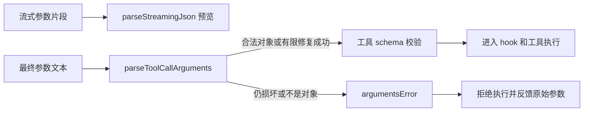

# Pi 版本核验与纠错：以 v1.3.0 发布源码为准

> 核验日期：**2026-10-17，Asia/Shanghai**。本页回答“这些文档是否根据刚发布的 Pi 分析”，同时记录能复查的源码差异。

## 目录

1. [先回答版本问题](#1-先回答版本问题)
2. [核验方法与证据](#2-核验方法与证据)
3. [旧快照与发布版的源码差异](#3-旧快照与发布版的源码差异)
4. [发布版必须补上的设计变化](#4-发布版必须补上的设计变化)
5. [main 的未发布变化](#5-main-的未发布变化)
6. [旧文怎样阅读](#6-旧文怎样阅读)
7. [本轮修改与边界](#7-本轮修改与边界)

## 1. 先回答版本问题

**上一轮不是严格基于最新发布版。** 当时依据本地 `1729ff447841e7666159a6f8bf70fbd6bac05642`，其 workspace 包版本仍是 `1.2.0`；“本地最新 checkout”不等于“官方最新 release”。该本地提交还包含自行加入的文档，因此不能把它当成官方发布标签。

截至本次核验，官方 GitHub 最新非预发布 release 为 **v1.3.0**：

| 项目 | 本次实测值 | 含义 |
|---|---|---|
| 官方仓库 | `earendil-works/pi` | 取自本地 origin，再核对官方远端 |
| 最新发布标签 | `v1.3.0` | 来自 GitHub `/releases/latest`，`prerelease=false` |
| 发布时间（UTC） | `2026-10-15T19:17:33Z` | GitHub release 的 `published_at` |
| 发布时间（北京时间） | **2026-10-16 03:17:33** | 与 changelog 的 `2026-10-15` 不是冲突，而是时间/记录口径不同 |
| 发布标签提交 | `71023aec1546d6d677a65669c5665c0927ce0dd0` | 本目录当前源码分析基线 |
| main 核验时提交 | `698a2d23b86a5045dd54554354a5e0cb7e466795` | 有未发布变更，不等于 v1.3.0 |

**现在的处理**：新主指南和后端专题已按 v1.3.0 对比修正；旧综合文档中已移除的实验设计就地标记为历史实现，不再声称所有旧代码块都能在当前源码定位。下面明确区分“源码相同”“这次发生变化”“仍未验证”。

官方依据：[最新 release API](https://api.github.com/repos/earendil-works/pi/releases/latest)、[v1.3.0 发布页](https://github.com/earendil-works/pi/releases/tag/v1.3.0)、[固定提交源码树](https://github.com/earendil-works/pi/tree/71023aec1546d6d677a65669c5665c0927ce0dd0)。API 会变化；本次核验值保存于 [审计记录](./version-audit/2026-10-17.json)。

## 2. 核验方法与证据

1. 读取现有 Pi checkout 的 origin、HEAD、package.json 与工作区状态；未执行 pull/reset，也未改动用户源码。
2. 向官方远端核对 `HEAD` 和 `refs/tags/v1.3.0`；读取 GitHub release 元数据，而非根据版本号猜测。
3. 在临时目录独立取得 v1.3.0 源码和 main 对照对象。
4. 对旧 checkout 与发布版的 **`packages/*/src` 全部文件做字节比较**，再阅读变化文件、相关类型和测试；没有以 changelog 代替源码。
5. 对 main 使用发布提交与核验时提交之间的差异，单列未发布语义。
6. 本目录可点击的 Pi 源码链接改为固定到 `v1.3.0`，防止点击后仍在读本地 1.2.0。

“文件相同”证明对应实现没有发生变动，不证明旧文字一定正确；因此本次还修正了旧文字本来就存在的 Harness、leaf、hook 等误读。

## 3. 旧快照与发布版的源码差异

以下统计包括 `src` 内的 TS、声明、JSON 和原生资源；不是仅统计 TS。**v1.3.0 共 681 个 src 文件：656 个字节一致、23 个修改、2 个新增；旧快照另有 1 个文件被移出。** 未计 test、README、构建脚本或 Rust daemon，因此不等于整个仓库差异数。

| 包 | 发布版 src 文件数 | 与旧快照一致 | 修改 | 新增 / 移出 | 对文档的影响 |
|---|---:|---:|---:|---|---|
| agent | 6 | 6 | 0 | 0 / 0 | Agent loop 和 hook 类型未改；旧实验 Harness 仍不存在 |
| ai | 199 | 188 | 11 | 0 / 0 | 参数终结校验、跨模型 thinking、错误图片、Kimi API、重试等 |
| chord | 32 | 29 | 2 | 1 / 0 | 新 output 子路径；remote ctx 边界加强 |
| codemode | 17 | 17 | 0 | 0 / 0 | 上轮核心实现仍适用，不把旧 changelog 累计项当作新差异 |
| coding-agent | 262 | 261 | 1 | 0 / 0 | InteractiveMode overlay 关闭语义修复；core 服务文件未改 |
| durable | 82 | 72 | 9 | 1 / 1 | SQLite prefix/共享事务队列；output 迁到 Chord |
| env | 8 | 8 | 0 | 0 / 0 | src 连接与协议实现未改；此行不含 daemon |
| evals | 5 | 5 | 0 | 0 / 0 | 源码未改，不代表已运行真实评测 |
| mcp | 18 | 18 | 0 | 0 / 0 | 核心源码未改 |
| telemetry | 6 | 6 | 0 | 0 / 0 | 契约实现未改 |
| tui | 46 | 46 | 0 | 0 / 0 | TUI 包未改；overlay 修复在 coding-agent |

每个修改文件的路径与 SHA-256、增删路径均记录在 [JSON 审计记录](./version-audit/2026-10-17.json)。[SOURCE_MAP.md](./SOURCE_MAP.md) 的目录清点也已从发布源码重新生成。

## 4. 发布版必须补上的设计变化

### 4.1 工具参数：流式预览不等于最终可执行参数

**问题**：模型一边输出 JSON，UI 一边展示参数，能否把已解析的前缀直接执行？

**例子**：模型最终发出的 JSON 已损坏，但前面 `path` 被成功解析。若默默使用这个半成品，可能执行一个参数不全、与模型意图不同的操作。

**v1.3.0 的处理**：流式阶段仍允许不完整预览；调用完成后，适配器使用 `parseToolCallArguments()` 解析完整文本。这里会先做源码允许的 JSON escape 修复；修复后仍不合法，或结果不是对象，则返回 `{ arguments: {}, argumentsError }`。`validateToolArguments()` 看到该字段立即拒绝，模型能收到含原始参数文本的错误，而不是静默执行前缀。



带注释的行为摘录（简化调用形态，不是可独立运行程序）：

```ts
// UI 的部分 JSON 只供预览；结束时重新解析完整文本。
const final = parseToolCallArguments(rawArguments);
// 内部优先检查 argumentsError，而非把 {} 当成一个正常的空参数工具调用。
const args = validateToolArguments(tool, { ...toolCall, ...final });
// 只有上面成功，才进入后续执行路径。
```

依据：[json-parse.ts](https://github.com/earendil-works/pi/blob/v1.3.0/packages/ai/src/utils/json-parse.ts)、[validation.ts](https://github.com/earendil-works/pi/blob/v1.3.0/packages/ai/src/utils/validation.ts)、[ToolCall 类型](https://github.com/earendil-works/pi/blob/v1.3.0/packages/ai/src/types.ts)。

### 4.2 换模型：不要把上一模型的 thinking 当成答案

`transformMessages()` 以 `provider + api + model` 判断是否同模型：不同模型的旧 thinking blocks 会被丢弃，**不再转成普通文本给新模型**；同模型的 redacted/signed thinking 保留供重放。否则，新模型可能把旧推理误认为可见回复，继续在答案里写推理。这个变化发生在请求投影边界，不是删除磁盘原始会话。

依据：[transform-messages.ts](https://github.com/earendil-works/pi/blob/v1.3.0/packages/ai/src/api/transform-messages.ts)、[跨模型测试](https://github.com/earendil-works/pi/blob/v1.3.0/packages/ai/test/transform-messages-cross-model-thinking.test.ts)。

### 4.3 Provider 不只是更换 URL

- `kimi-coding` 从 Anthropic Messages 改为 **OpenAI Chat Completions**，base URL 为 `https://api.kimi.com/coding/v1`；自定义 base URL 要包含 `/v1`。因此不能沿用旧协议假设。
- Anthropic / Bedrock Claude 的错误工具结果带图片时，先拆出图片，工具结果保留说明，图片放到同一 user turn 的所有 tool results 之后，避免 API 拒绝而又不丢图。
- Anthropic 对支持关闭 thinking 的模型优先处理 `off`：发送 `thinking: { type: "disabled" }`，不附 effort markers / effort output_config，也不附与 disabled 冲突的 block_binding。只有实际插入 effort markers 时才记录 `providerThinkingLevel` 供重放，不能笼统说“支持 managed effort 就总是 adaptive”。
- `retry.ts` 增加暂时不可用与特定 gateway 错误识别；这只影响 Provider 请求重试，不赋予工具副作用自动安全重跑能力。

依据：[kimi-coding.ts](https://github.com/earendil-works/pi/blob/v1.3.0/packages/ai/src/providers/kimi-coding.ts)、[Anthropic 转换](https://github.com/earendil-works/pi/blob/v1.3.0/packages/ai/src/api/anthropic-messages.ts)、[Bedrock 转换](https://github.com/earendil-works/pi/blob/v1.3.0/packages/ai/src/api/bedrock-converse-stream.ts)、[retry.ts](https://github.com/earendil-works/pi/blob/v1.3.0/packages/ai/src/utils/retry.ts)。

### 4.4 后端：SQLite 命名空间与共享数据库协调

`SqliteStorage.open(database, { prefix })` 及 Node/DO 打开函数支持 prefix，对**表和索引**统一命名；同一个 Cloudflare storage 对象创建的 adapter 共享操作队列，避免一个 adapter 的普通 SQL 混入另一个 adapter 正在进行的事务。不是“每个实例一把锁就够了”，也不是跨进程分布式锁。

输出限额工具从旧 `durable/src/harness/output.ts` 迁到 `@earendil-works/chord/output`；ToolTask、truncate 和 env 导出随之调整。详见 [BACKEND_RUNTIME.md §11](./BACKEND_RUNTIME.md#11-v130-发布版的后端变化2026-10-17-核验)。

### 4.5 两个容易遗漏的边界修复

- Chord remote 调用校验 ctx 的来源、host、过期和取消状态，拒绝 foreign ctx，不能把某个 host 的 root 借给另一个 host。
- `ctx.ui.custom({ overlay: true })` 完成时关闭**自己的 overlay handle**，不是关闭当时位于最上层的任意 overlay，避免多个扩展弹窗互相误关。

依据：[remote.ts](https://github.com/earendil-works/pi/blob/v1.3.0/packages/chord/src/remote.ts)、[InteractiveMode](https://github.com/earendil-works/pi/blob/v1.3.0/packages/coding-agent/src/modes/interactive/interactive-mode.ts)。

## 5. main 的未发布变化

以下来自核验时 `698a2d2…` 相对于 v1.3.0 的源码差异，**不写成已发布 API**：

| 位置 | main 的变化 | 阅读 v1.3.0 时注意 |
|---|---|---|
| coding-agent compaction / branch-summarization | 去掉摘要生成中额外计算的 maxTokens 限额，走模型输出上限 | 发布版仍有摘要预算计算；不要提前按 main 解释 |
| durable compaction / generation | 新增按 `provider/modelId` 的 `compaction.modelOverrides`，逐字段覆盖策略 | v1.3.0 Durable 不具备这个字段；不要与 CLI 既有配置混淆 |
| durable ToolControl | `terminate?: true` 放宽为 `terminate?: boolean`，false 不产生终止 | v1.3.0 的类型仍是 `terminate?: true` |
| ai adapters / retry | 空白工具输出使用空输出占位；额外 gateway 错误可重试 | 与 v1.3.0 已有的错误识别分开 |

可复查：[固定 main 对照提交](https://github.com/earendil-works/pi/tree/698a2d23b86a5045dd54554354a5e0cb7e466795)、[发布版到该提交的比较](https://github.com/earendil-works/pi/compare/71023aec1546d6d677a65669c5665c0927ce0dd0...698a2d23b86a5045dd54554354a5e0cb7e466795)。以后 main 继续变化，不会自动改变本文发布版基线。

## 6. 旧文怎样阅读

| 旧文现象 | 正确处理 | 当前入口 |
|---|---|---|
| `agent/src/harness/`、AgentHarness、Lane/registers/effect gate | 已移除实验设计；保留原理资料但不能当作当前目录/API | `durable/src/harness/`、`session/`、`storage/` |
| `type: "leaf"` / LeafEntry | CLI v3 没有这类行，leafId 是 SessionManager 游标 | JSONL 导读 §10 / session-manager.ts |
| “完整 JSONL”里的 `input`、`tool_use`、旧 usage | 已标成历史示例，不是可导入样本 | 当前 types.ts 使用 arguments、toolUse/stop 等 |
| beforeToolCall 返回 skip/result/args | 当前 core 返回 block/reason/terminate | agent/src/types.ts |
| coding-agent tool_call 改参数 | 原地改 event.input；不是返回 args；修改后不再 schema 校验 | extensions/types.ts |
| SQLite `SessionEntryRow` / `session-entries.ts` | 历史适配器，不是当前 Durable schema | durable/src/storage/sqlite/ |
| Prime、五大第三方插件 | 独立上层产品/生态分析，不等于 upstream 已有能力或版本保证 | 必须按各自仓库另查 |

优先阅读：**本页 → 源码全景 → 后端深潜 → 运行时支撑 → 源码导航 → 旧综合专题中的非历史部分**。旧图解 HTML 也保留为历史导读，已加入醒目的版本提示，不再推荐作当前 API 依据。

## 7. 本轮修改与边界

- 修正文档基线、包版本和阅读顺序；不再只写“本地最新”。
- 修正旧指南正文中的目录、leaf、hook 和“仅四工具”等错误；对于整段已移除设计，保留内容但在段首注明历史边界。
- 补齐 v1.3.0 与旧快照之间影响设计理解的参数、投影、Provider、SQLite、output、ctx 与 overlay 差异。
- 生成机器可读源码差异证据，并固定源码链接，避免把旧 checkout 当成发布源码。
- 不声称逐行重写了所有历史代码块、全部 Provider 字段或第三方插件；历史示例不作为当前接口教程。
- 未修改现有 Pi checkout，未安装依赖，未运行完整 build/test 或付费模型调用。校验的是文档图语法、链接目标和版本引用，不等同于运行时测试。
