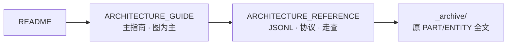
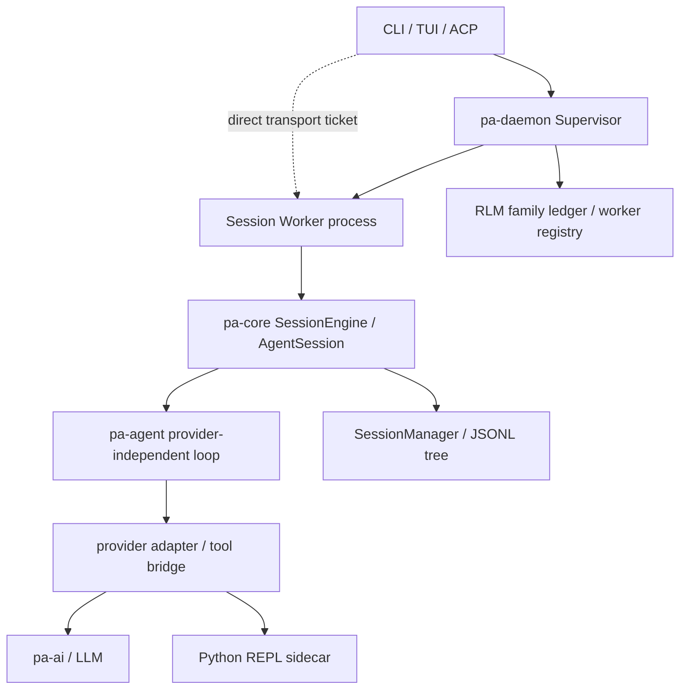

# Prime Agent — 架构导航

> **从这里开始** → [**ARCHITECTURE_GUIDE.md**](./ARCHITECTURE_GUIDE.md)（是什么 / 为什么 / Pi 关系 / 怎么做）

---

## 文档地图

| 文档 | 章节 |
|------|------|
| [ARCHITECTURE_GUIDE](./ARCHITECTURE_GUIDE.md#目录) | 一是什么 · 二为什么 · 三Pi关系 · 四端到端 · 五模块 · 六机制 · 七对照 · **八外部文章** |
| [EXTERNAL_ARTICLES](./EXTERNAL_ARTICLES_SYNTHESIS.md#目录) | 三篇微信整合 · 选型 · Factorio 治理 |
| [ARCHITECTURE_REFERENCE](./ARCHITECTURE_REFERENCE.md#目录) | 三层真相 · JSONL · Daemon · loop · ER · 场景 |

---

## 10 分钟速览

1. **Pi = 心脏** — `runAgentLoop` + steer/followUp → [GUIDE §6.1](./ARCHITECTURE_GUIDE.md#61-双环-loop)
2. **Prime = 壳** — Daemon、JSONL、IPython、RLM → [GUIDE §三](./ARCHITECTURE_GUIDE.md#三与-pi-的整体关系)
3. **客户端不跑 loop** → [GUIDE §4.2](./ARCHITECTURE_GUIDE.md#42-端到端时序带注释)
4. **Turn 不落盘** → [REFERENCE §1](./ARCHITECTURE_REFERENCE.md#1-三层真相模型)
5. **rlm ≠ steer** → [GUIDE §6.5](./ARCHITECTURE_GUIDE.md#65-rlm-子-session)

返回：[README.md](./README.md)

---

## 2026 源码校准补充：当前 Rust 主线

> 以下为追加内容，前文完整保留作为历史设计。核对基线：`d592d5e7746408fe9097541af96d3239e263f7a1`（2026-10-15）。当前实现为 Rust workspace + Python runtime，不应把旧 TypeScript/Pi 模块名称直接当成当前源码路径。

### 当前整体架构与责任大纲

这张图是 daemon 模式；daemonless headless 通过 core 运行，不必经过 supervisor。`pa-cli` 是组合根，`pa-tui` 只直接依赖 `pa-types`，底层 `pa-agent` 不依赖会话存储或 provider。`pa-models` 负责模型层，`pa-telemetry` 负责非阻塞遥测，共 9 个 Rust crate。

### 三层状态与两种历史

| 层 | 状态 | owner | 不能混淆的概念 |
|---|---|---|---|
| 执行层 | loop messages、steering、follow-up | pa-agent | loop 已接收不等于 durable commit |
| 会话层 | entry tree、leaf、goal、compaction | pa-core | 当前上下文不等于完整 JSONL |
| 进程层 | worker registry、lease、grant、roster | pa-daemon | resident 不等于全部历史子代理 |

Session transcript 是语义历史；daemon event replay 是传输恢复。后者受 generation、sequence 和保留窗口约束，不能替代前者。设计文档应分别描述 attach snapshot、event replay 和 session rebuild。

### 深读导航

[源码深读](SOURCE_DEEP_DIVE_2026.md) 给出依赖图、类关系、端到端时序、持久化和安全边界；[覆盖记录](COVERAGE_AND_CHANGES.md) 区分已实现能力和待补强项。
