# Prime Agent 当前 Rust 源码深读与架构校准（2026）

> 本文是现有 Prime Agent 架构文档的追加深读，不删除历史 TypeScript/Pi 时代内容。核对日期：2026-10-15。源码基线：`prime-agent` HEAD `d592d5e7746408fe9097541af96d3239e263f7a1`。当前主线已经是 Rust workspace；历史文档中关于 `pi-*`、Daemon v7 和 Python runtime 的描述保留为协议/迁移背景，但必须和 Rust crate owner 一起阅读。

## 目录与阅读路线

- [1. 当前事实与新旧映射](#1-当前事实与新旧映射)
- [2. Workspace 分层与依赖方向](#2-workspace-分层与依赖方向)
- [3. 端到端运行架构](#3-端到端运行架构)
- [4. pa-agent 双层循环与工具管线](#4-pa-agent-双层循环与工具管线)
- [5. pa-core SessionEngine 与持久化](#5-pa-core-sessionengine-与持久化)
- [6. Kernel、Python REPL 与 host.request](#6-kernelpython-repl-与-hostrequest)
- [7. pa-daemon Supervisor、Worker 与协议](#7-pa-daemon-supervisorworker-与协议)
- [8. JSONL 树、Compaction 与恢复](#8-jsonl-树compaction-与恢复)
- [9. RLM、Goals、MCP 与后台任务](#9-rlmgoalsmcp-与后台任务)
- [10. 可靠性、安全与性能边界](#10-可靠性安全与性能边界)
- [11. 当前缺口与验证计划](#11-当前缺口与验证计划)
- [12. 源码索引](#12-源码索引)

## 1. 当前事实与新旧映射

当前 workspace 在 `Cargo.toml` 中固定了 Rust crate 族：`pa-types`、`pa-telemetry`、`pa-agent`、`pa-ai`、`pa-models`、`pa-core`、`pa-daemon`、`pa-tui`、`pa-cli`。此外 `prime-agent-runtime` 是 Python kernel sidecar，负责持久 Python REPL 和 RLM API。

| 历史文档概念 | 当前源码 owner | 解释 |
|---|---|---|
| `pi-agent-core` / `runAgentLoop` | `pa-agent::agent_loop` | provider-independent loop，工具通过 trait 注入 |
| `pi-ai` / `streamSimple` | `pa-ai` + `pa-core::provider_adapter` | provider/model stream 适配 |
| `pi-coding-agent` AgentSession | `pa-core::session_engine` | SessionEngine 组装 agent、工具、kernel、持久化 |
| Daemon Supervisor | `pa-daemon::supervisor` | 进程监管、协议、路由、backpressure、更新/roster |
| SessionManager | `pa-core::session::manager` | JSONL entry、树、分支、compaction、原子落盘 |
| IPython bridge | `pa-core::kernel` + `prime-agent-runtime/src/rlm` | Rust 管理子进程；Python 执行 cell 并发 host request |
| 历史 `rlm.run()`；当前 `rlm.spawn()` | runtime Python API + `pa-core::session_engine::rlm_host` + daemon child workers | host request 不是直接调用父 loop |

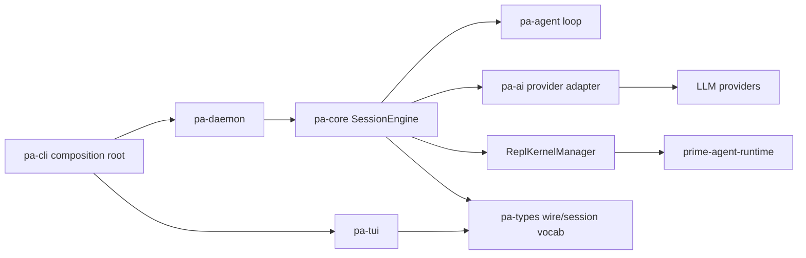

## 2. Workspace 分层与依赖方向

工程规范要求“一 crate 一 ownership”，`pa-types` 是共享词汇唯一来源，`pa-tui` 只依赖 wire types，不链接 session engine；`pa-cli` 是 composition root，不承载业务逻辑。

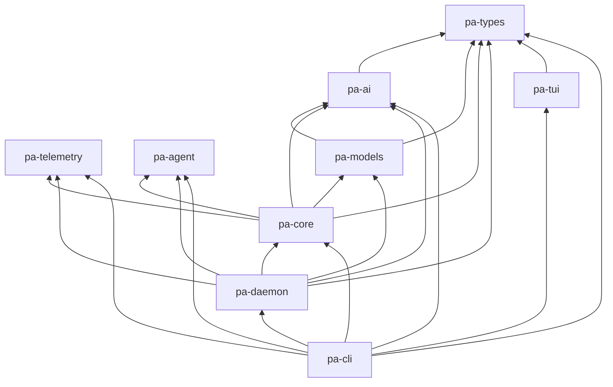

依赖图的价值不只是“画目录”：它决定新增能力放在哪里。Provider 逻辑不能进入 `pa-agent`；session persistence 不能进入 `pa-agent`；TUI 不能绕过 daemon wire 直接依赖 core。共享 wire/session 词汇使用 `pa-types`，但不能把这个规则扩大到所有类型：`pa-agent` 有意独立于 workspace，拥有自己的 loop 类型。`provider_adapter.rs` 通过 serde JSON round-trip 连接 agent 与 AI 类型；这是明确的适配边界，转换失败和枚举差异需要契约测试。

## 3. 端到端运行架构

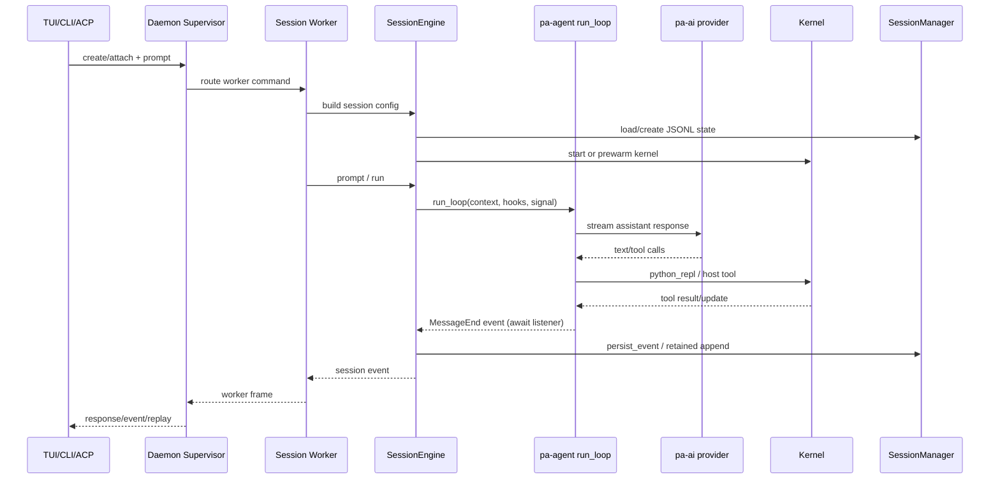

一个 prompt 同时跨越四种状态：客户端命令 admission、worker 执行状态、agent context、持久化 session tree。任何“已发送”指标都需要说明是已入队、已开始、已产生模型响应还是已落盘。

## 4. pa-agent 双层循环与工具管线

`pa-agent::agent_loop::run_loop` 是低层、无 provider 与持久化知识的循环。它接收 `AgentContext`、`AgentLoopConfig`、`AbortSignal`、事件 sink 和 `StreamFn`。每轮先 stream assistant；若有工具调用，则批量执行；之后按顺序处理 stop hook、steering、follow-up、continuation。

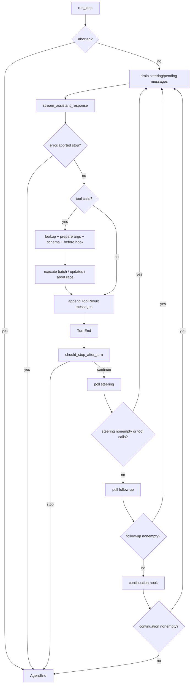

### 4.1 工具调用的真实分层

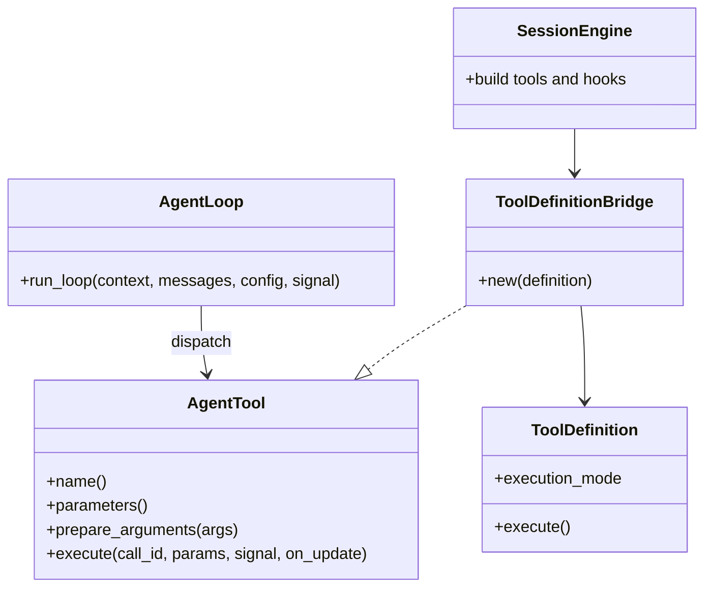

上图的 `AgentLoop` 是概念节点，实际入口是函数 `run_loop`；`SessionEngine` 是真实 struct，`AgentSession` 同样是 struct；`bridge_tool` 是自由函数，不是 bridge 的方法。

`pa-core::ToolDefinitionBridge` 将 core 工具转换为 `pa_agent::AgentTool`，把 abort signal、streamed tool update、content block 和 execution mode 转换到 loop 协议。工具不存在、参数准备失败、schema 校验失败都被转成 error tool result，而不是让工具管线直接崩溃；真正的 loop/transport error 仍可结束执行。

```rust
// tool_bridge.rs 的局部摘录：省略捕获/返回，不是独立可编译函数。
let abort = crate::tools::tool_definition::AbortSignal::new();
{
    let abort = abort.clone();
    let signal = signal.clone();
    tokio::spawn(async move {
        // 等待取消通知而非轮询，避免周期性 wake-up。
        signal.aborted().await;
        abort.cancel();
    });
}
```

注意 bridge 当前读取但丢弃 `ToolExecutionResult.is_error`，loop 的 `Ok`/`Err` 又承担错误分类。这里记录为**待验证的适配契约风险**：必须用真实工具返回 `Ok(is_error=true)` 的测试验证是否丢失错误标记，不能仅凭这一行推断全部工具出错。

## 5. pa-core SessionEngine 与持久化

`SessionEngineConfig` 是组合边界：cwd、agent_dir、model、thinking level、stream、tools、MCP、skills、session manager、RLM host、telemetry、steering/follow-up mode、kernel prewarm、cron store 等都在这里汇合。它把“可运行 session”组装出来，但不应被当作所有业务状态的数据库。

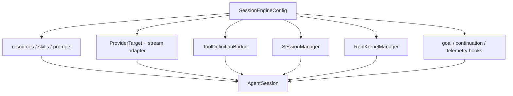

### 5.1 SessionManager append 语义

`SessionManager::append_entry` 先更新内存候选，再调用 `persist_entry`；写盘失败时回滚常规 append 的内存 entry/assistant 标记/flush 状态。成功后再更新 window、id index 和 leaf。`append_message_retained` 是有意不同的 retained-write 合同：即使 durable write 失败也保留 loop 已拥有的 live entry，错误交由上层记录。

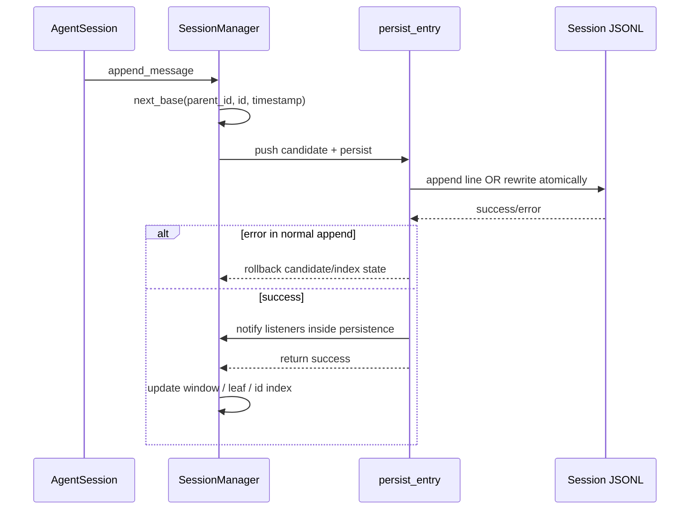

落盘不是“每条消息无条件 append”：在尚未出现 assistant entry 前，部分 entry 可能只保留内存；session info/state 有独立处理；session 文件消失时会重写完整文件。文档和运维指标需要区分 `persist=true`、flush 状态、append success 与 file durability。

## 6. Kernel、Python REPL 与 host.request

Kernel 是执行面边界，不是模型循环。Rust `ReplKernelManager` 管理 Python 子进程、JSON-lines stdin/stdout、请求队列、active execution、timeout、interrupt、snapshot/restore、namespace 和 MCP listing。Python `repl.py` 处理 cell 执行和 host request pending futures；Python `rlm/__init__.py` 将 `rlm.spawn/create_session/collect/...` 编译成 host request。

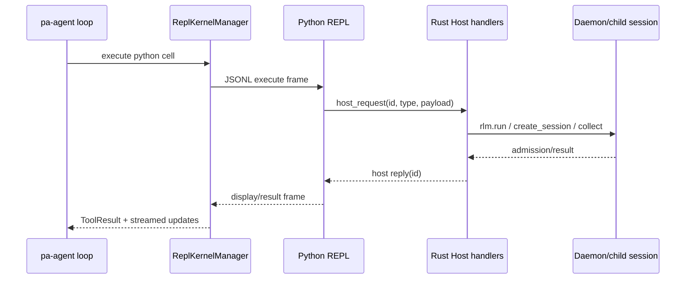

Python 侧在 host connection closed 时会主动 fail pending futures，否则等待 host reply 的 cell 会阻塞 shutdown。这个细节是故障恢复的一部分：kernel 关闭不能只 kill 子进程，还要解除所有等待者。

## 7. pa-daemon Supervisor、Worker 与协议

Supervisor 负责 resident worker registry、生命周期、路由、重启、roster、update flow 和 backpressure；一个活跃 session 一个 worker process。Worker 内部才持有 `AgentSession` 和执行循环。客户端可通过 supervisor 路由，也可使用 supervisor 签发的一次性 direct worker transport ticket 直接连接 worker socket。

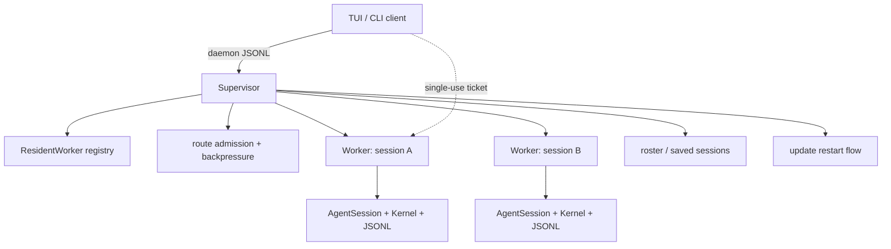

当前 `pa-types` wire 常量为 `DAEMON_PROTOCOL_VERSION=7`、`DAEMON_SCHEMA_REVISION=30`；协议 cursor 同时携带 generation/sequence，replay 有 `complete/partial/unavailable` 状态。`pa-daemon::backpressure` 设定 worker in-flight 128、event ring 4096、targeted queue 4096、client outbound 32K；慢客户端不能让 supervisor 永久阻塞。

### 7.1 direct transport 的安全边界

签发 ticket 前会检查 worker 可用性、worker instance id、pid 活跃性、socket identity，并将 single-use grant 推送到 worker，TTL 为 10 秒。源码注释同时披露一个 parity divergence：Rust supervisor 尚未移植 TS 对 `ownerClientId` 的 client-owned worker refusal。它应作为安全/协议缺口跟踪，而不是被图表隐藏。

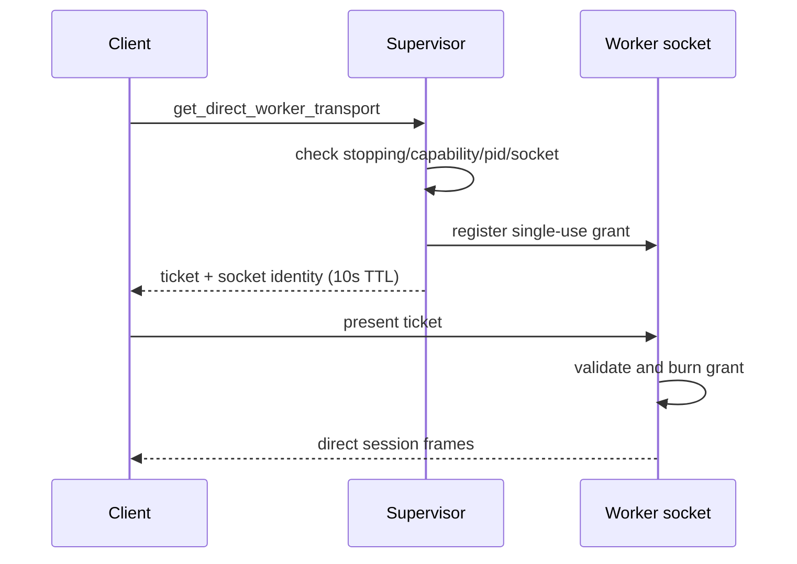

## 8. JSONL 树、Compaction 与恢复

Session 文件是 entry tree，不是 flat turn table。`parent_id` 形成分支；`SessionTree` 构建 children、header、labels，`path_to` 从 leaf 回溯祖先路径。Compaction entry 记录摘要与保留边界，不删除历史行；windowed store 可以只加载当前窗口，但语义上仍需保留可恢复的树信息。

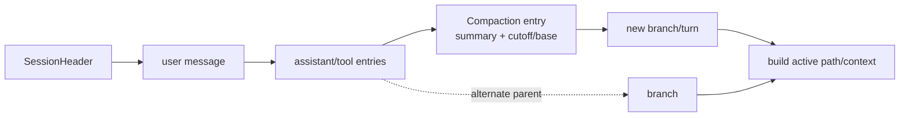

恢复路径必须同时重建：entry id 索引、leaf、labels、compaction cutoff、session state、goal/harness custom state、RLM child ledger。只恢复 `messages[]` 会丢失 branch/navigation/roster 语义。

## 9. RLM、Goals、MCP 与后台任务

Prime 的 RLM API 不是 Python 内部直接 spawn 任意进程，而是通过 host request 交给 Rust core/daemon。`rlm.spawn` 通常返回“已准入”的 child handle；实际 child worker 生命周期由 supervisor 管理，parent 通过 registry/ledger 观察、collect、rename/delete。`rlm.create_session` 与 `rlm.spawn` 是不同产品语义，不应合并成普通 follow-up。

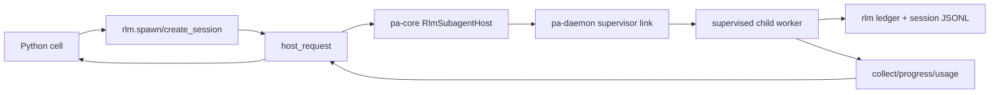

Goals/heartbeat/cron 通过 host handlers 和 daemon scheduler 影响 continuation admission；它们不是普通 prompt 文本。MCP 有自己的 auth/connection/OAuth lifecycle，`pa-core` 负责把可用工具暴露给 kernel/agent，而不是将外部 server 直接写进 `pa-agent`。

## 10. 可靠性、安全与性能边界

1. **持久化**：session file 使用临时文件、`sync_all`、rename；journal append 走 write + fsync。Compaction rewrite 与 append history 的 fallback 语义要分别记录。
2. **协议恢复**：generation/sequence cursor 能表达 partial/unavailable replay；UI 必须区分 replay 不完整与 session 执行失败。
3. **背压**：环形缓冲和有界队列隔离慢 reader；client outbound 满时仍会阻塞该连接自己的发送任务。事件 replay 与 durable session transcript 是两种恢复来源，不能声称事件环覆盖完整历史。
4. **权限**：kernel、workspace、MCP、session directory、socket ticket 是不同边界；路径权限和 secret storage 不能只靠 UI。
5. **性能**：工程规则要求 first paint 不等待网络、磁盘 sync、telemetry flush；后台 worker 拥有 retry/timeout/delivery 语义。
6. **可观测性**：telemetry 不应包含 prompt/session/file content；建议关联 session id、worker id、generation、sequence、tool operation id。
7. **跨平台**：Unix socket 与 Windows named pipe、进程控制、home directory 通过 `pa-types`/platform contract 抽象，不能在调用方复制平台判断。

## 11. 当前缺口与验证计划

### 11.1 已实现，不应误报为缺失

- Rust crate 分层和 cycle-free dependency direction；
- worker-per-session supervision、session JSONL persistence、reattach；
- agent loop 的 steering/follow-up/continuation 和 abort race；
- kernel request queue、interrupt、snapshot/restore、pending host request teardown；
- daemon bounded backpressure、generation/sequence replay、direct transport grant；
- RLM ledger、child worker topology、goal/harness/compaction seams。

### 11.2 源码已披露或仍需补强的项目

| 项目 | 证据/风险 | 建议验收 |
|---|---|---|
| direct transport ownerClientId parity | `peer_tickets.rs` 明确写 Rust 尚未移植 TS refusal | client-owned worker ticket 应拒绝，并做 wire parity test |
| direct ticket process identity | Rust 用 live pid/socket identity，注释说明未填充 TS process-start id | pid reuse 场景不能误连旧 worker |
| session retained write | `append_message_retained` 与普通 append 失败语义不同 | 记录 durable failure 后恢复/重放行为 |
| partial replay | wire 支持 partial/unavailable | UI 和 CLI 不得把 partial 当 complete |
| kernel shutdown | pending host requests 必须全部解除 | kill/timeout/EOF 注入测试无挂起 future |
| compaction crash | rewrite、journal fallback 有不同 durability | temp、fsync、rename 中间点恢复演练 |
| RLM ledger 与 session files | family topology 由 ledger，而非文件反推 | ledger 损坏/child passivation 时 roster 正确 |
| first-paint telemetry | 工程规范要求 fire-and-forget | hanging sink 不阻塞首帧回归测试 |

### 11.3 验证限制

本轮做源码静态核对、文档检查和局部 Python unittest。由于当前环境没有配置 Rust default toolchain，未运行 Cargo；未运行真实 LLM/provider、daemon 多进程、MCP OAuth、RLM 子 worker、Windows named pipe 或 crash injection。Python `test_create_session` 与 `test_subagent_registry` 共 31 项通过；额外加入 `test_agent_message_skill` 后共 33 项，其中 2 项因测试仍指向旧 `packages/coding-agent/...` 路径而报错。这是测试迁移漂移，不等于 runtime 主链路失败，也不代表完整 Python 套件通过。Mermaid 只做语法围栏/链接检查，未逐图渲染。

### 11.4 可执行的验收优先级

| 优先级 | 类型 | 验收场景 | 通过标准 |
|---|---|---|---|
| P0 | 迁移一致性 | client-owned worker 请求 direct ticket | wire 返回拒绝，不发 grant |
| P0 | 进程身份 | pid 复用、socket 替换、过期 ticket | 不连接错误进程；grant 单次消费 |
| P1 | 数据恢复 | retained append 磁盘写失败后重启 | 明确提示 durable gap；不宣称 live 状态已恢复 |
| P1 | 工具适配 | Ok result 的 is_error=true 与 Err | 模型上下文和 UI 错误分类一致 |
| P1 | 测试迁移 | agent-message skill 测试路径 | 移除旧 TS 路径依赖后 33 项重新运行 |
| P1 | Goal/refine | budget 越界、branch 在 review 中切换 | 单次 wrap-up；旧分支结果不应用 |
| P2 | 运行回归 | 慢 client、MCP hang、telemetry hang | 不拖住其他 session / 首帧 |

上述是建议验收标准，不是本轮已经通过的生产结论。

## 12. 源码索引

- [`Cargo.toml`](../../prime-agent/Cargo.toml)
- [`crates/pa-agent/src/agent_loop/run.rs`](../../prime-agent/crates/pa-agent/src/agent_loop/run.rs)
- [`crates/pa-agent/src/agent_loop/tool_call.rs`](../../prime-agent/crates/pa-agent/src/agent_loop/tool_call.rs)
- [`crates/pa-core/src/session_engine/engine.rs`](../../prime-agent/crates/pa-core/src/session_engine/engine.rs)
- [`crates/pa-core/src/session_engine/tool_bridge.rs`](../../prime-agent/crates/pa-core/src/session_engine/tool_bridge.rs)
- [`crates/pa-core/src/session/manager/append.rs`](../../prime-agent/crates/pa-core/src/session/manager/append.rs)
- [`crates/pa-core/src/session/manager/persist.rs`](../../prime-agent/crates/pa-core/src/session/manager/persist.rs)
- [`crates/pa-core/src/session/tree.rs`](../../prime-agent/crates/pa-core/src/session/tree.rs)
- [`crates/pa-core/src/kernel/manager/mod.rs`](../../prime-agent/crates/pa-core/src/kernel/manager/mod.rs)
- [`crates/pa-daemon/src/supervisor.rs`](../../prime-agent/crates/pa-daemon/src/supervisor.rs)
- [`crates/pa-daemon/src/worker.rs`](../../prime-agent/crates/pa-daemon/src/worker.rs)
- [`crates/pa-daemon/src/protocol.rs`](../../prime-agent/crates/pa-daemon/src/protocol.rs)
- [`crates/pa-daemon/src/backpressure.rs`](../../prime-agent/crates/pa-daemon/src/backpressure.rs)
- [`crates/pa-daemon/src/peer_tickets.rs`](../../prime-agent/crates/pa-daemon/src/peer_tickets.rs)
- [`prime-agent-runtime/src/rlm/__init__.py`](../../prime-agent/prime-agent-runtime/src/rlm/__init__.py)
- [`prime-agent-runtime/src/rlm/repl.py`](../../prime-agent/prime-agent-runtime/src/rlm/repl.py)
