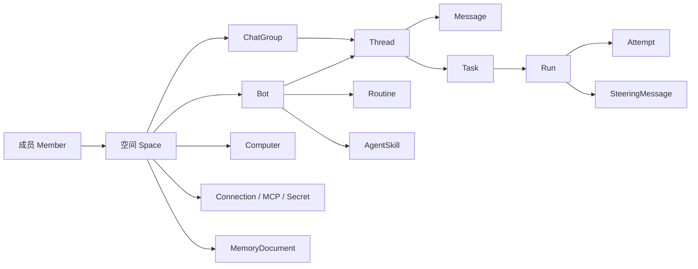
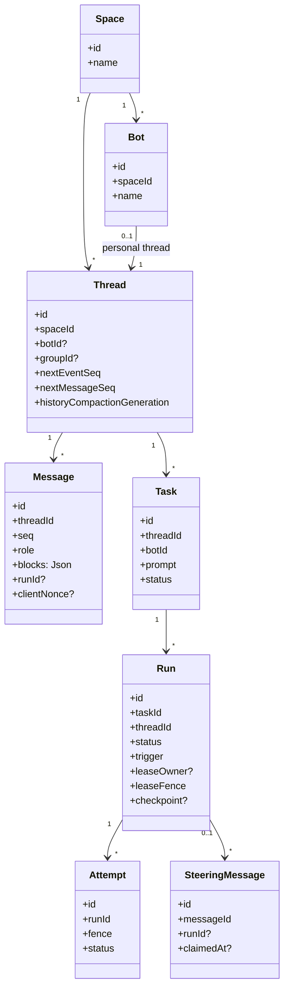
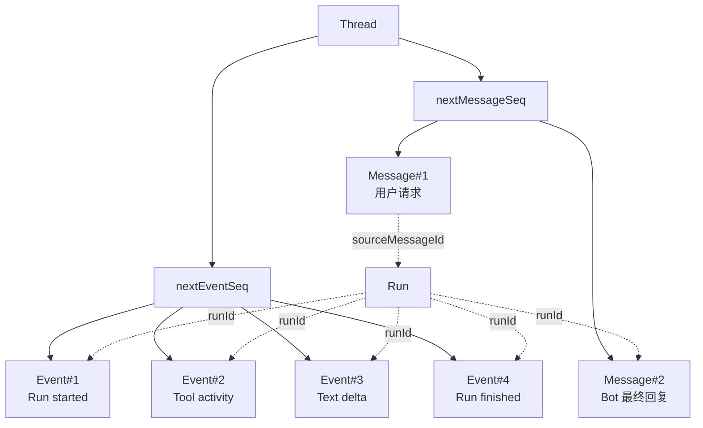
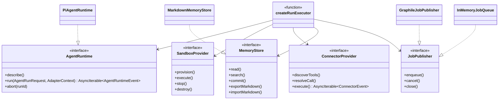
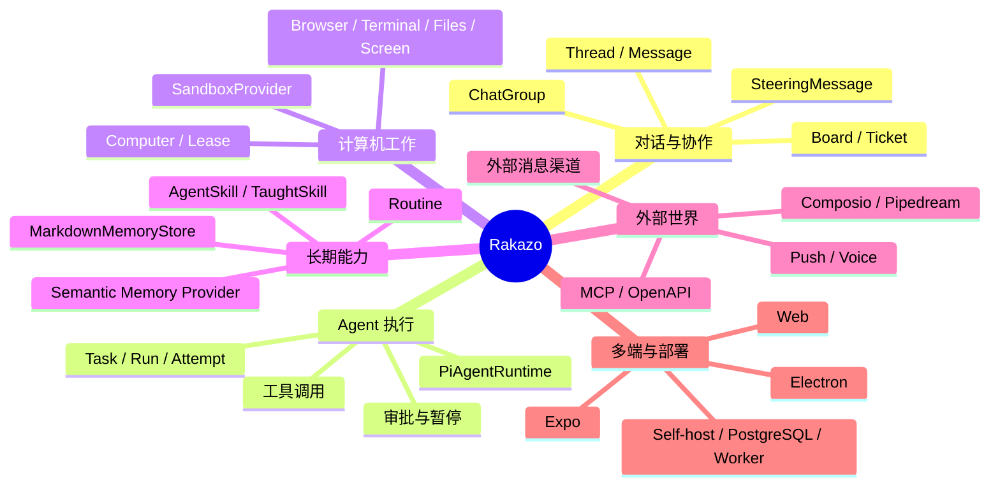

<a id="top"></a>

# 01. 产品对象与全局架构：Rakazo 如何把“聊天”变成持久工作

## 目录

- [1. 先看产品语言，而不是代码目录](#product-language)
- [2. 核心对象：谁拥有谁](#domain)
- [3. 从产品对象到真实数据模型](#data-model)
- [4. 从部署进程到模块架构](#module-architecture)
- [5. 依赖倒置：为什么 adapter-kit 是中枢](#adapters)
- [6. 产品能力如何落到模块](#capability-map)
- [7. 本章小结](#summary)

<a id="product-language"></a>
## 1. 先看产品语言，而不是代码目录

如果只从 `apps/`、`packages/` 开始读，会得到“这是一个 TypeScript monorepo”的结论，却看不懂产品。正确的第一层应是以下句子：

> **用户在一个 Space 内管理 Bot；Bot 在 Thread 中与用户或群组交谈；每次需要实际完成工作的交谈会生成 Task 与 Run；Run 由 AgentRuntime 驱动并可使用计算机、记忆、连接器和后台任务。**



这张图故意将 **可见的聊天对象**（Bot/Thread/Message）和 **执行对象**（Task/Run/Attempt）分开。聊天记录告诉用户发生了什么；运行记录使系统知道某项工作是否仍在跑、谁拥有执行租约、能否继续或需要人类处理。

<a id="domain"></a>
## 2. 核心对象：谁拥有谁

### 2.1 Space：隔离与配置边界

`Space` 是 Bot、成员、计算机、凭据偏好、消息和记忆的主要归属边界。它不是单纯“文件夹”：授权、配额、默认模型/语音偏好和很多查询都带 `spaceId`。

### 2.2 Bot：可持续配置的工作主体

`Bot` 不是一次 Prompt。它关联自己的 `Thread`，可拥有 routines、skills、MCP server 安装、agent home、browser profile、secret 和 memory；因此“同一个 Bot 下次还能继续做事”是数据模型的设计目标，不是模型记忆的偶然结果。

### 2.3 Thread 与 Message：用户可见的叙事线

`Thread` 可以属于一个 Bot、一个 `ChatGroup`，或一个 external conversation。`Message` 按 `(threadId, seq)` 排序，`clientNonce` 用于避免客户端重试重复写入。消息是事实记录，不等于即将传入模型的完整 prompt。

### 2.4 Task、Run、Attempt：执行状态的三层

- **Task**：用户希望完成的工作；存 prompt 与归属。
- **Run**：Task 的一次实际执行，记录 trigger、模型选择、lease、checkpoint、来源消息、routine、完成时间与外部投递标记。
- **Attempt**：Run 被某个 worker/执行者实际拿到的一次尝试，附带 fence 与状态。这为租约抢占、故障恢复和重复执行防护提供记录。



> 图中字段来自 `packages/db/prisma/schema.prisma`。它是用于理解关系的选择性类图，不应误解为 Prisma 生成的完整 API。

<a id="data-model"></a>
## 3. 从产品对象到真实数据模型

### 3.1 线程为何同时有 message 序列和 event 序列

`Thread` 同时保存 `nextMessageSeq` 和 `nextEventSeq`：

- `Message` 是用户和 Bot 的可阅读内容；
- `Event` 是运行中产生的过程性事实（文本增量、工具活动、状态变化等），按 `(threadId, seq)` 形成可追赶的流；
- 因此 UI 不能把“屏幕上暂时流出的字符”直接当成最终消息记录，也不能只轮询 Message 来恢复运行过程。



### 3.2 历史压缩的位置

`Thread` 有 `historyCompactedUpToSeq`、`historyCompactionSummary`、`historyCompactionGeneration`。这说明压缩首先是**线程历史的持久化摘要/游标策略**；而 `PiAgentRuntime` 的 `compaction: true` 表示运行时也具备模型上下文压缩能力。二者相关但不能等同：前者服务于可恢复的产品历史选择，后者服务于单次模型上下文的长度控制。

<a id="module-architecture"></a>
## 4. 从部署进程到模块架构

```mermaid
flowchart TB
  subgraph Clients[客户端进程]
    Web[apps/web]
    Desktop[apps/desktop\nElectron main + bundled renderer]
    Mobile[apps/mobile\nExpo router]
  end
  subgraph Server[服务端进程]
    Api[apps/api/src/index.ts\nHono server]
    App[apps/api/src/app.ts\ncreateApp composition root]
    Rpc[apps/api/src/router.ts\ncreateRouter]
    Worker[apps/worker/src/index.ts]
  end
  subgraph Shared[共享 packages]
    Contracts[@rakazo/contracts]
    Core[@rakazo/core]
    Kit[@rakazo/adapter-kit]
    Adapters[@rakazo/adapters]
    DB[@rakazo/db]
    Memory[@rakazo/memory]
    Auth[@rakazo/auth]
    UI[@rakazo/chat-ui + ui-web + ui-tokens]
  end
  Web --> Api
  Desktop --> Api
  Mobile --> Api
  Api --> App --> Rpc
  App --> Adapters
  Worker --> Adapters
  Rpc --> Contracts & Core & DB
  Adapters --> Kit & Contracts & Core & DB & Memory
  Web --> UI & Contracts
  Desktop --> Contracts
  Mobile --> Contracts
  App --> Auth
```

### 4.1 为什么 API 与 worker 都会创建 executor

它们不是重复业务逻辑：

- **API** 处理实时 HTTP/oRPC、认证、SSE、webhook，并可在某些配置下启动内存队列；
- **worker** 消费 Graphile Worker 的后台任务，装配同一套 `createRunExecutor()` 与 background handlers；
- 两者共享业务状态于 PostgreSQL，因此后台唤醒和前台请求可以围绕同一个 `Run` 协作。

这解释了为什么编排器位于 `packages/adapters/src/executor.ts`，而不是塞进某个 HTTP handler：它必须脱离单次 HTTP 请求生存。

<a id="adapters"></a>
## 5. 依赖倒置：为什么 adapter-kit 是中枢

`@rakazo/adapter-kit` 是产品内部的“端口定义”。上层写依赖抽象，下层实现可替换。下面不是泛泛的六边形架构图，而是源码中真实命名的接口。



**重要边界**：具体的 Docker、E2B、Daytona、CreateOS、Box、MCP、Composio、Pipedream、模型访问方式应在 adapters/composition root 中被选择；`createRunExecutor` 接受接口实现，不应自行绑定某个云厂商。

<a id="capability-map"></a>
## 6. 产品能力如何落到模块



<a id="summary"></a>
## 7. 本章小结

Rakazo 的设计起点是**可持续的 Bot 工作关系**，而非一次模型调用。它使用 Space 做归属/隔离，以 Thread/Message 呈现可读对话，以 Task/Run/Attempt 管理工作生命周期，以 adapter-kit 让模型、计算机、连接器和记忆可替换。下一章沿一次工作链路解释这些对象如何一起运转。

[返回总览](./README.md) · [下一章：一次工作如何运行](./02-core-execution-and-message-flow.md) · [回到顶部](#top)
