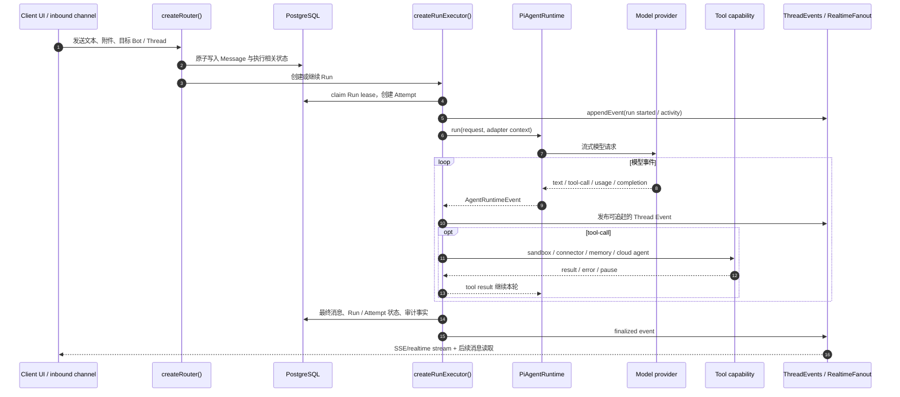
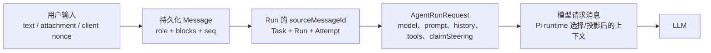
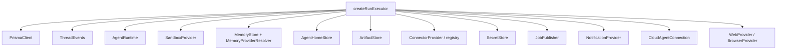
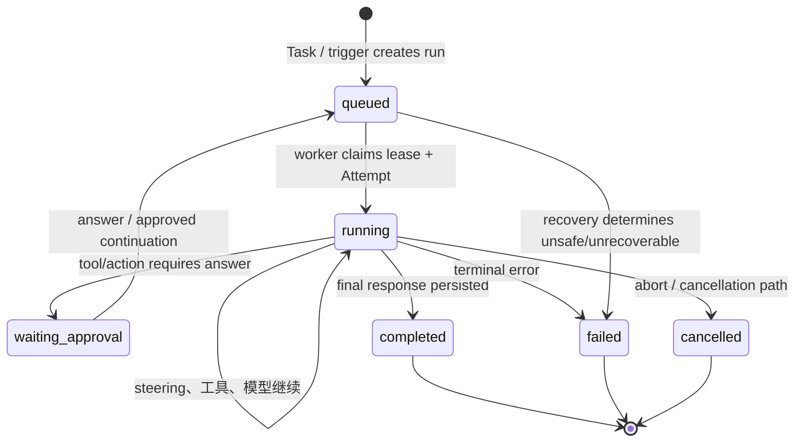
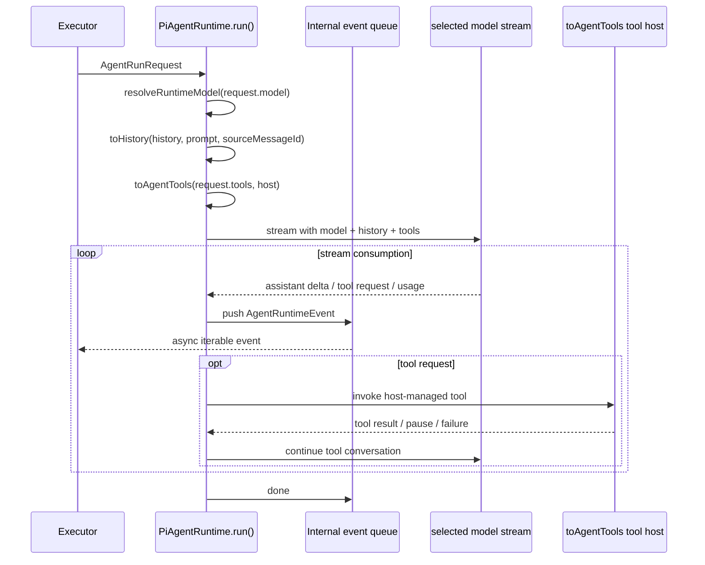
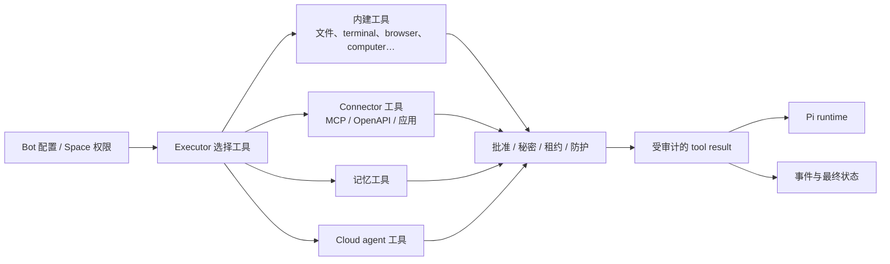
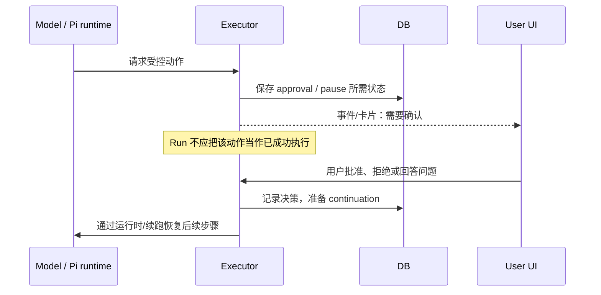
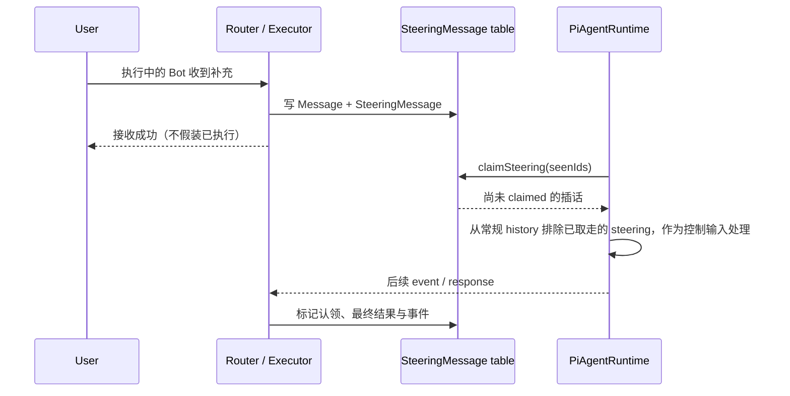
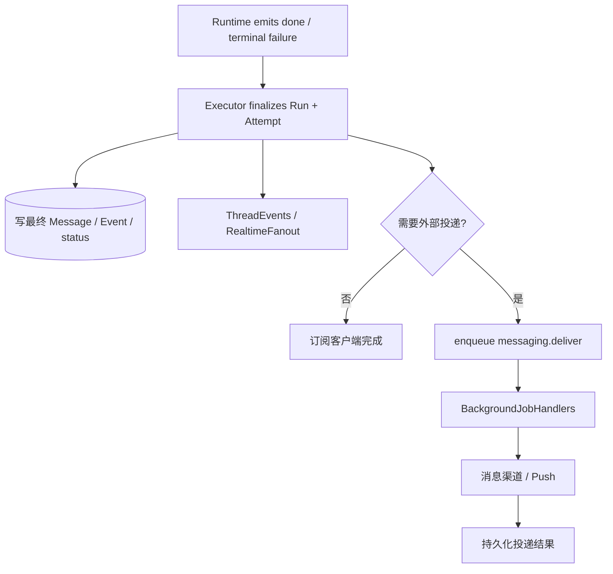

# 02. 一次工作如何运行：消息、Run、模型、工具、插话与暂停

## 目录

- [1. 主链路总览](#overview)
- [2. 入口：消息不是直接送进模型](#entry)
- [3. 编排：createRunExecutor 的职责](#executor)
- [4. 运行时：PiAgentRuntime 如何把模型与工具变成事件流](#runtime)
- [5. 工具、外部副作用与审批](#tools)
- [6. 执行中插话：SteeringMessage](#steering)
- [7. 结束、失败与异步投递](#finish)
- [8. 本章小结](#summary)

## 1. 主链路总览

这条链路最容易被误读为“Router 把用户文本转发给 LLM”。实际分工是：

- Router 负责 API 输入、授权、读写业务对象；
- Executor 负责把业务对象变成可恢复的工作；
- Runtime 负责一次 agent/model/tool 会话的流式协议；
- Event 层负责把过程传递给所有订阅该线程的客户端；
- 数据库保留事实，worker 负责以后继续的异步工作。

## 2. 入口：消息不是直接送进模型

### 2.1 三种相邻但不同的数据形态

1. **`Message`** 是线程事实：UI、搜索、引用、外部渠道同步和恢复都可以依据它；
2. **`Run`** 是一次执行事实：它反向引用触发它的 source message，可有 trigger、lease、checkpoint、模型选择；
3. **`AgentRunRequest`** 是运行时输入：除历史外还包括模型、系统提示、工具定义、控制信号和 context；
4. **模型消息** 是最终投影：`PiAgentRuntime` 的 `toHistory(...)`、prompt 与工具协议形成提供商实际接收的内容。

因此“数据库里一条 Message”不应被理解为“原封不动塞给模型的一条消息”。它是材料和审计事实；模型调用是按当前执行条件生成的投影。

### 2.2 幂等与排序为什么在入口就出现

`Message` 对 `(threadId, clientNonce)` 设有唯一约束；`Run` 对 `(spaceId, clientNonce)` 设有唯一约束。移动网络重发、前端重试或外部 webhook 重投时，系统需要先确保业务动作不会变成两次独立工作，再让执行器决定是否继续已有 Run。

## 3. 编排：createRunExecutor 的职责

`packages/adapters/src/executor.ts::createRunExecutor(deps)` 是流程中心；它接收 `ExecutorDeps`，而不是自行 new 出所有外部服务。关键依赖包括：

这里的设计含义是：**Executor 拥有工作流，但不拥有云厂商细节。**

### 3.1 Run 不是一个裸 `async` 函数

这是一张**概念状态图**：schema 将 `status` 存为 string，真实允许值及具体转移由 executor/DB 辅助函数控制。不要把图当成单个 enum 的完整定义；它表达的是为什么 `Run` 有租约、attempt、checkpoint 和终态字段。

### 3.2 事件与最终消息的差别

执行过程中，`ThreadEvents` 向 `RealtimeFanout` 追加/广播事件；最终输出会成为 `Message` 或对应 blocks。这样 UI 能在模型仍在运行时看到文字增量/工具活动，刷新后仍能从 DB 读取最终对话与事件序列继续同步。

## 4. 运行时：PiAgentRuntime 如何把模型与工具变成事件流

`PiAgentRuntime implements AgentRuntime`。它声明能力：`streaming`、`compaction`、`tools`，而不是让上层绑死某家模型 API。

### 4.1 `AgentRuntime` 为什么返回 `AsyncIterable`

模型流、工具执行、嵌套 agent、用户 steering 和 abort 的速度不同。若接口只返回 `Promise<string>`，上层就无法：

- 实时渲染文本或工具活动；
- 在每个过程点落库/审计；
- 在执行中收到 steering；
- 将暂停和取消传回运行时；
- 统计 usage、处理 provider retry 和模型 fallback。

使用异步事件流让 Executor 可以独立决定“哪些事件持久化、哪些转给 UI、何时 finalise”。

### 4.2 上下文压缩与持久历史不要混为一谈

`PiAgentRuntime.describe()` 声明 compaction 能力，且运行时负责 history/截图等上下文修剪；线程表又有历史压缩字段。前者是**本次模型请求的上下文控制**，后者是**长期线程重放的持久选择锚点**。它们共同降低 token 压力，但操作对象、时机和恢复语义不同。

## 5. 工具、外部副作用与审批

### 5.1 工具选择不是“模型看到所有能力”

Executor 依照 Bot、连接、计算机、权限和上下文生成本次 `request.tools`。运行时将工具声明转为 agent tool，并通过 host 回到 executor 管理的能力。这使用户设置、工具权限、审计与实际执行仍在后端控制面，而不是委托模型自由决定。

### 5.2 需要确认时发生的事

审批并不等于“工具失败”。更接近以下状态转换：

源码中有 `ActionApprovalRule`、`action-approval.ts`、`approval-effect.ts`、`buildApprovalContinuation()` 和 run pause/answer 辅助逻辑。这些名称说明设计目标是：将“用户决定”绑定到可审计执行续接，而不是仅把弹窗结果放进前端状态。

### 5.3 副作用要与模型文本分开对待

`ExternalEffect` 模型与 executor 中的 approval effect/replay 逻辑表明：一次发送邮件、改第三方记录、触发云任务等动作不能仅以模型最后说“已完成”为准。产品必须记录可验证的实际 effect，并在续跑/重试时识别重复风险。

## 6. 执行中插话：SteeringMessage

当一个 Bot 正在跑时，用户再输入“先停一下”“忽略刚才的方案，改为……”，这不是普通的下一轮消息那么简单。Rakazo 使用 `SteeringMessage` 将它和目标 bot/run、原始 Message、可选模型选择、claimed 状态关联。

这样做的目的：

- 插话有可恢复记录，服务重启不必依赖浏览器内存；
- 运行时可以去重地认领，而不是每次 history 重放都再次执行；
- UI 可以区分“已经送达执行中 Run 的补充”和“下一条普通对话”。

## 7. 结束、失败与异步投递

后台投递不是前台 HTTP 请求的附属动作。`messaging.deliver` 与 `routine.wakeup` 被定义为 background job 类型，worker 处理后再次通过 executor/相关服务与持久化状态协作。

## 8. 本章小结

一次 Rakazo 工作至少涉及四个层次：**消息事实 → Run 生命周期 → 运行时模型/工具事件 → 外部能力与最终状态**。把它们分开，才能解释为何系统有 client nonce、lease、attempt、event 序列、steering、approval 和 worker，而不是把所有复杂度误归因到“一次 LLM 调用”。

[上一章：产品对象与全局架构](./01-product-positioning-and-global-architecture.md) · [下一章：状态、后台与多端](./03-state-background-and-platforms.md) · [回到顶部](#top)
