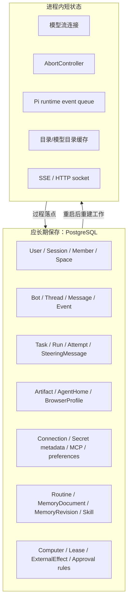
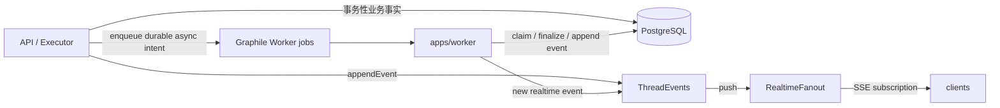
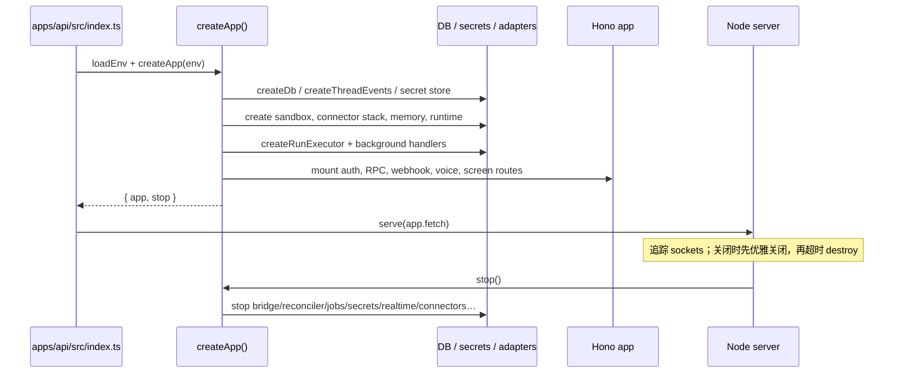
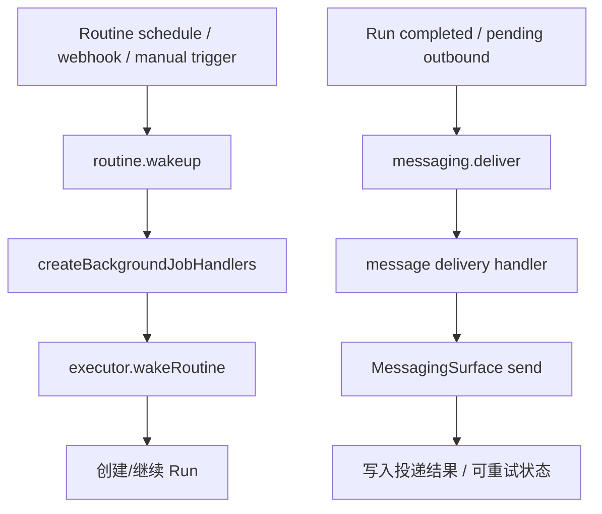
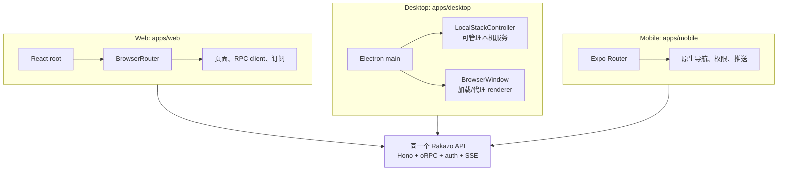
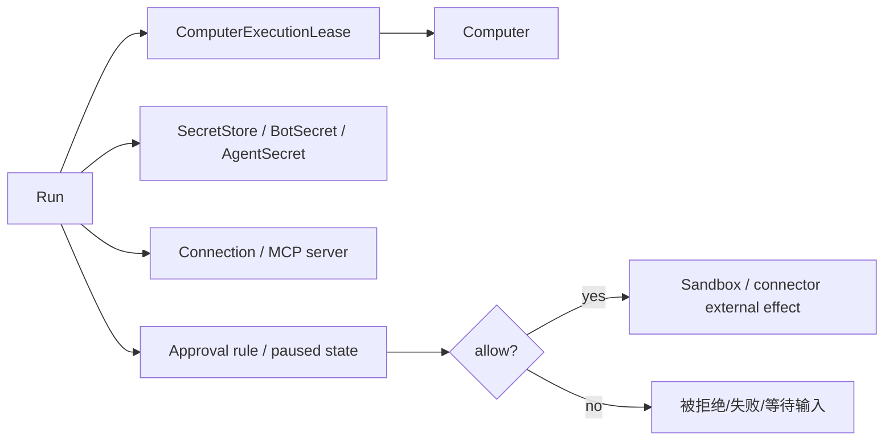

# 03. 状态、后台与多端一致性：为什么 Rakazo 能长期运行

## 目录

- [1. 状态分层：什么应该落库，什么只是瞬时过程](#state)
- [2. PostgreSQL、事件流与后台队列各做什么](#durability)
- [3. 启动与停止：API / worker 的职责](#lifecycle)
- [4. 后台工作：例行任务、消息投递与恢复](#jobs)
- [5. 三个客户端如何接到同一个产品](#platforms)
- [6. 计算机与秘密为什么是受控资源](#controlled)
- [7. 本章小结](#summary)

## 1. 状态分层：什么应该落库，什么只是瞬时过程

设计判断很简单：**只要一个事实会影响重试、恢复、审计、用户看到的历史或外部副作用，就不能只放在进程内。**

`PiAgentRuntime` 中的 `running` Map、`AbortController` 和内部 event queue 是正常的瞬时结构；但 `Run`、`Attempt`、`SteeringMessage`、`ExternalEffect`、`Message` 和 `Event` 必须存进数据库。

## 2. PostgreSQL、事件流与后台队列各做什么

| 组件 | 主要责任 | 不应承担的责任 |
|---|---|---|
| PostgreSQL/Prisma | 业务真相、顺序号、关系、Run 进度、审计落点 | 不能自己消费未来的定时/投递任务 |
| `ThreadEvents` / `RealtimeFanout` | 将线程过程以递增事件序列推送给在线订阅者 | 不能替代持久历史；断线客户端仍须追赶/水合 |
| `JobPublisher` / Graphile Worker | 延后、重试、并发处理后台意图 | 不是全部业务状态的唯一来源 |
| API 进程 | HTTP/oRPC/SSE/auth/webhook 与实时编排入口 | 不应把耗时后续工作绑死在请求 socket 上 |
| worker 进程 | 消费后台 job、调用相同 executor/handler | 不承担浏览器 UI 或用户会话渲染 |

### 2.1 为什么事件有序号

`Thread.nextEventSeq`、`Event(threadId, seq)` 唯一索引，以及 `followThreadEvents()` 这样的事件读取接口都表明：实时订阅会断线、重连、晚到或先收到快照。序列号是客户端判断“我缺了哪些变化”的基础；它比“收到一个 WebSocket/SSE 消息就更新 UI”更可靠。

## 3. 启动与停止：API / worker 的职责

### 3.1 API 启动

`apps/api/src/index.ts` 先读取根环境、创建 logger，调用 `createApp()`，再用 Hono Node server `serve(...)` 对外监听。`createApp()` 是真实的 composition root：会创建 DB、events、secret store、sandbox、connector stack、memory、runtime、executor、job handlers、router、HTTP routes 以及可选消息/语音/账单功能。

`index.ts` 特别追踪长连接 socket：线程 SSE 不会自然结束，单独调用 `server.close()` 可能永久等待。因此关闭时给 in-flight 请求短暂宽限，之后销毁仍打开的 socket，再调用 `stop()` 清理应用资源。这是长连接产品的实际生命周期设计，不是泛化的“关掉 Node 进程”。

### 3.2 worker 启动

worker 同样装配密钥、数据库、connector、sandbox、runtime 和 executor，但主要目标是启动 `JobWorkerHost` 并注册 `createBackgroundJobHandlers()`。这使 `routine.wakeup`、`messaging.deliver` 等任务不依赖某位用户仍保持页面打开。

## 4. 后台工作：例行任务、消息投递与恢复

### 4.1 已显式定义的 job 类型

在 `@rakazo/adapter-kit/background-jobs.ts` 中，`routine.wakeup` 与 `messaging.deliver` 是被 schema 验证的后台 job；其 key/replaceKey 设计用于避免同一 routine 或投递 drain 无界重复排队。

### 4.2 “可恢复”不等于“外部副作用绝对只执行一次”

数据库可以可靠保存 Run、Attempt、effect、投递状态和租约；但一旦请求越过进程边界进入外部应用/计算机，网络超时可能让系统不确定对方究竟是否已处理。因此设计采用：

1. **先记录可判定的业务状态和效果键/审计信息；**
2. **用 lease/fence、client nonce、claimed 状态降低重复执行；**
3. **恢复时根据已有状态继续或要求处理，而不是盲目重复所有副作用。**

这是一种“面向可审计恢复”的系统，而不是对所有第三方 API 作无法证明的 exactly-once 承诺。

## 5. 三个客户端如何接到同一个产品

### 5.1 Web

`apps/web/src/main.tsx` 创建 React root、i18n、UI appearance、`BrowserRouter` 和 desktop update provider。注释明确指出，在 SSE 高频更新时，router state 不能被低优先级 transition 无限抢占；这体现前端也是事件流系统的一部分。

### 5.2 Electron desktop

Electron 的 `apps/desktop/src/main.ts` 管理 BrowserWindow、本地 stack 发现/启动、health probe、setup、OAuth popup、session permissions 与安全外链打开。它**承载并连接 Web UI**，而不是复制一套 Agent 编排后端。项目规则也要求共享行为/合同/API/reusable UI 放 packages，只有原生存储、权限、导航和桌面交互才平台特化。

### 5.3 Mobile

`apps/mobile` 使用 Expo，负责移动端导航、原生能力与推送；业务协议仍通过共享 contracts/API 对接相同服务。于是“同一 Bot 的同一线程”可从三端进入，而不是在每端维护独立 Agent 状态机。

## 6. 计算机与秘密为什么是受控资源

- **计算机**：`Computer` 和 `ComputerExecutionLease` 暗示同一可视/可操作环境不是无限共享资源；Team computer、Private computer、screen control 与 lease 共同限制竞争使用。
- **秘密**：secret metadata、BotSecret/AgentSecret、secret store 与 connector 构成服务端保管边界；模型/前端不应天然拥有任意凭据。
- **连接器**：Connector/MCP 由后端选择、解析和执行，必要时在动作发生前走审批或安全检查。
- **副作用**：`ExternalEffect` 将“模型说要做”与“外部系统确实执行”区分开，便于续跑和审计。

## 7. 本章小结

Rakazo 能成为“持续的 AI 队友”，不只是因为模型能调用工具，而是因为它把长期事实放进 PostgreSQL，把实时过程放进事件流，把未来/重试工作交给 worker，把平台差异限制在客户端宿主层，并把计算机、秘密和外部副作用置于租约、审批和适配器边界之内。

[上一章：一次工作如何运行](./02-core-execution-and-message-flow.md) · [下一章：源码地图与验证](./04-source-map-and-verification.md) · [回到顶部](#top)
