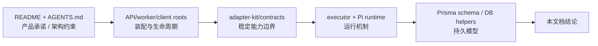

<a id="top"></a>

# 04. 源码地图与验证：每个结论从哪里来

## 目录

- [1. 分析基线与方法](#baseline)
- [2. 从产品入口到执行引擎的源码地图](#map)
- [3. 结论—证据对照](#claims)
- [4. 静态检查与未验证范围](#verification)
- [5. 后续建议的深入顺序](#next)

<a id="baseline"></a>
## 1. 分析基线与方法

- **源码根目录**：`/Users/gqli/work/deepagents/personal-agent/rakazo`
- **Git 提交**：`60684ee3c7de23486b2ecbbda904a0ba7478ea6e`
- **提交时间**：2026-10-15T10:35:39+03:00
- **工作区注意事项**：源码工作树在本轮开始时已存在未跟踪的 `apps/mobile/modules/rakazo-notifications/android/.gradle/`；本轮未写入该仓库。
- **方法**：阅读产品 README/工程约束；追踪 API 和 worker 的 composition root；阅读 adapter contracts、`createRunExecutor`、`PiAgentRuntime`、background handlers、Prisma schema 和三个客户端入口。



<a id="map"></a>
## 2. 从产品入口到执行引擎的源码地图

| 关注问题 | 主要文件 | 为什么读它 |
|---|---|---|
| Rakazo 对用户是什么 | `README.md` | 明确 persistent bots、self-host、跨端、computer、memory、routines、integrations 等产品能力 |
| 架构应遵守什么边界 | `AGENTS.md` | 明确 Web/Electron/Expo 是一个产品；后端拥有 orchestration/auth/retry/recovery/provider translation；供应商经 provider-neutral interfaces 隔离 |
| HTTP 服务如何启动/停止 | `apps/api/src/index.ts` | `loadEnv` → `createApp` → Hono `serve`；追踪/关闭长连接 sockets |
| API 如何装配真实依赖 | `apps/api/src/app.ts` | 创建 DB、events、sandbox、connector、memory、runtime、executor、job handlers、auth、router 与 HTTP routes |
| 用户命令如何进入业务层 | `apps/api/src/router.ts` | oRPC router、权限、线程/Run/Message 相关服务的应用入口 |
| 工作如何被编排 | `packages/adapters/src/executor.ts` | `ExecutorDeps`、`createRunExecutor`、工具/审批/续跑/事件/完成处理 |
| 模型与工具如何成为事件流 | `packages/adapters/src/pi-runtime.ts` | `PiAgentRuntime implements AgentRuntime`、`run()`、history、tool host、abort、流式模型处理 |
| 哪些能力可替换 | `packages/adapter-kit/src/interfaces.ts` | `AgentRuntime`、`SandboxProvider`、`ConnectorProvider`、`MemoryStore`、`JobPublisher` 等接口 |
| 未来任务如何执行 | `packages/adapter-kit/src/background-jobs.ts`、`packages/adapters/src/background-job-handlers.ts`、`apps/worker/src/index.ts` | job schema、routine/messaging handler、worker 装配 |
| 实际长期事实有哪些 | `packages/db/prisma/schema.prisma` | Space/Bot/Thread/Message/Event/Task/Run/Attempt/Routine/Computer 等关系和索引 |
| Web/Desktop/Mobile 的边界 | `apps/web/src/main.tsx`、`apps/desktop/src/main.ts`、`apps/mobile/app/_layout.tsx` | 客户端启动、桌面本机 stack/权限、移动端 native shell |

<a id="claims"></a>
## 3. 结论—证据对照

| 文档结论 | 一手源码证据 | 置信度 / 限制 |
|---|---|---|
| Rakazo 是持久 Bot 产品，而非纯 SDK | README features；schema 的 Bot/Thread/Run/Routine/Memory 模型 | 高；README 与实现互相印证 |
| 后端拥有编排、授权、重试、恢复、供应商翻译 | `AGENTS.md` 的架构约束；`createRunExecutor(deps)` | 高；这是显式约束 + composition 实现 |
| API 和 worker 共用 executor 但角色不同 | `apps/api/src/app.ts` 与 `apps/worker/src/index.ts` 都创建 executor/handlers | 高；未启动进程，只做静态阅读 |
| 默认 runtime 是 Pi | `app.ts` 导入/创建 `PiAgentRuntime`；其 `describe().id = "pi"` | 高；特定配置可能替换 runtime |
| 运行时是事件流，不是 Promise<string> | `AgentRuntime.run(): AsyncIterable<AgentRuntimeEvent>`；Pi runtime 的 event queue | 高 |
| 线程消息与事件分开排序 | schema 中 Thread 的 nextEventSeq/nextMessageSeq、Message/Event 索引 | 高 |
| Run 有租约/尝试/checkpoint | schema 的 `Run` 与 `Attempt` 字段 | 高；具体状态值由运行逻辑而非 schema enum 限制 |
| steering 可持久化关联 Run | schema `SteeringMessage`；Pi runtime 的 `claimSteering` request hook | 高 |
| 后台至少有 routine.wakeup 和 messaging.deliver | `background-jobs.ts` schema、handlers | 高 |
| Desktop 是 Electron 宿主，同时可管理 local stack | `apps/desktop/src/main.ts` imports/控制器 | 高；未运行 Electron |

<a id="verification"></a>
## 4. 静态检查与未验证范围

本轮已运行本目录的静态文档检查：

```text
python3 -B /Users/gqli/work/deepagents/docs/rakazo-architecture/verify_docs.py
```

该检查只验证：

- 本目录 Markdown 内部相对链接是否存在；
- 文档中显式 `id` 锚点是否重复；
- Mermaid 围栏是否闭合；
- 每篇是否有可见目录；
- 所记的源码目录和 Git 基线能否读到。

它**不验证**：Mermaid 的视觉渲染、真实模型调用、沙箱、数据库迁移、第三方集成、移动/桌面应用或端到端恢复行为。未运行这些流程，不能声称它们通过。

<a id="next"></a>
## 5. 后续建议的深入顺序

第一轮已经先补上产品定位、总体架构和一次 Run 的主链路。要继续达到“覆盖全部模块”的深度，建议按以下专题继续，每篇仍以“它是什么 → 能做什么 → 全景图 → 主链路 → 源码映射”为结构：

1. **上下文与记忆**：`context-selection.ts`、`MarkdownMemoryStore`、semantic memory providers、thread compaction 的区分；
2. **计算机运行时**：`SandboxProvider`、Computer/lease、screen control、Docker/E2B/Daytona/CreateOS/Box 的实现差异；
3. **权限与审批**：ActionApproval、MCP approval、secret/redaction、external effect idempotency；
4. **连接器与工具生态**：MCP/OpenAPI/Composio/Pipedream/install/remote connectors；
5. **多 Bot、看板与云 agent**：child bots、peer runs、Board/Ticket、CloudAgent；
6. **渠道、语音与推送**：messaging inbound/outbound、team chat、voice、Expo notification；
7. **部署与运维**：compose、self-host、desktop local stack、restricted-network、更新路径。

[返回总览](./README.md) · [回到顶部](#top)
