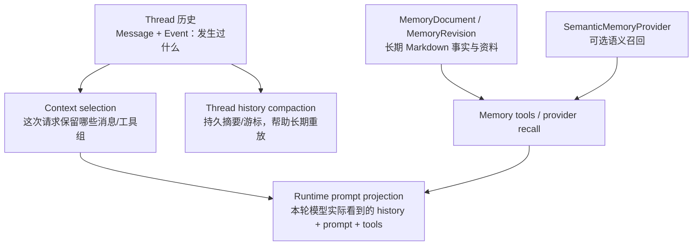
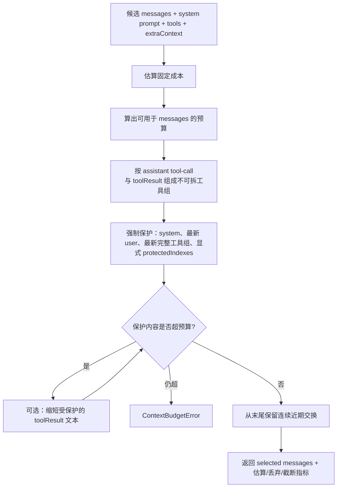
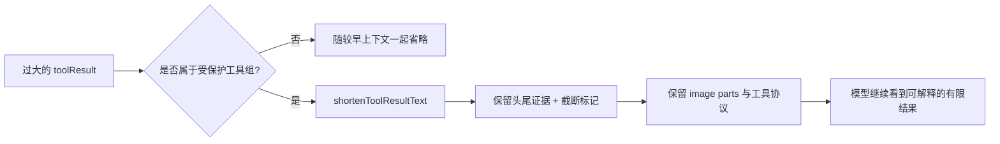
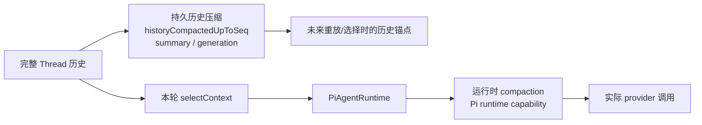
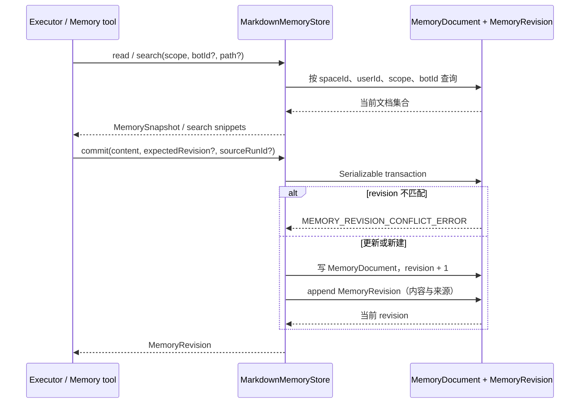
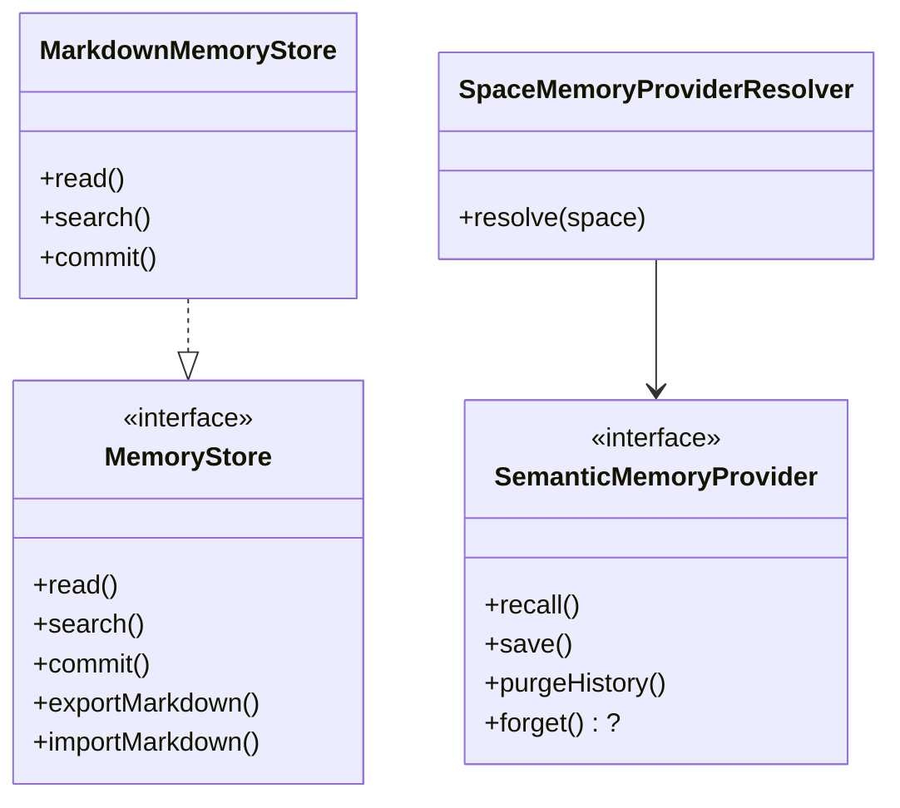
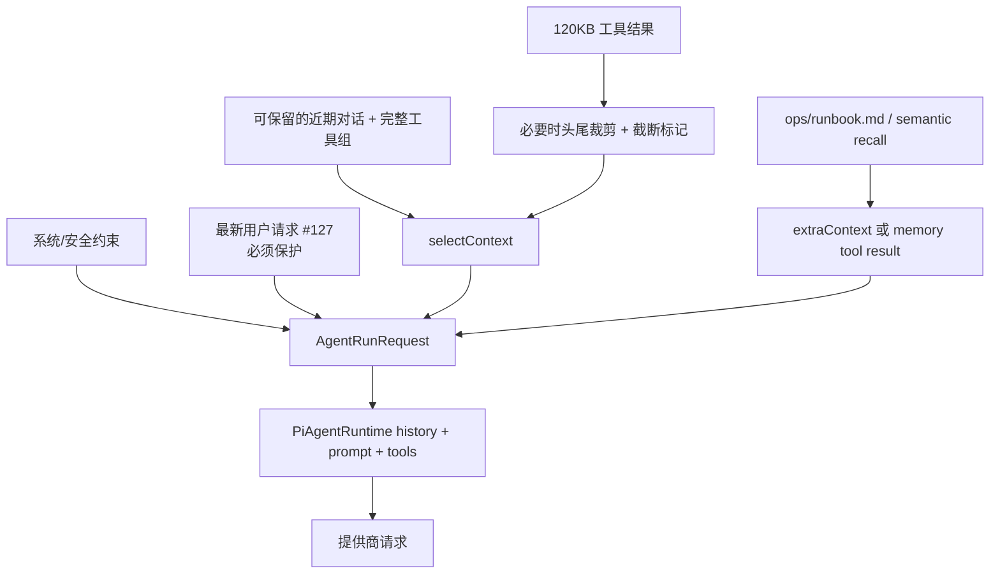

<a id="top"></a>

# 05. 上下文与记忆：哪些信息真的会给模型，哪些只应长期保存

## 目录

- [1. 先拆开四个常被混淆的概念](#four)
- [2. 上下文选择：不是“取最后 N 条”](#selection)
- [3. 工具结果如何被轻量缩短](#tool-trim)
- [4. 线程历史压缩与运行时压缩](#compaction)
- [5. 持久记忆：MarkdownMemoryStore](#durable-memory)
- [6. 可选语义记忆与记忆工具](#semantic)
- [7. 一次模型请求的上下文拼装示例](#example)
- [8. 本章小结](#summary)

<a id="four"></a>
## 1. 先拆开四个常被混淆的概念

在 Agent 产品里，“memory”很容易被用来指任何历史文本。Rakazo 的源码其实区分了至少四层：



| 概念 | 主要对象 | 生命周期 | 不能误解成 |
|---|---|---|---|
| 对话事实 | `Thread`、`Message`、`Event` | 长期持久 | 全量必然传给模型 |
| 本轮上下文选择 | `selectContext()` | 一次模型调用前 | 修改历史数据库 |
| 历史压缩 | Thread 的 compaction 字段、运行时 compaction 能力 | 跨轮/长线程 | 单纯截断字符串 |
| 长期记忆 | `MemoryDocument`、`MemoryRevision` | 跨 Thread / Run | 线程聊天记录的别名 |
| 语义记忆 | `SemanticMemoryProvider` | 可选外部/可替换能力 | Markdown memory 的强制替代 |

<a id="selection"></a>
## 2. 上下文选择：不是“取最后 N 条”

`packages/adapters/src/context-selection.ts::selectContext()` 接受一组 context messages 与预算，不调用模型、不生成摘要；它是**确定性的轻量选择器**。预算包含：模型 context window、输出预留、system prompt、tools、附加 context 和图片估算。



### 2.1 选择规则中最重要的三个不变量

1. **当前用户意图不能丢**：最后一个 `user` message 被自动保护；调用方也可保护 steering、审批、权威约束等索引。  
2. **工具协议不能断裂**：assistant 的 tool call 和相应 tool result 按 group 整体处理；源码会对孤立/重复/缺失的 tool result 抛错。  
3. **保留的是连续后缀，而不是随意挑片段**：在预算内从最近 group 往前保留，防止 model 看见“工具结果”却没有相应调用背景。

### 2.2 `current` 与 `cache-aware` 的含义

选择器支持 strategy。源码逻辑表明：

- `current`，以及 `cache-aware` 且 cache 很可能已 warm 时，可保留更长前缀；
- 否则用 `recentExchanges`（默认逻辑至少保留一轮）约束近期交换；
- 这是为模型 provider 的 prompt cache 特性优化的选择政策，**不是一个 LLM summarizer**。

<a id="tool-trim"></a>
## 3. 工具结果如何被轻量缩短

工具返回内容往往是上下文爆炸的第一来源：网页全文、命令输出、文件内容、历史搜索结果等。Rakazo 的选择器优先做**便宜且确定性的裁剪**：



这与“模型摘要”不同：

- `shortenToolResultText()` 会显式插入“结果为适应上下文被截断、被省略的证据不可用”一类标记；模型不应把缺失部分当成已读事实；
- 针对 `read_history` / `search_history` 的结构化结果还会尽力保留 offset、untrusted/contextTruncated 等控制字段；
- 只有在保护内容本身压垮预算时才尝试缩短；缩短后递归重新选择；仍放不下才抛 `ContextBudgetError`。

> 这解释了一个设计取舍：先轻量控制工具证据体积，再减少较早上下文，最后才失败；这里没有“超过 token 后必然调用 LLM 总结”的固定算法。

<a id="compaction"></a>
## 4. 线程历史压缩与运行时压缩



### 4.1 两个“压缩”层次

- **Thread 历史压缩**：schema 的 `historyCompactedUpToSeq`、`historyCompactionSummary`、`historyCompactionGeneration` 属于线程持久状态。它解决的是长生命周期线程如何在后来重新构造可用历史；
- **运行时上下文压缩**：`PiAgentRuntime.describe()` 声明 `compaction: true`，再配合 context selection / 截图裁剪等机制解决本轮模型调用是否放得下；
- **不能推出的结论**：仅凭这两处实现，不应断言“每次超预算都先工具裁剪、再保留固定 N 条、最后必定 LLM 压缩”。不同路径会受模型、策略、图片、被保护内容和 runtime 行为影响。

### 4.2 截图也属于上下文预算

Pi runtime 有 `pruneComputerScreenshotContext()`，并设置默认保留最近计算机截图数。这说明视觉环境不是一个在模型外无限积累的缓存：截图会被纳入模型输入成本，必须单独裁剪。

<a id="durable-memory"></a>
## 5. 持久记忆：MarkdownMemoryStore

`@rakazo/memory::MarkdownMemoryStore` 是默认 durable memory store，能力声明为：`search`、`revisions`、`markdownPortable`。



### 5.1 它存的是什么

`MemoryDocument` 包含 path、content、scope、可选 botId 和 revision；`MemoryRevision` 记录文档每次版本及可选 `sourceRunId` / `sourceThreadId`。这带来三个实际性质：

1. **范围隔离**：查询明确带 `spaceId`、`userId`，并可按 scope / bot 限制；
2. **乐观并发控制**：调用方可给 `expectedRevision`，不匹配返回冲突，而不是静默覆盖；
3. **可追溯修改**：写当前文档与追加 revision 在可序列化事务中完成，来源 Run/Thread 可以关联。

### 5.2 搜索不等于语义向量检索

默认 store 的 `search()` 是 path/content 的大小写不敏感匹配与 snippet，score 为固定值；不要把它误称为默认 embedding/RAG 系统。更复杂的语义召回应通过下一节的可选 provider 表达。

<a id="semantic"></a>
## 6. 可选语义记忆与记忆工具

`adapter-kit` 将 `SemanticMemoryProvider` 定义为独立的可选边界，拥有 `recall`、`save`、`purgeHistory`，以及可选 `forget`；注释明确指出 durable Markdown memory 仍由 `MemoryStore` 所有。



`memory-tools.ts::selectMemoryTools()` 只会在 semantic memory 配置存在时暴露 `recall_memory`、`save_memory`、`forget_memory` 这类工具。结论是：**让模型“记住”是一个显式配置和工具暴露决策，而不是每一轮模型天然可以写入长期记忆。**

<a id="example"></a>
## 7. 一次模型请求的上下文拼装示例

假设用户正在让一个 Bot 排查线上问题：

```text
线程事实：
  #124 用户：服务偶尔 500，帮我定位。
  #125 Bot：我准备查看日志和部署信息。
  #126 tool result：日志全文 120KB
  #127 用户（steering）：不要重启；只做只读检查。

长期记忆：
  ops/runbook.md：生产环境约束和常见排障步骤
语义记忆：
  可选命中：“该服务上周由 api-v2 迁移…”
```

本轮的概念拼装是：



注意两点：

- `#127` 作为最新用户意图属于保护内容；“不要重启”不能仅因它较短就被老日志淹没；
- 长期记忆可能作为额外上下文或通过工具返回进入模型，但它不是自动把所有 `MemoryDocument` 全量拼接到每次调用。

<a id="summary"></a>
## 8. 本章小结

Rakazo 的上下文设计不是一条“message 数组直接发送给模型”的直线，而是一套分层投影：线程保存事实，选择器在预算内保留完整语义组，工具结果先做确定性裁剪，运行时再组装模型协议；长期 Markdown 记忆和可选语义记忆则作为独立、可审计、可替换的能力存在。

[返回总览](./README.md) · [下一章：计算机与沙箱](./06-computers-and-sandboxes.md) · [回到顶部](#top)
