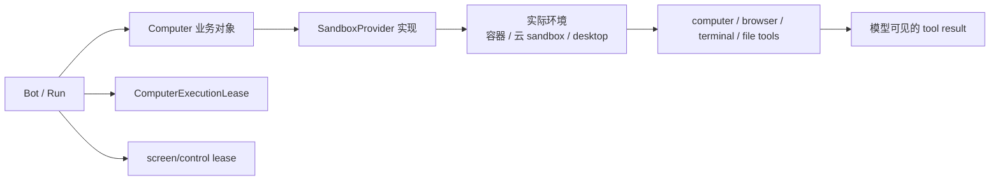
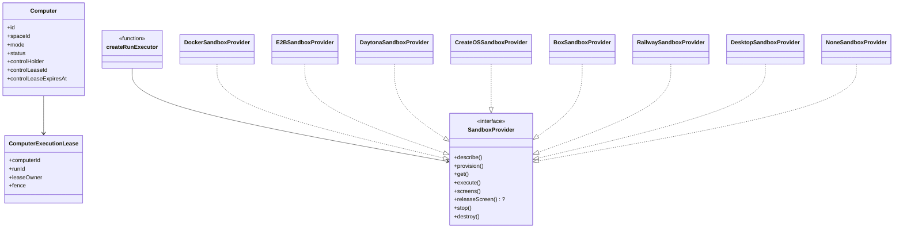
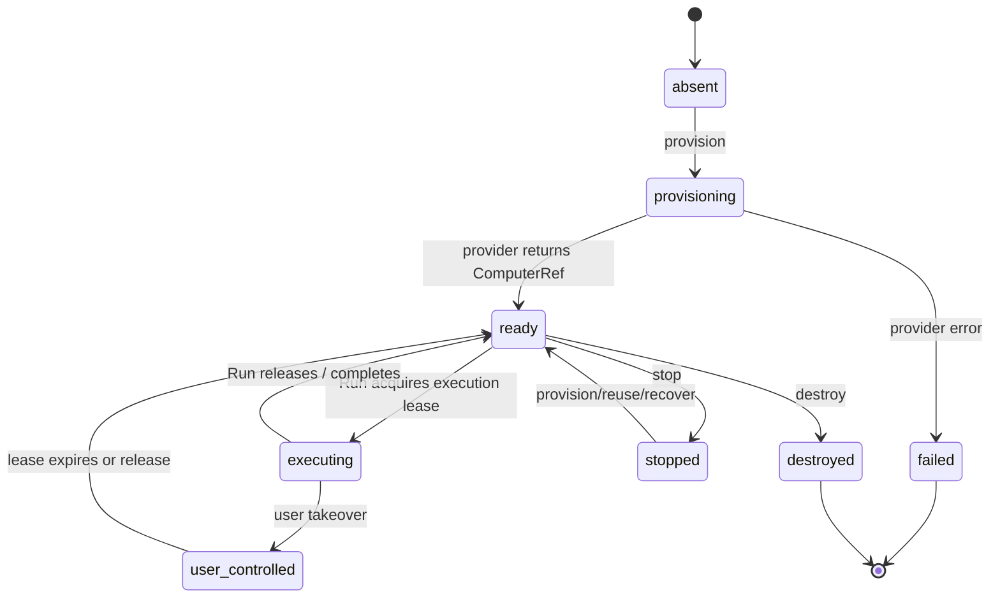
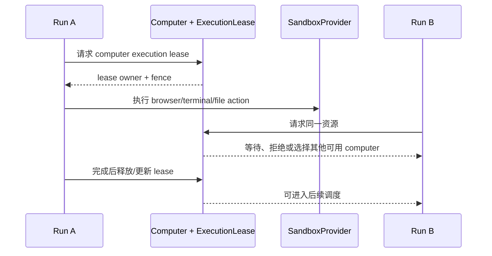
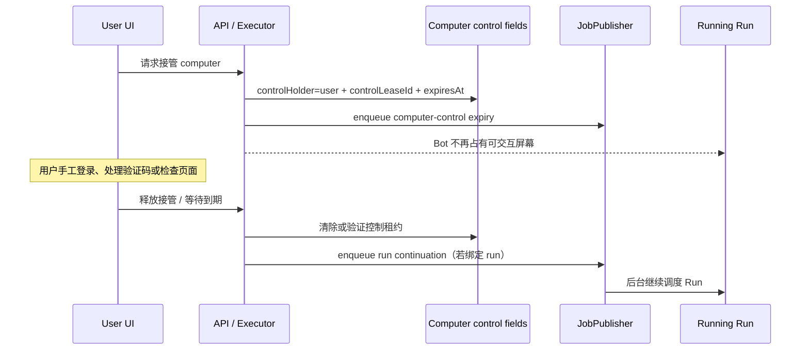
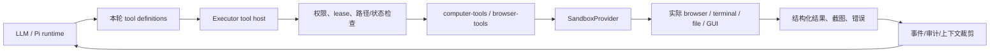

<a id="top"></a>

# 06. 计算机与沙箱：Bot 如何安全地拥有、共享、接管和恢复工作环境

## 目录

- [1. Computer 在 Rakazo 中是什么](#what)
- [2. 总体架构：产品对象、能力接口与 provider](#architecture)
- [3. 生命周期：从 provision 到 destroy](#lifecycle)
- [4. Team / Private 与执行租约](#leases)
- [5. 用户接管屏幕与 Bot 续跑](#takeover)
- [6. 工具投影：模型不是直接操作 Docker](#tools)
- [7. Provider 策略与恢复边界](#providers)
- [8. 本章小结](#summary)

<a id="what"></a>
## 1. Computer 在 Rakazo 中是什么

Rakazo 的 Computer 不是“给模型一段 shell”。它是由数据库记录、provider 实现、执行租约、屏幕控制权和工具适配共同组成的**受管理工作环境**。它可承载 browser、terminal、文件与图形桌面能力，也必须面对多人/多 Bot 竞争、用户接管、远端环境消失和重启恢复。



<a id="architecture"></a>
## 2. 总体架构：产品对象、能力接口与 provider



`createSandboxProvider(kind, opts)` 是 provider factory。源码支持 Docker、E2B、Daytona、CreateOS、Box、Railway、desktop，以及测试/emulator/none 等实现；不满足 provider 必需配置时会生成 `NoneSandboxProvider`，让“不具备计算机能力”成为显式可报告状态，而不是在工具调用时抛出不透明错误。

<a id="lifecycle"></a>
## 3. 生命周期：从 provision 到 destroy



这是设计状态图，不是声称所有 provider 都有完全相同的远端状态机。真正统一的是 `SandboxProvider` 合同：上层编排器请求 provision/get/execute/stop/destroy 等能力；每个实现将之翻译为 Docker、远端 sandbox 或受信任 desktop 的实际 API。

### 3.1 为什么需要 `ComputerRef`

外部计算机的原生 ID、URL、状态和可访问能力可能由 provider 决定。上层应保有稳定的“Rakazo 计算机记录 + provider reference”，而不应在业务流程中散落某一家 provider 的 ID 语义。

<a id="leases"></a>
## 4. Team / Private 与执行租约

### 4.1 计算机是竞争资源

当多个 Bot/Run 同时操作同一 GUI、browser profile 或工作目录，最危险的问题不是“请求慢”，而是状态互相覆盖：A 点击、B 输入、用户接管时 Bot 仍继续执行。因此 schema 有 `ComputerExecutionLease`，run/lease 以 owner 与 fence 协作，computer 控制又有独立的 `controlHolder` / `controlLeaseId` / `controlLeaseExpiresAt`。



### 4.2 Team 和 Private 不是仅 UI 标签

README 描述 Shared Team Computers 与 isolated Private computers；数据库与 control/lease 代码表明它们影响资源复用和竞争模型：

- **Private**：更接近一个 Bot/主体的隔离执行环境；
- **Team**：可能允许多 Bot/成员使用，但需要更严格的执行/屏幕租约；
- **无论模式**：客户端都不能假设“当前看到屏幕，就代表自己拥有输入控制”。

<a id="takeover"></a>
## 5. 用户接管屏幕与 Bot 续跑

用户临时接管图形环境是 Agent 产品必须显式建模的流程。`computer-control.ts` 包含 `DEFAULT_TAKEOVER_LEASE_MS`（默认 15 分钟）、控制租约延长、到期 job，以及 `enqueueTakeoverContinuation()`。



这个设计的重要含义是：**“用户接管”不是前端盖一层遮罩，而是持久状态 + 可过期租约 + 后台续跑决定。** 如果 enqueue continuation 暂时失败，代码注释明确让 reconciliation 重试；已持久化的 release 不依赖一次队列调用必然成功。

<a id="tools"></a>
## 6. 工具投影：模型不是直接操作 Docker



模型看到的是工具 schema 和工具结果；真正的 provider 调用仍经过 executor 与 computer tool 层。这样才可以在执行前后处理：

- computer 是否可用、是否被用户接管；
- 当前 Run 是否拥有执行 lease；
- 需要哪些 browser/screen/file 能力；
- 截图和大型结果如何进入后续模型上下文；
- provider 错误是否代表环境已消失、可否恢复。

<a id="providers"></a>
## 7. Provider 策略与恢复边界

```mermaid
flowchart TB
  Factory[createSandboxProvider(kind, opts)] --> K{kind}
  K --> Docker[DockerSandboxProvider\n本地/self-host]
  K --> Remote[ E2B / Daytona / CreateOS / Box / Railway]
  K --> Desktop[DesktopSandboxProvider\n受信任本机]
  K --> None[NoneSandboxProvider\n显式不可用]
  Docker & Remote & Desktop --> Contract[SandboxProvider contract]
  Contract --> Executor[统一 Run 编排]
```

恢复的现实边界：

- 本地容器、远端 sandbox、桌面机器的“重连/复用/销毁”语义不可能完全相同；
- `computer-recovery.ts`、`computer-reuse.ts`、`computer-lifecycle.ts` 等模块将这些差异收敛在 adapters；
- Run 的持久化可以帮助系统决定继续、重新建环境、报告失败或避免不安全重做；但它不能神奇恢复已经消失且 provider 不可重建的桌面现场。

<a id="summary"></a>
## 8. 本章小结

Rakazo 将计算机设计为带 provider、业务记录、执行租约、屏幕控制和恢复边界的受管资源。这样才能支持长任务、团队共享、用户接管与多 provider，同时不让模型直接绕过权限或把某一家 sandbox 的实现细节扩散到整个产品。

[上一章：上下文与记忆](./05-context-and-memory.md) · [下一章：工具与集成](./07-tools-and-integrations.md) · [回到顶部](#top)
