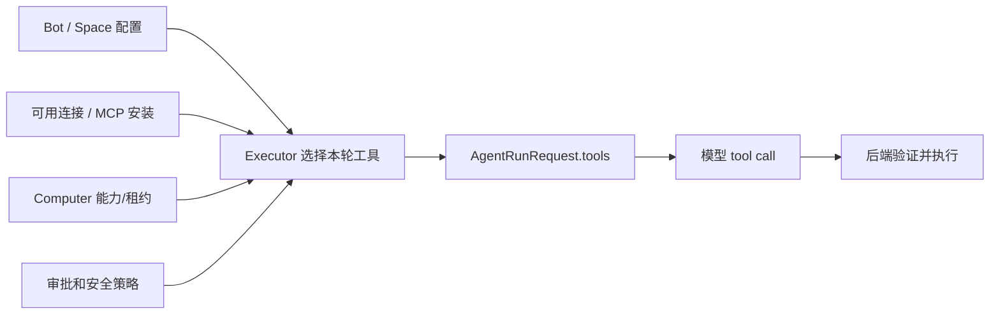
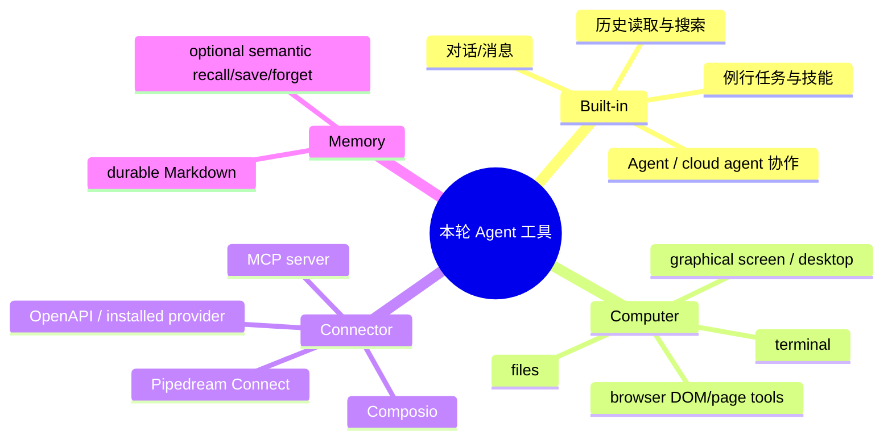
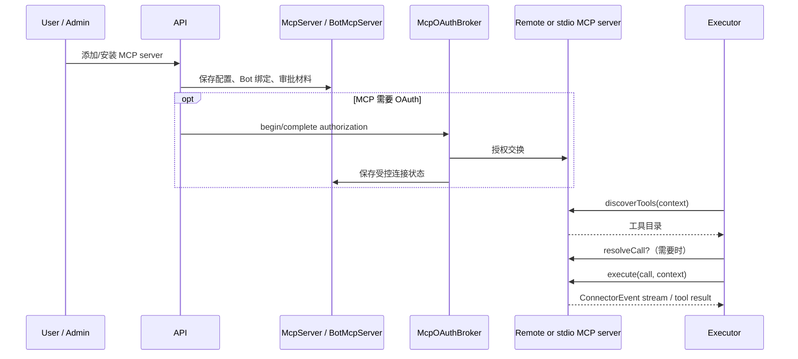
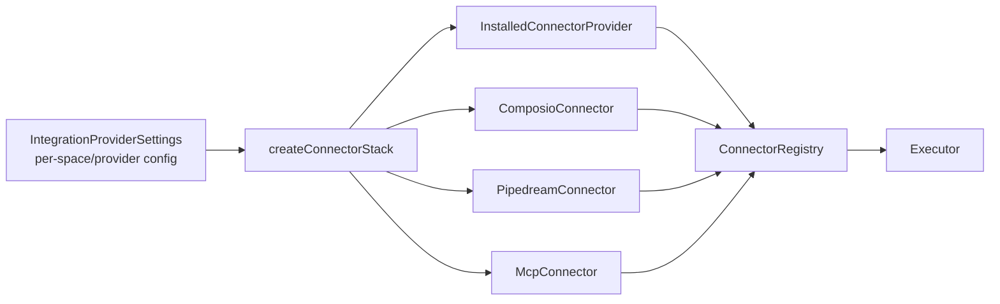
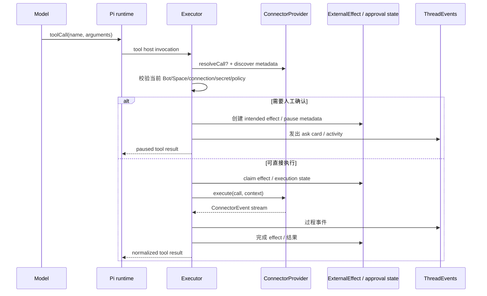
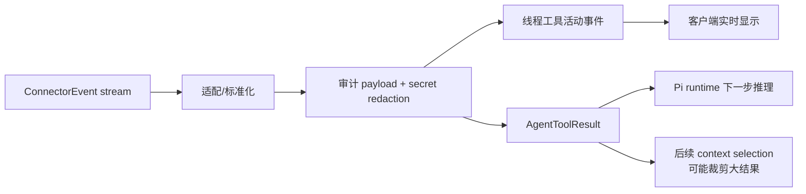

<a id="top"></a>

# 07. 工具与集成：MCP、OpenAPI 和应用连接如何成为可控的 Agent 能力

## 目录

- [1. 工具在 Rakazo 中是什么](#what)
- [2. 总体架构：发现、选择、解析、执行](#architecture)
- [3. 内建工具、计算机工具与连接器工具](#tool-kinds)
- [4. MCP 生命周期](#mcp)
- [5. 托管应用集成：Composio / Pipedream](#managed)
- [6. 工具调用的安全执行链路](#execution)
- [7. 工具结果如何回到模型和用户](#results)
- [8. 本章小结](#summary)

<a id="what"></a>
## 1. 工具在 Rakazo 中是什么

工具不是“模型拿到一串函数名后任意调用”。在 Rakazo 中，工具是由后端基于当前 Bot、Space、连接状态、计算机、权限和本轮目标**选择后注入**给 runtime 的能力；模型只能发起结构化请求，执行权仍在 executor 和 provider 适配层。



<a id="architecture"></a>
## 2. 总体架构：发现、选择、解析、执行

```mermaid
flowchart TB
  subgraph Catalog[工具来源]
    BI[Built-in tools]
    COMP[Computer / Browser tools]
    MCP[McpConnector\nremote / stdio MCP]
    OA[OpenAPI / installed connector]
    MG[Managed connectors\nComposio / Pipedream]
    CA[Cloud agent tools]
  end
  Catalog --> Registry[Connector registry / stack]
  Registry --> Discovery[discoverTools(context)]
  Discovery --> EX[createRunExecutor\n依据 Bot、权限、连接筛选]
  EX --> PI[PiAgentRuntime\ntoAgentTools]
  PI --> CALL[模型请求工具]
  CALL --> Resolve[resolveCall?\n解析 lazy catalog / authoritative tool]
  Resolve --> Gate[批准、秘密、参数、安全检查]
  Gate --> Exec[execute(call, context)\nAsyncIterable<ConnectorEvent>]
  Exec --> Events[ThreadEvents + tool result]
```

`ConnectorProvider` 合同中最值得注意的三部分是：

- `discoverTools(context)`：当前上下文可见哪些工具；
- `resolveCall?(call, context)`：在批准前把 lazy catalog 调用解析为权威、已授权的工具定义；
- `execute(call, context): AsyncIterable<ConnectorEvent>`：执行本身也可产生过程事件，而非只能返回一个最终 JSON。

<a id="tool-kinds"></a>
## 3. 内建工具、计算机工具与连接器工具



| 工具类型 | 实际执行边界 | 典型风险 | 为什么不是直接暴露给模型 |
|---|---|---|---|
| 内建工具 | executor / core service | 改状态、发消息、创建资源 | 要统一授权、审计、幂等与业务规则 |
| 计算机工具 | computer-tools → SandboxProvider | shell、文件、图形环境 | 要校验 lease、用户接管、路径/环境和 provider 状态 |
| Connector 工具 | ConnectorProvider | 第三方副作用、OAuth、SSRF/网络 | 要先发现/解析权威工具，再走审批与安全边界 |
| Memory 工具 | MemoryStore / SemanticMemoryProvider | 污染长期事实、越权读取 | 要限定 Space/User/Scope，并记录 revision/来源 |

<a id="mcp"></a>
## 4. MCP 生命周期

`McpConnector`、`McpOAuthBroker`、`McpServer`、`BotMcpServer` 等对象表明 MCP 在 Rakazo 中不是一段静态 JSON 配置，而是一个从安装、授权、发现到本轮调用的生命周期。



### 4.1 为什么有 `resolveCall`

某些连接器的工具目录可能是延迟加载或只展示摘要。若直接让模型对摘要工具请求“批准并执行”，批准对象可能与实际执行对象不同。`resolveCall` 的作用是在批准前获得当前权威工具定义与参数语义，避免审批卡片批准了一个模糊的“工具名称”。

<a id="managed"></a>
## 5. 托管应用集成：Composio / Pipedream

Rakazo 将 Composio、Pipedream 放在 adapter 层，并经 `IntegrationProviderSettings` / `createConnectorStack()` 装配；它们是可选 provider，不是核心业务逻辑的前提。



产品语义上，这些 provider 解决“用户已授权的应用能力怎样被转成 Agent 工具”；它们不是让前端把 OAuth token 直接交给模型。连接的配置、凭据处理、目录获取、工具解析和调用都在后端 provider 边界内。

<a id="execution"></a>
## 6. 工具调用的安全执行链路



值得强调：**MCP、OpenAPI、应用连接与 computer 工具最终都要回到相同的治理链路。** 机制可以不同，但“发现 → 权威解析 → 授权 → 执行 → 结果/副作用记录”是统一控制面。

<a id="results"></a>
## 7. 工具结果如何回到模型和用户



工具返回有三类消费者：

1. **模型**：要根据结果继续推理或修正计划；
2. **用户**：需要通过事件了解正在做什么、是否失败/暂停；
3. **系统**：需要记录可审计的 payload/外部 effect，并避免把秘密或超大结果无控制地重复注入上下文。

`connector-safety.ts` 对 connector error/payload 做 secret redaction，并限制错误长度；这是“工具结果不是可信展示文本”的一个直接实现信号。

<a id="summary"></a>
## 8. 本章小结

Rakazo 的工具设计不把模型当成基础设施控制器。模型只从本轮可见的工具集合中提出结构化调用；后端通过 connector stack、权威解析、审批、秘密和副作用状态来决定是否/如何执行；返回结果同时服务模型继续推理、用户可见过程和可恢复审计。

[上一章：计算机与沙箱](./06-computers-and-sandboxes.md) · [下一章：权限、审批与副作用](./08-permissions-approvals-and-effects.md) · [回到顶部](#top)
