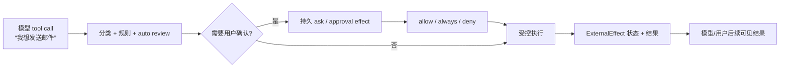
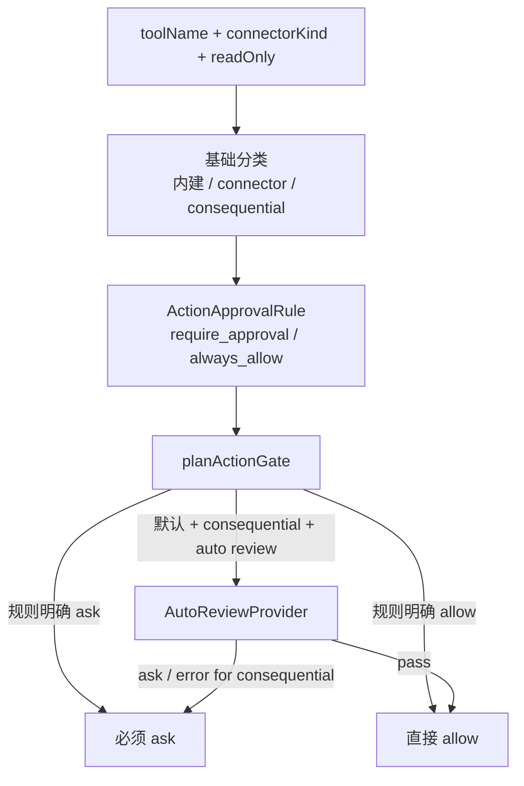
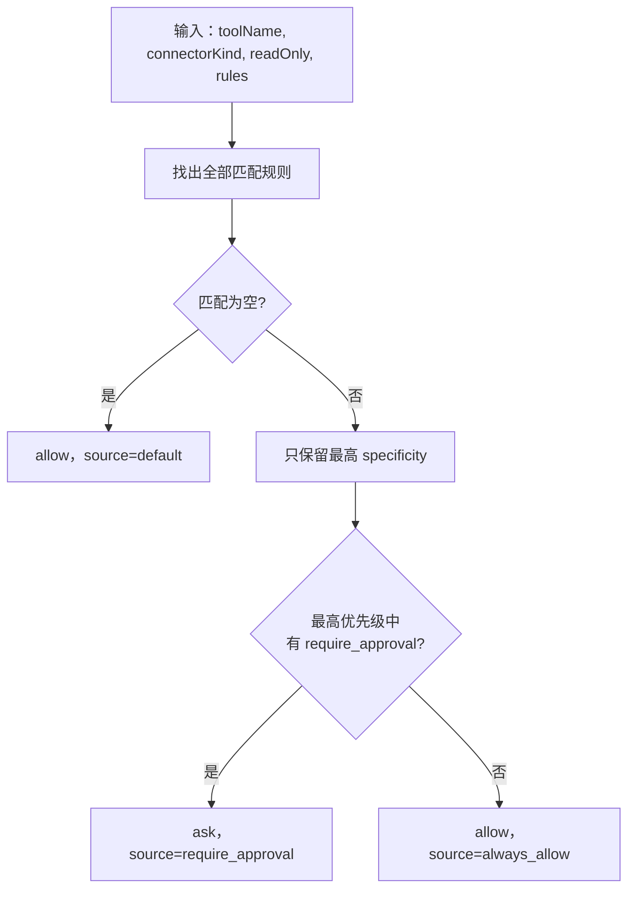
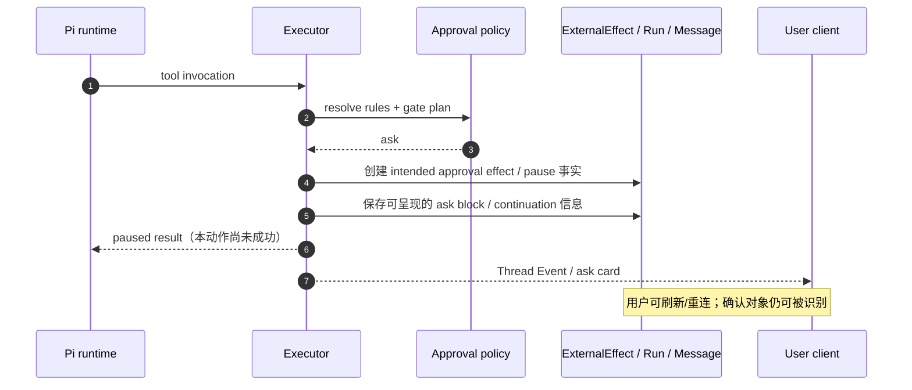
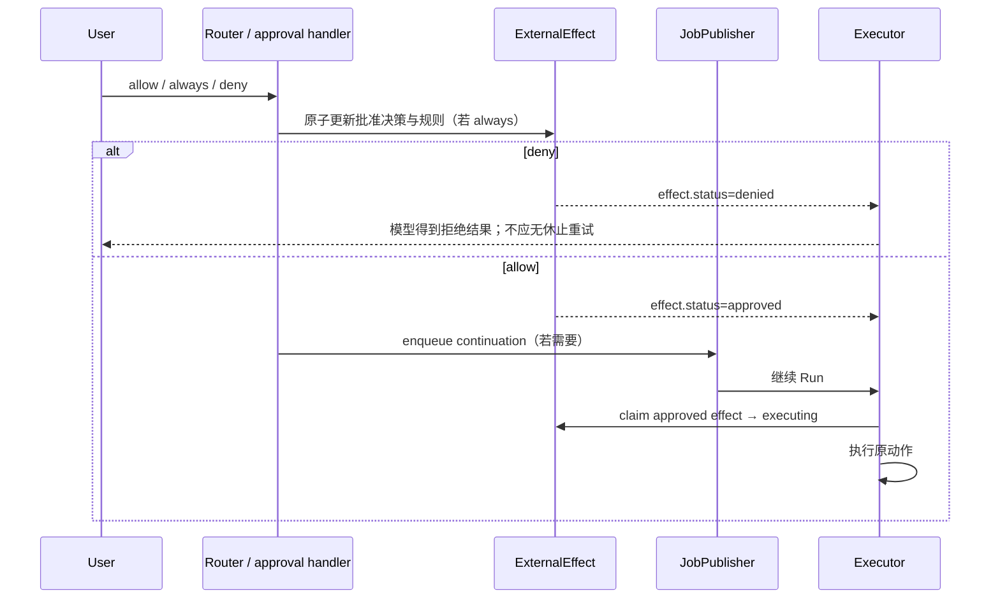
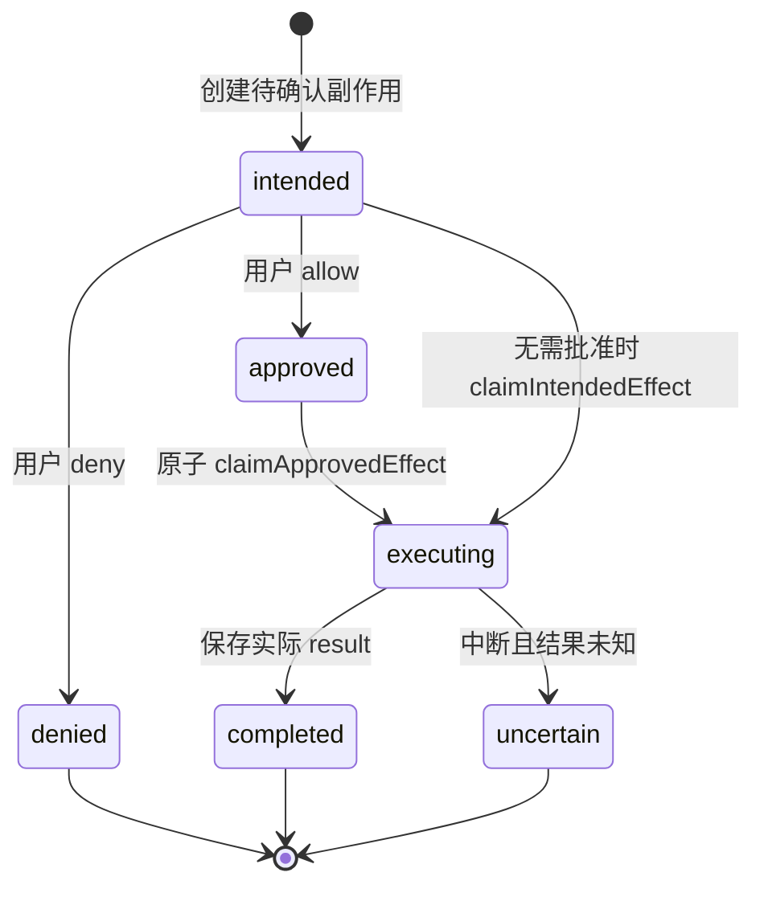
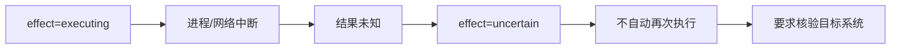
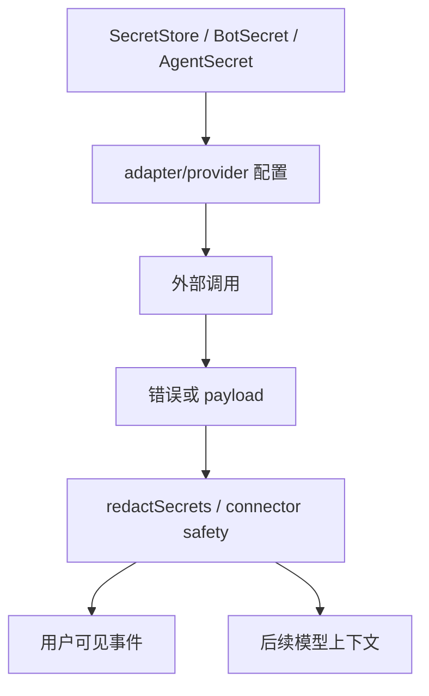
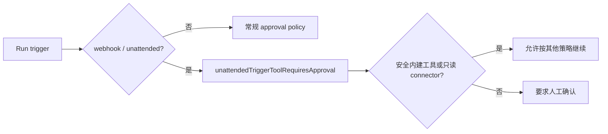

<a id="top"></a>

# 08. 权限、审批与副作用：一次“允许执行”如何成为可恢复的状态机

## 目录

- [1. 这个领域解决什么问题](#what)
- [2. 三层防线：工具分类、用户规则、自动复核](#layers)
- [3. 规则解析：哪些规则优先](#rules)
- [4. 人工确认的完整链路](#approval-flow)
- [5. ExternalEffect：为何不直接重放动作](#effects)
- [6. 秘密与错误输出的边界](#secrets)
- [7. 无人触发与计算机安全](#unattended)
- [8. 本章小结](#summary)

<a id="what"></a>
## 1. 这个领域解决什么问题

Agent 的危险不在于模型会输出一段文字，而在于它可能发送邮件、改第三方数据、创建空间、操作 shell 或控制计算机。Rakazo 的设计目标是把下面两件事拆开：

1. **模型希望执行某动作；**
2. **系统最终允许并且实际执行了该动作。**



<a id="layers"></a>
## 2. 三层防线：工具分类、用户规则、自动复核



- **基础分类**：`toolRequiresApproval()`、`connectorToolRequiresApproval()` 使用内建工具集合、read-only 信号和连接器名称模式识别可能有后果的动作；
- **用户规则**：`ActionApprovalRule` 可以按具体 tool、connector 或业务类别（如 email、purchase）匹配；
- **自动复核**：只在默认规则路径、动作有后果、开启 auto review 且 checker 已配置时介入；它只能升级为 ask，不能静默把用户显式规则推翻。

<a id="rules"></a>
## 3. 规则解析：哪些规则优先

`resolveActionApprovalDetail()` 的规则语义是确定性的，不依赖 LLM：



specificity 排序是：

```text
tool（具体工具） > connector（某一连接器） > category（如 email / purchase）
```

在同一最高优先级中，`require_approval` 优先于 `always_allow`。这避免了“一个宽泛 always allow 无意覆盖一个具体危险工具的 ask”，也避免让模型自行解释规则文本。

### 3.1 规则之外的显式/无人触发约束

源码还区分：

- 特定内建工具的显式确认要求；
- webhook 等无人触发场景的额外限制：对于 connector，按是否 read-only 判断；对于内建工具，只允许 `UNATTENDED_SAFE_BUILTIN_TOOLS` 白名单；
- 因此“此前用户允许过某类操作”不意味着 webhook 定时/外部触发可以无条件做任何事。

<a id="approval-flow"></a>
## 4. 人工确认的完整链路

### 4.1 从工具调用到 ask 卡片



这不是 `window.confirm()`：ask 是可持久化的业务状态，与 Run/工具动作/副作用标识关联。前端卡片只是该状态的一个视图。

### 4.2 用户批准、拒绝或总是允许



批准并不代表“重放整个用户请求”。正确的粒度是：**恢复/继续对应 Run，并只认领与该动作绑定的 approval effect**。这让前面已完成的工具调用不必再次执行。

<a id="effects"></a>
## 5. ExternalEffect：为何不直接重放动作

`approval-effect.ts` 显式处理 effect status，包括 `intended`、`approved`、`executing`、`completed`、`denied` 和 `uncertain` 等状态分支。



### 5.1 为什么 `uncertain` 是安全设计

如果进程在“请求已发往 Gmail/支付/第三方 API”之后、“收到响应并持久化结果”之前崩溃，系统无法证明动作是否发生。源码的 `uncertainEffectResult()` 明确要求：**不要重放以避免重复副作用；先验证目标端，再提出下一步。**



这比“重试直到成功”更保守，却是涉及发送、购买、修改外部记录时正确的默认取舍。

<a id="secrets"></a>
## 6. 秘密与错误输出的边界



`connector-safety.ts` 会：

- 对错误文本中的 Bearer token、特定 token 格式和已知秘密做 redaction；
- 递归清洗 connector payload；
- 将错误文本截为有限长度。

这解决的不是“绝对防止一切敏感信息进入外部系统”（模型/工具调用本身仍需要受控凭据），而是避免错误反馈、活动日志和后续上下文再次扩大泄漏面。

<a id="unattended"></a>
## 7. 无人触发与计算机安全



无人 webhook、定时任务、消息渠道唤醒的风险不同于用户正在看着屏幕点击“允许”。Rakazo 通过 unattended path 的额外判定限制自动动作；再配合 Computer 的 user takeover / lease 机制，避免 Bot 在用户正在手工处理屏幕时继续争夺控制权。

<a id="summary"></a>
## 8. 本章小结

Rakazo 的权限模型不是一个布尔开关。它把工具分类、确定性规则优先级、可选自动复核、可持久化审批卡片和 `ExternalEffect` 状态机串成一条链：模型提出意图，系统决定是否允许，用户决策绑定到特定动作，执行结果被记录；如果结果不确定，宁可停止重放并要求核验。

[上一章：工具与集成](./07-tools-and-integrations.md) · [源码地图与验证](./04-source-map-and-verification.md) · [回到顶部](#top)
