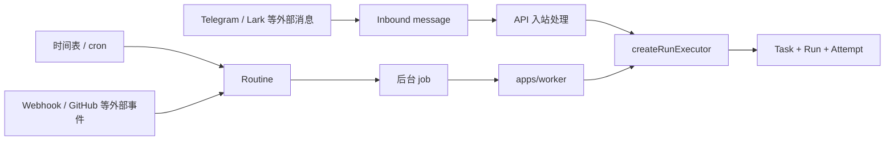
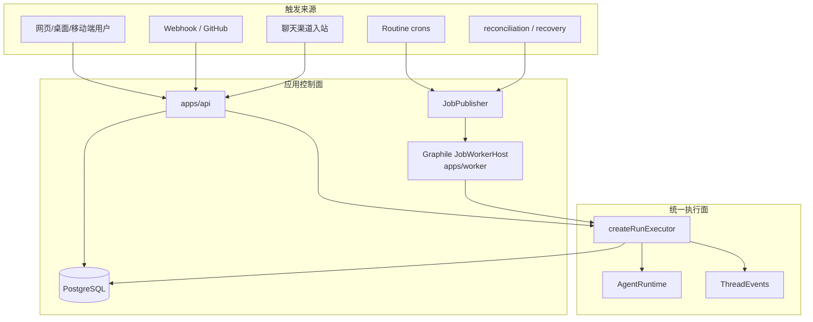
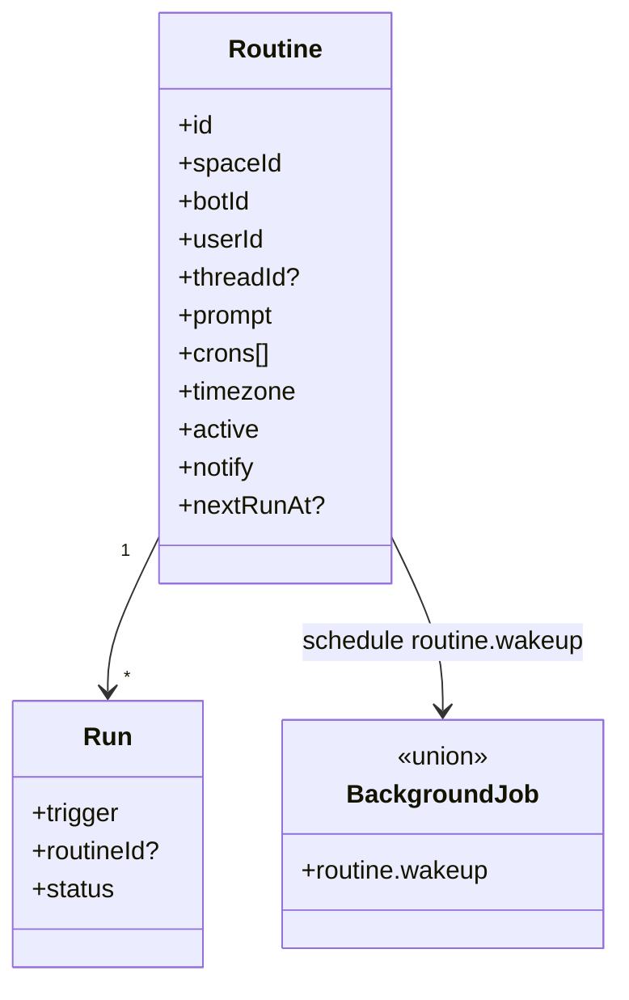
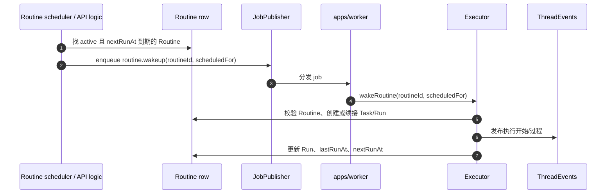
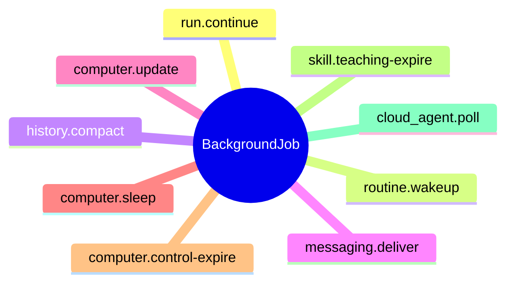
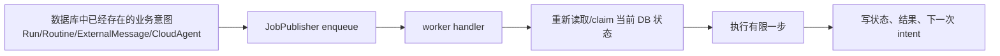
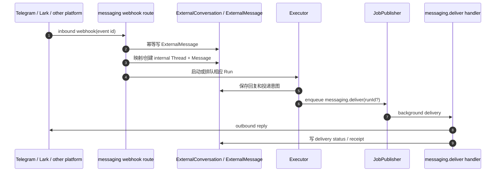
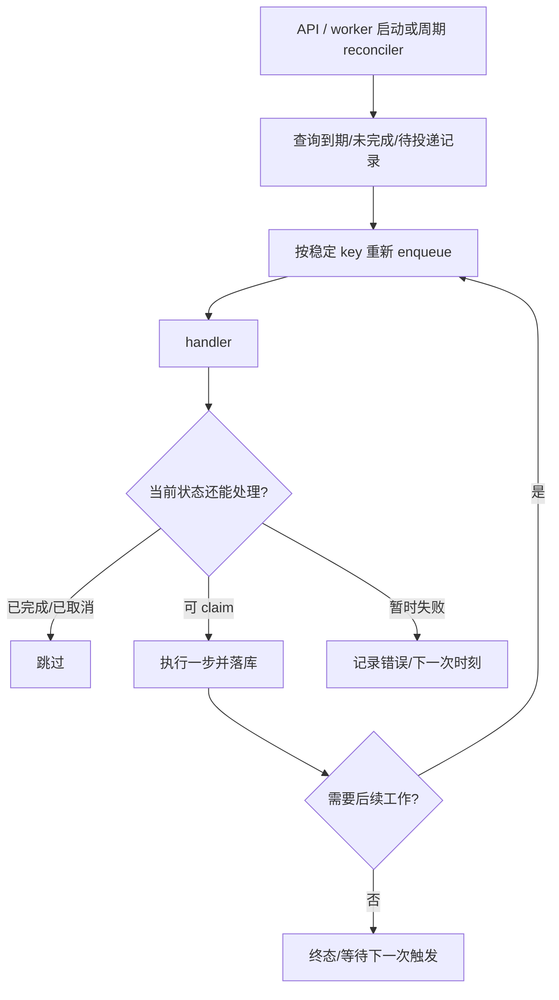

# 09. 例行任务、渠道与后台工作：Rakazo 如何在用户离开后继续做事

## 目录

- [1. 这块能力是什么](#what)
- [2. 总体架构：触发源不会直接调用模型](#architecture)
- [3. Routine：把计划变成可恢复 Run](#routine)
- [4. Background job：队列只传递意图，不取代数据库](#jobs)
- [5. 外部消息渠道：入站、出站与幂等](#messaging)
- [6. 重启、失败与 reconciliation](#recovery)
- [7. 本章小结](#summary)

## 1. 这块能力是什么

一个“持久化 AI 队友”不能只在用户开着网页、手工点击发送时工作。Rakazo 用 **Routine、消息渠道、Webhook、后台 job 和 worker** 将“未来应该做什么”保存为可恢复的业务意图，再把它转换为普通的 `Run` 生命周期。

核心思想是：**触发来源不同，执行内核相同。** 定时任务、用户消息、Webhook、外部聊天和恢复续跑最终都应落到可审计的 Run，而不是各自偷偷调用模型。

## 2. 总体架构：触发源不会直接调用模型

API 负责认证、webhook 验证、外部消息接入和用户即时交互；worker 负责延后/可重试工作。它们共享数据库中的 `Routine`、`Run`、`ExternalMessage` 等事实，并共用 executor，而不是各自实现不同的“Agent loop”。

## 3. Routine：把计划变成可恢复 Run

`Routine` 模型包含：Bot、用户、可选 Thread、名称、prompt、多个 cron、timezone、active、notify、webhook/GitHub 开关、可选消息 provider、模型 pin、`lastRunAt` 和 `nextRunAt`。

### 3.1 定时触发链路

`routine.wakeup` payload 明确带 `routineId` 和带 offset 的 `scheduledFor`。这比“worker 每分钟自己算当前时间就跑”更可审计：执行时可以判断本次工作对应哪一个预定时刻，也能利用 job key 控制重复排队。

### 3.2 Routine 不是绕过安全的后门

Routine 最终仍进入 executor、工具选择和 approval policy。尤其是无人触发路径会叠加更严格的工具审批规则；“用户曾经创建一个 routine”不等于无限授权 Bot 在未来做任意外部副作用。

## 4. Background job：队列只传递意图，不取代数据库

`@rakazo/adapter-kit/background-jobs.ts` 定义并 schema 校验的 job 类型包括：

为什么这么做：

- job payload 很小，只携带 ID/预定时间；业务事实仍以数据库为准；
- worker 执行前重新读取/claim，避免已取消、被其他 worker 处理或状态已改变的工作重复执行；
- enqueue 失败不必意味着意图丢失：相应记录仍可被 reconciliation 找到并重新入队；
- job schema 在 adapter-kit，API/worker 对同一 payload 合同达成一致。

## 5. 外部消息渠道：入站、出站与幂等

`ChatSdkMessagingSurface` 是聊天渠道适配面；`MessagingPlatform` 抽象特定平台。数据库用 `ExternalConversation`、`ExternalMessage`、`MessagingOutbound` 等对象保存外部世界与内部 Thread/Run 的映射。

### 5.1 为什么 `ExternalMessage` 有状态和 provider event ID

外部平台会重试 webhook，也可能在内部处理成功但出站回执迟到。`ExternalMessage` 通过 `(externalConversationId, providerEventId)` 唯一约束、状态、attempts、nextAttemptAt、lastError、runId、threadMessageId、deliveredAt 等字段，把“收到一条外部消息”从瞬时 HTTP 请求转为可重试的工作记录。

### 5.2 为什么出站必须走后台投递

模型/Run 结束并不等于渠道回复已送达。`messaging.deliver` 让出站投递脱离用户请求和模型流：网络临时失败可以重试，API 重启不必丢失回复，运行结果与渠道 delivery receipt 也能分别追踪。

## 6. 重启、失败与 reconciliation

典型例子：

- 用户释放 computer takeover 后，`run.continue` 可以恢复已暂停的 Run；
- 外部渠道投递未完成，`messaging.deliver` 可继续 drain；
- Routine 仍 active 且到期，`routine.wakeup` 可重新安排；
- 历史过长，`history.compact` 让压缩从交互路径移出；
- Cloud agent 仍需轮询，`cloud_agent.poll` 由 outbox/reconciler 重新驱动。

这不是“保证外部动作 exactly-once”，而是让系统对于每一步知道：已完成、已取消、可继续，还是结果不确定并应该停止重放。

## 7. 本章小结

Routine、外部消息、Webhook 与恢复逻辑并没有各自私有 Agent 流程。Rakazo 先把它们转为持久业务意图，再用受验证的后台 job 唤醒相同 executor。数据库保存事实，队列传递未来工作，worker 执行有限步骤，reconciliation 用于填补投递/进程故障留下的空洞。

[返回总览](./README.md) · [下一章：多 Bot、看板与 Cloud Agent](./10-collaboration-board-and-cloud-agents.md) · [回到顶部](#top)
