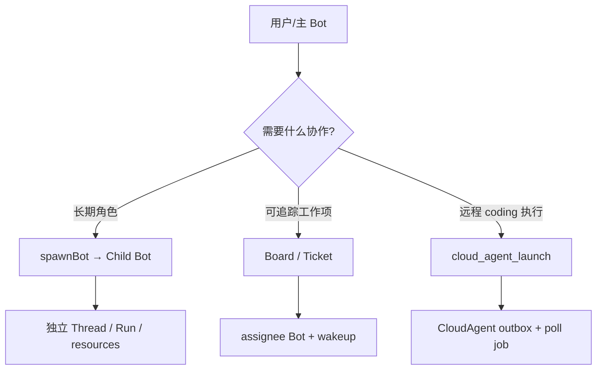
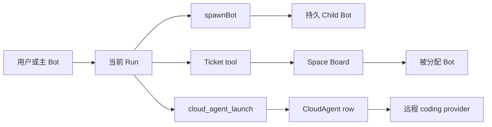
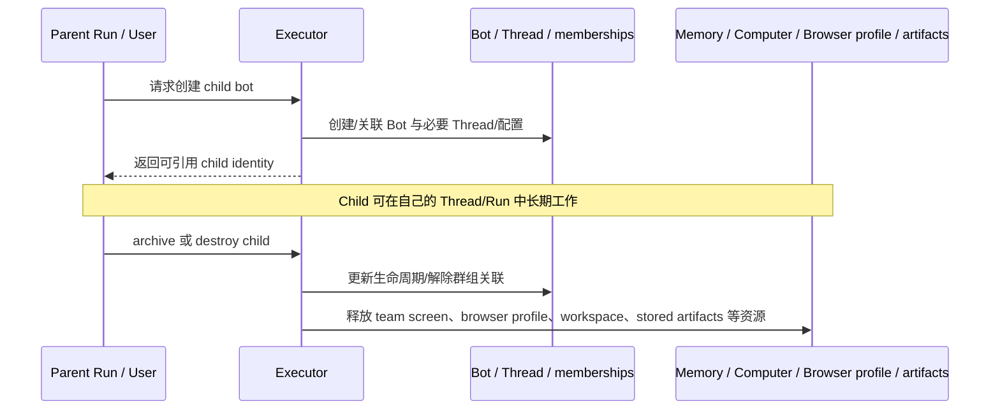
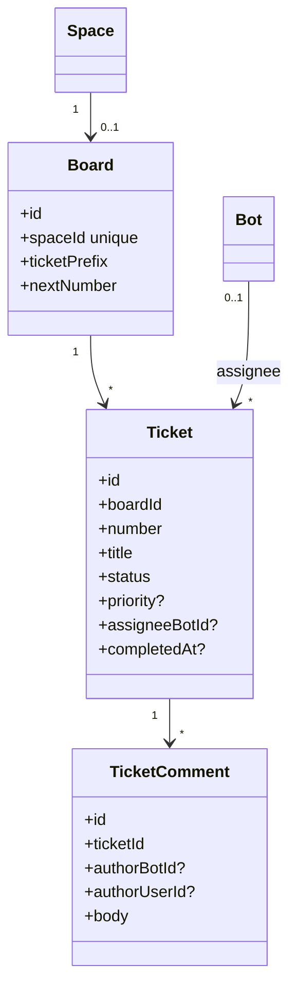
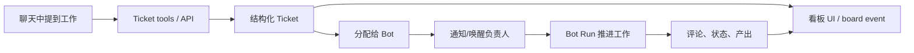
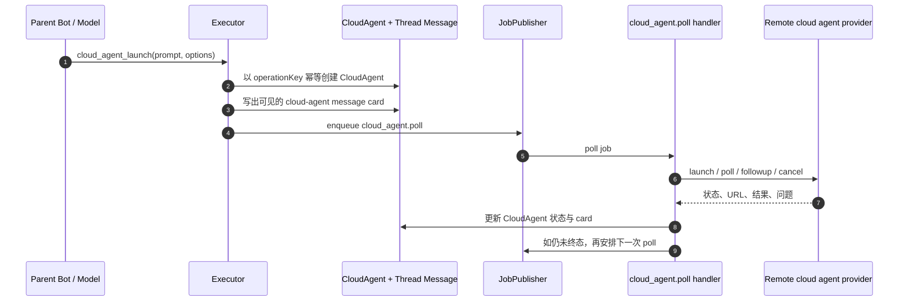
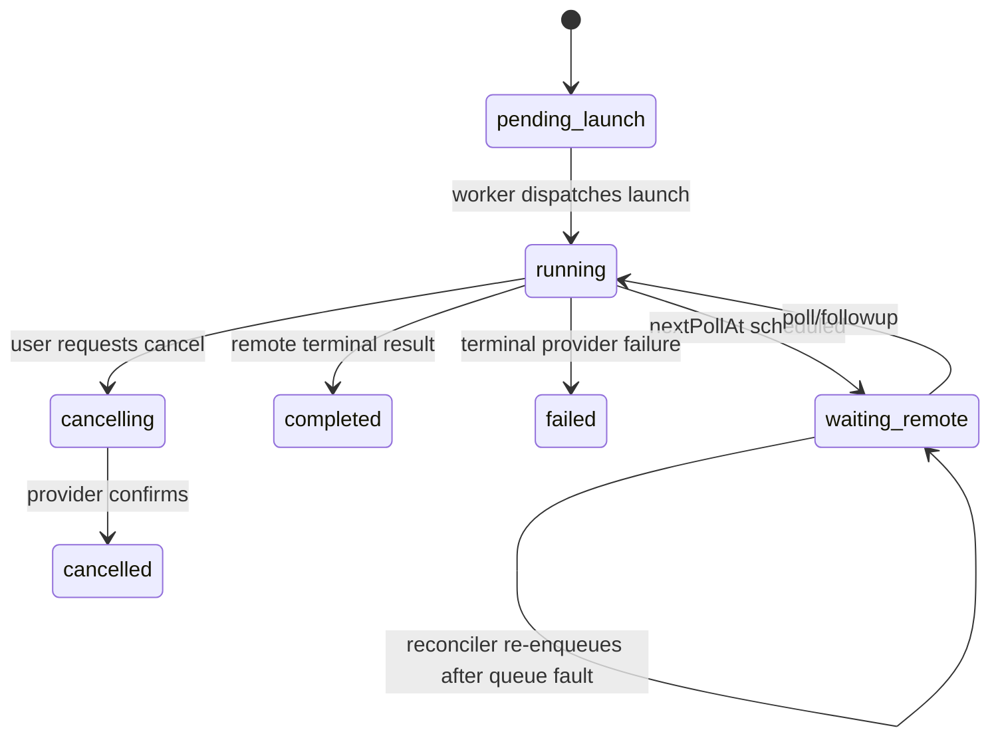
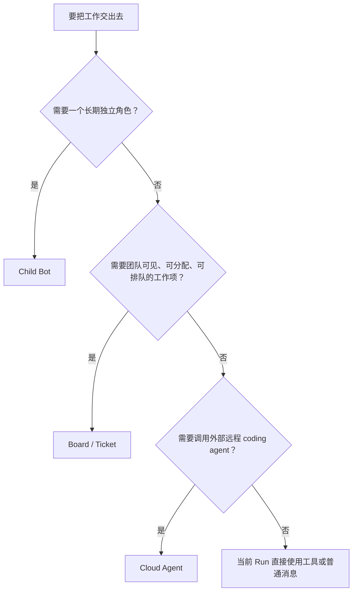

<a id="top"></a>

# 10. 多 Bot、看板与 Cloud Agent：从单个助手到可协作的工作系统

## 目录

- [1. 这三个模块分别解决什么](#what)
- [2. 协作全景：三种不同粒度的委派](#overview)
- [3. Child Bot：创建长期同伴，而非一次子调用](#child-bots)
- [4. Board / Ticket：把协作状态从聊天中拿出来](#board)
- [5. Ticket 变更如何唤醒负责人](#ticket-wake)
- [6. Cloud Agent：将远程编码工作做成 outbox 状态机](#cloud-agent)
- [7. 三种协作机制如何选择](#comparison)
- [8. 本章小结](#summary)

<a id="what"></a>
## 1. 这三个模块分别解决什么

“多 Agent”不是一个功能，而是不同生命周期的协作方式。Rakazo 源码至少表现出三种：

| 机制 | 想解决的问题 | 生命周期 | 代表对象 |
|---|---|---|---|
| Child Bot | 建立一个持续存在、有自己配置/会话/资源的同伴 | 长期 | `Bot`、`Thread`、skills、memory、computer 资源 |
| Board / Ticket | 让工作项、状态、归属、评论脱离聊天文本而结构化可见 | 持续到工作关闭 | `Board`、`Ticket`、`TicketComment` |
| Cloud Agent | 委派一次外部/远程 coding agent 工作，并轮询、回复或取消 | 一项远程操作的生命周期 | `CloudAgent`、`cloud_agent.poll`、外部 provider |



<a id="overview"></a>
## 2. 协作全景：三种不同粒度的委派



共同点：都应由后端保存归属和状态。不同点：

- Child Bot 的核心是“新增一个长生命周期的 Agent 主体”；
- Ticket 的核心是“把一个工作项公开、排队、分配、评论和完成”；
- Cloud Agent 的核心是“把一次外部异步执行转换为可轮询/可恢复的内部状态机”。

<a id="child-bots"></a>
## 3. Child Bot：创建长期同伴，而非一次子调用

`packages/adapters/src/child-bots.ts` 提供 `spawnBot()`、`archiveSpawnedBot()`、`archiveBot()` 与 `destroyBot()` 等生命周期函数。仅从这些函数和相关清理代码即可确定：Child Bot 不是只在内存存在的 function call，而是可归档、销毁并清理关联资源的持久实体。



### 3.1 为什么区分 archive 和 destroy

从文件中的 archive/destroy 分离、归档 memory directory、group detach、computer/browser/workspace/artifact cleanup 可以推断：

- **archive** 更偏向停止/隐藏但保留可恢复的历史或配置；
- **destroy** 需要跨多个资源边界做受控清理；
- 清理必须处理“资源可能已经被 provider 删除”的情况，不能假设所有远端环境都仍然存在。

<a id="board"></a>
## 4. Board / Ticket：把协作状态从聊天中拿出来

每个 Space 最多关联一个 `Board`（`spaceId` 唯一），Board 有名称、ticket prefix 与分配 ticket number 的 `nextNumber`；Ticket 有状态、优先级、创建者、可选 assignee Bot、完成时间与评论。





看板不是聊天记录的另一种展示皮肤。它提供稳定 ticket number、可查询状态、assignee、优先级和评论，使协作可见性不依赖模型是否在自然语言中提到“我已完成”。

<a id="ticket-wake"></a>
## 5. Ticket 变更如何唤醒负责人

`createTicketChangeNotifier()` 由 app composition root 创建，接收 `boardEvents`、`jobs`、`prisma` 和 ticket-board 开关；相关模块还包含 `ticket-wake.ts`、`ticket-changes.ts`、`ticket-context.ts` 与 `ticket-tools.ts`。

```mermaid
sequenceDiagram
  participant Actor as User / Bot
  participant API as Router / ticket tool
  participant DB as Ticket + TicketComment
  participant BE as BoardEvents
  participant N as TicketChangeNotifier
  participant J as JobPublisher
  participant Owner as Assignee Bot / Run

  Actor->>API: 创建/更新/评论/分配 Ticket
  API->>DB: 持久化结构化变更
  API->>BE: 发布 board change
  API->>N: 通知变更
  N->>J: 需要时安排 owner wake
  J->>Owner: 由统一执行面创建/继续工作
```

这条链路将“看板更新”变成事件和唤醒依据，而不要求用户再手工复制 ticket 内容给 Bot。最终是否真的启动一个 Run，仍由权限、当前繁忙状态和执行策略决定。

<a id="cloud-agent"></a>
## 6. Cloud Agent：将远程编码工作做成 outbox 状态机

Cloud agent 对接的是可选远程 coding agent provider，不是 Rakazo 自己的常驻 Bot。`cloudAgentLaunchSchema`、`cloudAgentReplySchema`、`executeCloudAgentTool()`、`enqueueCloudAgent()` 和 `reconcileCloudAgents()` 共同组成其实现骨架。



### 6.1 为什么数据库行就是 outbox

源码注释直说：**“The row is the outbox; queue failure leaves recoverable intent for the reconciler.”** 具体而言：

- `CloudAgent.operationKey` 用于幂等；同一 operation 不会因重试创建多个远程任务；
- 先持久化 CloudAgent/可见消息，再尝试 enqueue poll；
- enqueue 失败只意味着暂未唤醒 worker，不意味着意图消失；`reconcileCloudAgents()` 会查询 `nextPollAt` 已到期的记录重新入队；
- followup/cancel 也更新持久行并用 generation/version 降低并发更新错乱风险。



<a id="comparison"></a>
## 7. 三种协作机制如何选择



- 用 Child Bot 管理持久职责，不要把每项临时任务都变成新 Bot；
- 用 Ticket 表达可跟踪/可分配工作，不要让 chat 文本成为唯一看板；
- 用 Cloud Agent 承接外部 coding provider，不要把 provider 的轮询/重试细节泄漏到主 Bot 的 prompt；
- 这三者可以组合：Ticket 分配给 Bot，Bot 再启动 Cloud Agent，并将结果评论回 Ticket。

<a id="summary"></a>
## 8. 本章小结

Rakazo 的协作设计不是“多开几个模型窗口”。它为不同生命周期的协作提供不同状态载体：Child Bot 是长期主体，Ticket 是结构化工作项，CloudAgent 是可恢复的远端操作 outbox。它们通过数据库状态、事件、job 和统一 executor 连接，因此可以跨客户端、跨进程、跨重启继续运行。

[上一章：例行任务、渠道与后台](./09-routines-channels-and-background-work.md) · [返回总览](./README.md) · [回到顶部](#top)
