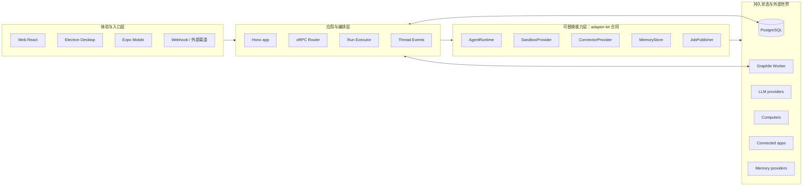
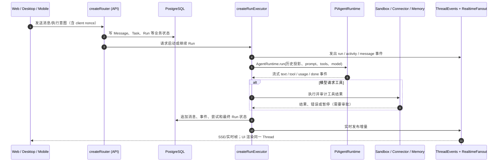

<a id="top"></a>

# Rakazo 设计原理：先理解产品，再进入源码

> **源码基线**：`/Users/gqli/work/deepagents/personal-agent/rakazo`  
> **分析提交**：`60684ee3c7de23486b2ecbbda904a0ba7478ea6e`（2026-10-15）  
> **文档状态**：第一轮源码设计整理；只分析源码，没有启动服务、访问真实凭据或修改 Rakazo 源码。

## 目录

- [0. 先给结论：Rakazo 是什么](#what)
- [1. 它能干什么：能力不是目录](#capabilities)
- [2. 它不是什​​么：边界与误解](#boundaries)
- [3. 整体架构：一张图先看懂](#architecture)
- [4. 如何阅读本套文档](#reading)
- [5. 文档导航](#navigation)
- [6. 源码证据与验证边界](#evidence)

<a id="what"></a>
## 0. 先给结论：Rakazo 是什么

**Rakazo 是一个可自托管、跨 Web / Electron 桌面端 / Expo 移动端的“持久化 AI 队友”产品。** 用户面对的是聊天；系统背后则把一个 Bot 的对话、长期记忆、定时例行任务、工具、计算机环境、外部应用连接、权限确认和执行历史组织成可以长期运行、可恢复的工作系统。

它不是“在网页里调用一次 LLM”的薄壳，也不只是一个 Agent SDK：

- **产品层**：用户创建或配置 Bot，在对话里交办工作、查看过程、接受结果，必要时接管计算机；
- **编排层**：`createRunExecutor()` 把一次工作转为可持久化的 `Task` / `Run` / `Attempt`，管理事件、审批、续跑和副作用；
- **运行时层**：默认 `PiAgentRuntime` 把模型流、工具调用、上下文压缩、steering（执行中插话）统一成事件流；
- **资源层**：通过稳定接口替换模型、沙箱计算机、MCP/OpenAPI/应用连接、记忆、后台队列和通知实现；
- **状态层**：PostgreSQL 保存业务事实，Graphile Worker 消费后台工作，SSE/实时 fanout 将线程事件推回各客户端。

```mermaid
flowchart TB
  U[用户 / 团队成员] --> C{客户端入口}
  C --> WEB[apps/web\nReact + Vite]
  C --> DESKTOP[apps/desktop\nElectron，承载 Web UI]
  C --> MOBILE[apps/mobile\nExpo]
  C --> EXT[外部消息渠道 / Webhook]

  WEB & DESKTOP & MOBILE --> API[apps/api\nHono + oRPC: createApp]
  EXT --> API
  API --> AUTH[@rakazo/auth\n身份与会话]
  API --> ROUTER[createRouter\n命令、查询、订阅]
  ROUTER --> EXEC[createRunExecutor\n工作编排器]

  EXEC --> RUNTIME[AgentRuntime\n默认 PiAgentRuntime]
  EXEC --> DB[(PostgreSQL + Prisma\n业务事实 / 线程 / Run)]
  EXEC --> EVENTS[ThreadEvents + RealtimeFanout\nSSE / 事件序列]
  EXEC --> JOBS[JobPublisher\nGraphile Worker 或内存队列]
  JOBS --> WORKER[apps/worker\nBackgroundJobHandlers]
  WORKER --> EXEC

  EXEC --> SANDBOX[SandboxProvider\nDocker / E2B / Daytona / CreateOS / Box…]
  EXEC --> TOOLS[ConnectorProvider\nMCP / OpenAPI / Composio / Pipedream]
  EXEC --> MEMORY[MemoryStore +\nSemanticMemoryProvider]
  EXEC --> CLOUD[CloudAgentConnection\n可选远程 coding agent]
  EXEC --> PUSH[ExpoPushProvider / 消息投递]

  RUNTIME --> MODEL[模型 / Pi 支持的提供方\nBYOK]
  EVENTS --> WEB & DESKTOP & MOBILE
```

**读图的关键**：客户端不直接操作模型或计算机；它们表达意图、渲染状态。真正决定一次工作如何授权、持久化、重试、恢复和调用外部能力的是 API 里的编排器与后台 worker。这也是项目 `AGENTS.md` 明确要求的前后端职责边界。

<a id="capabilities"></a>
## 1. 它能干什么：能力不是目录

| 用户看见的能力 | 系统实际协作的模块 | 结果为什么能持续存在 |
|---|---|---|
| 与一个或多个 Bot 持续聊天 | `Thread`、`Message`、`Run`，`createRouter()`、`createRunExecutor()` | 消息按 thread 的递增序列入库；执行过程以 `Event` 推送 |
| 让 Bot 读写文件、开网页、用终端或图形桌面 | `SandboxProvider`、computer/browser tool、`Computer` 与执行租约 | 计算机是受管理资源；同一屏幕/机器需要租约与接管语义 |
| 让 Bot 调用第三方应用 | `ConnectorProvider`、MCP、OpenAPI、Composio、Pipedream | 集成凭据/连接与一次实际外部副作用分离记录 |
| 执行中补充“等等，改成 B” | `SteeringMessage`、运行时 `claimSteering` | 插话是持久化待处理输入，不是仅前端临时文本 |
| 让 Bot 按时巡检或例行工作 | `Routine`、`routine.wakeup`、后台 worker | 定时唤醒以后台 job 入队；服务重启后仍可继续调度 |
| 记住长期事实、技能或工作资料 | `MemoryDocument` / `MemoryRevision`、`MarkdownMemoryStore`、`AgentSkill` | 长期记忆与模型短上下文/线程历史是三种不同的东西 |
| 需要时让人确认危险操作 | `ActionApprovalRule`、暂停 Run、审批/续跑 | 批准不是 UI 的“绿灯”；它会成为可审计的执行状态转换 |
| 从桌面、手机或网页进入同一套系统 | Web React、Electron 宿主、Expo App 都使用同一 API/合同 | 平台差异局限在原生权限、导航、存储和桌面宿主职责 |

<a id="boundaries"></a>
## 2. 它不是什​​么：边界与误解

1. **不是只有一个同步请求—响应回合。** `Run` 具有状态、租约、尝试记录、checkpoint、steering 和后台触发来源；请求可跨进程、跨客户端继续。
2. **不是把所有依赖写死在核心里的 vendor 集成。** `@rakazo/adapter-kit` 定义 `AgentRuntime`、`SandboxProvider`、`ConnectorProvider`、`MemoryStore`、`JobPublisher` 等边界；`@rakazo/adapters` 放具体实现和装配适配。
3. **不是“任意 Bot 永远有一台独占电脑”。** `Computer`、`ComputerExecutionLease`、屏幕控制与 Team/Private 语义说明计算机是受约束资源。
4. **不是将全部历史原样塞给模型。** 线程保留事件/消息事实；运行时再按本轮选择 history、提示词、工具与压缩策略。持久历史与模型请求投影不是同一个对象。
5. **不是用后台队列替代业务数据库。** 数据库记录事实和状态机；队列负责可投递的异步唤醒/投递，worker 再回到编排器完成状态转换。

<a id="architecture"></a>
## 3. 整体架构：一张图先看懂

### 3.1 四层，而非“前端 + 后端”两层



- **入口层**解决“用户从哪里用”：Web、Desktop、Mobile 与外部 webhook；Desktop 并不是另一套业务后端，而是 Electron 宿主 Web UI 并管理本地 stack/原生能力。
- **应用与编排层**解决“谁拥有流程”：`apps/api/src/app.ts::createApp()` 创建 auth、connector stack、runtime、executor、job handler、router 和 HTTP routes；`apps/worker/src/index.ts` 也装配 executor，但只消费后台任务。
- **可替换能力层**解决“如何不锁死供应商”：核心依赖接口，不直接依赖 Docker、某一家模型、某一家 MCP 目录或某个记忆服务。
- **状态/外部世界层**解决“事实保存在哪里、动作实际发生在哪”：PostgreSQL 是业务真相来源；模型、计算机、应用连接和消息/推送都可能是外部副作用边界。

### 3.2 “一条用户消息”贯穿全局的骨架



这只是骨架。重点不在“模型返回文本”，而在 **每一个阶段都能落下可恢复的状态，并将前端看到的过程变成线程事件**。

<a id="reading"></a>
## 4. 如何阅读本套文档

推荐顺序是：

1. 先读本页第 0～3 节，建立产品和全景图；
2. 再读 `01`，看“Bot、空间、线程、工作、运行”这些业务对象如何组成产品；
3. 读 `02`，沿一条真实消息→执行→工具→事件的时序追代码；
4. 读 `03`，理解持久化、后台 job、恢复、各端如何一致；
5. 最后读 `04`，查每个结论对应源码和本轮验证限制。

<a id="navigation"></a>
## 5. 文档导航

| 文档 | 首先回答什么 | 图 |
|---|---|---:|
| [01. 产品对象与全局架构](./01-product-positioning-and-global-architecture.md) | Bot、Space、Thread、Run 分别是什么；产品如何从用户语言落到系统实体 | 5 |
| [02. 一次工作如何运行](./02-core-execution-and-message-flow.md) | 一条消息如何创建 Run、驱动模型、调用工具、暂停/插话、回写事件 | 7 |
| [03. 状态、后台与多端一致性](./03-state-background-and-platforms.md) | 数据如何持久化；worker 做什么；Web/Desktop/Mobile 如何接入同一后端 | 6 |
| [04. 源码地图与验证](./04-source-map-and-verification.md) | 每个架构结论源自哪里；哪些已静态验证，哪些尚未运行验证 | 2 |
| [05. 上下文与记忆](./05-context-and-memory.md) | 哪些信息真的会给模型；历史选择、压缩、长期记忆如何区分 | 6 |
| [06. 计算机与沙箱](./06-computers-and-sandboxes.md) | Computer 是什么；Provider、租约、接管、恢复如何协作 | 6 |
| [07. 工具与集成](./07-tools-and-integrations.md) | MCP、OpenAPI、应用连接怎样成为可控工具 | 6 |
| [08. 权限、审批与副作用](./08-permissions-approvals-and-effects.md) | 什么操作需要确认；批准如何驱动一次安全的续跑 | 7 |
| [09. 例行任务、渠道与后台](./09-routines-channels-and-background-work.md) | 定时/外部消息如何变成可靠的 Run；后台队列如何恢复工作 | 7 |
| [10. 多 Bot、看板与 Cloud Agent](./10-collaboration-board-and-cloud-agents.md) | Bot 如何委派、以 Ticket 协作、编排远程 coding agent | 7 |

<a id="evidence"></a>
## 6. 源码证据与验证边界

本套文档以仓库 README、`AGENTS.md`、应用装配根、接口合同和 Prisma schema 为主证据；不以产品宣传页替代实现事实。详见 [04. 源码地图与验证](./04-source-map-and-verification.md)。

已完成：链接/锚点/Mermaid 围栏的静态检查。  
未声称完成：启动 Rakazo、连接真实模型、真实沙箱/第三方集成调用或端到端验证。

[回到顶部](#top)
