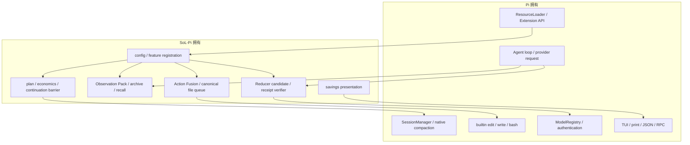
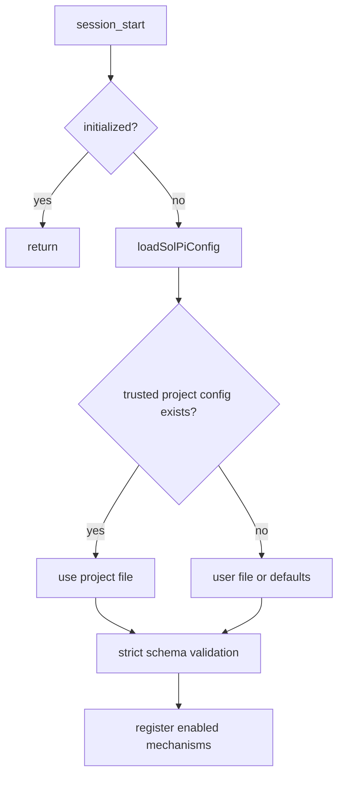
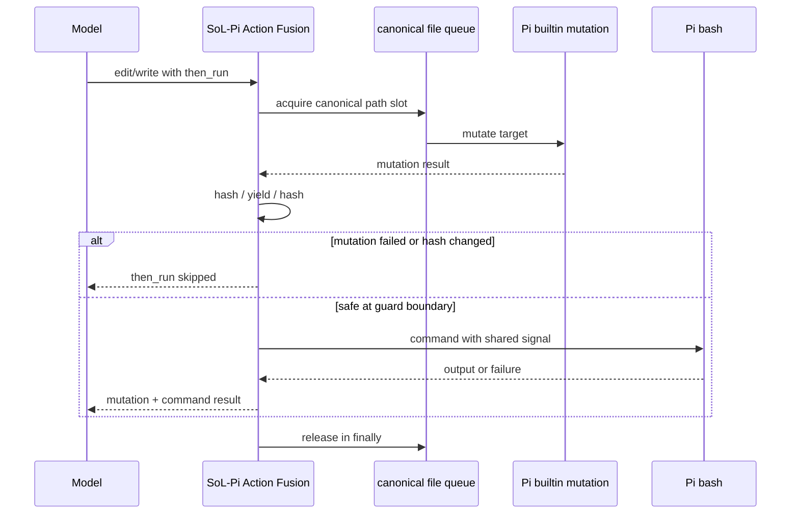
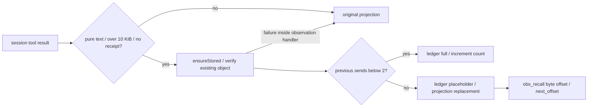
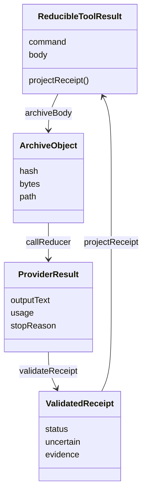
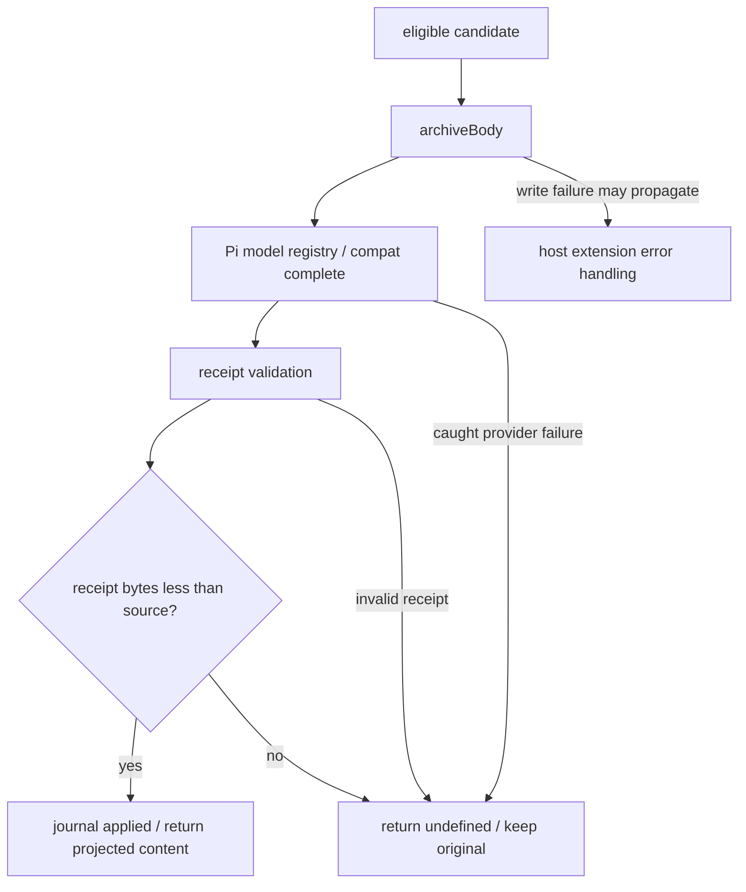
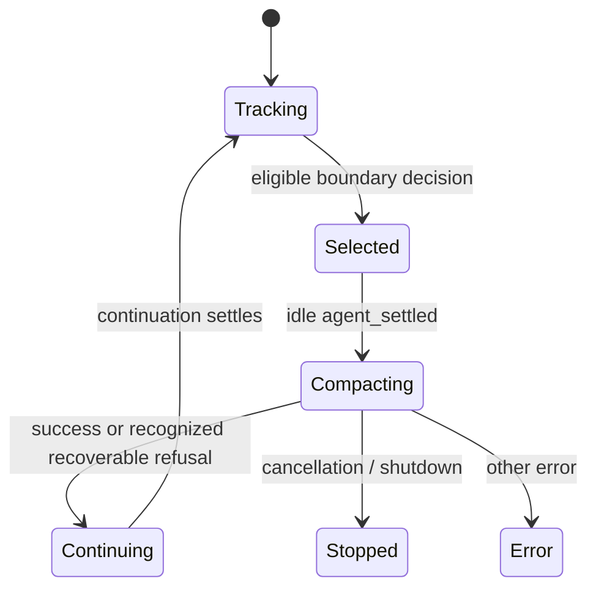
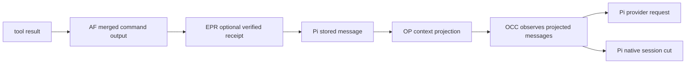

# SoL-Pi 自有能力、后端合同与源码深读

> 核对日期：2026-10-15；源码 HEAD：`06b3ee358ddc5cebc5fb21a8e7493fab2db508ce`；包版本 `0.1.0`。本文是原架构文档的追加校准，不替代原文。这里的“自有”指由 SoL-Pi 仓库实现和维护，不表示发明优先权或与用户组织的产权归属。

## 目录与大纲

1. [项目如何介绍自己](#1-项目如何介绍自己)
2. [Pi 与 SoL-Pi 的能力归属](#2-pi-与-sol-pi-的能力归属)
3. [注册、配置与生命周期](#3-注册配置与生命周期)
4. [Action Fusion：自己的队列和组合合同](#4-action-fusion自己的队列和组合合同)
5. [Observation Pack：自己的数据面](#5-observation-pack自己的数据面)
6. [Reducer：自己的证据验证后端](#6-reducer自己的证据验证后端)
7. [OCC：自己的调度和成本模型](#7-occ自己的调度和成本模型)
8. [跨机制协作与状态归属](#8-跨机制协作与状态归属)
9. [缺失内容与验收优先级](#9-缺失内容与验收优先级)
10. [源码与测试索引](#10-源码与测试索引)

入门读 1–3；开发读 4–8；评审读 9–10 和[覆盖记录](COVERAGE_AND_CHANGES.md)。既有长篇分析见 [ARCHITECTURE.md](ARCHITECTURE.md)，设计思路见 [DESIGN_THINKING_SERIES.md](DESIGN_THINKING_SERIES.md)。

## 1. 项目如何介绍自己

仓库 `package.json` 将自己定义为 **Standalone context and tool-efficiency extensions for Pi**。源码 README 的 Project Status 说明由 NVIDIA 开发维护；Acknowledgements 说明通过 Pi public extension interfaces 构建，不 vendor upstream Pi。官方介绍可从以下本地一手材料交叉核对：

- [源码 README](../../SoL-Pi/README.md)：定位、四机制、存储、开发和贡献方向。
- [Compatibility](../../SoL-Pi/docs/compatibility.md)：公开 API、生命周期、版本与集成测试。
- [Security](../../SoL-Pi/SECURITY.md)：宿主权限、远程日志归约、敏感数据。
- [package.json](../../SoL-Pi/package.json)：入口、依赖、版本、打包范围。

**一句话工程定位：SoL-Pi 不重新实现 Agent loop，而是在 Pi 执行与上下文边界上，减少可避免的模型往返和重复上下文，并让被压缩的工具证据仍可回读。**

不要将它介绍为独立 daemon、通用多代理框架、权限沙箱、向量数据库或新的模型 provider。本地文件和 session custom entries 是它的“后端”，不是 HTTP 服务。

### 1.1 四种“节省”不是同一种指标

| 机制 | 自己做的改变 | 可直接观察的量 | 不能直接推出 |
|---|---|---|---|
| Action Fusion | 文件修改与命令合成一次 tool result | 少一次分开请求命令的模型往返机会 | 所有任务都恰好省一次请求 |
| Observation Pack | 重复发送大结果变成 placeholder | 投影移除的字节/估算 token | 最终账单下降同等数值 |
| Reducer | 大诊断日志变成可验证 receipt | receipt 大小、nested usage、fallback | 摘要完整覆盖所有失败 |
| OCC | 合适边界调用原生压缩并续跑 | 上下文 token、决策 reason、cache debt | 缓存命中/实际价格一定满足模型 |

TUI `Money saved` 是展示文案，不是经过计费核算的金额。`cacheWriteReadRatio` 是配置策略输入，模型切换不会自动刷新该值。

## 2. Pi 与 SoL-Pi 的能力归属



| 责任 | Pi owner | SoL-Pi owner |
|---|---|---|
| 模型 turn 与工具调度 | AgentSession/loop | 注入钩子，不取代 loop |
| edit/write/bash 执行 | public tool definitions | 添加 then_run、文件级队列与 hash guard |
| session 树与原生摘要 | SessionManager/native compact | 决定何时压缩、提供 instructions、持久化 online state |
| provider 与密钥 | modelRegistry | 选 reducer route；调用宿主或 compat API |
| observation 历史 | session 中原有消息 | context projection、sidecar object、obs_recall |
| UI 模式 | Pi context/UI | 仅 TUI 模式显示节省提醒 |

宿主本地 `pi/` 可用于对照 API，但包实际测试 pin 为 Pi `0.85.1`；本地宿主 HEAD 与已安装 package 不自动等价。peerDependencies 使用 `*` 不代表所有未来版本兼容。

## 3. 注册、配置与生命周期

`index.ts` 在第一次 `session_start` 执行配置加载，按 Action Fusion → Observation Pack → Reducer → OCC 的顺序注册。这里没有后台服务启动，也没有运行时配置监听。



- 四个 feature 默认全部 `false`。没有配置不能理解为“四机制自动启用”。
- trusted project 文件替代 user 文件，**不合并**；可信项目判断属于宿主。
- 未知字段、非 boolean feature、错误版本、空 reducer route、非有限/负 ratio 均拒绝。
- 配置无独立环境变量，不放 API key、shell path、storage root 或 run id。
- initialized 先置 true 再加载；配置失败后不应假设同一 extension instance 会自动重试。

### 3.1 状态生命周期必须单独描述

runtimeRoot 使用安全 session id，持久模式为 `<sessionDir>/sol-pi/<sessionId>/`；无 session/in-memory 模式用 `mkdtempSync` 建私有临时目录，同进程同 session id 共用 root。目录保留供上游 worker 回读，不在 shutdown 自动删除。系统清理后不保证恢复。

[源码 runtime-paths.ts](../../SoL-Pi/src/sol-pi/runtime-paths.ts) 的 `temporaryRoots` 是进程内 Map，不是跨进程目录发现协议；仅复制 session JSONL 并不保证带上 OP/EPR sidecar。

## 4. Action Fusion：自己的队列和组合合同

`createActionFusionExtension` 使用 Pi public definitions 包装 edit/write，加 `then_run` schema，成功修改后再执行 bash，并返回一个合并结果。



### 4.1 为什么需要自己的 canonical queue

`file-queue.ts` 做 `@`、Unicode 空格、home、file URL、Windows shell drive 路径规范化；对未创建文件沿祖先 realpath 再补缺失路径。队列 key 不是模型传入字符串，避免别名路径绕过串行化。

```typescript
// withFusedFileQueue 的局部摘录；previous 是同 canonical path 的前一任务。
await previous;
try {
    return await work();
} finally {
    release(); // 失败也解除下一位，不让 rejected work 永久堵塞队列。
    if (queueTails.get(key) === tail) queueTails.delete(key);
}
```

Pi 自身 mutation queue 仍存在；SoL-Pi 不修改它、不把两个 queue 嵌套持锁。SoL-Pi 的 slot 覆盖 mutation + follow-up，但只保证**同进程、同 canonical file 的 fused operations**。

### 4.2 不变量与限制

- 修改失败：命令不执行，带 `[then_run:skipped]`。
- 命令失败：修改保留，带 `[then_run:failed]`；不是跨文件/命令事务，不 rollback。
- 成功：带 `[then_run:succeeded]`，不是对项目整体正确性的认证。
- timeout 单位秒，未指定时没有默认 timeout。
- 双 hash 检查只探测读取之间的内容改变，不是 OS 文件锁；guard 后仍可能被外部进程改写。
- 文件级 slot 不锁住命令访问的其他文件，也不提供跨进程项目一致性。

### 4.3 融合输出与 Reducer 的边界

`then-run.ts` 将 bash text 拼进 mutation result，但不复制 bashResult.details。Reducer 对 standalone bash 可用 `details.fullOutputPath` 读完整输出；融合结果主要通过 marker 和 text 中的 Full output 路径识别。建议补一条真实“超长融合输出 → receipt”集成测试，确认该路径在成功/失败时都保留；目前只据静态数据流不能宣称所有融合日志必然完整可读。

## 5. Observation Pack：自己的数据面

它在 `context` 改 provider-visible projection，不修改 session 历史。大于 10 KiB 的 pure text tool result 首两次完整发送，以后 placeholder；receipt 已归约，主动排除再次 packing。



### 5.1 id、完整性和分页

id 为 `obs_` 加 24 hex，来自 tool name、tool call id、content hash 的组合；同内容不同 call 不一定同 id。已有 object 检查 regular file、size 与 hash；创建/读取使用 `O_NOFOLLOW`，拒绝 object symlink，并检查当前 objects directory。

Recall 总输出硬上限 16 KiB/400 行，给 header 留预算；`next_offset` 是 byte offset，不是 JS 字符 index。实现修正分页尾部 UTF-8 边界；调用方应沿返回 offset 分页，不手工用字符长度计算。任意手填 offset 是否处于 UTF-8 字符起点仍值得专项测试。

### 5.2 三种状态，不是一份 ledger

| 状态 | owner | 恢复语义 |
|---|---|---|
| 原始 tool message | Pi session | 未就地改写 |
| sentCounts | extension Map | 当前进程；缺失时用后续 assistant 数补偿 |
| object / ledger.jsonl | SoL-Pi files | object 回读；ledger 是操作记录，不是 sentCounts 自动恢复源 |

归档成功、ledger 写成功后才替换投影。`obs_recall` 同样 await ledger 写入，所以 ledger 失败可能使回读工具报错，即使 object 可读。

### 5.3 “fail-open”必须精确到作用域

单 observation 的存储/ledger 错误有 catch，保留其原 projection。但 context handler 的 `runtimeRoot(ctx)` 在该循环 catch 之外，不能声称所有初始化错误都 fail-open。落盘代码不提供 fsync/事务声明；“可回读”不等于“掉电后强持久”。

## 6. Reducer：自己的证据验证后端

EPR 不把维修权交给第二个 agent；nested model 仅提取引用，frontier agent 仍诊断、修复、重跑和判断结果。它自己的后端是 candidate → archive → provider adapter → receipt verifier → journal。



图中是 TypeScript 数据接口及函数关系，不是有状态 service class。

### 6.1 Candidate 和隐私边界

只考虑 bash 或带 then_run marker 的 edit/write；命令匹配 diagnostic regex，body 至少 4096 bytes、最多 600000 JS chars。likely-secret 命中不远程委托。secret detector 是启发式防线，不是完整 DLP。

对超长日志只允许读取 OS tmp root 下 regular、非 symlink 的 `pi-bash-*.log`；检查后再 read 的时差不等于零 TOCTOU。归档路径为内容 hash 分片 objects 文件，`wx` 创建；EEXIST 要比较内容和 hash。

### 6.2 Receipt 为什么可信、又在哪些方面不可信

验证 schema、source hash、observed isError 对应的 status、uncertain 类型、最多 12 个 evidence、每条最多 600 chars，quote 必须 `body.includes(quote)`。失败日志含 failure signal 时要求至少 fatal/failure evidence。重复 kind+quote 去重，line number 取首次出现。

```typescript
// receipt.ts 局部条件：约束引用真实性，而不是证明诊断完整性。
if (typeof quote !== "string" || quote.length < 1 ||
    quote.length > MAX_QUOTE_CHARS || !body.includes(quote)) {
    return { ok: false, reason: "unverifiable-quote" };
}
```

实际验证基于读取后的 UTF-8 text/JS substring，不应无限扩大为任意二进制字节证明。“引用确实出现”不证明 evidence kind 分类、因果结论或遗漏部分没有故障。prompt 中的 lossless 是职责期望，不是整体信息无损保证。

### 6.3 接受和降级



provider 支持 registry.complete，旧 API 则 getApiKeyAndHeaders + compatComplete；密钥仍由 Pi 管理。内部 timeout 90000ms、输出上限 2048 tokens，并清理 abort relay/timer。回传保留 event.isError。

**不是所有错误都在 SoL-Pi 层被吞掉**：archiveBody 和多个 journal 调用在 provider catch 之外；其失败可能传播到宿主。需要真实 Pi 磁盘失败测试确认宿主行为，不能沿用笼统“全链路 fail-open”。

## 7. OCC：自己的调度和成本模型

OCC 的自有部分是 `update_plan`、boundary 统计、projection 定价、cache debt、触发选择与自动 continuation；真正的摘要和 session cut 由 Pi native compaction 做。

### 7.1 模型是 token-equivalent 启发式，不是财务账本

令 A=archiveTokens、M=memoTokens、W=writeTokens、R=cacheWriteReadRatio：

```text
savingTokens = A - M
postCompactionTokens = max(0, W - savingTokens)
incrementalCacheCostRatio = max(0, R - 1)
newDebtTokens = postCompactionTokens * incrementalCacheCostRatio
breakevenRequests = newDebtTokens / savingTokens
combinedBreakevenRequests = (carriedDebt + newDebt) / (priorRepayment + savingTokens)
```

只有正 saving 才允许 compact；预估 horizon 从完成 plan boundaries 的 request count 和剩余 boundaries 推导，并受窗口增长上界约束。首次 horizon scale=2，后续 margin=1.5，最少间隔 2 次 provider requests；窗口保护 reserve=16384 tokens，近窗口时可越过经济 cooldown。

这没有读取 model price metadata，也不保证 provider 缓存稳定命中。native archive 不可切时还会覆写决策为 `native_not_compactable`。

### 7.2 关键生命周期

```mermaid
sequenceDiagram
  participant Loop as Pi run loop
  participant OCC as SoL-Pi OCC
  participant Native as Pi native compact
  Loop->>OCC: turn_end / completed plan boundary
  OCC->>OCC: price projected context / select decision
  OCC->>Loop: context.abort()
  Loop->>OCC: agent_settled
  OCC->>Native: compact(customInstructions, callbacks)
  Note over OCC: compactionInFlight blocks tree navigation
  Native-->>OCC: onComplete or onError
  OCC->>Loop: hidden reminder + triggerTurn
  alt Pi starts turn synchronously
    OCC->>OCC: await continuation settlement barrier
  else host defers until handler returns
    OCC-->>Loop: return control to host
  end
```

print/JSON 不应在自动续跑完成前被外层 prompt 提前收尾；sendMessage 在 Pi 0.85.1 不返回 continuation Promise，因此 barrier 是 SoL-Pi 自己负责的 lifecycle 适配。

### 7.3 跳过、取消与状态恢复



`Nothing to compact (session too small)`、`Already compacted` 和明确 incomplete-summary token-cap 错误可恢复并续跑；skipped entry 不记新 compaction/cache debt。其他 error 传播；取消或退出不自动继续。plan-only turns 不能无限重试，需要 non-plan 成功工具工作或新 user input。

状态从当前 branch 最新合法 `sol-pi-online-context-state-v1` custom entry 恢复；切树重新 restore 并清掉 transient selection/projected messages。`session_before_tree` 在压缩中拒绝导航，避免 leaf 移动。

## 8. 跨机制协作与状态归属



这是启用四机制时的概念数据流，具体 event 顺序由 Pi API 决定。EPR receipt 被 OP 排除；OCC 用 provider-visible projection 估成本，但 native cut 仍沿 session entries，不能把 pack 移除的内容重复计费。

| 数据/状态 | 文件或内存位置 | 所属方 | 不变量 |
|---|---|---|---|
| canonical queue | module Map | SoL-Pi | finally release，不是跨进程锁 |
| full sends | sentCounts Map | SoL-Pi | 恢复时 assistant count 仅补偿 |
| observation | observation-pack/objects | SoL-Pi | object 完整后才 pack |
| OP operation ledger | observation-pack/ledger.jsonl | SoL-Pi | append 记录，不是交易日志 |
| reducer body | evidence-preserving-reducer/objects | SoL-Pi | hash identity / exact text readback |
| reducer journal | Pi custom entries | SoL-Pi 经宿主 | 不进 LLM context |
| online state | Pi custom entries | SoL-Pi 经宿主 | version/epoch/branch-aware restore |
| plan/compaction transient | closure state | SoL-Pi | 不直接当作重启恢复来源 |

### 8.1 备份与运维合同

持久 session 要连同 sidecar 目录备份。清理对象前应确认是否有 placeholder/receipt 仍引用它；当前没有自动 reference-aware GC。无 session 模式不是“完全无落盘”：OP/EPR 为 exact recall 仍写 tmp archive。

SoL-Pi 与宿主同权限，不隔离 filesystem/process/network。权限、安全策略和远程日志允许范围不能只依赖模型提示。

## 9. 缺失内容与验收优先级

原文已经详细覆盖机制动机与算法，本轮真正新增的是 owner 边界、可运维的状态合同和证据强度，而不是重复写四机制介绍。

| 优先级 | 缺口类型 | 静态证据/限制 | 建议验收 |
|---|---|---|---|
| P1 | 错误合同需校准 | EPR archive/journal 并非全被 catch；OP root 在循环 catch 外 | ENOSPC/EACCES/journal failure 不丢原结果，明确宿主错误反馈 |
| P1 | durability 规范缺失 | object/ledger 无明确 fsync/事务实现 | 写入中断、部分文件、恢复/重试矩阵 |
| P1 | 完整融合日志 | AF 不复制 bash details，EPR 也可从 inline path 读 | 超长 fused 成功与失败输出都回读完整源 |
| P1 | 安全声明易扩大 | SoL-Pi 同宿主权限；secret regex 是启发式 | 网络禁用场景；secret corpus；不宣称 DLP/sandbox |
| P2 | artifact retention | tmp/object 保留，缺引用感知 GC | quota、保留期、可恢复备份导出方案 |
| P2 | 宿主组合兼容 | later-loaded async agent_settled extension 会改变调度 | 同时加载第三方 extension 的 continuation/exit 测试 |
| P2 | 省钱口径 | TUI 是避免量；ratio 固定 | baseline/quality、nested token、recall、cache miss、wall time 一起统计 |
| P2 | schema 演进 | config/online/receipt 各 version 1 | 旧版本恢复、未知字段、迁移/回滚策略 |

以上是待验收问题，不等于已证实漏洞。已有 path/recovery/stress tests 不能忽略；但文件名和仓库记录也不能当作本轮测试通过。

### 9.1 建议基准方案（未执行）

固定 Pi/provider/model、任务 corpus 与缓存条件，对 baseline、各单机制、四机制组合做消融。至少记录主模型 usage、nested reducer usage、recall 请求、成功率、错误诊断保真、延迟、archive 磁盘占用。将截断/大日志/多轮失败/中途纠正/多次压缩分层；不要只用 context token removed 作最终收益。

## 10. 源码与测试索引

| 主题 | 源码 | 对应测试入口（不代表本轮已运行） |
|---|---|---|
| 注册/config | [index.ts](../../SoL-Pi/src/sol-pi/index.ts)、[config.ts](../../SoL-Pi/src/sol-pi/config.ts) | [all-mechanisms](../../SoL-Pi/tests/all-mechanisms.test.ts)、[config](../../SoL-Pi/tests/config.test.ts) |
| AF | [then-run.ts](../../SoL-Pi/src/sol-pi/extensions/action-fusion/then-run.ts)、[file-queue.ts](../../SoL-Pi/src/sol-pi/extensions/action-fusion/file-queue.ts) | [action-fusion-paths](../../SoL-Pi/tests/action-fusion-paths.test.ts) |
| OP | [observation.ts](../../SoL-Pi/src/sol-pi/extensions/observation-pack/observation.ts)、[index.ts](../../SoL-Pi/src/sol-pi/extensions/observation-pack/index.ts) | [observation-pack](../../SoL-Pi/tests/observation-pack.test.ts) |
| EPR | [candidate.ts](../../SoL-Pi/src/sol-pi/extensions/evidence-preserving-reducer/candidate.ts)、[receipt.ts](../../SoL-Pi/src/sol-pi/extensions/evidence-preserving-reducer/receipt.ts)、[archive.ts](../../SoL-Pi/src/sol-pi/extensions/evidence-preserving-reducer/archive.ts) | [evidence-preserving-reducer](../../SoL-Pi/tests/evidence-preserving-reducer.test.ts) |
| OCC | [extension.ts](../../SoL-Pi/src/sol-pi/extensions/online-context-compact/extension.ts)、[economics.ts](../../SoL-Pi/src/sol-pi/extensions/online-context-compact/economics.ts)、[state.ts](../../SoL-Pi/src/sol-pi/extensions/online-context-compact/state.ts) | [agent-session](../../SoL-Pi/tests/online-context-compact-agent-session.test.ts)、[recovery](../../SoL-Pi/tests/online-context-compact-recovery.test.ts) |
| storage/TUI | [runtime-paths.ts](../../SoL-Pi/src/sol-pi/runtime-paths.ts)、[tui.ts](../../SoL-Pi/src/sol-pi/tui.ts) | [runtime-paths](../../SoL-Pi/tests/runtime-paths.test.ts)、[tui](../../SoL-Pi/tests/tui.test.ts) |

### 本轮总结

SoL-Pi 的特色不是拥有独立 agent engine，而是**在不修改宿主的条件下，自行实现工具组合、证据外置、可验引用归约和边界驱动压缩续跑**。这些功能的价值与可靠性最终取决于 Pi API、sidecar 完整性、生命周期组合测试和真实成本/质量基准。验证状态详见[覆盖记录](COVERAGE_AND_CHANGES.md)。
