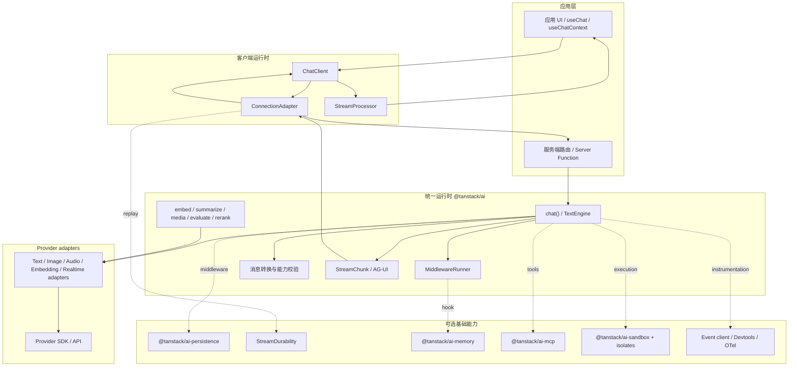
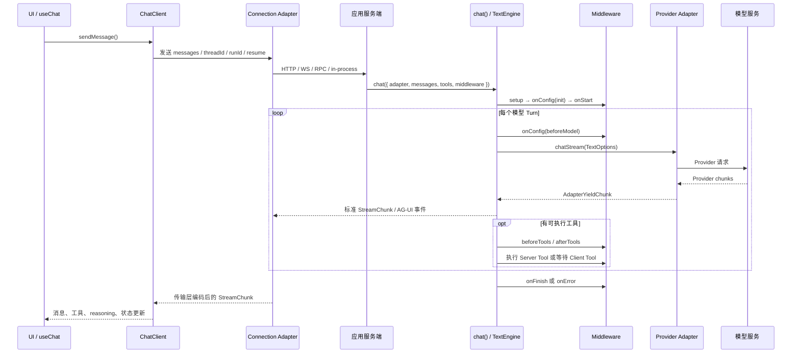

# 01. 系统架构总览

## 先看清调用链

TanStack AI 的核心不是某个框架 Hook，而是一条可替换的端到端数据路径：应用选择 Provider Adapter，服务端 `chat()` 驱动模型和工具循环，事件经连接层到达无头 ChatClient，框架集成再把客户端状态映射为响应式 UI。

## 分层和所有权

| 层 | 主要模块 | 拥有的职责 | 不负责什么 |
|---|---|---|---|
| 应用层 | 路由、认证、业务工具、UI | 鉴权、业务数据访问、业务授权、页面布局 | 不应把供应商事件格式暴露到 UI |
| Provider 层 | `@tanstack/ai-openai`、`ai-anthropic` 等 | 调用供应商 SDK/API，把输入和流转换到 Adapter 契约 | 不拥有线程 transcript 或 UI 状态 |
| Core Runtime | `@tanstack/ai` | `chat()` 循环、活动入口、Schema 校验、Middleware、统一事件和消息转换 | 不强制指定 UI 框架、数据库或部署平台 |
| Client Runtime | `@tanstack/ai-client` | 连接、增量事件处理、UIMessage、队列、interrupt、取消与恢复 | 不负责 server-side 鉴权或数据库隔离 |
| Framework Bindings | `ai-react`、`ai-vue` 等 | 把无头状态订阅接入响应式框架，可提供可选 UI 子路径 | 不重复实现 Provider 协议和 Agent Loop |
| Optional capabilities | persistence、memory、MCP、sandbox、devtools | 以包、Middleware、Adapter 或 Store Contract 提供附加能力 | 不应与 Core 生命周期混为一个“巨型 Agent 类” |

## 一次 Chat 的主路径

关键事实：

- `chat()` 返回 `AsyncIterable<StreamChunk>`，并非固定的 `Response`。HTTP 边界由 `toServerSentEventsResponse()`、`toHttpResponse()` 等封装器建立。
- Provider Adapter 的流不是应用协议。Core 负责转换为公共 `StreamChunk`，Provider 可替换而客户端消费协议不变。
- Framework Hook 是 Client Runtime 的薄绑定。直接使用 `ChatClient` 或自定义 `ConnectionAdapter` 不需要 React 等框架。
- Tool / Persistence / Memory 等功能接入同一个运行生命周期，但所有权并不相同：工具属于应用能力；Store 属于宿主持久化；记忆由独立 Memory Adapter 提供。

## 核心实体边界

| 实体 | 典型字段 | 生命周期 / 所属层 | 不要混淆 |
|---|---|---|---|
| `threadId` | 稳定对话身份 | 应用和客户端跨 Run 使用；存储层按 Scope 授权 | 它只是标识符，不是用户身份或访问凭证 |
| `runId` | 单次 Agent/Chat 执行身份 | 每次请求的事件关联键 | 不等于 Thread，也不等于传输恢复 offset |
| `parentRunId` | 被续接/中断的 Run | 中断恢复、子执行关联 | 新 Run 的 ID 通常不同于被中断的 Run ID |
| `ModelMessage` | role、content、toolCalls、thinking 等 | 面向模型的对话输入/历史 | 不是流事件，也未必等同于 UI 表示 |
| `UIMessage` | id、role、parts、metadata | 客户端渲染、持久化/恢复转换 | 不直接等同于某个 Provider 的消息格式 |
| `StreamChunk` | `type`、增量字段、`threadId`/`runId` | 单次运行的事件 | 它不是完整 transcript |
| Interrupt | descriptor、schema、correlation | 一次暂停和后续续接 | 不是传输 offset；即使无存储也可进行临时恢复 |
| Delivery offset | Durable Stream 自有的不透明游标 | 流重放 / 客户端重连 | 不是消息 ID、Run ID 或业务状态版本 |

## 产品边界：用与不用

适合：需要统一多个模型 Provider、流式 Chat、工具调用、类型化客户端、多种传输，或希望按需引入 Memory、Persistence、MCP、Sandbox 等能力的 TypeScript 应用。

不适合把它理解成：

- 一个默认托管数据库、用户系统、对话记录服务或云端 Agent 平台。
- 一个必须使用 TanStack Router/Start 或必须采用官方 Chat UI 的框架。
- 一个自动替应用实现权限审批、租户隔离或业务幂等性的安全层。
- 一个长期记忆产品。`ai-memory` 是适配能力；具体记忆服务仍由对应 Provider/宿主负责。

## 运行时的重要不变量

1. **协议收敛在 Core**：供应商差异放在 Adapter；跨网络事件使用 `StreamChunk`/AG-UI。
2. **能力显式声明**：Provider 的模型能力参与类型检查；Middleware 的 Capability 用于声明和验证运行时依赖。
3. **线程安全由宿主完成**：读取/保存线程必须将客户端 Thread 标识与服务端可信用户/租户身份绑定。
4. **功能按层可替换**：连接方式、Provider、Store、Framework UI 可以独立变化。
5. **恢复有不同语义**：中断续接重放业务执行；流恢复重放交付事件。实现一种不能自动获得另一种保证。

## 源码入口

- Core 公共导出：[ `packages/ai/src/index.ts`](../../ai/packages/ai/src/index.ts)
- Adapter 接口：[ `activities/chat/adapter.ts`](../../ai/packages/ai/src/activities/chat/adapter.ts)
- TextEngine：[ `activities/chat/index.ts`](../../ai/packages/ai/src/activities/chat/index.ts)
- Middleware 类型：[ `activities/chat/middleware/types.ts`](../../ai/packages/ai/src/activities/chat/middleware/types.ts)
- Public event types：[ `packages/ai/src/types.ts`](../../ai/packages/ai/src/types.ts)
- ChatClient：[ `packages/ai-client/src/chat-client.ts`](../../ai/packages/ai-client/src/chat-client.ts)

---

下一步：沿 [03-Chat运行时与中间件](./03-Chat运行时与中间件.md) 核对 `TextEngine.run()` 的每个阶段。
