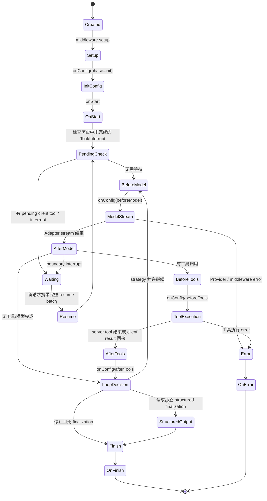
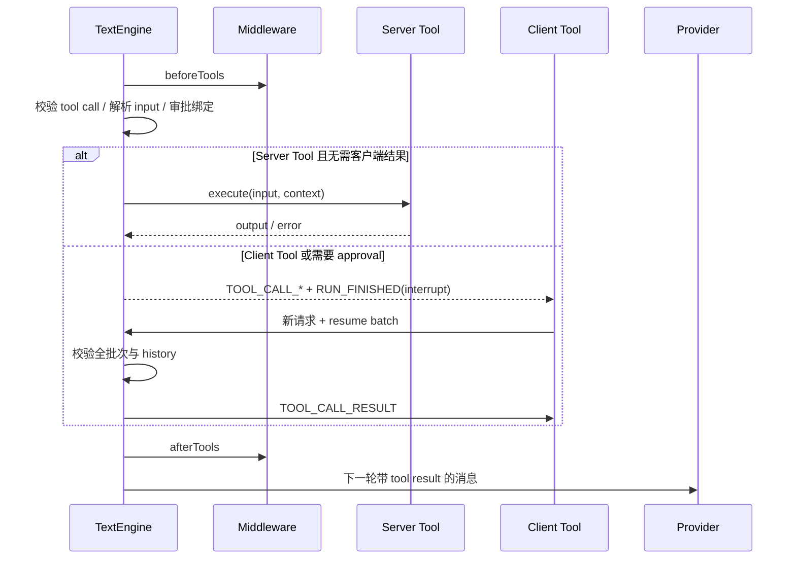

# 03. Chat 运行时与中间件

## 先回答“一个请求里到底发生什么”

`chat()` 是一个异步事件源。真正的执行器是 `TextEngine`：它维护本次运行的消息、工具、迭代计数、终止状态、interrupt resume、middleware 上下文和事件缓冲，然后按模型 Turn 推进 Agentic Cycle。

源码主入口：

- [`packages/ai/src/activities/chat/index.ts`](../../ai/packages/ai/src/activities/chat/index.ts)
- `TextEngine.run()`：初始化、中间件、Agent Loop、Structured Output、终止 Hook
- `streamModelResponse()`：调用 Adapter，读取并归一化 Provider chunks
- `processToolCalls()` / `executeToolCalls()`：工具调度、服务端执行或等待客户端
- `activities/chat/stream/processor.ts`：客户端/服务端对增量事件的消息化处理

## 生命周期状态机



## `TextEngine.run()` 的真实阶段

### 1. `beforeRun()` 和上下文初始化

引擎解析：

- `threadId`、`runId`、可选 `parentRunId`。
- `AbortSignal`、请求和流身份。
- 初始 `ModelMessage` / `UIMessage`，并把客户端已有的 approval/tool result 提取为 resume 输入。
- Adapter、Tools、Interrupt definitions、Lazy Tool Manager、Agent loop strategy。
- `MiddlewareRunner` 与 `ChatMiddlewareContext`。

`ChatMiddlewareContext` 是所有 middleware 的共享上下文。除 ID、phase、iteration、chunkIndex、signal 外，还能携带 runtime `context`、capabilities、`emitCustomEvent()`、deferred side effects 和 persistence seam。

### 2. Setup 与初始配置

运行 `middleware.setup`，让 middleware 提供 Capability、Persistence、Metadata、Interrupt Store 或 Sandbox runtime。然后执行 `onConfig(phase='init')`，允许 middleware 修改本轮的系统提示、工具、model options、metadata 等配置。

之后应用临时 resume 和 Durable Generic Interrupt resolution，再执行 `onStart`。`onStart` 是“运行已进入生命周期”的边界，Devtools 通常在这里发送 request started 和初始消息；Persistence 也常在此处保存完整 transcript 的起点。

### 3. Pending 状态检查

引擎在开始调用模型之前检查历史里的未完成 Tool Call、Client Tool Result 和 Interrupt。这个检查避免重放已经完成的服务端工具，也避免在等待客户端决策时误调用 Provider。

如果必须等待，引擎直接产生带 `RUN_FINISHED.outcome` 的 interrupt terminal；下一次请求必须带 `parentRunId`、当前消息历史和完整的 resume batch。

### 4. Agent Loop

默认策略由 `maxIterations(5)` 提供，计数单位是 **模型 Turn**，不是单个 Tool Call。一次模型 Turn 可以并行产生多个 Tool Call。

每轮执行：

1. `onConfig(phase='beforeModel')`。
2. 检查 boundary interrupt。
3. 调用 `adapter.chatStream()`。
4. 将 AdapterYieldChunk 归一化为公共 StreamChunk，并累积当前 assistant message、thinking、tool call、usage 和 finish reason。
5. `onConfig(phase='afterModel')` 与 boundary interrupt。
6. 若有工具，进入 Tool Phase；否则根据策略决定是否再循环。
7. 工具结果回写消息后，下一轮将新的模型消息和工具结果发给 Provider。

`agentLoopStrategy` 只决定“是否继续”，不负责执行工具，也不负责安全审批。工具预算、累计调用数、限流和业务授权应使用 middleware 或应用层策略实现。

## Adapter 输入与输出

`TextAdapter` 的关键契约：

```ts
interface TextAdapter<...> {
  readonly kind: 'text'
  readonly name: string
  readonly model: string
  readonly inputModalities?: ReadonlyArray<Modality>
  readonly supportsFileSources?: boolean
  readonly '~types': { providerOptions; inputModalities; toolCapabilities; ... }
  chatStream(options: TextOptions<ProviderOptions>): AsyncIterable<AdapterYieldChunk>
  structuredOutput(options: StructuredOutputOptions<ProviderOptions>): Promise<StructuredOutputResult>
  structuredOutputStream?(...): AsyncIterable<AdapterYieldChunk>
  supportsCombinedToolsAndSchema?(modelOptions?): boolean
}
```

Provider 可输出包含 `model`、`finishReason`、`usage`、`toolName`、`args`、`signature` 等内部 extras 的 `AdapterYieldChunk`。Core 的 `normalizeStreamChunk()` 只保留事件规范字段，将 TanStack 专属信息放进 `metadata.tanstack`，并为 reasoning encrypted value 等附加事件生成公共事件。

## Tool Phase



工具定义由 `toolDefinition()` 建立单一 schema：

- `.server(execute)`：服务端执行函数。
- `.client()` / definition：只共享定义，由客户端实现或返回结果。
- `inputSchema` / `outputSchema`：支持 Standard Schema / JSON Schema，Core 负责转为 Provider 所需 JSON Schema。
- `needsApproval: true`：不直接执行，先产生 Interrupt descriptor。
- `execution: 'task'`：将工具的执行语义标记为任务式路径，具体处理仍由运行时和宿主能力决定。

工具执行不是“把任意 JSON 直接 `JSON.parse` 后调用”。引擎还负责唯一工具名、Provider tool capability、Schema 校验、审批 schema hash、工具错误结果、取消和中断恢复。

## Structured Output 的两条路径

### 独立 finalization

默认情况下，模型先正常完成 Agent Loop；如果有 `outputSchema`，工具循环结束后再用 `structuredOutput()` 或 `structuredOutputStream()` 发起一次 JSON Schema 约束的最终请求。这样工具调用和最终结构化对象职责分离，但多一次 Provider round-trip。

### Native combined

如果 Adapter 的 `supportsCombinedToolsAndSchema()` 返回 true，Schema 会进入正常 `chatStream()`。模型自然结束的最终 Turn 就是 schema-constrained JSON，Core 从累积文本或 `structured-output.complete` 事件 harvest，而不是重复调用 Provider。

## Middleware 不是回调集合

`MiddlewareRunner` 是运行时的可组合拦截器。典型 phase：

| Phase | 适合的动作 |
|---|---|
| `setup` | 提供 Capability、初始化资源、注入 runtime seam |
| `onConfig` | 修改本轮配置，注入系统提示、工具、Provider options |
| `onStart` | 保存起始状态、发起可观测性事件 |
| `onBeforeModel` | 审核模型请求、预算、上下文压缩前置 |
| `onModelStream` | 观察或变换模型 chunks |
| `onAfterModel` | 检查结果、决定是否中断 |
| `onBeforeToolCall` | 工具授权、限流、缓存、参数审查 |
| `onAfterToolCall` | 记录工具结果、脱敏、指标 |
| `onFinish` | 保存最终 transcript、usage、完成指标 |
| `onError` | 记录失败、清理资源、映射错误 |

Middleware 可以发 `CUSTOM` 事件、调用 `ctx.abort()`、等待异步副作用，或通过 Capability 与 Persistence/Sandbox/Memory 协作。它不应偷偷改变 Thread 所属权、绕过审批校验或把不可重放的副作用放在会重复执行的恢复路径中。

## 取消、错误和终止

- `AbortSignal` 来自调用者或连接适配器，Provider 和工具都应尊重它。
- 显式 Stop 与网络断开是不同语义：Core/Delivery 层可选择把连接取消视为 detach，或真正结束 Run。
- Provider 错误规范化为 `RUN_ERROR`；HTTP 层再决定 response status/编码。
- 正常完成的关键终点是 `RUN_FINISHED`。中断也使用一个带 `outcome.type='interrupt'` 的终止事件，而不是另起一套 native approval event stream。
- `onFinish` / `onError` 只应调用一次。持久化和 Delivery 层必须保证终止记录与事件交付顺序一致。

## 源码阅读路线

1. `activities/chat/index.ts`：先看 `TextEngine.run()`，再看 `streamModelResponse()`、`processToolCalls()`。
2. `activities/chat/middleware/compose.ts`：理解 hook 如何串接。
3. `activities/chat/tools/tool-calls.ts`：理解服务端/客户端工具、错误和 middleware 边界。
4. `utilities/normalize-stream-chunk.ts`：理解 Provider extras 如何被收敛。
5. `activities/chat/stream/processor.ts`：理解事件如何累积为消息状态。

---

下一步：读 [04-消息协议与传输](./04-消息协议与传输.md)，把上面 `StreamChunk` 送到网络和浏览器。
