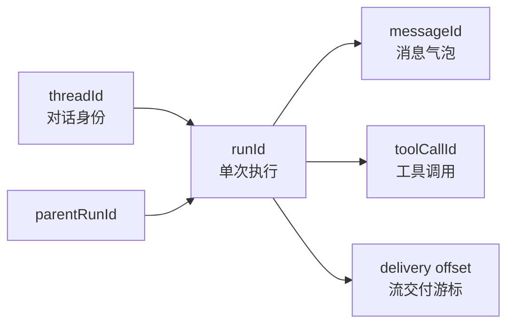
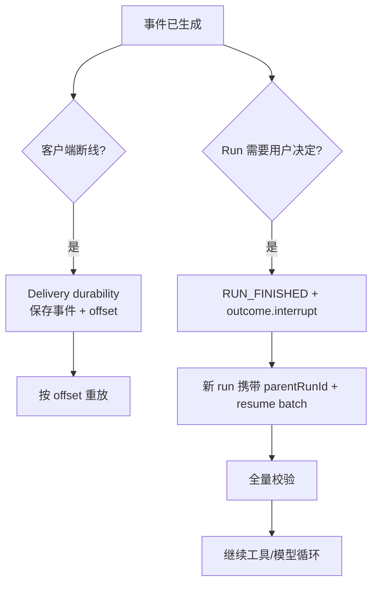

# 04. 消息协议与传输

## 先分清三种数据

同一个聊天会同时出现三种形态：

| 形态 | 用途 | 典型模块 |
|---|---|---|
| `ModelMessage` | 发给模型的 Provider-facing history | `@tanstack/ai` |
| `UIMessage` | 浏览器/框架渲染的 parts 状态 | `@tanstack/ai`、`ai-client` |
| `StreamChunk` | 一次 Run 的增量事件 | Core → Transport → Client |

不要把“当前 UI 里显示的消息”直接当作“可无条件发回 Provider 的消息”。Core 会在 `convertMessagesToModelMessages()`、`modelMessagesToUIMessages()` 和 `uiMessageToModelMessages()` 之间处理工具、thinking、资源、多模态和 Provider metadata。

## AG-UI 事件模型

`StreamChunk` 采用 `@ag-ui/core` 的 `EventType` 与事件结构，TanStack 专属信息通过 `metadata.tanstack` 扩展。一次普通文本 Run 通常是：

```text
RUN_STARTED
  STEP_STARTED (可选)
  TEXT_MESSAGE_START
  TEXT_MESSAGE_CONTENT × N
  TEXT_MESSAGE_END
  RUN_FINISHED
```

带工具的 Run 会出现：

```text
RUN_STARTED
TEXT_MESSAGE_* / REASONING_*
TOOL_CALL_START
TOOL_CALL_ARGS × N
TOOL_CALL_END
TOOL_CALL_RESULT
[下一轮模型事件]
RUN_FINISHED
```

常用事件族：

| 事件族 | 作用 |
|---|---|
| `RUN_STARTED` / `RUN_FINISHED` / `RUN_ERROR` | Run 边界、usage、finish reason、error、interrupt outcome |
| `TEXT_MESSAGE_START/CONTENT/END` | 文本增量 |
| `REASONING_*` | 思考文本、加密 reasoning 值 |
| `TOOL_CALL_START/ARGS/END/RESULT` | 工具调用与结果 |
| `MESSAGES_SNAPSHOT` | 当前消息完整快照，常用于持久化/恢复或中断 terminal |
| `STATE_SNAPSHOT/DELTA` | 应用状态快照/增量 |
| `CUSTOM` | 应用/能力包扩展事件 |
| `SUBAGENT_*` | 子 Agent 的开始、结束、错误和归属 |
| `ACTIVITY_*` | 多活动记录快照/增量 |

`TEXT_MESSAGE_CHUNK`、`TOOL_CALL_CHUNK`、`REASONING_MESSAGE_CHUNK` 是兼容某些 AG-UI 服务的另一种增量形态；客户端 `StreamProcessor` 会把它们与 START/CONTENT/END 形式收敛成同一 UI 状态。

## IDs 的层次



- `threadId`：同一对话的稳定关联键，可跨多个 Run。
- `runId`：一次请求/Agent 执行的唯一键。
- `parentRunId`：中断续接或父子运行关系；续接通常创建新的 `runId`。
- `messageId`：同一文本/思考消息的增量归属。
- `toolCallId`：模型产生的某次 Tool Call 归属。
- Delivery offset：由 durable stream 实现拥有的不透明游标，只用于事件重放。

不要使用客户端传入的 `threadId` 单独做权限判断；服务端应把它与可信的 user/tenant Scope 绑定。

## 服务端编码边界

```mermaid
flowchart LR
  G[AsyncIterable<StreamChunk>] --> SSE[toServerSentEventsStream/Response]
  G --> HTTP[toHttpStream/toHttpResponse]
  G --> JSON[toJsonResponse]
  G --> WS[toWebSocket]
  G --> InProc[stream() / server function]
```

Core 的 `chat()` 保持运行时和网络无关：

```ts
const stream = chat({ adapter, messages, tools })
return toServerSentEventsResponse(stream)
```

主要输出方式：

- **SSE**：最常用，逐事件发送，浏览器和普通 HTTP server 支持最好。
- **HTTP stream**：适合不方便使用 SSE 的代理/runtime。
- **JSON**：一次性响应，适合不需要实时逐 token 的场景。
- **WebSocket**：长连接、多 Run 或双向实时场景。
- **In-process / server function**：直接消费 AsyncIterable，不需要编码和解码。
- **RPC/custom**：通过 `stream()`、`rpcStream()` 或自定义 `connect`/`subscribe` 适配。

所有连接适配器都应暴露同一套 `StreamChunk` 语义。Transport 负责字节和连接；Core 负责事件和运行时。

## 客户端流处理

`@tanstack/ai-client` 的 connection adapter 只解决“怎么接收/发送”，`ChatClient` 解决“怎样把事件变成聊天状态”。典型顺序：

1. 建立连接并发送 `ChatRequestBody`。
2. 解析 SSE/HTTP/JSON/WebSocket 负载。
3. 按 `runId` 过滤和关联事件。
4. `StreamProcessor` 维护 open text/tool/reasoning lanes。
5. 追加/更新 UIMessage parts。
6. `RUN_FINISHED` 收集 usage、finish reason、interrupt state。
7. `RUN_ERROR` 更新 error 并触发 `onError`。

SSE 和 HTTP 流解析器必须处理：

- 跨 chunk 的不完整行。
- 响应提前结束，抛出 `StreamTruncatedError`。
- `[DONE]` 或规范终点。
- Abort 时释放 reader，不把正常取消误报成模型失败。
- 可恢复流中的重复 offset、空 SSE `id:` reset 和连续无进展重连上限。

## 交付恢复 vs 业务恢复

### Delivery durability

`StreamDurability<TOffset>` 的职责是保存/读取/恢复已经产生的事件交付。客户端断线后用 offset 继续消费，避免重复显示或漏事件。`@tanstack/ai-durable-stream` 对 durable-streams HTTP protocol 提供实现，但它明确不拥有业务事件本身。

### Interrupt / Run resume

Approval 或 generic interrupt 需要客户端带回业务输入、output、schema/correlation 等 resume batch，服务端验证后继续 Agent 执行。它解决的是“运行暂停后如何继续”，不是“断线后从哪个字节继续”。



两者可以同时使用，也可以分别关闭：无 Persistence 仍可进行临时 interrupt resume；有 Persistence 也不代表网络流可以恢复。

## Metadata 约定

规范字段优先使用 AG-UI 事件本身的字段。TanStack 扩展放到 `metadata.tanstack`，典型包括：

- `finishReason`、`model`、TanStack `TokenUsage`。
- `retryAfterMs`。
- `interruptErrors`。
- 子 Agent 和活动的附加关联信息。
- Provider reasoning 加密值的回传标识。

通过 `normalizeStreamChunk()` 写入，通过 client 侧 restore/reconstruct 读取。不要把自定义字段散落在每个事件上，避免 SSE 与 in-process 结果不一致。

## 调试事件的最小方法

```ts
for await (const chunk of chat({...})) {
  console.log(chunk.type, chunk.runId, chunk)
}
```

排查顺序：

1. 有没有 `RUN_STARTED`。
2. `runId` 是否在整条流里保持一致。
3. 文本是否有成对的 START/END。
4. Tool Call 是否有完整 start/args/end/result。
5. 最后是否有 `RUN_FINISHED` 或 `RUN_ERROR`。
6. 重连时 offset 是否只前进、是否发生截断。

## 源码入口

- 公共事件类型：[`packages/ai/src/types.ts`](../../ai/packages/ai/src/types.ts)
- 事件规范化：[`packages/ai/src/utilities/normalize-stream-chunk.ts`](../../ai/packages/ai/src/utilities/normalize-stream-chunk.ts)
- 服务端编码：[`packages/ai/src/stream-to-response.ts`](../../ai/packages/ai/src/stream-to-response.ts)
- WebSocket：[`packages/ai/src/stream-to-websocket.ts`](../../ai/packages/ai/src/stream-to-websocket.ts)
- 客户端连接：[`packages/ai-client/src/connection-adapters.ts`](../../ai/packages/ai-client/src/connection-adapters.ts)
- 客户端处理器：[`packages/ai/src/activities/chat/stream/processor.ts`](../../ai/packages/ai/src/activities/chat/stream/processor.ts)

---

下一步：读 [05-工具中断与Agent组合](./05-工具中断与Agent组合.md)，理解 Tool、Approval、MCP 和 Subagent 如何共用同一条 Run。
