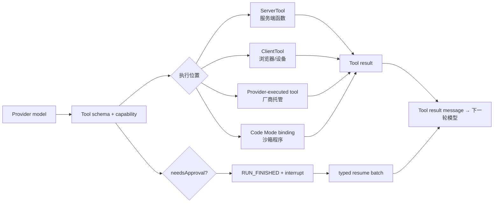
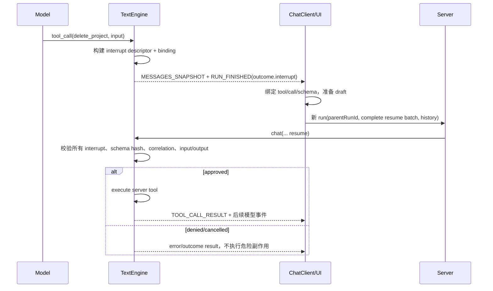
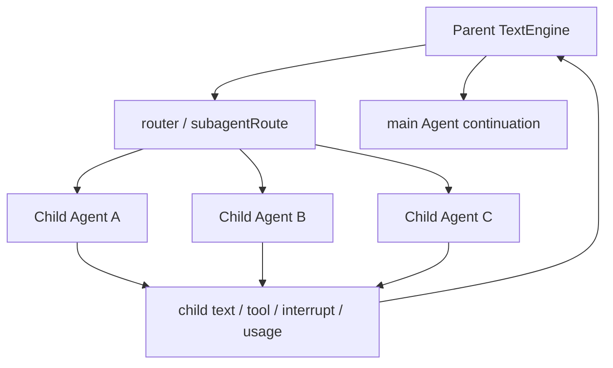
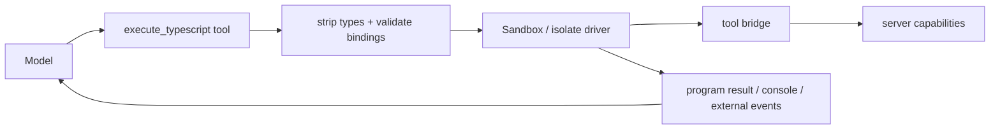

# 05. 工具、中断与 Agent 组合

## 先画出工具执行边界

工具是模型请求和现实世界之间的权限边界。TanStack AI 只提供定义、类型、调度、事件和中断协议；数据库写入、外部 API 权限、幂等和用户授权仍由应用负责。



## `toolDefinition()` 的类型流

```ts
const definition = toolDefinition({
  name: 'get_products',
  description: 'Search the product catalog',
  inputSchema: ProductQuerySchema,
  outputSchema: ProductListSchema,
})

const serverTool = definition.server(async (input, ctx) => {
  return db.products.search(input.query)
})
```

Definition 同时是：

- Provider 的函数声明来源。
- ServerTool / ClientTool 的类型来源。
- Tool call input/output 的推导来源。
- Approval schema 和 metadata 的挂载点。
- MCP、Code Mode 等能力的可转换输入。

Core 通过 `schema-converter.ts` 把 Standard Schema、Standard JSON Schema、Zod/Valibot/ArkType 等输入转成 JSON Schema；服务端执行前还要再次校验输入，不能只相信模型的参数。

## Server Tool、Client Tool、Provider Tool

| 类型 | 执行者 | Core 做什么 | 应用要做什么 |
|---|---|---|---|
| Server Tool | 服务端 `execute` | schema、调用、结果事件、错误、approval | 鉴权、业务逻辑、超时、幂等、数据脱敏 |
| Client Tool | 浏览器/设备 | 发送 Tool Call，等待 resume/result | 执行本地能力、校验用户环境、回传结果 |
| Provider Tool | 模型服务商 | 保留 provider metadata、重新构造 history | 配置供应商能力，理解结果可信边界 |
| Code Mode Tool | Sandbox program 通过 binding 调用 | 生成 binding、执行外部调用桥、回传 program result | 选择 sandbox、限制权限、处理副作用 |
| MCP Tool | MCP host 调用 server | discovery、命名、转换和执行 | MCP server auth、资源权限、超时和审计 |

一次模型 Turn 可能并行返回多个 Tool Call；Tool Call 的数量与 loop iteration 数量不是同一预算。

## Approval 是 Interrupt + Resume

工具审批的核心不变量是：**descriptor → 全量校验 → continuation → history**。



服务端必须一次性验证整个 batch，而不是验证一个就执行一个。验证内容包括：

- interrupt ID、reason、tool identity、toolCallId。
- interrupted run / parentRunId / thread correlation。
- tool schema 与 approval schema hash。
- 客户端编辑后的 input、tool output 和状态。
- 每个 pending interrupt 是否恰好提交一次。

客户端的 typed resolver 只会为可信匹配的定义绑定强类型方法；无法匹配的 descriptor 应降级为 generic，而不是凭客户端 payload 获取执行能力。

## Generic Interrupt

工具审批不是唯一的暂停点。`defineInterrupt()` 可以定义业务自有的请求/响应 schema，例如：

- 需要用户选择候选文件。
- 需要补充 MFA 或付款信息。
- 需要人工审核模型生成的发布内容。
- 需要在 Agent 之间交接控制权。

Generic interrupt 与 Tool Approval 共用 `RUN_FINISHED.outcome.interrupt` 和 resume batch，但由应用定义 `request` / `response`。中断边界可发生在：

- `beforeModel`
- `afterModel`
- `beforeTools`
- `afterTools`

不要把“暂停 UI”实现成只在浏览器保存一个布尔值；服务端需要能从 descriptor/binding 和消息历史重建预期状态。

## MCP 组合

`@tanstack/ai-mcp` 提供 Host 侧 MCP 能力：

```text
连接 MCP server
  → 初始化 session / auth
  → list tools/resources/prompts
  → 处理重复工具名和命名策略
  → 把 MCP tools 注入 chat()
  → 模型选择工具
  → MCP callTool()
  → 转为统一 tool result
```

`MCPManager` 位于 Core Chat 的工具边界中，负责把 MCP source 的 discovery 与本地 Tool registry 合并。重复名称必须显式处理；MCP server 的 auth、资源访问、task 生命周期不能被当作普通函数工具忽略。

## Subagents

Subagents 是同一 Core Run 模型上的组合执行，而不是另一个完全不同的协议：

- `defineAgent()` 为子 Agent 定义 adapter、tools、middleware、输入 schema 等。
- `subagentRoute()` 让 router 选择一个或多个命名 Agent。
- `spawn` 处理 child run、父子消息、usage 聚合和结果注入。
- 子 Agent 事件带 `subagentRunId`，客户端可把其归入 `SubagentPart`。
- 子 Agent 自身可以执行工具、触发 interrupt；父运行需要持久化/恢复这些子状态。



子 Agent 的并行/顺序计划由 `SubagentStepsPlan` 表示。恢复时要复用保存的 plan，已完成 child 不应重复执行，暂停 child 才续接。

## Code Mode 与 Sandbox

传统 Tool Loop 是“模型发 Tool Call → 运行一个 Tool → 把结果送回模型”。Code Mode 让模型生成一段 TypeScript，在隔离 Sandbox 中通过 typed bindings 编排多个工具：循环、条件、`Promise.all` 和数据转换在一次执行里完成。



`ai-sandbox` 的统一契约包含：

- `SandboxHandle` 生命周期。
- `process.exec/spawn` 与可取消进程。
- `fs`、`git`、ports/channels、workspace。
- capabilities（network、snapshots、durable filesystem、fork、killable processes）。
- policy、secrets、checkpoint、journal、claim/reclaim、watch。

具体执行后端（Node isolated-vm、QuickJS、Cloudflare、Daytona、E2B、Docker 等）在 `ai-isolate-*` / `ai-sandbox-*` 中实现，不应让 Code Mode 绑定某一家供应商。

安全边界：

1. Sandbox 不是业务授权；工具 bridge 仍需服务端授权。
2. Local-process provider 明确是 trusted/dev 用途，不等同于隔离。
3. 每个 isolate 的网络、文件、进程、超时、内存限制必须由 provider capability 真实声明。
4. 工具副作用需要幂等和审计，Code Mode 的 `Promise.all` 可能并行触发。

## Lazy Tools 与 Skills

- Lazy tool discovery 只把工具定义按需暴露给模型，降低 system prompt 和 tool schema 的上下文开销。
- `ai-skills` 把 `SKILL.md` 解析成可验证、可限制数量的工具/资源，中间件负责按需装载。
- Lazy tool、MCP 和 Skill 都是“工具可见性”策略，不改变 Core 工具执行与中断校验边界。

## 改工具系统时的清单

1. 更新 `tool-definition.ts` 与 `types.ts` 的推导。
2. 更新 schema converter 和 Provider tool converter。
3. 更新 `tool-calls.ts` 的执行/错误/取消路径。
4. 更新 interrupt binding/resume 全批次验证。
5. 更新 client typed tool、StreamProcessor、Persistence reconstruct。
6. 覆盖普通 Tool、并行 Tool、Client Tool、Approval、MCP、Subagent、Code Mode E2E。

---

下一步：读 [06-客户端与框架集成](./06-客户端与框架集成.md)，看服务端事件怎样变成 UI 状态。
