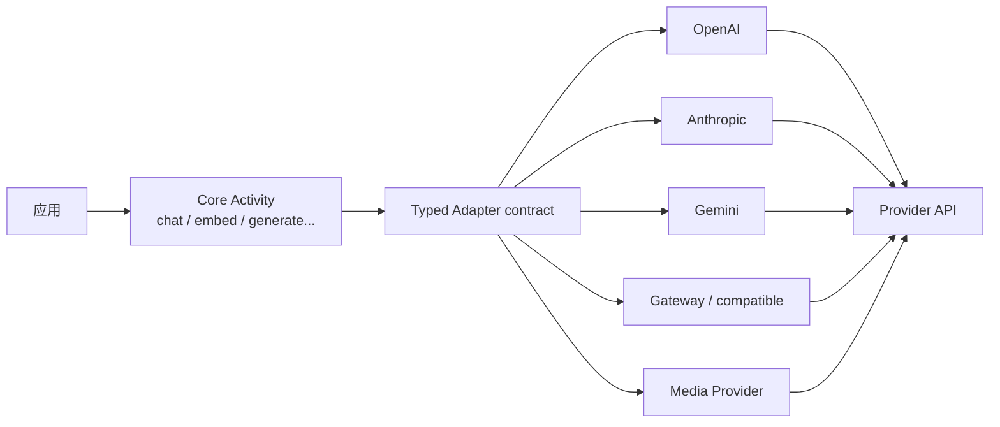

# 07. Provider 与多模态活动

## 先理解 Adapter 的目的

Provider SDK 各有消息结构、工具格式、thinking 字段、usage、模型能力和媒体 API。TanStack AI 不试图把差异藏在一个无限增长的 `if provider === ...` 文件里，而是让每个 Provider 包实现统一 Adapter 契约，再由 Core 编排活动。



## Activity 家族

`@tanstack/ai` 的 `activities/` 不是只有 Chat：

| Activity | 典型输入/输出 | 适合场景 |
|---|---|---|
| `chat` | Model/UI messages → StreamChunk | 对话、Agent Loop、Tool Calling、Structured Output |
| `summarize` | 文本/Chat stream → summary | 摘要、Compaction、上下文压缩 |
| `embed` | 文本 → vectors | 检索、Memory、RAG |
| `rerank` | query + documents → ordered scores | 搜索结果重排 |
| `decide` / `choice` / `score` / `boolean` | 问题 + context → typed decision | 分类、评估、路由 |
| `generateImage` | prompt/options → image result/stream | 图像生成 |
| `generateAudio` | prompt → audio | 音频生成 |
| `generateSpeech` / `generateVoice` | text / voice config → speech/voice | TTS 与声音创建 |
| `generateTranscription` | audio → text | ASR |
| `generateVideo` / `generateLiveVideo` | prompt/media → job/live stream | 视频生成与实时视频 |
| `generateWorld` | prompt → world artifact | world generation |
| `uploadFile` / `getFile` / `deleteFile` | file input/handle | Provider Files API |

活动层的作用是统一 options、result、errors、middleware/persistence integration 和 Provider adapter。不同媒体活动可以采用不同的异步/轮询/二进制流，但对应用暴露稳定的活动语义。

## 类型安全来自哪里

Provider 函数一般在创建 adapter 时解析模型泛型：

```ts
const adapter = openaiText('gpt-5.5')
```

Adapter 的 `~types` 记录：

- `providerOptions`：该模型可用的 Provider options。
- `inputModalities`：文本、图片、音频、视频、文件等输入能力。
- `messageMetadataByModality`：不同 Content Part 的 metadata。
- `toolCapabilities`：该模型支持的 provider tool kind。
- `toolCallMetadata`：如 Gemini thought signature。
- `systemPromptMetadata`：如 Anthropic prompt cache control。

因此类型检查发生在应用写 `chat({ adapter, tools, messages })` 时，而不是等请求发到 Provider 才发现不支持。

运行时仍需要二次检查：模型元数据可能未知，Provider 服务端也可能拒绝选项；类型安全不是对外部服务响应的信任替代品。

## Text Adapter 的职责

Provider 的 `chatStream()` 应负责：

1. 把 Core `TextOptions` 转成 Provider request。
2. 处理 system prompt、messages、tools、tool choice、reasoning、model options。
3. 消费 Provider stream，转换为 `AdapterYieldChunk`。
4. 提取 Provider usage、finish reason、model、tool metadata。
5. 在错误路径调用 logger，并保留 retry-after 等可操作信息。
6. 对支持的 Provider 实现 `structuredOutput()`，必要时实现 streaming 或 combined tools + schema。

Core 负责：

- Agent loop 与工具执行顺序。
- Schema、approval、interrupt 和消息历史。
- 事件规范化和网络输出。
- 统一错误终点与 middleware hooks。

## Provider 工具

Provider tool 有两种来源：

- TanStack function tool：Core 传入 schema，Provider converter 转成厂商函数格式。
- 厂商托管 tool：如搜索、代码执行、Computer Use 等，Provider package 以 branded tool 暴露并通过模型能力做类型约束。

Provider-executed tool 的结果可能不是标准的“服务端 execute 函数返回值”，必须携带 Provider metadata，重新构造后续模型 history。Core 的 `isProviderExecutedToolCall()` 和 message conversion 处理这一类边界。

## 多模态消息

多模态 Content Part 包括文本、图片、音频、视频、文件和 UI resource。Adapter 通过 `inputModalities` 声明模型可消费哪些输入。Core 在 preflight 阶段验证：

- 当前 adapter 是否支持该 modality。
- `{ type: 'file' }` 是否有 adapter 明确声明 `supportsFileSources`。
- URL、base64、File handle 是否能映射到 Provider 的输入格式。
- 文件大小、媒体 metadata 和服务端/客户端可见性。

Provider 不应静默把不支持的 file reference 当 URL 或空文本发送；失败应尽早、可诊断。

## Structured Output

结构化输出是跨 Provider 的两层抽象：

1. 应用传入 Standard Schema / JSON Schema。
2. Core 将其规范化，决定 native structured output、streaming parse 或最终 JSON 文本解析。
3. Provider Adapter 负责自身的 native schema 参数和 response extraction。
4. Core 负责 validation、`StructuredOutputPart`、错误和 Agent Loop 后置 finalization。

某 Provider 如果不能把 tools 和 schema 放在同一次请求，Adapter 应返回 false/undefined，让 Core 走独立 finalization，而不是假装支持后产生不合法 wire request。

## 模型元数据与能力

Provider package 的 model metadata 是设计的一部分，不只是下拉列表。它影响：

- 输入 modality 的类型约束。
- 支持的 Provider tools。
- sampling/reasoning/model options。
- 价格和 usage 计算。
- OpenRouter/Gateway 的模型路由和别名。

仓库的 model sync 脚本从网关和 Provider catalog 生成/更新元数据。新增模型要同步 capability map、tool capability row、model id 规则和测试，不要只改一个字符串列表。

## BYOK 与 Keyed Adapters

Core 的 `byok/` 能把 provider key、keyed adapter 和 provider resolution 组合起来：

- 服务端可按请求租户/用户选择 key。
- 客户端可对用户自有 key 做受控解析。
- 多 Provider fallback 可以通过 keyed adapters 或应用路由层完成。

Key resolution 不应改变 activity contract，也不应跳过模型能力校验、日志脱敏和数据隔离。

## 自定义 Provider 的最小实现路线

1. 阅读 [`activities/chat/adapter.ts`](../../ai/packages/ai/src/activities/chat/adapter.ts)。
2. 实现 `BaseTextAdapter` 的 `chatStream()` 和 `structuredOutput()`。
3. 建立 Provider options、model metadata、input modalities、tool converter。
4. 处理 usage、reasoning、tool metadata、retry-after 和错误。
5. 通过 `@tanstack/ai` 的 normalize/stream tests 和 Provider wire tests。
6. 再添加图像/音频/Embedding 等专门活动，不要先修改 Core。

---

下一步：读 [08-持久化记忆与可观测性](./08-持久化记忆与可观测性.md)，了解状态如何跨 Run 和跨进程保存。
