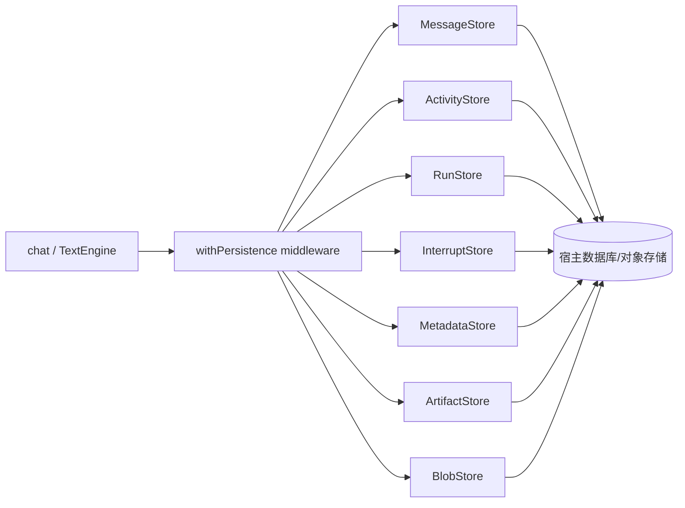
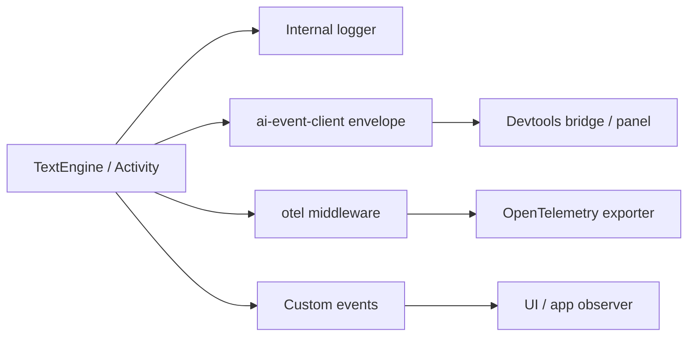

# 08. 持久化、记忆与可观测性

## 先选正确的状态层

TanStack AI 把“聊天保存”“Run 恢复”“事件重放”“长期记忆”“调试观测”拆成不同模块。把它们全部叫作 persistence 会导致错误的可靠性假设。

| 需求 | 使用 | 保存/观察的对象 |
|---|---|---|
| 刷新后继续看对话 | `@tanstack/ai-persistence` | Model transcript、UI reconstruct、metadata |
| 中断后继续执行 | Persistence + interrupt store | pending descriptor、resume batch、run status |
| 网络断线后补事件 | `StreamDurability` / `ai-durable-stream` | StreamChunk + delivery offset |
| 记住用户事实 | `@tanstack/ai-memory` | memory records，由 Adapter 定义 |
| 缩小上下文 | `@tanstack/ai-compaction` | 摘要/压缩后的 conversation projection |
| 调试模型/工具流 | `ai-event-client` + Devtools | request、chunks、tool calls、errors、traces |

## Persistence Store Contract

`ai-persistence` 不是一个指定数据库实现，而是一组 Store Contract 和 middleware：



主要 Store：

- `MessageStore`：按 thread 保存完整、权威的 message list；`saveThread` 是 overwrite 语义，不是盲目 append。
- `ActivityStore`：保存活动记录/增量，用于重建非文本 activity 或子 Agent timeline。
- `RunStore`：Run 状态、开始/结束、abort/error、active run 查找。
- `InterruptStore`：pending/resolved/cancelled Interrupt 与提交记录。
- `MetadataStore`：应用或运行 metadata。
- `ArtifactStore` / `BlobStore`：生成物引用、二进制或可分页 blob。

Store records 常用 epoch milliseconds；跨出 persistence boundary 的 artifact reference 使用 ISO-8601。不要在 adapter 内混用时间单位。

## `withPersistence` 的生命周期

Persistence middleware 通常在 setup 中提供 capability 和 store，引擎的生命周期中执行：

1. `onConfig`：加载既有 transcript，合并本次输入，避免短客户端 history 覆盖存储历史。
2. `onStart`：保存本次 turn 的起点；慢 Middleware 可使用 PendingTurn capability 提前快照。
3. 流程中：按配置做 snapshot streaming，保存活动/Run/interrupt sidecar。
4. `onFinish`：保存完成消息、usage、终态和活动。
5. `onError` / abort：保存失败状态，保证 waiting/reconstruct 不会看到永远 running 的幽灵 Run。
6. `reconstructChat()`：从 stores 重新组装 UI/Model transcript、pending interrupt、active Run 和 activity。

Persistence 的授权入口必须在宿主层实现，例如 `reconstructChat({ authorize })` 将客户端 `threadId` 和服务端可信 `userId`/`tenantId` 绑定。客户端 thread ID 本身不是租户隔离凭证。

## 分页与恢复

消息 Store 可以为 hydration 提供 paging hint；但 middleware 的常规 `loadThread(threadId)` 需要完整 transcript。若返回分页，必须提供 cursor 且 reconstruct 能继续拿到更早消息。

恢复时最重要的是保留稳定 `messageId`、`createdAt`、toolCallId 和 provider thinking metadata。否则：

- 中途刷新会重复气泡。
- 工具结果找不到对应 call。
- Anthropic/Provider signed thinking 无法原样回放。
- 子 Agent/Activity 归属丢失。

## Memory Middleware

`@tanstack/ai-memory` 把 Memory 作为可替换 Adapter：

```text
onStart / onConfig
  → 根据 thread/user scope 读取相关记忆
  → 以系统提示或 metadata 注入模型上下文
  → 运行完成后提取候选事实
  → 交给 memory adapter 写入/更新
```

仓库内有 in-memory、Redis、Mem0、Hindsight、Honcho 等 Provider。Memory 不等于 Conversation Persistence：

- Transcript 记录“这次对话发生了什么”。
- Memory 记录“跨对话可复用的事实/偏好/知识”。
- Memory retrieval 的权限、scope、删除和 PII 策略需要单独设计。

## Compaction

`ai-compaction` 是 Context-window Middleware，不是数据库备份。它通常在模型调用前：

1. 根据 token/消息预算决定是否压缩。
2. 选择旧消息或工具结果作为 summary 输入。
3. 通过 summarize activity 产生压缩投影。
4. 保留最近消息、pending tool/interrupt、不可丢失的 Provider metadata。
5. 将模型看到的 history 替换为 compacted projection，同时 persistence 仍可保存原始 transcript。

必须把“模型上下文投影”和“权威 transcript”分开；压缩不能覆盖原始审计记录。

## Delivery Durability

`StreamDurability` 的契约类似：

```ts
interface StreamDurability<TOffset extends string = string> {
  append(runId, chunks): Promise<TOffset>
  read(runId, after?: TOffset): AsyncIterable<...>
  // 具体接口以源码版本为准
}
```

Core 的 `stream-to-response.ts` 负责把运行流接到 durability sink，响应层提供 resume endpoints。Durability 的存储应具备：

- 事件顺序。
- offset 不透明且可比较/继续读取。
- 重连去重。
- terminal event 可靠落盘。
- 无进展重连上限和 abort 清理。

它不应把业务数据库里的 `messageId` 当 offset，也不应执行工具副作用。

## 可观测性链路



观察维度应覆盖：

- request/stream/thread/run IDs。
- Provider、model、iteration、finish reason。
- 每个 Tool Call 的 name、duration、success/error、approval 状态。
- input/output token usage 与 cache detail。
- stream chunk 顺序、断线、重连、截断。
- interrupt descriptor、validation failure、resume correlation。
- 子 Agent 的 parent/child run 和 usage 聚合。

日志和 Devtools 应脱敏：API key、用户隐私、工具 secrets、reasoning encrypted value 不能直接打印。

## 失败恢复设计

| 故障 | 期望行为 | 主负责层 |
|---|---|---|
| Provider 429 | 解析 retry-after，输出 `RUN_ERROR` metadata，按策略重试 | Adapter + Core |
| 浏览器断线 | 若开启 durability，按 offset 重连；否则进入 detach/结束 | Client + Delivery |
| Run 中断 | 输出 interrupt terminal，保存 pending 状态，等待完整 resume | Core + Persistence |
| 进程崩溃 | reconstruct active run / interrupt；必要时重新加入 | Persistence |
| Store 写失败 | 根据 store 重要性决定 fail run 或 best-effort sidecar | Persistence middleware |
| 工具执行超时 | abort/错误结果，禁止不明确的重复副作用 | Tool runtime + app |

---

下一步：读 [09-测试发布与变更指南](./09-测试发布与变更指南.md)，把设计边界映射到验证和修改流程。
