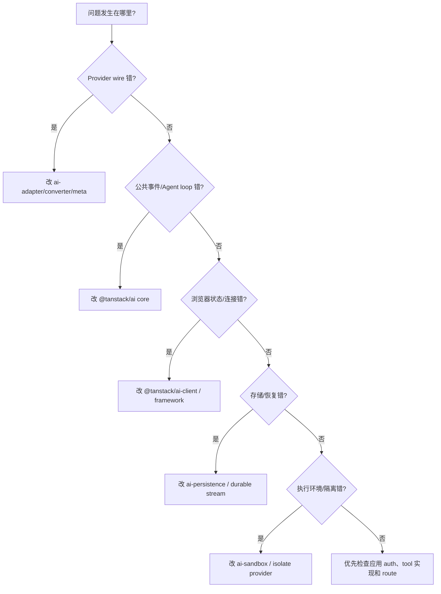

# 10. 源码索引与场景决策

## 按场景选择入口

| 你要解决的问题 | 从哪里开始 | 接着看 |
|---|---|---|
| 做最小流式聊天 | `packages/ai/src/activities/chat/index.ts` | Provider `adapters/text.ts`、`stream-to-response.ts` |
| 接入 React | `packages/ai-react/src/use-chat.ts` | `ai-client/chat-client.ts`、`connection-adapters.ts` |
| 支持另一个 HTTP/WS 协议 | `packages/ai-client/src/connection-adapters.ts` | `stream-to-response.ts`、reconnect tests |
| 加一个函数工具 | `activities/chat/tools/tool-definition.ts` | `tool-calls.ts`、Provider converter |
| 工具需要审批 | `interrupt-definition.ts`、`interrupt-resume.ts` | `ai-client/interrupt-manager.ts`、persistence interrupts |
| 自定义暂停点 | `defineInterrupt()` 与 middleware interrupt hooks | generic interrupt continuation、client resume |
| 加一个 Provider | `activities/chat/adapter.ts` / `BaseTextAdapter` | model-meta、message-types、wire tests |
| 支持图片/音频输入 | Core `ContentPart` 和 adapter input modalities | Provider file/media converter、preflight |
| 做 structured output | `TextAdapter.structuredOutput` | `chat/index.ts` finalization / combined path |
| 保留聊天记录 | `ai-persistence/types.ts` | `ai-persistence/middleware.ts`、`reconstruct.ts` |
| 断线补事件 | `stream-durability.ts` | `stream-to-response.ts`、client reconnect tracker |
| 接入 MCP | `ai-mcp/client.ts`、`ai-mcp/tools.ts` | Chat `mcp/manager.ts`、server auth/session |
| 让模型写程序调用工具 | `ai-code-mode/create-code-mode.ts` | `ai-sandbox/contracts.ts`、`ai-isolate-*` |
| 加长期记忆 | `ai-memory/middleware.ts` | memory Provider 和 scope/PII 策略 |
| 缩小上下文 | `ai-compaction/index.ts` | summarize activity、Persistence 原始 transcript |
| 排查事件/性能 | `ai-event-client`、`middlewares/otel.ts` | Devtools bridge、logger、E2E events |

## Core 文件地图

### 公共入口与类型

| 文件 | 关注点 |
|---|---|
| `packages/ai/src/index.ts` | 发布出口、类型/函数/工具/中断/传输导出 |
| `packages/ai/src/types.ts` | ModelMessage、UIMessage、Tool、TextOptions、StreamChunk、活动类型 |
| `packages/ai/src/adapter-internals.ts` | Adapter 内部辅助类型/协议 |
| `packages/ai/src/extend-adapter.ts` | 叠加/扩展 Adapter |
| `packages/ai/src/tool-registry.ts` | Tool registry 与能力映射 |

### Chat runtime

| 文件 | 关注点 |
|---|---|
| `activities/chat/index.ts` | `chat()`、`TextEngine`、agent loop、structured output、subagent routing |
| `activities/chat/adapter.ts` | `TextAdapter` / `BaseTextAdapter` |
| `activities/chat/messages.ts` | Model/UI message 转换、资源和 ID |
| `activities/chat/tools/tool-definition.ts` | definition、ServerTool、ClientTool、schema inference |
| `activities/chat/tools/tool-calls.ts` | 解析、调度、执行、错误和 middleware |
| `activities/chat/tools/schema-converter.ts` | Standard Schema / JSON Schema 转换和校验 |
| `activities/chat/tools/approval-schema.ts` | approval schema normalization/hash |
| `activities/chat/tools/lazy-tool-manager.ts` | lazy tool discovery 和可见性 |
| `activities/chat/mcp/manager.ts` | MCP tool source 注入与命名冲突 |
| `activities/chat/agents/define-agent.ts` | 子 Agent 定义 |
| `activities/chat/agents/spawn.ts` | child run、步骤、usage 和事件归属 |
| `activities/chat/agents/route.ts` | router 选择和子 Agent route |
| `activities/chat/agent-loop-strategies.ts` | iteration / finish reason 策略 |

### Middleware 与中断

| 文件 | 关注点 |
|---|---|
| `activities/chat/middleware/types.ts` | Context、phase、hook、Capability、interrupt boundary 类型 |
| `activities/chat/middleware/compose.ts` | middleware 组合和执行顺序 |
| `activities/chat/middleware/capabilities.ts` | capability registry / 提供与读取 |
| `activities/chat/middleware/run-store.ts` | detached / active run store seam |
| `interrupt-definition.ts` | `defineInterrupt()`、descriptor、rehydrate |
| `interrupt-resume.ts` | binding、correlation、完整 batch validation |
| `interrupt-serialization.ts` | canonical JSON、digest、冻结/签名相关序列化 |
| `interrupts.ts` | approval/resolution/error 公共类型 |
| `generic-interrupt-continuation.ts` | generic interrupt continuation metadata |
| `locks.ts` | run/thread locks |

### Stream 与协议

| 文件 | 关注点 |
|---|---|
| `activities/chat/stream/processor.ts` | START/CONTENT/END 与 CHUNK 事件到消息状态 |
| `activities/chat/stream/strategies.ts` | 分词、标点、批处理等流消费策略 |
| `activities/chat/stream/json-parser.ts` | streaming partial JSON |
| `utilities/normalize-stream-chunk.ts` | Adapter extras → spec event + TanStack metadata |
| `utilities/adapter-yield-chunk.ts` | Adapter 内部 chunk 类型 |
| `utilities/ag-ui-wire.ts` | AG-UI message/event wire 转换 |
| `stream-to-response.ts` | SSE、HTTP、JSON、durability source、resume |
| `stream-to-websocket.ts` | WebSocket framing、resume、response |
| `stream-durability.ts` | memory/contract/resume offset |
| `utilities/chunk-ids.ts` | chunk identity |
| `utilities/durability-batch.ts` | durability batch hint |

## Client 文件地图

| 文件 | 关注点 |
|---|---|
| `packages/ai-client/src/chat-client.ts` | headless ChatClient 生命周期、发送、停止、队列、恢复 |
| `packages/ai-client/src/connection-adapters.ts` | SSE、HTTP、JSON、XHR、WS、stream、RPC |
| `packages/ai-client/src/types.ts` | ChatClientState、Queue、Persistence、Tool、Interrupt 类型 |
| `packages/ai-client/src/interrupt-manager.ts` | typed interrupt bind/resolve/submit |
| `packages/ai-client/src/client-persistor.ts` | transcript + resume state 持久化 |
| `packages/ai-client/src/storage-adapters.ts` | localStorage、sessionStorage、IndexedDB |
| `packages/ai-client/src/response-stream.ts` | response body 解析和终点 |
| `packages/ai-client/src/generation-client.ts` | 非 Chat 活动客户端 |
| `packages/ai-client/src/realtime-client.ts` | Realtime session 客户端 |
| `packages/ai-react/src/use-chat.ts` | React Hook |
| `packages/ai-react/src/chat-ui/` | 可选 Chat UI 组件和 approval UI |

## Persistence 文件地图

| 文件 | 关注点 |
|---|---|
| `packages/ai-persistence/src/types.ts` | Message/Activity/Run/Interrupt/Artifact/Blob Store contracts |
| `packages/ai-persistence/src/middleware.ts` | withPersistence、snapshot、completion、generation persistence |
| `packages/ai-persistence/src/reconstruct.ts` | 从 stores 重建 chat state |
| `packages/ai-persistence/src/retrieve.ts` | 读取 thread、run、interrupt、metadata |
| `packages/ai-persistence/src/merge-stored.ts` | 存储 transcript 与客户端 history 合并 |
| `packages/ai-persistence/src/subagent-runs.ts` | child run 记录与恢复 |
| `packages/ai-persistence/src/testkit/conformance.ts` | backend contract conformance |

## 如何判断应该改哪一层

## 阅读源码时的五个追问

1. 这个函数接收的是 Provider input、ModelMessage、UIMessage 还是 StreamChunk？
2. 它是在模型 Turn 前、模型流中、工具执行前，还是 terminal 后运行？
3. 这个状态由内存、客户端 storage、业务 store 还是 durable stream 拥有？
4. retry/resume 时会不会再次执行外部副作用？
5. 错误最终会成为 thrown exception、Tool result、`RUN_ERROR`，还是 interrupt outcome？

这五个问题比从文件名猜功能更可靠。TanStack AI 的很多 bug 都发生在边界形态转换，而不是单个 Provider SDK 调用内部。

---

下一步：先用本表定位一个入口文件，再沿同一条调用链打开它的测试文件。
