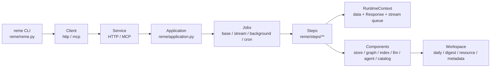
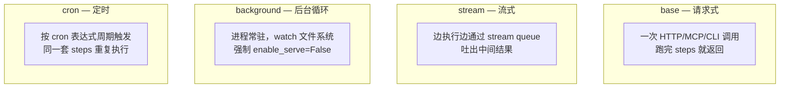
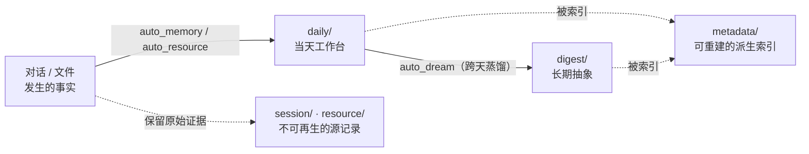
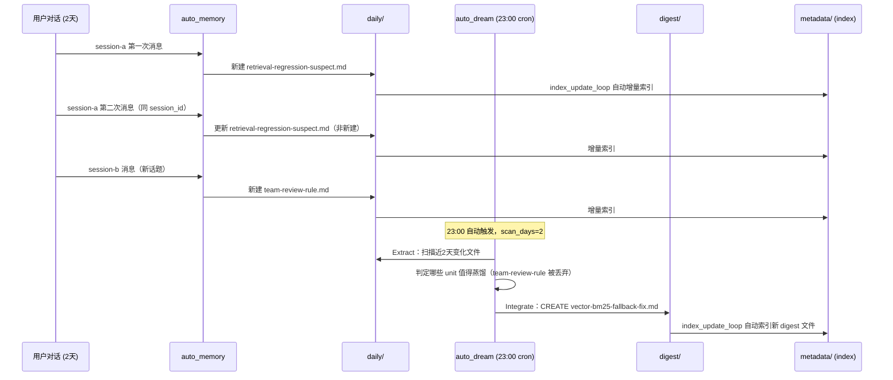
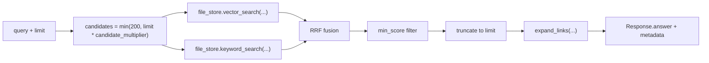

# ReMe 设计原理文档

[ReMe](https://github.com/agentscope-ai/ReMe)（Remember Me）源码整理，面向设计原理而非源码细节。
核验基准：本地 `/Users/gqli/work/deepagents/ReMe`，tag `v0.4.1.13-40-gd6b02a20`，整理日期 2026-10-21。
素材来源：`README.md` 与 `docs/en/` 下的设计文档（`framework.md`、`memory_as_file.md`、`auto_memory.md`、`auto_resource.md`、`auto_dream.md`、`auto_link.md`、`memory_search.md`、`proactive.md`），不深入 `reme/` 源码实现。

## 一句话

ReMe 把"记忆"做成了**用户自己能读、能改、能迁移的 Markdown 文件**，而不是藏在数据库里只有系统能解释的记录。系统的职责被压缩成"维护文件之间的索引和链接"，而不是"独占记忆的表示形式"。本文档想讲清楚：为什么这样设计，文件会经历哪几层形态变化，以及每一层转换具体改了磁盘上的什么东西。

---

## 目录

- [Part I. 核心理念与运行时骨架](#part-i-核心理念与运行时骨架)
  - [1. Memory as File, File as Memory](#1-memory-as-file-file-as-memory)
  - [2. 运行时分层：谁调度、谁执行、谁存储](#2-运行时分层谁调度谁执行谁存储)
- [Part II. 记忆分层模型与读写流程](#part-ii-记忆分层模型与读写流程)
  - [3. 四层记忆模型总览](#3-四层记忆模型总览)
  - [4. 完整示例：一段对话如何变成可检索的长期记忆](#4-完整示例一段对话如何变成可检索的长期记忆)
  - [5. 完整示例：一份上传文件如何变成记忆](#5-完整示例一份上传文件如何变成记忆)
  - [6. 检索时刻：从一句问话到展开的证据网络](#6-检索时刻从一句问话到展开的证据网络)
  - [7. Proactive：另一条不产生 digest 的旁路](#7-proactive另一条不产生-digest-的旁路)
- [Part III. 关键设计决策与思考](#part-iii-关键设计决策与思考)

---

## Part I. 核心理念与运行时骨架

### 1. Memory as File, File as Memory

ReMe 的全部设计都在回答一个问题：**记忆应该用什么形式存在？**

多数记忆系统的默认答案是"数据库记录 + 向量"：结构化、系统友好，但用户看不懂、改不动、搬不走。ReMe 给出相反的答案——原文引用：

> "ReMe memory is therefore neither a hidden database record nor a prompt fragment visible only to an LLM. It is first a file owned by the user and only then indexed by the system for retrieval."

也就是说，file 是第一公民，index 是派生物。这个顺序决定了后面几乎所有的设计：

| 设计目标 | 具体含义 |
|---|---|
| **Readable** | 记忆是人能直接打开读的 Markdown，不是只能通过 API 查询的 blob |
| **Editable** | 用户或 Agent 可以直接改文件内容来修正记忆，不需要特殊的"编辑记忆"接口 |
| **Traceable** | 每条长期记忆都能通过 wikilink 追溯回它的原始对话或资源文件 |
| **Portable** | 换一个 agent 框架、换一台机器，整个工作区文件夹原样拷过去就是完整的记忆迁移 |
| **Indexable** | 文件仍然要支持高效检索——可读性不能以牺牲检索质量为代价 |
| **Collaborative** | 人和 Agent 可以共同编辑同一份记忆文件，而不是人只能观察、不能参与 |

索引（BM25、向量、wikilink 图）全部是**可重建的派生数据**，真相永远是磁盘上的 `.md` 文件。这一点在后面"分层原理"和"检索设计"两节里都会反复出现，是理解 ReMe 几乎所有取舍的总纲。

### 2. 运行时分层：谁调度、谁执行、谁存储

记忆哲学回答的是"数据长什么样"，但数据总要被某种运行时驱动产生和消费。ReMe 的运行时骨架用一句话概括（引自 `framework.md`）：

> "a configuration-driven Application assembles components and Jobs; the Service exposes service-enabled Jobs to the CLI, HTTP, or MCP; and each Job executes its Steps in sequence"

画成图：



八层职责划分：

| 层 | 主要位置 | 职责 |
|---|---|---|
| CLI | `reme/reme.py` | 命令行入口，`reme start` / `reme <job>` |
| Service | HTTP / MCP | 把"启用了 serve"的 Job 暴露给外部调用者 |
| Application | `reme/application.py` | 读配置，组装 Component 与 Job，管理生命周期 |
| Job | `base` / `stream` / `background` / `cron` | 一次调用或一次调度周期的工作单元 |
| Step | `reme/steps/**` | Job 内按顺序执行的最小步骤 |
| Component | store / graph / index / llm / agent / catalog | 被多个 Step 共享的能力提供者 |
| Schema | 各 Job/Step 的 `parameters` | 输入输出的类型契约 |
| Config | `reme/config/default.yaml` | 声明式地拼装以上所有层 |

这里最值得注意的是 **Job 的四种 backend**，因为它们直接对应后面"记忆为什么会自动产生"的机制：



四种 Job 里，`background` 和 `cron` 是本文档后面反复出现的主角：`index_update_loop`（background，watch `daily/` 和 `digest/`）、`resource_watch_loop`（background，watch `resource/`）、`dream_cron`（cron，每天 23:00）、`proactive_refresh_cron`（cron，每天 18:00）、`optimize_index_cron`（cron，每天 02:00）。换句话说，ReMe 的"自动记忆"不是靠用户显式调用触发的，而是靠这几个常驻/定时 Job 在后台持续把文件变化转化成记忆变化。

Component 层用一个全局单例注册表 `R = ComponentRegistry()` 管理，键是 `(component_type, register_name)`，Component 之间通过 `.bind()` 声明依赖，Application 启动时按拓扑排序逐个初始化——这保证了例如"search Step 依赖的 file_store 一定先于 search Job 启动"这种约束是声明式的，不需要手写初始化顺序。Step 访问 Component 时遵循优先级：调用时的 kwargs > `context.data` 中已有的绑定 > 配置里指定的 Component 名字 > 默认 Component。这套机制本身是源码实现细节，这里只需知道它存在、且作用是让"配置文件"而不是"代码"决定一次运行里哪些 Job/Step/Component 被组装在一起。

能力边界上，`framework.md` 有一句明确的范围声明，决定了 ReMe 不做什么：

> "ReMe v4 focuses on long-term memory... Single-session context-window management is outside the scope of ReMe v4... Those capabilities belong in the host agent framework. ReMe accepts conversations, resources, and file changes that have already occurred and persists the information with long-term value."

也就是说，ReMe 不管"这一轮对话的上下文窗口怎么裁剪、怎么压缩"——那是宿主 Agent 框架（比如调用 ReMe 的 Claude Code、AgentScope agent）自己的事。ReMe 只接收"已经发生过的"对话、资源、文件变化，决定其中哪些有长期价值、要不要留下来、怎么留。这条边界在 Part III 还会展开讨论为什么这样划分。

---

## Part II. 记忆分层模型与读写流程

### 3. 四层记忆模型总览

工作区（workspace）是 ReMe 的全部状态所在，顶层目录固定为四类：

```text
workspace/
  session/      源记录层：原始对话 JSONL、图片等不可再生的一次性证据
  resource/     源记录层：用户上传/放入的原始文件（文档、表格、图片……）
  daily/        轻处理层：当天发生的事，一事一卡 + 当天索引页
  digest/       深处理层：跨天沉淀下来的、可复用的长期抽象
  metadata/     系统索引层：file_catalog、BM25、向量、wikilink 图——全部可从前四者重建
```

四层不是随意的文件夹划分，而是对应四种不同的"记忆成熟度"：



四层各自的职责边界，`memory_as_file.md` 用两句话说得很清楚：

- `daily/`："Daily does not aim for final abstraction; it is closer to a workbench for the day." —— daily 不追求最终抽象，更像是当天的工作台，记录"发生了什么"。
- `digest/`："digest should not merely copy daily. It should merge recurring facts, methods, and relationships into more stable descriptions." —— digest 不是 daily 的副本，而是把反复出现的事实、方法、关系合并成更稳定的描述。

两句话合起来就是分层的核心原理：

> "These layers let ReMe preserve both the original situation and its abstraction: daily reconstructs what happened, while digest answers what remains reusable later."

即 **daily 回答"发生了什么"，digest 回答"以后还能用上什么"**。这是一个主动的取舍：不追求每次对话后立刻产出"最终正确"的知识条目，而是先廉价地记录原始情境，等反复出现的信号积累到一定程度，再蒸馏成长期知识。这避免了"一次性的偶然细节被过早固化成长期记忆"的问题，也是为什么 ReMe 需要 auto_dream 这个独立的、跨天批量运行的蒸馏步骤，而不是在 auto_memory 的同一次调用里就直接写 digest。

#### digest/ 内部的三个分类（bucket）

`digest/` 不是一个扁平目录，而是按内容性质分成三个子目录，对应 `auto_dream.md` 和 `auto_link.md` 里反复出现的 `bucket` 字段：

| Bucket | 目录 | 内容 | 写作侧重 |
|---|---|---|---|
| `procedure` | `digest/procedure/*.md` | 方法、工作流、运行手册、可执行经验——"怎么做" | 触发条件、步骤、前置条件、失败模式；链接相关的前置步骤和子步骤 |
| `personal` | `digest/personal/*.md` | 用户、团队、项目相关的偏好、事实、长期上下文——"是什么情况" | 用户/团队/项目特定的事实与偏好；链接相关项目、习惯、决策背景 |
| `wiki` | `digest/wiki/*.md` | 通用知识、概念、观察、决策先例——"知道什么" | 概念、方法论、观察、决策先例；链接相邻的概念和方法 |

这三个值是 `dream_extract_step` 在 Extract 阶段给每个记忆单元（unit）分配的 `bucket` 字段，只能是这三者之一——不认识的值会被自动路由到 `wiki`，保证每条 unit 一定能落地，不会因为分类模糊而被丢弃。`dream_integrate_step`（即 `auto_link` 的能力）在 Integrate 阶段写入节点正文时，会按 bucket 调整叙述重点（上表"写作侧重"列），但三者共享同一套写入机制：都要保留 `## Sources` 证据边，都要在创建或更新时尝试链接相关的 digest 节点。换句话说，bucket 决定的是"这篇笔记该强调什么、该链接什么类型的邻居"，不是三套独立的存储或索引机制。

这个三分类划分呼应了前面"daily 回答发生了什么，digest 回答以后还能用上什么"的原则——`procedure`/`personal`/`wiki` 分别对应三种最常见的"以后还能用上"的知识形态：能照着做的方法、关于具体的人/项目的持久事实、以及通用的概念性知识。三者在检索时没有特殊区别，`search` 和 `node_search` 都是跨 bucket 统一检索，分类只影响写入时的叙述结构和链接策略。

`session/` 和 `resource/` 的角色是"证据的原始出处"：daily 卡片是对它们的解读和摘要，但原始文件本身从不会被移动或覆盖。`auto_memory.md` 里有一条具体的证据卫生细节：保存到 `session/dialog/<session_id>.jsonl` 的对话记录会故意省略 tool-result 块和 base64 数据块——

> "Saved messages omit tool-result blocks and base64 data blocks, preventing recalled memory and binary payloads from being mistaken for user-provided evidence later."

这是个很容易被忽略但很重要的细节：如果把 Agent 自己检索回来的内容也原样存成"源记录"，下次再检索到这条记录时，系统会把"Agent 曾经说过的话"误当成"用户提供的证据"，造成证据污染和自我强化的幻觉循环。把 tool-result 从源记录里剔除，就是在源头切断这条污染路径。

`metadata/` 则是唯一一层"可以丢"的层：BM25 倒排索引、向量索引、wikilink 图、file_catalog 的 mtime 快照，全部可以通过 `reme reindex` 从 daily/digest 的文件内容重新生成。换句话说，**真相永远是 Markdown 文件，metadata 只是加速查询的缓存**。这个设计使得"备份记忆"和"迁移记忆"这两件事被极大简化：只需要拷贝四个顶层目录里的前两到三个（甚至只拷 daily + digest 也够用），到新环境跑一次 reindex，检索能力就恢复了。

### 4. 完整示例：一段对话如何变成可检索的长期记忆

下面构造一个真实一点的场景，逐步跟踪磁盘上的文件变化。场景设定：用户是一名工程师，这两天在调试检索系统的一个质量回归问题，并和 Agent 多次交流。

#### 第一天（2026-06-19）：第一次对话，写入 daily

用户在会话 `session-a` 里说：

```text
user:      最近线上检索结果变差了，怀疑是 index 重建流程改了分数计算方式。
           我更喜欢排查问题先看最近改过的 commit，而不是先怀疑数据质量。
assistant: 明白，我先去看最近一周改动过 ranking 相关代码的 commit。
```

调用方式：

```bash
reme auto_memory session_id=session-a messages='[...]'
```

**写入前**，工作区里这一天什么都没有。**写入后**，`auto_memory` 在 daily 层产生了两个文件：

```text
workspace/
  session/
    dialog/
      session-a.jsonl                       # 新增：源对话记录（已过滤 tool-result / base64）
  daily/
    2026-06-19.md                           # 新增：当天索引页
    2026-06-19/
      retrieval-regression-suspect.md       # 新增：本次对话蒸馏出的记忆卡
```

`retrieval-regression-suspect.md` 的内容大致是（字段名取自 `auto_memory.md` 的 frontmatter 约定）：

```markdown
---
name: retrieval-regression-suspect
session_id: session-a
source_conversation: "[[session/dialog/session-a.jsonl]]"
memory_tags: [retrieval, ranking, regression]
---

## 用户偏好
排查问题时优先查看最近改动的 commit，而不是先怀疑数据质量。

## 当前状态
线上检索结果质量下降，怀疑是 index 重建流程里 ranking 分数计算方式被改动。
下一步：检查最近一周改过 ranking 相关代码的 commit。
```

注意三点，对应前面讲的设计原理：

1. 这张卡不是对话的逐字摘要，而是按照 `auto_memory.md` 列出的五类信息（用户偏好、关键事实、过程决策、当前状态、可复用经验）做了结构化提炼——这里命中了"用户偏好"和"当前状态"两类。
2. `source_conversation` 这个 wikilink 把卡片和原始对话记录绑在一起，但原始记录本身（`session/dialog/session-a.jsonl`）里不会包含任何 tool 调用结果或图片二进制数据。
3. `daily/2026-06-19.md` 作为当天索引页，内容只是一行链接：`- [[daily/2026-06-19/retrieval-regression-suspect.md]] 检索质量回归排查`。

与此同时，常驻的 `index_update_loop`（background Job）监测到 `daily/` 下有新文件，自动触发 `update_index_step`：把这两个新文件解析成 `FileNode` + `FileChunk`，写入 `metadata/` 下的 BM25 倒排索引与 wikilink 图。这一步用户不需要做任何事，是后台自动发生的。

#### 第二天（2026-06-20）：第二次对话，更新同一张卡 + 新开一张卡

同一天用户继续在同一个 `session_id=session-a` 里补充信息（这次话题延续，所以命中已有卡片）：

```text
user: 排查出来了，是上周那次 index 重建把向量权重从 0.5 调到了 0.7，但没有同步调整 BM25 融合的 fallback 逻辑。
```

因为 `session_id` 相同，`auto_memory` 通过 frontmatter 的 `session_id` 定位到已存在的 `retrieval-regression-suspect.md`，执行**更新**而不是新建：

```markdown
---
name: retrieval-regression-suspect
session_id: session-a
source_conversation: "[[session/dialog/session-a.jsonl]]"
memory_tags: [retrieval, ranking, regression, root-cause]
---

## 用户偏好
排查问题时优先查看最近改动的 commit，而不是先怀疑数据质量。

## 当前状态
已定位根因：上周 index 重建将向量权重从 0.5 调整为 0.7，但未同步调整 BM25 融合的 fallback 逻辑，
导致在向量检索无结果时的降级路径出现偏差。
下一步：修复 fallback 逻辑并补充回归测试。
```

同一天，用户另外开了一个新话题（`session_id=session-b`），讨论团队的 code review 习惯，与检索问题无关：

```text
user: 我们团队的规则是，涉及 ranking 逻辑的改动必须双人 review。
```

这会在 `daily/2026-06-20/` 下产生一张**独立**的新卡 `team-review-rule.md`，而不会和 `retrieval-regression-suspect.md` 混在一起——因为 `session_id` 不同。此时 `daily/2026-06-20.md` 索引页链接两张卡：

```markdown
- [[daily/2026-06-20/team-review-rule.md]] 团队 review 规则
```

(`retrieval-regression-suspect.md` 仍挂在 2026-06-19 的索引下，因为它是那天创建的卡片，只是内容被跨天更新了。)

这个例子说明了 **daily 层"一事一卡"的粒度来自 `session_id`，不来自日期**：同一个 `session_id` 跨天延续时，更新的是原来那张卡；不同话题即使发生在同一天，也会分成不同的卡片。

#### 第三天凌晨（2026-06-21 23:00 触发的 dream_cron）：daily → digest 的蒸馏

`dream_cron` 每天 23:00 自动运行 `auto_dream`（`scan_days` 默认 2，即扫描当天和前一天）。它看到 `daily/2026-06-19.md`、`daily/2026-06-19/retrieval-regression-suspect.md`、`daily/2026-06-20.md`、`daily/2026-06-20/team-review-rule.md` 这几个文件自上次 dream 以来发生了变化（通过比较 `file_catalog: dream` 里记录的 mtime）。

**Extract 阶段**：LLM 读取这些变化文件，抽取出跨文件、有长期复用价值的"units"。假设抽出了一个 unit：

```text
name: vector-bm25-fallback-fix
bucket: procedure
summary: index 重建调权重后必须同步检查 BM25 fallback 逻辑，否则向量检索无结果时的降级路径会出问题。
paths: [daily/2026-06-19/retrieval-regression-suspect.md, daily/2026-06-20.md]
```

注意 `team-review-rule.md` 这次**没有**产生独立 unit——因为它是孤立的一次性事实，暂时没有被判定为"反复出现、值得长期沉淀"的内容（Extract 阶段会丢弃"passing mentions, per-file summaries, and weak candidates without reusable value"）。这正是前面讲的"daily 不是每条都会升级到 digest"的具体体现。

**Integrate 阶段**：Agent 拿着这个 unit 调用 `node_search` 在 `digest/` 里检索，发现没有同类抽象存在，于是选择 `CREATE`，写出新文件 `digest/procedure/vector-bm25-fallback-fix.md`：

```markdown
---
name: vector-bm25-fallback-fix
bucket: procedure
memory_tags: [retrieval, ranking, fallback]
---

## 方法

调整混合检索的向量权重（`vector_weight`）后，必须同步检查 BM25 的 fallback 路径：当向量检索无结果时，
系统会降级到纯 BM25 排序，如果 fallback 逻辑假设的权重分布和新权重不一致，会导致降级路径的排序质量下降。

修复步骤：
1. 定位 fallback 触发条件（向量候选集为空）。
2. 按新的 `vector_weight` 重新校准 fallback 排序公式。
3. 补充针对"向量检索为空"场景的回归测试。

## Sources

根因排查记录在 [[daily/2026-06-19/retrieval-regression-suspect.md]]，相关权重参数的具体取值见
[[daily/2026-06-20.md]]。
```

**Finish 阶段**：把这几个已处理文件的 mtime 写回 `file_catalog: dream`，防止下次 dream 重复处理。**Auto Tag 阶段**：给新建的 `vector-bm25-fallback-fix.md` 打上 `memory_tags`。

至此，这条记忆完成了一次完整的生命周期：



可以看到，磁盘上同时留存了三份"同一件事"的不同粒度记录：`session/dialog/session-a.jsonl`（逐字对话）、`daily/2026-06-19/retrieval-regression-suspect.md`（当天提炼）、`digest/procedure/vector-bm25-fallback-fix.md`（长期方法论），且后者通过 `## Sources` 的 wikilink 明确指回前者，三层之间不是互相替代，而是互相印证。

### 5. 完整示例：一份上传文件如何变成记忆

延续上面的场景，假设用户同一天把一份性能测试报告放进了 `resource/2026-06-20/perf-report.csv`。`resource_watch_loop`（background Job）监测到文件新增，触发 `auto_resource`：

```text
resource/2026-06-20/perf-report.csv          # 用户放入的原始文件（不会被移动或修改）
          ↓ AutoTextResourceStep 解析 + LLM 提炼
daily/2026-06-20/perf-report-highlights.md   # 新生成的解读卡
          ↓
daily/2026-06-20.md                          # 索引页新增一行链接
```

`perf-report-highlights.md` 的 frontmatter 用 `source_resource` 指回原始文件（语义上和 `auto_memory` 用 `source_conversation` 指回 `session/` 完全对称）：

```markdown
---
name: perf-report-highlights
source_resource: "[[resource/2026-06-20/perf-report.csv]]"
memory_tags: [performance, benchmark]
---

## 核心内容
p99 延迟从 120ms 上升到 340ms，时间点与上周的 index 重建上线时间吻合。

## 关键细节
- 受影响最明显的是无向量候选命中、触发 BM25 fallback 的查询（占比从 3% 升到 18%）。
```

这张卡片后续会被同一个 `dream_cron` 流程扫描到——如果它和前面 `retrieval-regression-suspect.md` 的内容在同一个 `scan_days` 窗口内，Extract 阶段甚至可能把两者合并成同一个 unit（p99 延迟上升与 fallback 逻辑缺陷互为证据），这正是"跨文件证据合并"在 Integrate 阶段落地的样子。原始的 `perf-report.csv` 本身永远留在 `resource/` 原地，不会被移动、不会被覆写——这是"保留原始证据"原则在资源文件上的体现，与对话场景中 `session/dialog/*.jsonl` 永久保留的做法一致。

### 6. 检索时刻：从一句问话到展开的证据网络

几天后，用户（或者接入 ReMe 的宿主 Agent）发起一次检索：

```bash
reme search query="检索质量为什么下降" limit=5
```

`search_step` 的执行顺序（引自 `memory_search.md`）：



默认配置下（`embedding_store: ""`，向量检索关闭），实际只有 BM25 分支有结果，所以这次查询直接返回 BM25 排序。假设命中的最相关 chunk 是 `digest/procedure/vector-bm25-fallback-fix.md` 里的"方法"小节。返回结果不止这一段文字本身，还会调用 `expand_links()`：

```text
匹配 chunk: digest/procedure/vector-bm25-fallback-fix.md:8-15
  -> file_store.get_outlinks(path)   找到它链接出去的 daily/2026-06-19/retrieval-regression-suspect.md、daily/2026-06-20.md
  -> file_store.get_inlinks(path)    找到链接进来它的其它 digest 节点（如果有）
  -> 渲染邻居的 path / name / description
```

最终 `response.answer` 的文本形态大致是：

```text
========== digest/procedure/vector-bm25-fallback-fix.md:8-15 [score=0.0298 keyword=5.1] ==========
修复步骤：1. 定位 fallback 触发条件...
  outlinks (2):
    -> daily/2026-06-19/retrieval-regression-suspect.md  name="retrieval-regression-suspect"
    -> daily/2026-06-20.md  name="2026-06-20"
  inlinks (0):
```

这一步体现了"渐进式展开"的设计：检索本身只返回 `limit` 条最相关的**片段**（不是整篇文件），但每个片段都带着它在 wikilink 图里的邻居信息，调用方可以判断"要不要进一步 `read` 这篇 daily 原文看完整上下文"，而不需要一次性把整个工作区塞进模型上下文。

### 7. Proactive：另一条不产生 digest 的旁路

`proactive_refresh_cron` 每天 18:00 独立运行，扫描近两天 daily 变化，判断"有什么值得主动提起"，产出 `daily/2026-06-20/interests.yaml`：

```yaml
version: 2
date: 2026-06-20
topics:
  - id: baa88ad49cb2
    title: 检索质量回归的后续验证
    reason: 用户近期多次修改检索相关代码并记录了根因分析，但尚未看到回归测试已补充的记录。
    kind: follow_up
    confidence: 0.86
    evidence: daily/2026-06-19/retrieval-regression-suspect.md
agenda:
  - topic_id: baa88ad49cb2
    opener: 要不要确认一下 fallback 修复的回归测试补上了没有？
    next_action: 检查 vector-bm25-fallback-fix 相关的测试覆盖
```

宿主 Agent 调用 `reme proactive_read date=2026-06-20` 读到这个文件后，自行决定要不要在对话里主动提起。关键是：**这条链路完全不经过 `digest/`，也不会被 `auto_dream` 读取或写入**——`proactive.md` 明确说"Auto Dream does not read or write any of those proactive artifacts"。两条流水线都消费同一份 `daily/` 原料，但各自独立产出、职责不交叉：

```text
daily notes -> auto_dream            -> digest/                      （长期知识沉淀）
daily notes -> proactive_refresh_cron -> daily/<date>/interests.yaml  （今日主动关注清单，自身不是长期记忆）
```

---

## Part III. 关键设计决策与思考

这一部分挑出几个"如果设计者选了另一个方向，系统会长什么样"的关键决策点，讲清楚 trade-off。

### 8. Wikilink 为什么坚持"显式全路径"

ReMe 的 wikilink 全部写工作区相对全路径（例如 `[[digest/procedure/vector-bm25-fallback-fix.md]]`），而不是像很多笔记软件（Obsidian 等）那样支持裸文件名、短别名、自动模糊匹配到最相似的标题。`memory_as_file.md` 把这个取舍说得很直接：

> "Explicit path semantics sacrifice a little convenience when writing by hand, but provide predictability, portability, and automatic maintainability."

手写时确实更麻烦——打一个 `vector-bm25-fallback-fix` 短名字显然比打完整路径快。但 ReMe 的 wikilink 绝大多数不是人手写的，而是 `dream_integrate_step` 这类 Agent 流程自动写入的，这时"显式路径"换来三个好处：

1. **可预测**：给定一个 wikilink 字符串，不需要搜索整个工作区就能确定它指向哪个文件，`file_graph` 的解析逻辑可以是纯字符串匹配，不需要做模糊匹配排歧义。
2. **可迁移**：文件在不同机器之间搬运、改变相对位置时，只要相对路径关系不变，链接始终有效，不依赖某个全局的"标题→文件"索引表。
3. **可自动维护**：当 `auto_memory` 因为用户提供了更好的 `name` 而重命名一张卡片时，系统可以批量重写所有指向旧路径的入链——这件事只有在路径是显式字符串、而不是依赖运行时模糊解析时才能做到可靠。

这个决策背后的哲学和前面"daily/digest 的 Agent 编辑准则"是一致的：

> "an agent may rewrite the wording, but it must not lose evidence edges."

Agent 可以自由改写措辞，但不能把证据边丢了——而显式路径正是让"证据边"变成一个可以被程序检查、而不是靠自然语言模糊指代的具体东西。

### 9. 为什么检索默认关闭向量，只用 BM25 + 链接展开

`default.yaml` 里 `file_store.default.embedding_store` 默认是空字符串，也就是说开箱即用的 ReMe **不跑向量检索**，纯用 BM25 加 wikilink 图展开。这与行业默认"语义检索优先"的直觉相反，但符合 ReMe 自己的记忆哲学：

- 记忆内容是 Agent/用户精心蒸馏写出的结构化 Markdown，关键词本身的信噪比已经很高（标题、frontmatter 的 `name`、`memory_tags` 都是显式写出来的概念词），不像原始网页或长文档那样需要语义检索来弥补关键词稀疏的问题。
- 向量检索需要额外的 embedding 服务、额外的索引维护成本（`optimize_index_cron` 要处理 tombstone 压缩），而 BM25 是纯 CPU、零额外依赖、可预测的。
- wikilink 展开（`expand_links`）在很大程度上补偿了"纯关键词检索可能漏召回语义相关但字面不相关的内容"这个弱点——因为 Integrate 阶段已经把"相关"这件事显式地写成了链接，检索时只需要沿着图走一步，不需要靠向量相似度去猜。

当然，系统并没有把向量检索做死：`vector_weight=0.7` 的默认配置本身就是"如果你开了 embedding，语义检索权重应该更高"的预设判断，而 RRF（Rank-based Fusion，融合的是排名而不是分数本身）的选择也说明设计者刻意避开了"BM25 分数和 cosine 相似度数值域完全不同、不能直接加权平均"这个常见陷阱。换句话说，这是一个"默认关闭、但认真设计了开启后怎么融合"的决策，而不是"没想好所以先关掉"。

### 10. Extract 和 Integrate 为什么拆成两步，而不是一步到位

`auto_dream` 把"决定什么值得记"（Extract）和"决定怎么写进 digest"（Integrate）拆成了两个独立阶段，且 Integrate 阶段对每个 unit **独立**调用一次 Agent。这里有一个明确的职责分离：Extract 阶段的 LLM 调用是**全局**的——把这几天所有变化过的文件一次性交给模型，让它跨文件合并证据、过滤噪音，一次调用产出一批 units；Integrate 阶段则是**局部**的——每个 unit 单独决定落在哪个 digest 节点、和哪些已有节点建立关联。

拆开的好处：Extract 阶段不需要关心 `digest/` 当前已经有什么内容（它只管"daily 里出现的这些事实里，哪些值得抽成可复用的单元"），避免了"一边读全部 daily 变化，一边还要同时检索全部 digest 做去重判断"这种认知负荷过高、容易出错的单次调用设计。Integrate 阶段反过来可以专注于一个更小的问题：拿着一个已经确定"值得记"的 unit，去 `digest/` 里做准确的去重和建链判断（`node_search` 配合 `same_abstraction` / `related` / `unrelated` 三分类）。

这个分解也解释了为什么 Integrate 没有 `SKIP` 动作——引用原文：

> "Extract is the gate for deciding whether material is worth remembering, so Integrate has no SKIP action: each admitted unit must land in exactly one digest node."

值得记的判断权完全交给 Extract，Integrate 阶段的唯一任务就是把已经判定为"值得记"的东西正确地放进图里（`CREATE` / `CORROBORATE` / `REFINE` / `CORRECT` 四选一），不能跳过。这避免了两个阶段互相"甩锅"——如果 Integrate 也能 SKIP，就会出现"Extract 判定值得记，Integrate 又判定不值得记"的矛盾状态，审计起来会很麻烦。

### 11. auto_link 为什么是 auto_dream 的一个阶段，而不是独立的 Job

`auto_link.md` 开篇就说明了这件事目前的实现状态：

> "In the current implementation, auto_link is not a separately registered Job. It is a capability of the Integrate stage in auto_dream."

也就是说，"给 digest 节点建关联链接"这个能力没有被设计成一个可以单独调用的 Job，而是和"把 unit 写入 digest"绑在同一次 Agent 调用里完成。原因在于 Integrate 阶段原本就需要调用 `node_search` 来做去重判断（判断新 unit 是不是已有节点的 `CORROBORATE`/`REFINE`/`CORRECT`），这次检索顺带就能发现哪些节点是 `related`（相关但不是同一抽象）。把建链拆成独立的下游 Job，意味着要再做一次几乎相同的检索，且会出现"内容已经写入但链接还没建好"的中间状态窗口。合并在同一个 Agent 调用里，保证了"一个 digest 节点从诞生起就带着完整的证据链和关联链接"，不存在裸节点先落盘、之后再补链接的过渡态。

代价是 `node_search` 的检索质量（triggers、动词、名词、同义词的召回是否全面）直接决定了链接质量，这也是为什么文档建议"broad recall, for example limit=20-30"——建链这一步宁可多召回、让 Agent 自己筛选 unrelated，也不要因为召回不足而漏掉真正相关的节点。

### 12. Proactive 和 Auto Dream 为什么是两条平行、不交叉的流水线

两者都读 `daily/` 的变化，但 `proactive_read` 从不读写 `digest/` 或 dream 的 `file_catalog`，`auto_dream` 也从不读写 `interests.yaml` 或 proactive 的 catalog。这不是实现上的疏忽，而是因为两者回答的问题性质完全不同：

| | auto_dream | proactive_refresh |
|---|---|---|
| 回答的问题 | "这段经历里有什么东西以后还能复用" | "今天有什么事值得现在就主动提一下" |
| 产物的生命周期 | 长期（持久沉淀进 digest，期望被未来任意时刻的检索命中） | 短期（`interests.yaml` 是"今天"的时效性产物，过期后价值归零） |
| 失败的代价 | 漏记一个 unit，之后的某次对话还有机会重新触发 dream | 错过一个 agenda，这次没提，以后"现在就该提"的时机就过去了 |
| 是否需要去重/合并历史 | 需要（CORROBORATE/REFINE 要和已有 digest 节点比对） | 需要跨天的"carry forward"（14 天内已知但尚未处理完的话题），但不需要和一个永久积累的知识库比对 |

把两者合并成一条流水线的坏处是：合并后的单次调用既要做长期知识的去重合并，又要做"这个话题是不是已经提过、该不该这次再提"的时效性判断，这两种判断所需要的上下文窗口、置信度阈值、失败后果都不一样（`proactive_topics_step` 用 `known_threshold=0.85` 判断"是否已知"，这个阈值和 `auto_dream` 判断"是否值得蒸馏"的标准没有任何理由应该相同）。拆成两条独立流水线，让每条流水线的 Step 参数都可以独立调优，也让其中一条的失败不会连带影响另一条——`proactive_refresh_cron` 的每日输出即使出错，也不会污染 `digest/` 的长期知识质量；反过来 `dream_cron` 积压的失败 unit 也不会拖慢"今天要不要提醒用户"的决策时效性。
